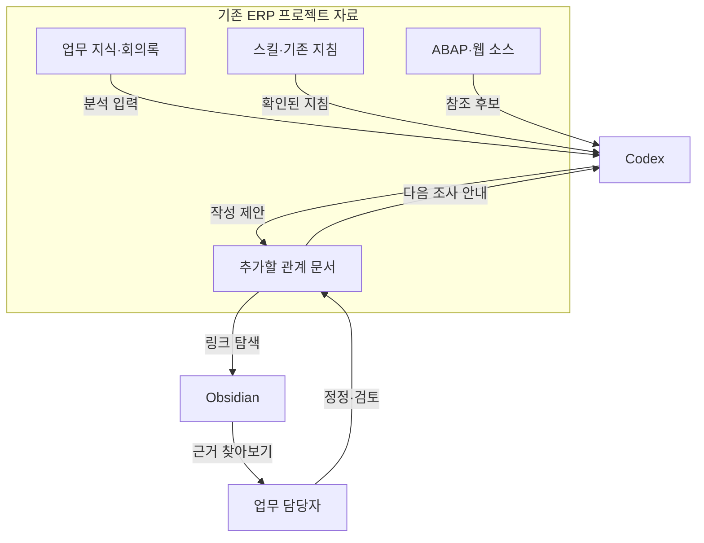

# Obsidian으로 업무 관계 연결 · 공유 대화 전문 반영

2026-10-14 · v1.10.0

2026-10-14 공개 공유 대화를 직접 확인했습니다. 사용자 요청 9개, AI 최종 응답 전문 9개, 진행 안내 8개, 본문 없는 상태 안내 0개를 구분합니다. 기존 진행 안내와 이미지·첨부 연결을 보존했고 플랫폼 turn/message ID를 확보한 항목에 추가했습니다. HTML 서식을 Markdown으로 전사했으며 전체 플랫폼 export는 아닙니다.

출처: https://chatgpt.com/share/6acf6cf5-03fc-83e8-9921-90f3229f7fd0

이전 문서의 미확보·발췌 표시는 당시의 추출 상태입니다. 현재 확보 상태는 위 안내와 MISSING_RESPONSES.md를 기준으로 읽어 주세요. 구현·운영 검증 수준은 새 전문 확보만으로 변경하지 않습니다.

## 이전 맥락 문서 — 당시 기록

---
project_id: erp-obsidian-knowledge-map
project_title: 옵시디언을 활용한 ERP 업무 관계정립
extracted_on: 2026-10-12
document_version: "1.0"
coverage: partial
---

# 01. 프로젝트의 출발점과 변화

프로젝트: **옵시디언을 활용한 ERP 업무 관계정립** · project_id: **`erp-obsidian-knowledge-map`** · 정리 기준일: **2026-10-12**

## 1. 시작 계기와 실제 업무 문제

사용자는 ERP 관련 매뉴얼·회의록·대화·업무 맥락을 Markdown으로 분류하고 연결해 두려 했다. 목적은 단순한 파일 보관을 넘어 관련 근거와 시스템 자료를 함께 탐색하는 것이었다. 처음 질문은 Obsidian이 그 분류·연결 작업 자체를 해 주는지 확인하는 데 초점이 있었다. [obs-m001]

다음 발화에서 문제의 구체적인 출발점이 드러났다. 사용자는 이미 시간외 프로젝트에서 매뉴얼과 회의·대화를 추출하고 AI로 스킬·지식·하네스 폴더를 만들었으며 엑스포트 폴더에 ABAP와 웹 소스를 보관한다고 보고했다. 따라서 새 자료 추출 체계를 처음 만드는 문제가 아니라, 여러 폴더에 있는 기존 자료를 원래 위치에서 이어 보는 문제가 됐다. 실제 파일 내용·버전·경로는 제출되지 않았다. [obs-m003]

이 프로젝트가 실제로 다룬 범위는 Obsidian·Codex·업무 관계 문서의 역할 및 도입 순서에 관한 상담과 그 상담의 교육자료화다. 시간외 시스템의 정책·계산 로직·SAP 배포를 구현한 프로젝트라고 확대하지 않는다. [obs-m001~015, obs-m016, obs-m025]

## 2. 당시 환경과 자료 — 확인 수준 구분

| 구성 | 확인된 내용 | 근거·한계 |
|---|---|---|
| 사용자 컴퓨터 | Mac 사용 | obs-m010. 모델·macOS 버전·실제 접근 경로 미확인 |
| AI 작업 도구 | 사용자 Mac에서 Codex Desktop 사용 | obs-m010. 제품 버전·모델·권한·프로젝트 등록·설정 미확인 |
| 업무 스킬 | 사용자가 `skill.md`를 만들었다고 보고 | obs-m003. 원본 미확보. 실제 파일 대소문자·자동 로딩 여부 미확인 |
| 업무 지식 | `knowledge` 폴더 보유 보고 | obs-m003. 파일 목록·원본 출처·현재성 미확인 |
| 하네스 | 하네스 엔지니어링을 위한 폴더 보유 보고 | obs-m003. 테스트 장치·검증 범위·실행 여부를 이름만으로 추정하지 않음 |
| 소스 | 엑스포트 폴더에 ABAP·웹 소스 보관 보고 | obs-m003. 정확한 폴더명·파일명·추출일·브랜치·배포 상태 미확인 |
| 업무 원자료 | 매뉴얼·회의록·대화가 기존 추출의 입력이었다고 보고 | obs-m003. 원본 파일 및 승인·적용일을 읽지 못함 |
| Obsidian | 도입을 검토하고 설치·Vault 적용 순서를 질문 | obs-m014. 설치 완료·플러그인·버전·Vault 경로 보고 없음 |
| 교육 포털 | KBS 담당 팀원을 위한 통합 계획 | obs-m016, obs-m025. 웹·서버·GitHub 반영은 현재 작업의 제외 범위 |

이번에 직접 읽은 파일은 [이전 ZIP](assets/archives/ERP_Obsidian_교육자료_20261008.zip)과 내부 MD 4개다. 이것은 **대화에서 파생한 산출물**이고 사용자의 Mac 원본이 아니다. 현재 사용 가능한 ZHR5 관련 스킬이 있더라도 같은 원본·버전임을 확인하지 못했으므로 사용자 언급 자산 대신 넣지 않았다.

## 3. 시간 흐름에 따른 목표의 구체화

아래 날짜는 사용자 제출 메타데이터 기준이다. AI의 개별 시각은 확인되지 않아 JSON에 `null`로 남겼다.

| 시점 | 대화와 목표 변화 | 결과·확인 수준 |
|---|---|---|
| 2026-10-03 00:59 | ERP 맥락·회의록·매뉴얼을 MD로 연결할 수 있는지 질문 | AI는 문서 보관·링크와 의미 분류의 역할을 설명. 예시만 제공. obs-m001~002 |
| 2026-10-03 01:05 | 기존 skill·knowledge·하네스·소스가 있음을 설명하고 통째로 열면 되는지 질문 | 기존 구조 보존과 연결 문서 추가를 제안. 파일 직접 확인은 없다고 명시. obs-m003~005 |
| 2026-10-03 01:09~01:11 | 지도 도구·AI의 관계와 효율을 확인 | 사람이 UI를 보고 AI가 관계 문서를 읽는 구상. 효과는 일반 설명. obs-m006~009 |
| 2026-10-06 22:44 | Mac Codex의 응답·처리 속도로 질문을 좁힘 | 설치 자체가 추론을 빠르게 하지는 않는다고 한정. 측정 없음. obs-m010~011 |
| 2026-10-06 22:46 | 시각화 이점 때문에 손해 없는 도입인지 질문 | 경로 변경·최신성·관리 비용을 덧붙임. 실제 장애 보고 아님. obs-m012~013 |
| 2026-10-07 08:48 | 연결 문서 작성 → 설치 → 최상위 폴더 지정 순서를 제안 | 관련 ERP 프로젝트 루트로 범위를 한정. 실제 실행 없음. obs-m014~015 |
| 2026-10-08 21:08 | 통합 포털의 입력으로 MD 4개·ZIP을 요청 | 기존 요약·교육 초안 생성 및 문서 검사. 원본 ZIP을 이번에 확보. obs-m016~024 |
| 2026-10-12 15:07 | 요약뿐 아니라 실제 명령·응답·오해·수정 과정을 채팅 데이터로 보존 요청 | 이번 추출의 요구사항. 현재 요청 이후 완료 발화는 스냅샷 밖. obs-m025 |

처음 목표가 틀려 폐기된 것은 아니다. 자료 연결이라는 목표가 기존 자산 보존·성능 기대·유지보수·적용 범위로 구체화됐고, 이후 교육 포털에 전달할 형식이 요약 문서에서 원문·해설·첨부 연결로 확대됐다.

## 4. 역할과 연결 관계

다음은 **대화에서 제안된 운영 구상**이다. 실제 설치·파일 생성·자동 연동을 확인한 구성도가 아니다. 소스나 업무 정책 사이의 구체적인 관계는 실제 원본 확인 후 확정해야 한다. [obs-m003~015]

| 담당 | 대화에서의 역할 | 완료로 오해하면 안 되는 것 |
|---|---|---|
| 사람 | 기존 자료·업무 맥락 제공, 범위·효과 질문, 향후 관계 검토 | 사용자가 다음 질문을 했다는 사실은 실행·검증 승인이 아님 |
| AI/Codex | 파일을 읽을 수 있을 때 관계 문서 작성, 그 문서를 업무 조사에 활용하는 구상 | 이 대화에서 실제 Mac 파일을 분석·수정했다는 증거 없음 |
| Obsidian | 관계 문서를 사람이 탐색하는 UI로 활용하는 구상 | 폴더를 열었다는 것만으로 의미 분석·정확한 관계·자동 AI 연결이 보장되지 않음 |
| 교육 포털 | 실제 발화, 해설, 첨부, 상태를 보여 줄 향후 소비자 | 이 ZIP이 HTML·Node.js·KBS 도메인 배포 구현물은 아님 |

## 5. 입력 → 처리 → 출력: 계획과 실제를 구분

### 5.1 논의된 사용자 업무 흐름

입력은 기존 skill·knowledge·하네스·소스와 업무 질문이다. Codex가 접근 범위와 내용을 확인하고 관계 문서를 추가한다는 방안이 제안됐다. 사람이 Obsidian에서 근거와 문서 연결을 탐색하고 AI도 해당 MD를 참고하는 것이 기대 출력이다. 실제 폴더 조사·생성 파일·링크 검사·사용 보고는 이 범위에서 확보되지 않았다. [obs-m003~015]

### 5.2 실제 확인된 첫 교육자료 추출

입력은 현재 대화와 접근 가능한 자료의 확인 범위였다. AI가 범위·미확인을 구분해 MD 4개와 ZIP을 만들었다고 보고했고, 실제 ZIP과 내부 MD가 확보됐다. 이전 도구 결과에는 MD 상대경로 링크 20개와 ZIP 4개 파일 검사가 기록돼 있다. 검사의 출력은 문서 패키지 무결성 근거이며 ERP 업무 정확성이나 Mac 작동 시험 결과가 아니다. [obs-m016~024; assets/evidence/20261008_validation_excerpt.json; assets/prior-20261008/00_README.md §8]

### 5.3 이번 대화 추출

입력은 obs-m025까지 확인되는 자연어 발화와 이전 산출물 원본이다. 실제 발화 순서를 유지하고 자체 ID를 부여했으며, 새 해설·실습을 별도 단계에 배치했다. 출력은 이 문서 3개, JSON, 이전 첨부, 현재 구조 검사 기록이다. 현재 생성 결과를 과거 AI의 완료 발화로 역삽입하지 않았다. [obs-m025; conversation-data.json; validation-report.json]

## 6. 핵심 판단과 결정 이유

| 판단 | 이유 | 상태·근거 |
|---|---|---|
| 기존 자료를 보존하며 관계 문서를 추가 | 사용자는 이미 업무 지식·스킬·소스를 갖췄고 경로가 기존 작업에 쓰일 수 있음 | 제안, 이후 논의의 기준. obs-m003~005, obs-m013~015 |
| 문서의 의미 연결과 그래프 탐색을 분리 | 폴더 지정과 업무 관계 분석은 다른 작업 | 설명·방향 정리. obs-m002, obs-m005, obs-m007 |
| 효율 향상을 조건부로 설명 | 모델 추론 속도와 자료 탐색 비용을 나눠야 함 | 설명 보완, 실측 없음. obs-m009~011 |
| 도입 비용도 고려 | 경로 변경·오래된 맵·과도한 링크는 관리 부담 가능 | 예방 설계, 실제 장애 아님. obs-m012~013 |
| 최상위는 해당 ERP 프로젝트 루트로 한정 | 무관한 자료까지 한 범위로 잡지 않기 위함 | 마지막 적용 순서 제안. obs-m014~015 |
| 자료 추출과 웹 구현·배포를 분리 | 각 대화 자료를 모아 별도 통합할 계획 | 사용자 명시 제외 범위. obs-m016 및 obs-m025 |
| 원문과 교육 해설을 분리 | 성공 요약만으로 요구 구체화·수정 이유를 보여주기 어려움 | 이번 사용자 요구로 결정. obs-m025 |

맵 문서의 정확한 파일명·저장 위치·기존 지침 수정 위치는 확정되지 않았다. AI가 언급한 예시 트리를 최종 실물 구조처럼 사용하는 것은 피한다. 사용자 무응답이나 다음 주제 이동을 구현·검증 완료로 처리하지 않는다.

## 7. 오해·보완·보류한 접근

| 당시 기대 또는 표현 | 후속 한정·설명 | 결과 |
|---|---|---|
| “통째로 폴더 지정하고 관계를 만들어 달라면 가능한가” | 의미 분석은 AI 작업, Obsidian은 탐색 도구라는 역할 분리 | 자동 구축 기대를 조정. 실제 실패 실행 아님. obs-m003~005 |
| “AI가 지도를 본다” | 화면 그래프 자체보다 MD에 적힌 관계를 읽는 구상으로 설명 | 자동 화면 연동 구현 아님. obs-m006~007 |
| “좀 더 효율적” | 사용자 Mac 속도 질문에 대해 설치만으로 추론 성능은 개선되지 않으며 조건별 효과가 다르다고 설명 | 정량 개선 약속으로 채택하지 않음. obs-m008~011 |
| “손해볼 건 없다” | 원본 경로·최신성·관리 부담을 덧붙임 | 비용 없는 도입으로 확정하지 않음. obs-m012~013 |
| “최상위 폴더” | Mac 전체·홈이 아닌 업무 프로젝트 상위 경로로 설명 | 실제 경로는 여전히 미확인. obs-m014~015 |
| 교육 요약 문서면 충분한가 | 실제 순서·명령·응답·오해·수정을 보존하도록 최신 요구가 확대됨 | 이전 요약은 보존하고 채팅 데이터 추가. obs-m016→obs-m025 |

실제 프로그램 오류의 증상·원인·조치·해결을 입증할 로그는 없다. 실패한 AI 출력·운영 장애·수정 전후 코드가 있었던 것처럼 재구성하지 않는다. 위 항목은 질문을 통해 개념과 제약이 정교해진 과정이다.

과거 순서로는 먼저 Obsidian에서 열어 작은 맵을 작성하자는 안내가 있었고(obs-m013), 마지막에는 연결 문서를 먼저 만든 뒤 여는 사용자 제안을 수용했다(obs-m014~015). 두 순서는 기술적으로 상충한다고 판단할 근거가 없고, 앞 순서를 실패·폐기했다고 주장할 수 없다. 교육 실습은 마지막으로 확인된 순서를 따른다. 원본 이동·대규모 폴더 재편은 채택한 실행 방안이 아니다.

## 8. 산출물·버전·구현 상태

| 대상 | 파일·버전 | 상태·증거 |
|---|---|---|
| 사용자 스킬·지식·하네스·소스 | 이름 일부만 언급, 버전 null | 사용자 보유 보고. 원본 미확보. obs-m003, obs-a007~011 |
| 관계 문서·Vault | 실제 파일명·버전·경로 null | 제안 단계. 구현·실행·운영 확인 없음. obs-m005, obs-m015 |
| 2026-10-08 MD 4개 | assets/prior-20261008, 각 document_version 1.0 | 실제 생성 파일 확보 및 내용 확인. Mac 원본이 아닌 요약·교육 산출물 |
| 2026-10-08 ZIP | ERP_Obsidian_교육자료_20261008.zip, 별도 버전 null | 실제 바이트 확보. 이름·정리일은 확인되나 파일명 날짜를 배포 버전으로 만들지 않음 |
| 이전 검사 발췌 | assets/evidence/20261008_validation_excerpt.json | 도구 출력 일부를 이번에 증거 파일로 정리. 당시 원본 첨부가 아님 |
| 이번 추출 MD·JSON | 본 패키지, 문서 버전 1.0·JSON schema_version 1.0 | 현재 생성·구조 검사. 사용자 환경 동작 검사와 별개 |
| 포털·Node 서버·사내 도메인·GitHub push | 파일·버전 없음 | 향후 활용 구상. 이번 수행 제외 |

직접 확인 가능한 마지막 원본은 위의 이전 ZIP·MD다. 더 최신의 사용자 로컬 맵이나 다른 저장소 산출물이 없다고 단정할 수 없다. 단지 이번 접근 범위에는 없다.

## 9. 검증과 남은 검증

| 증거 유형 | 실제 확보 내용 | 판단 가능한 것 |
|---|---|---|
| AI의 완료 주장 | obs-m022~024 | AI가 문서 생성·검사를 완료했다고 보고했음 |
| 도구 검사 기록 | obs-a006 | 이전 패키지 파일·링크 검사 수행 범위 |
| 현재 파일 확인 | 이전 ZIP·MD의 존재·파싱·바이트 해시 | 이전 문서 산출물 실제 존재와 복사 무결성 |
| 현재 구조 검사 | validation-report.json | 현재 JSON 문법·참조·순서·첨부 경로·ZIP 구성 |
| 사용자 실행 보고 | 이 범위에서 없음 | Mac·Obsidian 적용 완료 판단 불가 |
| 운영·성능 시험 | 이 범위에서 없음 | SAP 정확성·실제 속도 향상 판단 불가 |

추가 검증은 실제 프로젝트 파일 조사, 관계의 업무적 정확성 검토, 원본 보존 비교, Obsidian에서 링크·백링크 탐색, Codex에서 시작 문서 읽기 확인, 대표 질문의 조건을 고정한 비교가 필요하다. 모두 이번에 통과한 것처럼 표시하지 않는다. 자세한 준비물과 실습은 [교육 가이드](02_LEARNING_GUIDE.md)를 참고한다.

## 10. 다른 ERP AI 프로젝트와의 연결

| 연결 대상 | 이 프로젝트가 받을 입력 | 이 프로젝트가 제공할 출력 | 통합 시 확인할 것 |
|---|---|---|---|
| ERP 소스 추출 | 실제 파일 트리·추출 시점·프로그램 식별자 | 업무 지식에서 소스까지의 참조 후보 | 운영·개발 소스 차이, 최신본, 소스 링크 검증 |
| 업무 지식·스킬·하네스 | 원본 규정·매뉴얼·회의·스킬·지침·검사 범위 | 근거·시점·상태가 있는 관계 문서 구상 | 문서 권위, 확정 정책과 논의 구분, 실제 로딩·검사 방식 |
| Codex 프로젝트 | 실제 프로젝트 루트·기존 지침 | 시작 문서와 연결 문서 사용 방안 | 파일 접근권한·맥락 주입·원본 보존 확인 |
| 담당자 피드백 | 관계 오류·업무 예외·검토 기록 | 정정 후보와 다음 교육 에피소드 | 담당 검토와 자동 파일 검사의 차이 |
| 통합 교육 포털 | 다른 대화의 별도 추출본·공통 노드 정의 | 이번 MD·대화 JSON·이전 첨부 | 같은 사례 중복, 자체 ID 충돌, 각 프로젝트의 구현 상태 |
| GitHub·DIAG·MCP·원격 협업 | 해당 프로젝트의 실제 원문·코드·검사 자료 | 현재는 추가 확인 목록만 제공 | 이 대화에 실행 기록이 없으므로 연동·검증을 추정하지 않음 |

## 11. 출처와 인용 규칙

실제 발화의 위치는 [conversation-data.json](conversation-data.json)에서 `obs-thread-01`의 `messages[].id`로 확인한다. `obs-m001~025` 표기는 해당 연속 범위를 가리키며 플랫폼 원래 ID가 아니다. 날짜가 확인되는 사용자 발화와 null인 AI 시각을 혼합해 가상 시간표를 만들지 않았다.

이전 문서의 출처 ID와 현재 메시지의 내용 대응은 다음과 같다. 이는 인용체계 연결을 위한 대응이며 이전 요약을 추가 원문으로 넣지 않았다.

| 이전 요약의 내용 구간 | 현재 발화 |
|---|---|
| C01: 최초 Obsidian 활용 질문 | obs-m001~002 |
| C02: 기존 자산·폴더 전체 활용 | obs-m003~005 |
| C03: 지도와 AI 역할 | obs-m006~007 |
| C04: 효율 | obs-m008~009 |
| C05: 처리 속도 | obs-m010~011 |
| C06: 도입 부담 | obs-m012~013 |
| C07: 연결 문서와 Vault 순서 | obs-m014~015 |
| C08: 첫 교육자료 추출 요청 | obs-m016 |

이전 문서의 `P01`, `R01`, `R02`, `T01~T08`은 해당 이전 파일에 기록된 출처 유형으로 남겨 둔다. 특히 P01의 다른 질의 검색 요약은 이 프로젝트의 실제 대화로 편입하지 않았다. 이전 기술 문서 설명은 이번 제품 버전에서 재검증한 기술 사실로 표현하지 않는다.
