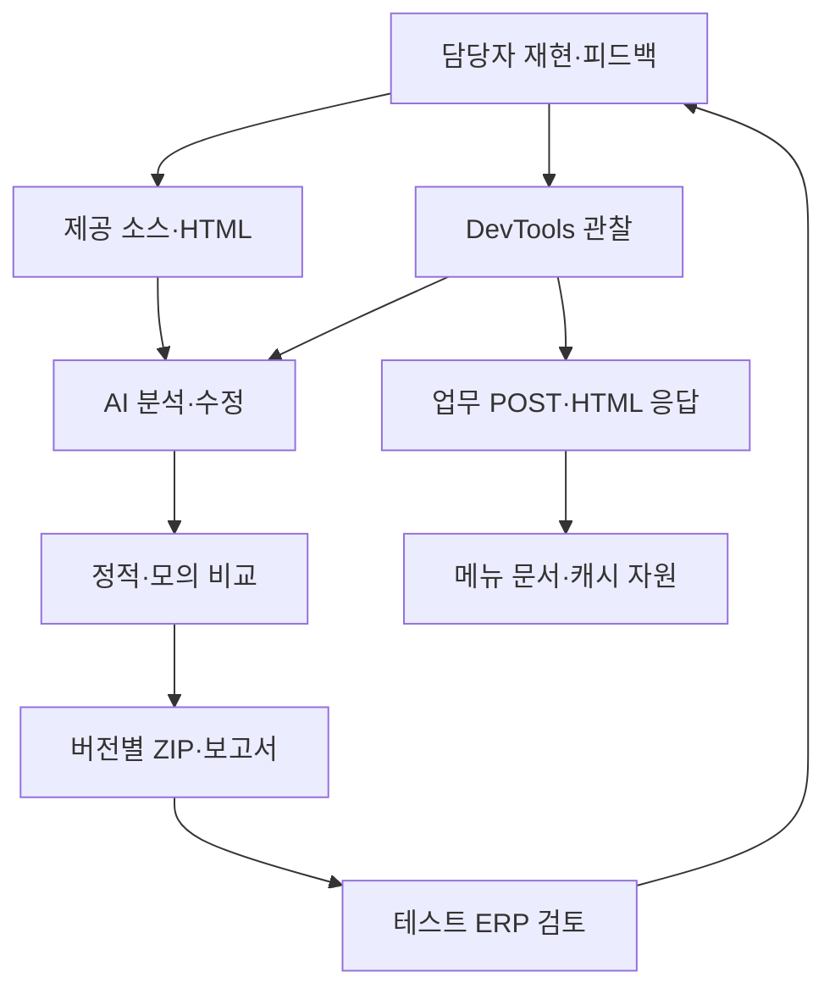

# WebGUI 리팩토링과 오류 추적 · 공유 대화 전문 반영

2026-10-14 · v1.10.0

2026-10-14 공개 공유 대화를 직접 확인했습니다. 사용자 요청 20개, AI 최종 응답 전문 15개, 진행 안내 28개, 본문 없는 상태 안내 2개를 구분합니다. 기존 진행 안내와 이미지·첨부 연결을 보존했고 플랫폼 turn/message ID를 확보한 항목에 추가했습니다. HTML 서식을 Markdown으로 전사했으며 전체 플랫폼 export는 아닙니다.

출처: https://chatgpt.com/share/6acf6c95-6264-83e8-b980-449928cb48b8

이전 문서의 미확보·발췌 표시는 당시의 추출 상태입니다. 현재 확보 상태는 위 안내와 MISSING_RESPONSES.md를 기준으로 읽어 주세요. 구현·운영 검증 수준은 새 전문 확보만으로 변경하지 않습니다.

## 이전 맥락 문서 — 당시 기록

# 프로젝트의 출발점과 변화

프로젝트: KBS ERP WebGUI·SYSTEMGUI AI 리팩토링 과정  
project_id: `kbs-erp-webgui-refactor` / 추출일: 2026-10-12

이 문서는 교육 해설이다. `wg-m*`는 [conversation-data.json](conversation-data.json)의 실제 발화 ID이며, 보고서에서만 확인한 내용은 별도로 표시한다.

## 1. 배경과 처음의 목표

사용자는 기존 ERP WebGUI 화면의 가독성을 개선하되 업무 기능·데이터·화면 배치·조작 방식을 유지하려고 했다. 확보된 초반 대화는 이미 일부 JS가 비어 있어 재업로드를 요청한 뒤부터 시작한다. 최초 제안 전부는 보이지 않는다. Google Drive의 WEBGUI 폴더에 JS/CSS를 공급하고 AI가 변경본·원본·검증 증빙을 ZIP으로 돌려주는 방식이었다. [wg-m010~019, 별도 지침 조각]

당시 지침은 단순 문법 현대화, 전역 변경, 무분별한 unload 치환을 금지했다. JS가 만든 클래스·인라인 스타일과 CSS를 함께 분석하고, 크기·위치·스크롤 계산은 디자인 값으로 임의 변경하지 않도록 했다. 자료가 없어 중요한 동작을 확인할 수 없으면 보존하고 나머지 독립 작업을 계속하도록 했다. 결과물은 변경 없는 파일까지 원래 경로로 포함하고 운영 서버에 직접 적용하지 않는 방식이었다. [assets/source_notes/initial_instruction_fragment.md]

## 2. 환경·역할·연결

| 요소 | 확인한 역할 | 한계 |
|---|---|---|
| SAP ITS/WebGUI | HTML 업무 문서와 정적 MIME 소스 제공 | 업무 HTML 생성 서버 코드 미확보 |
| `/mimes/webgui/sl` | 메뉴·폼·표·트리·스크롤·입력 등 JS/CSS | 제공 폴더명과 서버 경로 대응은 배포 시 확인 필요 |
| `/mimes/system/sl` | 공통 JS/CSS, 메뉴·검색 도움말 등의 보조 HTML | 다른 ITS 화면의 공유 영향 고려 |
| Chrome DevTools | Doc·JS·CSS·Fetch/XHR·Timing·콘솔 관찰 | 한 장의 캡처로 전체 호출 흐름을 확정할 수 없음 |
| 사용자 | 소스 재업로드, 실제 적용 피드백, 재현 화면 제공, 우선순위 결정 | 적용 시점의 파일 해시·전체 테스트 기록은 없음 |
| AI | 원본 분석, 변경안·완전한 파일·보고서·모의 검증 산출 | 실제 ERP 성공을 대신 판단하지 않음 |
| 비교·검증 프로그램 | 구문·함수·CSS/HTML 구조·모의 입력·해시 검사 | 실제 Chrome 렌더링·IME·서버 통신과 다름 |

최종 캡처 판독에는 Chrome/Chromium 152, Windows, `SAP NetWeaver Application Server / ITS 721`와 다른 캐시 문서의 `/ ABAP 700` 헤더가 보인다. 이는 **각 응답에 표시된 문자열**이며 시스템 전체 제품 버전·패치 수준·현재 지원 환경을 증명하지 않는다. 정확한 운영 버전은 추가 확인해야 한다. [assets/source_notes/image_review.md]

마지막 두 연결은 관찰한 브라우저 흐름이다. 스크롤 콜백부터 실제 POST까지의 전체 호출 스택은 미확인이다. 도식이 모든 네트워크 요청의 원인을 입증하는 것은 아니다.

## 3. 변경 과정 1 — 누락 보완과 초기 WEBGUI 개편

사용자가 누락 JS를 재업로드했고 AI는 `ewtlib.js` 2,979바이트, `gui_popupresize.js` 13,919바이트와 나머지 파일 목록을 확인했다고 보고했다. 최종 초기 구성은 CSS 33·JS 34, 총 67개였다. 26개 CSS와 4개 JS를 수정하여 팔레트 및 JS 동적 색상을 연결하고 달력·트리의 반복 처리를 줄였다. [wg-m010~019; assets/historical/WEBGUI_Analysis_Report.md §1·§5]

브라우저 지원 범위가 미정이므로 IE·표준 브라우저 분기를 유지했다. Chrome·일반 Edge를 IE로 오분류하는 원본 코드를 발견했지만 당시에는 영향이 커 보존했다. 함수 1,303개 및 680건의 모의 검증을 보고했다. 이번에는 보고서와 Evidence ZIP을 확보했으며 과거 검증을 새로 실행했다고 쓰지 않는다. [wg-m017·019]

사용자는 적용 뒤 “동작이 이상은 없는 것 같다”고 했지만, 이는 초기본의 제한적 실행 보고다. 이후 v3 또는 모든 업무 회귀의 성공으로 옮겨 적을 수 없다. [wg-m020]

## 4. 변경 과정 2 — 스크롤 병목과 보류한 타이머 변경

사용자는 기존부터 스크롤이 끊기는 문제를 관련 JS/CSS만 바꿔 개선하길 요청했다. AI는 로컬 화면 이동과 서버 위치 전달을 구분하고 `gui_scroll.js`, `gui_gridview.js`, `columntree.js`, `searchhelpctrl.js`의 중복 조회·동일 값 재대입을 줄였다. CSS에서 근거 있는 병목을 찾지 못해 유지했다. [wg-m020~025; assets/historical/WEBGUI_Scroll_Report.md]

모의 916건은 값·콜백·인터페이스 보존 확인이다. 동일 위치 재대입 감소는 코드상 연산 수의 개선이지, 실제 FPS나 사용자의 체감 시간 측정은 아니다. 위치 비교 때문에 읽기가 늘어나는 경로도 보고서에 기록되어 있다.

`mousewheel → scrollTo → moveSliderTo`에서 350ms 예약 뒤 700ms 예약이 기존 핸들을 덮어써 두 콜백이 남는 모형이 재현됐다. 그러나 주입된 콜백이 실제 업무 제출을 하는지, busy 상태가 중복을 막는지는 확인하지 못했다. 이 단계는 요청 시점 변경을 보류했다. “중복 콜백 재현”과 “중복 POST 입증”을 구분하는 핵심 사례다. [wg-m024~025; Scroll Report의 서버 연동 타이머 절]

## 5. 변경 과정 3 — Network 오해를 관찰로 좁히기

사용자는 휠 때마다 `/system/sl/script/its_utils.js`가 나타나 공통 파일 최적화의 효과를 물었다. 이어 350/700ms가 호출 리턴값을 받기 위한 대기인지 질문했다. AI는 캐시 응답과 실제 다운로드를 구분하고, 타이머가 요청 콜백 실행 전 대기라는 점을 설명했다. 타이머 설계 의도는 추정으로 남겼다. [wg-m026~029]

Fetch/XHR 목록이 비어 있어 사용자는 서버 요청보다 리페인트 같다고 해석했다. AI는 Doc 요청과 문서 재구성을 확인할 필요를 설명했다. 첫 후속 캡처는 업무 문서가 아니라 작은 `menubase.html`이어서 대상 선택을 바로잡았다. 다음 캡처에서 업무 문서의 POST·HTML·Timing을 확인했다. 사용자 관찰을 틀렸다고만 끝내지 않고 **다음에 선택할 요청을 구체적으로 좁힌 과정**이 교육의 핵심이다. [wg-m030~036]

| 구분 | 확인 값 | 판단 범위 |
|---|---|---|
| Doc 목록의 한 관찰 | 149kB·277ms | 이후 다른 선택 요청의 163.19ms와 같은 측정으로 합치지 않음 |
| 메뉴 문서 | GET·disk cache·678바이트·1.93ms | 서버 업무 처리 시간으로 쓰지 않음 |
| 업무 문서 | POST·HTML UTF-8·158,856바이트 | 문서 응답을 받은 증거 |
| 업무 Timing | 대기 85.68ms·수신 74.59ms·전체 163.19ms | 순수 ABAP 시간·전체 화면 완성 시간으로 확정하지 않음 |

위 수치는 당시 발화와 이번 원본 이미지 판독이 대응한다. 350/700ms를 무조건 더해 총 지연을 계산하지 않는다. 단순 리페인트만으로 JS/CSS 요청 목록이 새로 생긴다고 설명하지 않는다. [wg-m031·034·036; image_review.md]

## 6. 변경 과정 4 — SYSTEM 확대와 화살표 오류

사용자는 SYSTEMGUI 폴더를 제공하고 같은 방식의 리팩토링을 요청했다. SYSTEM 1차 보고서는 JS 13·CSS 1 가운데 2개 변경과 221건 모의를 기록한다. 해당 당시 AI 답변 원문은 보이지 않으므로 JSON 말풍선으로 만들어 넣지 않았다. [wg-m037; 동봉 SYSTEMGUI_Analysis_Report.md]

그 뒤 사용자는 휠은 되지만 화살표 클릭에서 오류가 난다고 보고했다. 이미지에는 unload 정책 메시지, `gui_dropdownManager is not defined`, `f.createTextRange is not a function`이 함께 나타난다. 이 셋이 모두 동일 원인 또는 모두 AI 변경 탓이라고 단정하지 않았다. [wg-m038; console_attachment_note.md]

| 증상 | 확인·조치 근거 | 현재 상태 |
|---|---|---|
| dropdown 전역 미정의 | 로딩 실패·순서·실제 배포 파일 확인 필요 | 실제 업무 HTML·응답 JS가 없어 원인/해결 미확정 |
| createTextRange 오류 | 표준 커서 API/가드 관련 국소 패치 보고서, 25건 모의 | 패치 존재. 실제 오류 화면의 해결은 미확인 |
| `gui_ts.js:360` | 제공 gui_ts.js는 126행, 커서 함수 위치와 불일치 | 같은 파일명만 보고 동일 실행 소스라고 판단하면 안 됨 |
| unload 정책 메시지 | 세션 종료·보안 초기화 경로의 구분 필요 | 전체 세션 종료 구현은 미확보. 일괄 치환 금지 |

출처: 동봉 `WEBGUI_Arrow_Error_Report.md` 및 v3 보고서. 오류 당시 배포본의 해시가 없으므로 “오류 버전”과 “완전 해결 버전”의 확정 대응표는 만들 수 없다.

## 7. 변경 과정 5 — Chrome 기준 통합 v3

사용자는 다음 우선순위를 명시하고 더 구조적인 변경을 허용했다: **① 업무·데이터 정확성 ② 기존 시스템 호환성 ③ 배치·조작 유지 ④ 디자인·가독성 ⑤ 근거 있는 성능**. 브라우저는 Chrome으로 최적화하도록 결정했다. 이는 처음의 지원 범위 미정 상태보다 구체적인 후속 기준이다. 업무 계약까지 임의 변경하라는 허가는 아니다. [wg-m039]

HTML page 폴더와 `contextmenubase.html` 재동기화 요청이 추가됐다. v3 보고서·manifest에서는 contextmenubase 원본 736바이트와 수정본 891바이트를 구분한다. 파일명 존재만 확인한 것이 아니라 HTML·부모 프레임 콜백 계약까지 연결한 단계다. [wg-m040; v3 manifest·report]

v3 진행/최종 답변 원문은 미확보다. 다음은 **실제 확보한 코드·보고서의 결과**이며 복원한 대화가 아니다.

| 구현 영역 | 주요 변경 | 유지·한계 |
|---|---|---|
| Chrome 분기 | UA 오분류, 표준 DOM 관련 분기 보완 | 실제 브라우저 렌더링 미검증 |
| 공통 파싱·통신 | 전역 정규식 상태, escaping, 0/false 값, 매개변수 검증 등 | 서버 계약·프레임 맥락 검증 필요 |
| 스크롤·입력 | 이벤트 지역 처리, 버튼 판별, IME 가드, 중복 타이머 취소 | 기본 700ms 유지. 모형의 콜백 2→1을 실제 POST 감소로 단정하지 않음 |
| 메뉴·HTML | parent 콜백, 폼 대상/이벤트 실패 복원, 대소문자 경로 정합성 | JS 초기화 순서·실제 화면 비교 필요 |
| 보안 초기화 | 일부 실패 정리 이벤트 조정 | 모든 unload를 pagehide로 치환한 것이 아님 |
| CSS | 기존 구조에 포커스 가독성 보완 | 실제 배치·확대율 회귀 필요 |

v3 Full 총 100개(WEBGUI 67·SYSTEMGUI 33), 직전 기준본 대비 33개(HTML 14·JS 16·CSS 3) 변경이다. 원본 대비 누적 변경과 직전본 대비 변경을 혼동하지 않는다. 기록에는 JS 47개 구문 검사, HTML 19·CSS 34 비교, 인라인 script 30·이벤트 속성 66 검사, 186건 모의가 있다. 실제 Chrome·ERP 검증은 완료하지 못했다. [동봉 ITS_Chrome_v3_Report.md, validation/markup/inline/integration JSON]

## 8. 추가 구조 제안과 보류 상태

사용자는 더 구조적으로 고치고 싶은 부분을 정리해 달라고 했다. 실제 답변 원문은 현재 보이지 않는다. 이전 교육 MD의 제안 정리는 남아 있으나 구현 결과로 승격하지 않는다. 공통 이벤트·수명 관리, 브라우저 판별 일원화, 서버 생성 HTML과 MIME 자원의 버전 추적, 배포/회귀 증거 관리는 후속 검토 주제로 다룰 수 있다. [wg-m041; 이전 01_프로젝트_맥락과설계.md §17]

Ajax/SPA 전환·문서 전체 갱신 제거·무조건 delay 축소·강제 GPU/CSS contain 적용은 이 자료의 검증된 최종 방법이 아니다. 교육 실습에서 성공한 해법처럼 적용하지 않는다. 서버 요청 구조 자체를 바꾸려면 화면 생성 및 업무 이벤트 계약이 추가로 필요하다.

## 9. 교육 추출로의 전환과 다른 프로젝트 연결

10-08에는 4개 MD 중심의 자료 추출을 요청했고, AI는 이전 산출물·100개 소스 목록·검증 근거를 정리했다. 사용자는 이어 실제 명령·응답·오류·수정 과정을 말풍선으로 보여줄 JSON을 요구했다. 따라서 이번 판은 요약을 덮어쓰지 않고 실제 발화와 해설·첨부를 분리한다. [wg-m042~050]

전체 ERP AI 구성도에서 이 사례가 제공하는 것은 **프런트 소스 분석과 사용자 피드백 기반 변경·검증 과정**이다. GitHub·Codex Desktop·MCP·Obsidian 자체 설치/연동 사례를 추가하지 않는다. 별도 소스 추출 프로젝트에서는 MIME 경로·추출 시각·해시가 입력으로 필요하고, 이 사례는 버전별 ZIP·diff·오류 재현 조건·교육 대화 JSON을 출력으로 제공한다. GitHub 통합 시 같은 파일명의 다른 버전과 교육용 예시/실제 소스를 분리해야 한다.

## 10. 완료·미확인과 다음 검증

| 항목 | 상태 |
|---|---|
| 초기·스크롤·SYSTEM·커서·v3 산출물 | 파일 확보·변경 기록 확인 |
| 당시 모의 검증 수치 | 보고서·Evidence 기록 확인, 이번 기능 재실행 아님 |
| 초기본 사용자 실행 | 일부 정상 보고와 후속 오류 보고 있음 |
| 실제 v3 업무·Chrome·IME·배치·저장·세션 | 미검증 또는 결과 미확보 |
| 구조 제안의 후속 구현 | 증거 없음 |
| 이번 교육 JSON·링크·파일 보존 | validation-report.json에 별도 기록 |
| 포털·GitHub·서버 배포 | 이번 작업 범위 아님 |

다음 검증은 오류가 난 실제 업무 HTML과 JS Response, 적용 파일 해시를 먼저 확보해 제공본과 맞춘 뒤 수행한다. 같은 테스트 화면·데이터·확대율에서 휠과 화살표, 키보드, IME, 표 선택, 저장, 재진입, 세션 종료를 각각 확인한다. 성능은 동일 조건의 여러 실행에서 요청 전 지연·네트워크·JS/레이아웃을 나눠 측정한다. 운영 데이터 변경은 교육 실습에 포함하지 않는다.

## 11. 근거 찾기

발화는 JSON의 `source_locator` 또는 [읽기용 전사](assets/source_notes/conversation_transcript.md)에서 찾는다. 파일 근거는 JSON assets의 ID와 상대 경로로 연결한다. `a-old-analysis`, `a-scroll-report`, `a-arrow-report`, `a-system-report`, `a-v3-report`가 단계별 핵심 보고서다. `a-v3-manifest`는 버전/해시, `a-v3-diff`는 실제 변경, `a-image-review`는 새로 확보한 이미지 판독, `a-retrieved-summary`는 원문이 아닌 보충 요약이다.

## 2026-10-12 답변 전문 보완판 안내

이 문서의 기존 41개 발화 집계와 이전 추출 경계는 당시 기록이다. 이번 보완판은 기존 본문을 보존한 채 현재 직접 보이는 상태 문의 1개와 AI 진행 안내 4개·최종 답변 1개를 추가하여 47개 발화로 구성했다. wg-ep08에 wg-m051~056을 연결했다. SYSTEMGUI·화살표 오류·v3·구조 제안의 누락 AI 본문은 재조회에서도 찾지 못했다. 검색 요약을 원문처럼 추가하지 않았다.

현재 요청별 확보 상태는 [AI 답변 검토](AI_RESPONSES_FULL.md), [누락 목록](MISSING_RESPONSES.md), [변경 이력](CHANGELOG.md)과 [응답 연결 데이터](assets/answer_recovery/response-index.json)를 따른다. 기존 검증 수치는 이번 기능 재실행 결과가 아니다.
