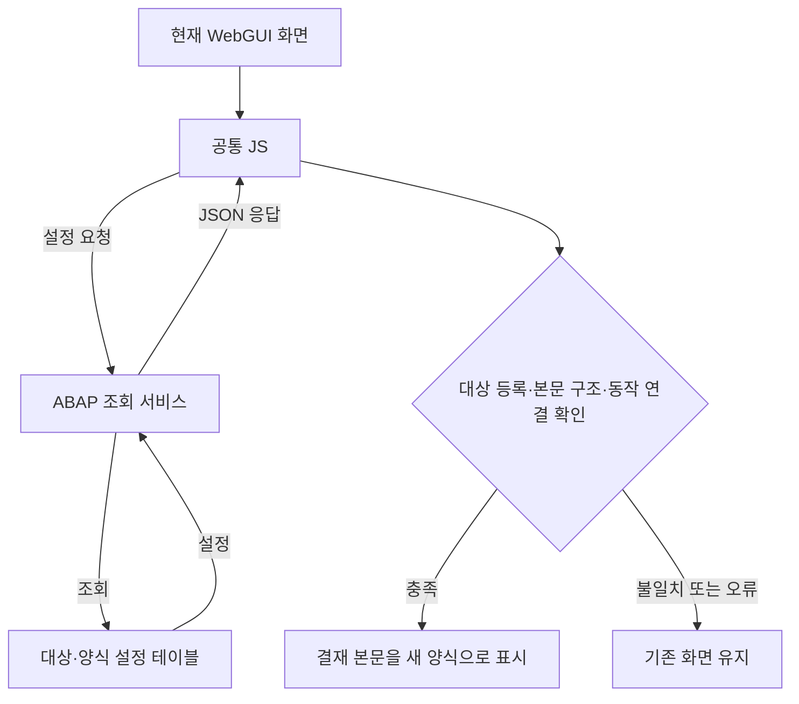

# AI 응답 전문 — KBS ERP WebGUI·SYSTEMGUI AI 리팩토링 과정

원문 전사이며 교육용 경어체 표시와 구분합니다.

## WebGUI·SYSTEMGUI 리팩토링 — 현재 대화와 전달된 이전 발췌

### SHARED-002

[ERP_CSS_Modernized.zip](ERP_CSS_Modernized.zip)

**16개 CSS 전체를 포함한 수정본입니다.** 15개 파일을 색상 중심으로 수정했고, `gui_font.css`는 원본 그대로 포함했습니다.

| 파일 | 주요 변경 |
| --- | --- |
| gui_dropdown.css | 중립적 목록 배경, 청색 선택 항목 |
| gui_input.css | 입력 테두리, 읽기 전용 배경, 오류색 개선 |
| gui_page.css | 화면 배경과 바깥 테두리 색상 통일 |
| gui_popup.css | 팝업 배경·텍스트·비활성 제목색 개선 |
| gui_button.css | 회색 기본 버튼, 연청색 상호작용 상태 |
| gui_ts.css | 탭 컨테이너와 펼침 메뉴 색상 개선 |
| gui_toolbarctrl.css | 도구 버튼 배경·테두리 개선 |
| gui_font.css | 글꼴과 치수 영향 방지를 위해 변경 없음 |
| gui_statusbar.css | 상태 표시줄 배경·경계 정리 |
| gui_bar.css | 공통 바 배경과 장식 구분선 정리 |
| gui_tablecontrol.css | 청색 선택 행, 연노랑 현재 셀, 오류색 개선 |
| gui_splitter.css | 분할선 기본·선택 색상 정리 |
| menu.css | 청색 강조 메뉴, 비활성 텍스트 가독성 개선 |
| gui_cua.css | 상단 메뉴·버튼의 호버·비활성 색상 통일 |
| gui_toolbar.css | 도구 아이콘 영역 배경·테두리 개선 |
| gui_gridview.css | ALV 헤더·선택 셀·오류색 개선, 업무용 색상표 보존 |

**검증 결과**

- 파일명·개수와 제공된 평면 폴더 구조 유지.

- 429개 규칙, 1,473개 선언의 선택자·순서 유지.

- 크기·배치·글꼴·테두리 두께·조작 속성 유지.

- 이미지 경로 95곳과 기존 주석·줄바꿈 보존.

- 색상 값 246곳과 설명 주석만 변경했으며, ZIP 무결성 확인.

- 대표 버튼·메뉴·오류 입력 색상 조합의 계산상 대비는 **5.91~11.28:1**.

**확인이 필요한 부분:** 실제 HTML·이미지·로딩 순서와 실행 브라우저가 없어 화면 배치, 텍스트 잘림, Chrome·Edge·IE 모드 호환성은 검증하지 못했습니다. 원본의 `outline: none`, `text-decoraion` 오타, `float: top` 등도 기능 영향 판단이 필요해 유지했습니다.

원본은 보존했으며 운영 시스템에는 적용하지 않았습니다. ZIP의 CSS를 기존과 동일한 위치·로딩 순서로 테스트 환경에 적용해 확인하면 됩니다.

### SHARED-004-P1

Google Drive의 WEBGUI 폴더에서 CSS와 JS 전체를 확인하고, 동적 스타일·이벤트·화면 갱신 흐름을 함께 분석하겠습니다. Google Drive 스킬을 사용해 원본을 가져온 뒤, 동작 보존 근거가 있는 수정만 적용하고 교체용 ZIP과 분석 보고서를 별도로 만들겠습니다.

### SHARED-004-P2

WEBGUI 폴더에서 CSS 33개와 JS 34개를 확인했습니다. 이전 작업에 없던 달력·트리·검색 도움말과 IE 전용 CSS도 포함되어 있어 이번에는 이들까지 함께 검토합니다. JS 중 `ewtlib.js`, `gui_popupresize.js`는 업로드된 파일 자체가 0바이트이므로 그대로 보존하겠습니다.

### SHARED-006

[공유 화면에 AI 응답 본문이 표시되지 않은 위치]

### wg-m011

비어 있던 `ewtlib.js`와 `gui_popupresize.js`를 다시 확인해 최신 업로드본으로 분석을 이어가겠습니다. 다른 파일도 변경되었는지 목록을 함께 확인하겠습니다.

### wg-m012

재업로드를 확인했습니다. `ewtlib.js`는 2,979바이트, `gui_popupresize.js`는 13,919바이트로 정상 확보했고, 나머지 32개 JS의 내용은 이전과 동일합니다.

현재 코드에는 IE 전용 이벤트 처리와 표준 브라우저 처리가 함께 들어 있습니다. 브라우저 지원 범위가 확정되기 전까지 이 분기들은 보존하고, CSS·JS 색상 연계와 안전한 반복 연산 개선을 먼저 진행하겠습니다.

### SHARED-009

[공유 화면에 AI 응답 본문이 표시되지 않은 위치]

### wg-m014

재업로드된 JS를 포함해 작업을 이어가겠습니다. 먼저 기존 작업 파일과 진행 상태를 확인한 뒤, CSS·JS 수정과 검증을 마쳐 교체용 ZIP과 별도 분석 보고서를 제공하겠습니다.

### wg-m015

기존 수정본과 분석 기록이 남아 있어 이어서 검토할 수 있습니다. Google Drive 스킬로 원본 목록을 대조하고, 결과물 저장에는 Library 스킬을 사용하겠습니다. 지원 브라우저 범위는 아직 확정되지 않았으므로 기존 IE·표준 브라우저 분기를 유지하겠습니다.

### wg-m016

현재 Drive의 CSS 33개·JS 34개가 확보된 원본의 파일명·크기·수정 시각과 모두 일치합니다. 기존 수정에는 버튼·표·입력창 색상 정리, JS 동적 색상 연계, 달력 배열 복사와 트리 속성 조회를 줄이는 변경이 포함돼 있습니다. 이제 선택자·배치 속성·함수 인터페이스 보존 여부를 검증하고 있습니다.

### wg-m017

JS 34개 모두 구형 문법 기준의 구문 검사를 통과했고, 함수 1,303개의 이름·매개변수와 이벤트·타이머 코드는 보존됐습니다. 달력 80개, 트리 600개 모의 입력에서는 변경 전후 결과가 일치했습니다.

또한 원본의 `wgu_utils.js`가 Chrome·일반 Edge의 사용자 에이전트 문자열도 IE로 분류하는 것을 재현했습니다. 이 분기는 화면 배치와 이벤트 처리에 폭넓게 연결되어 있어 이번에는 보존하고 보고서에 후속 확인 사항으로 기록하겠습니다. 실제 ERP 화면 검증은 별도로 필요합니다.

### wg-m018

교체용 ZIP과 원본 ZIP을 만들었고, 각각 67개 파일의 경로·내용과 압축 무결성을 확인했습니다. 보고서에는 파일별 변경 이유, 검증 결과, 브라우저 판별 문제, 적용·복원 절차를 정리했습니다. 현재 영구 저장 연결은 사용할 수 없어 다운로드 파일로 제공하겠습니다.

### wg-m019

수정과 검증을 완료했습니다. **전체 67개 파일 중 CSS 26개·JS 4개를 수정**했고, 나머지도 원본 그대로 포함했습니다.

- [WEBGUI_Optimized.zip](WEBGUI_Optimized.zip) — 교체용 전체 파일

- [WEBGUI_Analysis_Report.md](WEBGUI_Analysis_Report.md) — 변경 이유·검증·적용 방법

- [WEBGUI_Original.zip](WEBGUI_Original.zip) — 원본 백업

- [WEBGUI_Review_Evidence.zip](WEBGUI_Review_Evidence.zip) — 상세 변경·검증 증빙

색상과 CSS·JS 연계를 정리하고 달력·트리의 반복 연산을 줄였습니다. **배치 속성·함수 인터페이스 보존 검사와 모의 회귀 680건을 통과**했습니다.

실제 ERP·브라우저별 동작은 미검증입니다. Chrome·Edge를 IE로 분류하는 원본 코드도 발견했지만, 영향 범위가 커 이번에는 보존했습니다.

영구 저장은 완료하지 못했으므로 파일을 내려받아 보관해 주세요.

### wg-m021

스크롤 처리에서 반복 계산이나 화면 갱신이 몰리는 부분을 찾아보겠습니다. 적용하신 수정본을 기준으로 관련 JS·CSS를 분석하고, 기존 휠·키보드·스크롤바 동작을 유지할 수 있는 개선은 실제 파일에 반영하겠습니다.

### wg-m022

코드에는 서로 다른 스크롤 방식이 섞여 있습니다. 화면 안에서 바로 이동하는 방식과 서버에 다음 위치를 요청하는 방식이며, 후자는 기본 휠 대기값이 700ms입니다. 또 ALV·트리는 고정 열과 헤더를 반복 동기화하고, 트리는 스크롤할 때 행을 훑으며 같은 위치 값을 계속 읽습니다.

우선 중복 위치 지정과 반복 조회를 줄이겠습니다. 서버 요청 간격을 줄이거나 부드러운 스크롤 애니메이션을 추가하는 변경은 요청량·조작 방식에 영향을 주므로 이번 수정에서는 유지하겠습니다.

### wg-m023

스크롤 관련 JS 4개에 수정했습니다. ALV·트리는 이미 같은 위치인 고정 열과 헤더를 다시 이동시키지 않고, 트리의 현재 스크롤 위치는 행 검색 중 한 번만 읽도록 했습니다. 검색 도움말도 같은 텍스트를 다시 쓰는 작업을 줄였습니다.

관련 CSS에서는 무거운 그림자·애니메이션이 발견되지 않았습니다. 배치와 팝업에 영향을 줄 수 있는 강제 GPU 합성이나 `contain` 추가는 하지 않고, 기존 CSS를 유지하겠습니다.

### wg-m024

추가로, 서버 연동 스크롤의 타이머가 겹치는 경로를 발견했습니다. 휠 처리 중 내부 함수가 350ms 콜백을 예약한 뒤, 바깥 함수가 이를 취소하지 않고 별도의 휠 콜백을 예약할 수 있습니다. 이 경우 요청 중복이나 재조회 끊김과 관련될 가능성이 있습니다.

이 부분은 서버 요청 시점을 바꾸는 수정이어서 우선 재현 결과를 보고서에 분리하겠습니다. 현재 만든 패치는 요청 시점을 유지하면서 화면 쪽의 불필요한 작업을 줄이는 범위입니다.

### wg-m025

가능합니다. **이전에 적용하신 디자인 개편본을 기준으로, 스크롤 관련 JS 4개만 교체하는 패치**를 만들었습니다.

| 파일 | 개선 내용 |
| --- | --- |
| `gui_scroll.js` | 슬라이더 크기 반복 조회·동일 위치 재대입 감소 |
| `gui_gridview.js` | ALV 고정 열·헤더의 불필요한 스크롤 동기화 감소 |
| `columntree.js` | 트리 스크롤 위치 반복 조회·재대입 감소 |
| `searchhelpctrl.js` | 검색 도움말에서 같은 텍스트를 반복 갱신하는 작업 감소 |

CSS에서는 확실한 개선 근거가 없어 **현재 디자인 그대로 유지**했습니다. 휠 이동량·서버 요청 간격·이벤트 처리도 유지했습니다.

- [WEBGUI_Scroll_Patch.zip](WEBGUI_Scroll_Patch.zip) — 교체용 JS 4개

- [WEBGUI_Scroll_Report.md](WEBGUI_Scroll_Report.md) — 분석·적용 방법

- [WEBGUI_Scroll_Rollback.zip](WEBGUI_Scroll_Rollback.zip) — 적용 직전 상태로 복원

- [WEBGUI_Scroll_Evidence.zip](WEBGUI_Scroll_Evidence.zip) — 변경·검증 증빙

**모의 회귀 916건은 통과했지만, 실제 화면의 체감 개선은 아직 측정하지 못했습니다.** 기존 4개 파일을 백업하고 교체한 뒤 캐시를 갱신해 비교해 주세요.

추가로 서버 연동 스크롤에서 **350ms와 700ms 콜백이 중복 예약되는 경로**도 재현했습니다. 실제 서버 요청과 연결되는지는 미확인이어서 이번에는 수정하지 않았습니다. **끊길 때 표가 다시 조회되거나 로딩 표시도 나타나나요?** 그렇다면 이 경로가 다음 확인 대상입니다.

영구 저장은 완료하지 못했으므로 파일을 내려받아 보관해 주세요.

### wg-m027

네. **`/mimes/system/sl` 쪽 소스까지 함께 분석하면, 지금까지 확인하지 못한 공통 처리와 스크롤 갱신 흐름을 추적할 수 있습니다.** 다만 파일 자체의 최적화와 스크롤마다 그 파일이 요청되는 원인은 나눠서 확인해야 합니다.

지금 관찰하신 현상은 중요한 단서입니다. 스크롤할 때 서버에서 새 화면이나 프레임 내용을 받아오고, 그 문서가 `its_utils.js`를 다시 참조하는 구조일 수 있습니다. **Network에 파일이 나타난다고 매번 파일 전체를 다운로드하는 것은 아닙니다.** 캐시에서 가져오는지도 확인해야 합니다.

| 스크롤 때 확인되는 현상 | 우선 확인할 부분 |
| --- | --- |
| `its_utils.js`가 메모리·디스크 캐시에서 처리됨 | 파일 다운로드보다 문서 갱신·스크립트 실행 비용 |
| `304` 응답이 반복됨 | 캐시 재검증에 따른 왕복 요청 |
| 실제 전송량이 있는 `200` 응답이 반복됨 | 캐시 헤더·URL 변화·문서 재생성 |
| 함께 `Document` 요청이나 iframe 갱신이 발생함 | 스크롤 → 서버 요청 → 화면 재구성 흐름 |
| 한 번의 스크롤에 같은 업무 요청이 여러 번 발생함 | 중복 이벤트·타이머·콜백 |

앞서 발견한 **350ms·700ms 콜백 중복 예약과 연결되는지도 확인할 가치가 있습니다.** 아직은 같은 원인이라고 단정할 수 없습니다.

`/mimes/system/sl`을 추가로 제공하실 때는 다음 자료가 있으면 좋습니다.

- **`script` 폴더 전체**: `its_utils.js`와 관련 공통 함수의 연결을 확인하기 위해 필요합니다.

- **관련 CSS**: 기존 위치·표시 계산과의 관계를 확인합니다.

- **문제가 발생하는 화면의 HTML 또는 iframe HTML**: 실제로 어떤 파일을 어떤 순서로 불러오는지 확인합니다.

- **스크롤 한 번 전후의 Network 캡처**: 요청명, Status, Type, Size, Initiator, Waterfall이 보이도록 해주세요. 인증 쿠키나 토큰은 공유하지 않아도 됩니다.

이 자료가 있으면 기존 `/webgui/sl` 수정본과 함께 분석해 **중복 호출, 반복 초기화, 스크롤마다 재실행되는 작업**을 대상으로 수정할 수 있습니다. 공통 경로 파일은 다른 화면에서도 사용할 수 있으므로 영향 범위까지 확인하겠습니다.

**효율 상승은 기대할 수 있지만, 가장 큰 개선 지점은 `its_utils.js` 내부 연산보다 “왜 스크롤할 때 문서·프레임이 다시 갱신되는가”에 있을 수도 있습니다.** 캐시 설정이 원인이라면 JS·CSS 수정 외에 서버 설정 조치가 필요할 수 있습니다.

### wg-m029

**서버 연동 스크롤을 위해 의도적으로 대기 시간을 넣었을 가능성은 높습니다. 다만 “호출의 리턴값을 받기 위해 350·700ms를 기다린다”는 해석은 정확하지 않습니다.** 확인한 코드에서는 **요청 콜백을 실행하기 전의 대기 시간**입니다.

캡처를 보면 `its_utils.js`, `its_domain.js`, CSS·이미지 대부분이 **`memory cache`에서 처리되고, 표시 시간도 `0ms`**입니다. 따라서 이 파일들을 매번 서버에서 다운로드하느라 끊긴다고 보기는 어렵습니다. `Status 200`이어도 메모리 캐시에서 처리될 수 있습니다.

또한 `its_utils.js`의 Initiator가 `menubase.html:83`으로 표시됩니다. 이는 **메뉴 문서가 해당 스크립트를 참조한다는 증거**이며, 스크롤 과정에서 문서나 iframe이 다시 만들어지는 상황과 부합합니다. 다만 캡처만으로 WebGUI 전체가 재로딩된다고 확정할 수는 없습니다.

대기 시간의 의미를 구분하면 다음과 같습니다.

| 구분 | 확인한 코드의 동작 |
| --- | --- |
| **350ms** | 서버형 슬라이더 이동 후 위치 전달 콜백을 예약 |
| **700ms** | 기본 설정의 서버형 휠 처리에서 위치 전달 콜백을 예약 |
| **서버 응답 대기** | 콜백이 실제 요청을 보낸 뒤 응답이 도착할 때까지 걸리는 별도의 시간 |
| **화면 갱신** | 응답을 반영하면서 문서·프레임·스크립트·화면을 다시 처리하는 시간 |

이런 지연은 보통 **휠 입력마다 서버 요청을 쏟아내지 않고, 입력이 잠시 멈췄을 때 이동 위치를 전달하려는 목적**으로 해석할 수 있습니다. 설계 의도에 대한 추정이지만, 확인한 타이머 취소·재예약 구조와 맞습니다. 고정된 시간만큼 기다리는 것으로 서버 응답 완료가 보장되는 것은 아닙니다.

그리고 **대기 시간을 둔 의도와 350ms·700ms 예약이 동시에 남는 문제는 별개**입니다. 앞서 재현한 중복 예약을 “응답을 받으려면 반드시 두 개 다 필요하다”고 볼 근거는 없습니다. 반대로 둘 다 없애면 요청이 더 잦아져 오히려 끊김이 심해질 수 있습니다.

지금은 **Network를 `Doc`과 `Fetch/XHR`로 나눠 보고, 스크롤 한 번에 실제 업무 요청이 몇 번 발생하는지 확인하는 것이 우선**입니다. 그 요청의 `Timing`과 `Initiator`를 보면, 지연이 **요청 전 타이머인지, 서버 처리인지, 응답 후 화면 재구성인지** 훨씬 명확하게 구분할 수 있습니다.

### wg-m031

**이번 캡처는 단순 리페인트보다, 스크롤할 때 HTML 문서를 다시 받아 화면을 재구성하는 쪽을 강하게 가리킵니다.** `Fetch/XHR`가 없어도 서버 요청은 발생할 수 있습니다. 폼 제출이나 iframe의 문서 이동은 `Doc`에 표시됩니다.

첫 번째 캡처에 핵심 증거가 있습니다.

| 관찰 내용 | 의미 |
| --- | --- |
| 첫 번째 `document`: **200 · 149kB · 277ms** | 캐시 표시가 있는 나머지 항목과 달리, 실제 문서 응답을 받아오는 요청으로 보입니다. |
| 여러 `menubase.html`: **disk cache · 1~2ms** | 메뉴용 문서들이 다시 로드되는 모습입니다. |
| JS·CSS 대부분: **memory cache · 0ms** | 파일 다운로드 비용은 작지만 새 문서에서 초기화·스타일 적용 작업은 발생할 수 있습니다. |
| `Fetch/XHR` 없음 | 비동기 API 요청이 없다는 뜻이지, 서버 통신이 없다는 뜻은 아닙니다. |

**이미 표시된 화면을 단순히 다시 그리는 리페인트라면, 그것만으로 HTML·JS·CSS가 Network에 다시 나열되지는 않습니다.** 이번에는 문서를 다시 로드하면서 그 문서에 필요한 리소스를 캐시에서 가져오는 흐름으로 해석하는 것이 맞습니다.

추정되는 순서는 다음과 같습니다.

1. 휠 입력을 WebGUI의 스크롤 명령으로 처리합니다.
2. 폼 제출이나 프레임 이동으로 서버에 다음 표시 위치를 요청합니다.
3. 서버가 해당 위치의 HTML을 반환합니다.
4. WebGUI 내부 문서와 메뉴 프레임을 구성하고, JS 초기화·스타일 계산·화면 그리기를 수행합니다.

브라우저 탭 전체가 새로고침되는지는 아직 확정할 수 없지만, **최소한 내부 문서가 갱신되는 정황은 뚜렷합니다.** 캡처의 277ms도 요청 전체 소요 시간이지, 순수한 ABAP 처리 시간이나 리페인트 시간은 아닙니다.

따라서 개선 방향도 조금 달라집니다. `/system/sl`의 JS를 최적화하면 **문서 갱신 후 초기화 비용**은 줄일 여지가 있습니다. 하지만 매번 HTML을 받아야 하는 구조라면, 그것만으로 일반 웹페이지처럼 연속적인 스크롤이 되지는 않습니다. 앞서 만든 패치 역시 이 문서 갱신 자체를 없애는 수정은 아닙니다.

또한 현재 `Doc` 캡처에는 큰 업무 문서가 하나 보입니다. **여러 메뉴 문서와 JS가 보인다는 이유로 350·700ms 때문에 업무 요청이 두 번 발생했다고 판단하면 안 됩니다.** 해당 타이머가 이 화면의 실제 스크롤 경로인지도 추가 확인이 필요합니다.

다음에는 **첫 번째 149kB짜리 `document` 요청**의 아래 항목을 보면 됩니다.

- **Headers → Request Method**: GET인지 POST인지

- **Payload**: 스크롤 위치나 업무 이벤트 값이 전달되는지

- **Timing**: 응답 대기와 다운로드에 각각 얼마나 걸리는지

이 세 가지가 확인되면, **서버에서 다음 구간을 생성하는 스크롤인지, 불필요한 문서 재로드인지**를 구분하고 수정 범위를 정할 수 있습니다. 세션 토큰·쿠키 값은 가려서 보여주세요.

### wg-m033

캡처에서 선택된 항목은 메뉴용 `menubase.html`입니다. 상위 WebGUI 문서 URL에 보이는 `jmprow` 값이 기존 스크롤 코드와 연결되는지 확인하겠습니다.

### wg-m034

**이번 자료로 JS·CSS가 반복해서 나타나는 이유는 확인됐습니다. `menubase.html`이 로드될 때 공통 스크립트와 메뉴 스타일을 다시 불러오는 구조입니다.** 다만 지금 선택하신 문서는 앞서 149kB·277ms로 표시됐던 업무 화면 문서가 아니라, **메뉴를 구성하는 작은 보조 문서**입니다.

| 캡처에서 확인된 내용 | 해석 |
| --- | --- |
| `menubase.html`, GET, **disk cache** | 해당 HTML은 디스크 캐시에서 가져왔습니다. |
| `Content-Length: 678` | 메뉴 틀을 구성하는 작은 HTML입니다. |
| 전체 소요 **1.93ms** | 이 문서의 로드 시간 자체는 짧습니다. |
| `its_domain.js`, `its_utils.js` 참조 | `/system/sl` 공통 스크립트를 로드합니다. |
| `document.write()`로 `menubase.js`, `menu.css` 추가 | `/webgui/sl`의 메뉴 코드와 스타일도 이어서 로드합니다. |

여기서 Timing의 **`Waiting for server response: 0.11ms`를 실제 SAP 서버 처리 시간으로 해석하면 안 됩니다.** 선택된 항목이 캐시 응답이기 때문입니다. 또한 1.93ms에는 이후의 모든 스크립트 실행·화면 그리기 시간이 포함되는 것도 아닙니다.

새로 눈에 띄는 중요한 단서는 **상위 WebGUI 문서 URL의 `?jmprow=76.325`**입니다. 이름과 스크롤 상황을 보면 특정 행·위치로 이동시키는 파라미터일 가능성이 큽니다. 다만 확보한 JS에서는 `jmprow` 문자열이 검색되지 않아, 정확한 생성·처리 위치는 아직 확인하지 못했습니다.

현재 증거를 연결하면 다음 흐름이 유력합니다.

1. 휠 입력으로 이동 위치를 지정한 **상위 WebGUI 문서 요청**이 발생합니다.
2. 응답으로 받은 화면에서 메뉴용 문서들을 로드합니다.
3. 각 메뉴 문서가 공통 JS와 메뉴 JS·CSS를 캐시에서 가져와 초기화합니다.

따라서 말씀하신 **“화면을 다시 구성하면서 JS·CSS를 참조한다”는 관찰은 맞습니다.** 여기에 앞단의 업무 문서 요청까지 포함해서 봐야 합니다. 단순 리페인트만으로 생기는 리소스 목록은 아닙니다.

**`/system/sl` 최적화는 반복 초기화 비용을 줄일 여지가 있지만, 우선순위는 상위 업무 문서가 왜·얼마나 자주 갱신되는지 확인하는 것입니다.** 여러 `menubase.html`은 서로 다른 메뉴 프레임일 수 있으므로, 개수가 많다는 이유만으로 불필요한 중복이라고 판단해 제거해서는 안 됩니다. 350·700ms 타이머가 이 화면에서 실제 사용되는지도 아직 확정되지 않았습니다.

다음 캡처는 왼쪽 목록에서 **`menubase.html` 바로 위의 `~fINU…`로 시작하는 항목**을 선택해 **Headers와 Timing**을 보여주세요. 그 항목이 앞서 확인하려던 업무 문서입니다. 거기서 요청 방식과 응답 대기 시간을 확인하면, 서버 왕복과 화면 재구성 중 어디에 개선 여지가 큰지 판단할 수 있습니다.

### wg-m036

**이제 서버 통신 여부는 확인됐습니다. 스크롤 후 WebGUI에 POST 요청을 보내고, 약 159kB의 HTML을 받아 문서를 다시 구성하고 있습니다.** 단순히 기존 화면을 리페인트하는 동작보다 훨씬 큰 작업입니다.

이번 요청의 수치는 다음과 같습니다.

| 항목 | 확인된 값 | 의미 |
| --- | --- | --- |
| 요청 방식 | **POST** | WebGUI 서버로 요청 전송 |
| 응답 형식 | **HTML, UTF-8** | JSON 데이터가 아닌 화면 문서 반환 |
| Content-Length | **158,856바이트** | 약 159kB의 응답 본문 |
| 응답 대기 | **85.68ms** | 서버 처리와 네트워크 왕복 등이 포함된 대기 |
| 본문 수신 | **74.59ms** | 응답 본문을 받는 구간 |
| 요청 전체 | **163.19ms** | 이 문서 요청의 총 소요 시간 |

**85.68ms 전체가 ABAP 실행 시간은 아니고, 74.59ms 전체가 순수 회선 전송 시간이라고 단정할 수도 없습니다.** 서버가 응답을 나누어 생성·전송하는 시간 등이 섞일 수 있습니다.

Initiator에 업무 문서 아래로 `gui_form.js`, `gui_event.js`, `gui_list.js`, 여러 CSS와 공통 스크립트가 이어지는 것도, **반환된 문서가 WebGUI 구성요소를 다시 로드하는 흐름**과 맞습니다. 다만 이 화면은 요청을 유발한 정확한 JS 함수의 호출 스택까지 보여주지는 않습니다.

사용자가 느끼는 시간에는 다음 단계들이 관여합니다.

1. 휠 입력을 처리하고 필요하면 타이머로 대기
2. **POST 요청과 HTML 수신 — 이번 측정에서 약 163ms**
3. HTML 해석, JS 실행·초기화, 메뉴 프레임 구성, 레이아웃·화면 표시

일부 단계는 겹쳐 실행될 수 있습니다. **Network의 163ms에는 요청 생성 전의 휠 대기 시간이나 화면 표시 완료까지의 모든 시간이 들어 있지 않습니다.** 따라서 여기에 350ms 또는 700ms를 기계적으로 더해 전체 지연을 확정할 수는 없습니다.

이 증거에 따라 개선 방향은 이렇게 정리됩니다.

| 개선 대상 | 기대할 수 있는 효과 | 한계 |
| --- | --- | --- |
| `/system/sl`·`/webgui/sl` JS 초기화 최적화 | 문서 갱신 때 반복되는 브라우저 작업 감소 | HTML 요청 자체는 남음 |
| 실제 휠 요청 경로의 중복 예약·제출 점검 | 불필요한 요청이나 갱신이 있다면 제거 | 현재 캡처만으로 중복 제출은 미확정 |
| 요청 전 대기 시간 조정 | 입력 후 반응을 앞당길 여지 | 너무 줄이면 서버 요청 증가 |
| 문서 전체 갱신을 줄이는 구조 변경 | 연속 스크롤 체감의 큰 개선 가능성 | JS·CSS 국소 수정 범위를 넘어설 수 있음 |

**따라서 공통 JS까지 최적화할 가치는 있지만, “파일들을 가볍게 만들면 이 스크롤이 완전히 부드러워진다”고 기대하는 것은 과합니다.** 앞서 제공한 패치는 화면 내부의 반복 작업을 줄이는 것으로, 이번에 확인된 POST·HTML 재수신 구조는 그대로 유지합니다.

이제 같은 종류의 Network 캡처를 더 반복할 필요는 없습니다. 다음 분석에 가장 유용한 자료는 **이 POST 문서의 Response HTML과 `/system/sl/script` 소스**입니다. 화면에서 생성한 스크롤 콜백까지 연결해 보면, **실제로 350·700ms 경로를 사용하는지, 다른 목록 스크롤 경로인지**를 확인하고 관련 JS만 수정할 수 있는 범위를 정할 수 있습니다.

### SHARED-025

리팩토링을 완료했습니다. **전체 14개 파일 중 JS 1개·CSS 1개를 수정**했고, 나머지 12개도 원본 그대로 포함했습니다.

| 수정 파일 | 주요 변경 |
| --- | --- |
| `its_utils.js` | DOM 탐색·좌표 계산 함수 4개의 반복 조회 감소 |
| `gui.css` | 기존 WEBGUI 개편 색상과 통일. 배치·이미지 경로 유지 |

- [SYSTEMGUI_Optimized.zip](SYSTEMGUI_Optimized.zip) — 교체용 전체 파일

- [SYSTEMGUI_Analysis_Report.md](SYSTEMGUI_Analysis_Report.md) — 분석·변경·적용 방법

- [SYSTEMGUI_Original.zip](SYSTEMGUI_Original.zip) — 제공된 원본 백업

- [SYSTEMGUI_Review_Evidence.zip](SYSTEMGUI_Review_Evidence.zip) — 변경·검증 증빙

**구문·인터페이스 보존 검사와 모의 회귀 221건을 통과했습니다.** 서버 요청·휠 대기시간·세션 처리·브라우저 분기는 유지했습니다.

실제 ERP의 체감 개선은 미측정입니다. 같은 함수가 `wgu_utils.js`에도 있어 **문서별 로드 순서에 따라 적용 여부가 달라질 수 있으며**, 확인 방법을 보고서에 정리했습니다.

### SHARED-027

**제공한 ZIP에서 함수 누락은 발견하지 못했지만, 실제 화살표 클릭 후 갱신 경로까지 검증하지 못한 부분입니다.** 원본과 수정본을 대조해 중요한 차이를 확인했습니다.

| 오류 | 확인 결과 |
| --- | --- |
| `gui_dropdownManager is not defined` | 제공한 `gui_dropdown.js`에는 정의가 정상적으로 있고 원본과도 동일합니다. 오류가 난 문서에서 이 파일이 제대로 실행됐는지 확인해야 합니다. |
| `f.createTextRange is not a function` | 기존 IE용 커서 복원 경로에서 같은 오류를 재현했습니다. 해당 함수의 수정본을 만들었습니다. |
| `unload` 정책 위반 | 별도의 이벤트 제한 메시지입니다. 위 두 오류의 원인이라고 단정할 수 없습니다. [Chrome 설명](https://developer.chrome.com/docs/web-platform/deprecating-unload?utm_source=chatgpt.com) |

**특히 캡처의 파일명이 맞지 않습니다.** `webguiSetCursorPosition`은 제공본의 **`gui.js:360`**에 있는데, 캡처에서는 **`gui_ts.js:360`**으로 표시됩니다. 제공한 `gui_ts.js`는 **126줄**뿐입니다. 실제 응답 내용·배포 매핑·캐시 또는 개발자 도구의 소스 표시를 확인해야 합니다.

커서 복원만 수정한 파일은 준비했습니다. **관련 모의 검증 25건을 통과했지만, 드롭다운 미정의 오류까지 해결한 패치는 아닙니다.** 실제 파일 대응을 확인한 후 적용해 주세요.

- [WEBGUI_Cursor_Fix.zip](WEBGUI_Cursor_Fix.zip) — 수정된 전체 `gui.js`

- [WEBGUI_Cursor_Rollback.zip](WEBGUI_Cursor_Rollback.zip) — 수정 전 복원본

- [WEBGUI_Arrow_Error_Report.md](WEBGUI_Arrow_Error_Report.md) — 진단·검증·적용 방법

**오류 발생 직후 업무 문서의 `<script>` 태그 목록과 `gui_dropdown.js`·`gui_ts.js`의 Network → Response 원문을 올려주시겠어요?** 요청 자체가 없다면 없다고 알려주세요. 이것으로 함수가 사라진 경로와 파일명 불일치를 확인하겠습니다.

### SHARED-029-P1

추가하신 HTML 페이지를 확보해 실제 로드 순서와 초기화 흐름까지 연결해서 분석하겠습니다. 이번에는 Chrome 기준으로 브라우저 판별·드롭다운 초기화·커서 복원·프레임과 도메인 처리까지 수정 범위를 넓히되, 업무 요청과 데이터 처리의 정확성, 기존 배치·조작 방식은 우선 보존하겠습니다.

### SHARED-029-P2

HTML 19개가 추가된 것을 확인했습니다. 메뉴·검색 도움말·프레임 제출·종료 페이지가 포함돼 있어 JS와의 연결을 더 구체적으로 볼 수 있습니다. 다만 `contextmenubase.html`은 현재 0바이트이므로 임의로 내용을 만들지 않고 나머지 분석을 진행하겠습니다.

기존 Google Drive·Library 작업 방식에 이어, 가능하면 Browser 스킬로 Chrome 동작도 검증하겠습니다.

### SHARED-029-P3

HTML에서도 실제 결함이 확인됩니다. `shmult.html`은 드롭다운 파일 경로의 `sl` 대소문자가 섞여 있고 이벤트 관리자를 두 번 생성합니다. 공통 JS에는 Chrome을 IE로 판단하는 코드와, 쿼리 문자열 처리 중 반복이 끝나지 않을 수 있는 코드도 있습니다. 이 문제들을 먼저 수정하고 제출 데이터가 변형되지 않는지 함께 검증하겠습니다.

### SHARED-029-P4

Chrome의 표준 이벤트·커서 API를 사용하도록 수정했고, 휠 처리에서 350ms 콜백이 별도로 남는 경로도 정리했습니다. 화살표의 350ms 대기와 기존 휠 대기값은 유지합니다.

`unload`는 처리 내용을 확인한 뒤 구분했습니다. 실패한 초기화 상태를 메모리에서 해제하는 부분만 변경했고, 세션 종료 함수의 구현이 없는 부분은 보존했습니다. 콘솔 메시지를 없애려고 세션 동작까지 바꾸지는 않겠습니다.

### SHARED-031

재업로드된 **`contextmenubase.html`까지 포함해 v3 수정본을 완성했습니다.** 전체 100개 중 **HTML 14개·JS 16개·CSS 3개**를 수정했습니다.

Chrome 판별·커서 복원, 화살표 반복 이벤트·휠 중복 타이머, 제출 데이터 처리, 메뉴 제출 실패 시 복원을 개선했습니다.

- [ITS_Chrome_v3_Full.zip](ITS_Chrome_v3_Full.zip) — 전체 100개

- [ITS_Chrome_v3_Apply.zip](ITS_Chrome_v3_Apply.zip) — 기존 수정본에 적용할 변경 33개

- [ITS_Chrome_v3_Report.md](ITS_Chrome_v3_Report.md) — 파일별 변경·검증·적용 방법

- [ITS_Chrome_v3_Rollback.zip](ITS_Chrome_v3_Rollback.zip) — 이번 작업 직전 버전

- [ITS_Chrome_v3_Original.zip](ITS_Chrome_v3_Original.zip) — 원본

- [ITS_Chrome_v3_Evidence.zip](ITS_Chrome_v3_Evidence.zip) — 변경·검증 증빙

**구문 검사와 모의 회귀 186건을 통과했습니다.** 실제 Chrome 검증 접근은 승인 검토에서 차단되어 ERP 화면 검증은 미완료입니다. 이전 업무 화면의 드롭다운 오류와 일부 세션 종료 경로는 추가 확인이 필요하므로, 백업 후 테스트 환경에서 먼저 적용해 주세요.

### SHARED-033

있습니다. **다음 단계에서 가장 손보고 싶은 부분은 ‘업무 요청’, ‘화면 초기화’, ‘공통 코드’를 각각 책임이 분명한 구조로 정리하는 것**입니다.

이번에 발견한 타이머 중복, 메뉴 제출 후 폼 상태 문제, 드롭다운 초기화 오류는 서로 다른 증상이지만, 여러 기능이 전역 변수·공용 폼·로드 순서에 의존한다는 공통점이 있습니다. 아래는 **추가 제안이며, v3에 모두 반영된 내용은 아닙니다.**

1. **업무 요청을 관리하는 공통 처리층**

   현재 `gui_form.js`, `menu.js`, `framepost.html` 등에 요청 준비와 제출 처리가 나뉘어 있습니다. 메뉴는 업무 폼의 주소·대상·이벤트 값을 잠시 바꾸기도 합니다.

   이를 **파라미터 준비 → 검증 → 제출 → 임시 상태 복원**의 공통 절차로 정리하고 싶습니다. 기존 함수명은 유지하면서 내부 처리를 공통 함수에 맡기는 방식입니다.

   특히 요청별 정책을 구분해야 합니다. 저장·결재는 실행 순서와 중복 제출 방지가 중요하고, 스크롤 위치 요청은 조건이 맞으면 대기 중인 이동을 마지막 위치로 합칠 수 있습니다. **모든 요청에 같은 중복 방지·취소 규칙을 적용해서는 안 됩니다.**
2. **SYSTEMGUI와 WEBGUI의 공통 유틸리티 정리**

   `its_utils.js`와 `wgu_utils.js`를 다시 비교하니, **이름이 겹치는 함수 선언이 68종**입니다. 같은 이름인데 구현이 다른 것도 있어 로드 순서에 따라 사용되는 구현이 달라질 여지가 있습니다.

   함수별 동작과 호출 규약을 대조한 뒤, 공통 부분은 개발 원본을 하나로 관리하고 기존 두 파일로 배포하는 방식을 추천합니다. 이렇게 하면 기존 MIME 경로를 유지하면서도 브라우저 대응이나 버그 수정을 두 곳에 따로 반영하는 부담을 줄일 수 있습니다.

   **장기적인 유지보수 효과가 가장 큰 항목**이라고 봅니다.
3. **화면·컨트롤별 초기화와 정리 절차**

   각 컨트롤이 다음 상태를 명확히 관리하도록 바꾸고 싶습니다.

   | 시점 | 관리할 내용 |
   | --- | --- |
   | 생성 | 필요한 DOM과 의존 함수 확인 |
   | 초기화 | 이벤트 등록, 초기 선택·포커스 설정 |
   | 갱신 | 바뀐 데이터와 화면만 반영 |
   | 종료 | 등록했던 이벤트·타이머·참조 해제 |

   핵심은 같은 컨트롤을 두 번 초기화해도 이벤트가 누적되지 않고, 이전 화면에서 예약한 콜백이 새 화면을 건드리지 않도록 하는 것입니다.

   **화면 정리와 SAP 세션 종료는 별도로 관리**해야 합니다. 메뉴 프레임 하나를 닫는 동작이 업무 세션 종료로 연결되지 않도록 책임을 분리하는 것이 중요합니다.
4. **스크립트 로드 순서를 명시적으로 관리**

   현재 HTML에는 `document.write()`로 스크립트를 추가하고, 부모 문서의 전역 변수를 바로 사용하는 부분이 있습니다.

   문서별로 **공통 유틸리티 → 컨트롤 정의 → 화면 초기화** 순서를 명확히 하고, 초기화 시 필요한 함수가 준비됐는지 확인하는 구조를 추천합니다. 실패하면 어떤 파일이나 초기화 단계가 누락됐는지 알 수 있어야 합니다.

   여기서는 업무 화면을 생성하는 HTML까지 확보하는 것이 중요합니다. 이번 `shmult.html` 경로 수정과 별개로, 이전 업무 화면의 드롭다운 오류는 실제 로드 순서와 서버 응답을 연결해야 확정할 수 있습니다. 각 iframe은 별도 문서이므로 같은 JS가 보인다는 이유만으로 로드를 제거할 수도 없습니다.
5. **스크롤의 화면 갱신과 서버 요청을 분리**

   스크롤은 다음 두 부분으로 나누어 정리하고 싶습니다.

   - **화면 처리:** 슬라이더·고정 열·헤더 위치 동기화

   - **업무 처리:** 서버에 다음 표시 위치 요청

   화면 처리에서는 크기·위치를 먼저 읽고, 계산 후 스타일을 모아서 반영하는 방식이 유효합니다. 스타일 변경과 위치 조회가 반복 교차하면 불필요한 레이아웃 계산이 발생할 수 있습니다. [브라우저 레이아웃 최적화 설명](https://web.dev/articles/avoid-large-complex-layouts-and-layout-thrashing?utm_source=chatgpt.com)

   `requestAnimationFrame` 적용도 화면 표시 작업부터 검토하겠습니다. 서버 제출이나 업무 상태 변경까지 함께 지연시키면 조작 결과가 달라질 수 있기 때문입니다.

   **일반 웹페이지처럼 연속적인 스크롤까지 목표로 한다면**, 목록 데이터를 받는 방식과 서버가 생성하는 화면 구조도 검토해야 합니다. 현재 확인한 POST·HTML 재구성 방식의 한계까지 JS 내부 최적화만으로 없앨 수는 없습니다.
6. **업무 상태와 디자인 표현을 분리**

   선택·비활성·오류 같은 상태를 여러 곳에서 클래스명과 인라인 스타일로 직접 표현하는 구조를 정리하고 싶습니다.

   예를 들어 컨트롤의 선택 상태를 바꾸는 함수가 관련 클래스·표시만 일관되게 갱신하도록 하고, 색상은 공통 디자인 값으로 관리하는 방식입니다. 기존 클래스·ID와 화면 배치는 유지할 수 있습니다.

   이렇게 해야 앞으로 색상을 바꿀 때 JS 안의 색상까지 찾아 수정하는 일이 줄고, **선택 상태·포커스·오류 표시가 화면마다 다르게 보이는 문제**도 관리하기 쉬워집니다.
7. **실제 화면 재현 자료와 진단 기능을 개발 자산으로 만들기**

   다음 작업의 정확도를 가장 크게 높이는 것은 대표 화면 몇 개를 반복 검증할 수 있게 만드는 것입니다.

   저는 **일반 입력 화면, TC, ALV, 검색 도움말, 메뉴·팝업**을 우선 대상으로 잡겠습니다. 입력·조회·스크롤·저장 전후의 요청 값과 화면 상태를 확인하고, 적용 파일의 버전도 함께 식별하도록 만들고 싶습니다.

   성능은 휠 입력부터 화면 표시까지를 기록해 **요청 전 대기, 네트워크, JS 실행, 레이아웃** 중 어디에 시간이 쓰이는지 먼저 측정해야 합니다. Chrome Performance 기록은 이 구분에 활용할 수 있습니다. [Chrome 성능 분석 문서](https://developer.chrome.com/docs/devtools/performance?utm_source=chatgpt.com)

**제가 다음 작업을 맡는다면, 대표 화면의 실제 동작을 확보한 뒤 ‘요청 처리 공통화 → 초기화·정리 체계 → 공통 유틸리티 정리’ 순서로 진행하겠습니다.** 사용하시는 ECC 업무 기능과 화면을 유지하면서, 지금 같은 오류가 다른 화면에서 반복되는 원인을 줄이는 데 우선 투자하고 싶습니다.

### wg-m043

기존 Chrome v3 보고서와 전체 소스·복원본·검증 자료를 확보했습니다. 교육자료에서는 “초기 WEBGUI 적용 후 사용자 확인”과 “v3의 정적·모의 검증”을 분리하고, 실제 Chrome·ERP에서 아직 확인하지 않은 항목을 명확히 표시하겠습니다.

### wg-m044

오류 캡처도 다시 확인했습니다. `gui_dropdownManager` 오류의 실제 운영 원인은 아직 확정되지 않았고, `gui_ts.js:360` 표시와 제공 소스의 함수 위치도 일치하지 않습니다. 이 차이를 실패 사례로 보존하겠습니다. Google Drive 스킬로 원본 폴더의 현재 접근 가능 여부도 확인하고 있습니다.

### wg-m045

Drive의 대상 100개 파일은 보관된 원본과 파일명·크기가 모두 일치했고, `contextmenubase.html`의 현재 본문도 확인했습니다. 다만 나머지 99개를 새로 내려받아 바이트까지 비교한 것은 아니므로 그 한계를 기록합니다.

자료는 버전 구분 → 문서·프레임 구조 → 오류 진단 → 데이터 보존 → 검증·복원 순서로 구성하겠습니다. 콘솔 캡처에는 세션 식별자로 보이는 URL 조각이 있어 ZIP에는 넣지 않고, 오류 문구와 재캡처 항목만 남기겠습니다.

### wg-m046

맥락 문서에 원본·v3 직전 기준본·v3 수정본의 차이와, 오류별 조치 및 미확인 상태를 정리했습니다. 특히 186건 모의 검증을 실제 ERP 화면 검증으로 오해하지 않도록 구분했습니다. 실습은 ERP에 접속하지 않는 ZIP·해시 비교부터 시작하도록 작성하고 있습니다.

### wg-m047

MD 4개 초안을 작성했고, 기존 소스 ZIP·보고서·검증 기록을 원문 그대로 첨부했습니다. 이제 상대경로 링크, ZIP 구성, 원본 보존 여부와 문서 간 수치·상태를 대조하겠습니다. 운영 검증에 필요한 캡처와 추가 자료는 별도 목록으로 정리했습니다.

### wg-m048

파일 검증을 마쳤습니다. 기존 첨부 16개는 원본과 바이트가 같고, 상대경로 링크 63개와 ZIP 무결성도 확인했습니다. MD 4개, 기존 산출물, 읽기 전용 실습을 담은 약 2.3MB ZIP을 Library에 저장하겠습니다.

### wg-m049

[ERP_WebGUI_Refactoring_교육자료추출_2026-10-08.zip](ERP_WebGUI_Refactoring_교육자료추출_2026-10-08.zip)

요청한 **MD 4개**, 기존 소스 ZIP·보고서·검증 근거·읽기 전용 실습을 포함했습니다. 상대경로와 압축 무결성도 확인했습니다.

- 추출 범위: 접근 가능한 대화, 보고서 3개, Chrome v3 산출물, Drive 대상 100개 목록 및 `contextmenubase.html` 현재 본문.

- 주요 미확인: 다른 대화방 전체, 실제 업무 Response HTML·Network 원본, v3의 실제 Chrome·ERP 운영 검증.

- 세션 식별자가 보이는 콘솔 이미지는 제외하고 오류 문구만 안전하게 기록했습니다.

### wg-m052

MD와 대화 JSON은 작성됐습니다. 지금 첨부 파일·발화 연결과 ZIP 누락 여부를 최종 확인하고 있습니다. 확인 가능한 부분 원문과 미확보 자료를 구분한 다운로드 파일로 마무리하겠습니다.

### wg-m053

최종 대조 중 초기 WEBGUI·스크롤 패치의 원본 ZIP과 보고서도 작업 폴더에서 확인해 추가하고 있습니다. 그래서 당시의 “수정·검증했다”는 응답을 실제 산출물과 함께 비교할 수 있습니다. 캡처에 있는 세션 식별자는 교육용 배포물에서 제외하겠습니다.

### wg-m054

파일 구성과 v3 원본·수정본의 해시 대조는 통과했습니다. 현재 구성은 **발화 41개, 학습 단계 8개, 포함 첨부 46개**입니다. 당시 모의 검증 기록과 사용자의 실행 보고를 구분했고, JSON 참조와 ZIP 검사를 마친 뒤 바로 링크를 드리겠습니다.

### wg-m055

검증을 마쳤습니다. JSON 참조·상대경로·원본 보존·ZIP 무결성 검사를 통과했고, 현재 다운로드 파일을 저장하고 있습니다. 초기 패치부터 v3까지 비교할 수 있는 약 6.2MB 묶음입니다.

### wg-m056

네, 완성했습니다.

[kbs-erp-webgui-refactor_교육대화추출_20261012.zip](kbs-erp-webgui-refactor_교육대화추출_20261012.zip)

- **구성:** MD·JSON, 대화 1묶음·발화 41개·학습 단계 8개·첨부 46개

- **확보 수준:** 부분 원문입니다. 생략된 초기·v3 대화, 실제 업무 HTML과 운영 검증 결과는 미확보로 표시했습니다.

- **대표 시행착오:** 캐시 요청과 다운로드 혼동, 메뉴 문서와 업무 POST 혼동, 휠 정상 후 화살표 오류 발생 과정을 보존했습니다.

- **검증:** JSON 참조·상대경로·원본 보존·ZIP 무결성 검사를 통과했습니다.

ZIP을 풀고 `00_README.md`부터 읽으시면 됩니다.

### SHARED-041

[kbs-erp-webgui-refactor_교육대화_답변전문보완_20261012.zip](kbs-erp-webgui-refactor_교육대화_답변전문보완_20261012.zip)

- **추가한 AI 전문:** 5개—이전 교육자료 추출의 진행 안내 4개·최종 답변 1개입니다.

- **핵심 리팩토링 전문 신규 확보:** 0개. 재검색에서도 요약만 반환되어 원문으로 대체하지 않았습니다.

- **남은 누락:** SYSTEMGUI 1차, 화살표 오류 수정, Chrome v3·contextmenubase, 추가 구조 제안의 4구간입니다.

해당 구간의 **실제 AI 답변 전체를 TXT·MD 또는 대화 내보내기 파일로 제공**해 주세요. 복사할 질문과 앞뒤 경계는 `MISSING_RESPONSES.md`에 명시했습니다.

---

대화 내용을 간단히 요약하면 다음과 같습니다.

기존 ERP WebGUI의 CSS와 JavaScript 파일 전체를 분석하여 업무 기능과 화면 배치를 유지하면서 디자인과 성능을 개선하는 작업 진행 중입니다. 분석은 CSS와 JS의 역할, 참조 관계, 동적 클래스 및 스타일, 이벤트 구조, 서버 통신, 브라우저 대응, 이미지 사용 등을 포함하며, 기존 구조와 파일 명, 폴더 구조, 로딩 순서 및 의존성을 엄격히 보존합니다.

디자인 방향은 중립적 배경과 절제된 강조색을 적용해 업무용으로 적합한 가독성 높은 UI를 목표로 하며, 상태별 표현과 이미지 사용을 신중히 유지합니다. JavaScript도 기존 함수명과 변수, 공개 인터페이스를 보존하면서 불필요한 연산과 중복 제거 등 성능 최적화를 도모하되, 기능과 조작 방식은 변경하지 않는 것을 우선시하고 있습니다.

## 프롬프트 작성 WEBGUI 개편

### webgui-t001-a1

**“최신 ERP처럼 새로 만들어줘”보다는 “기존 SAP 동작과 연결 구조를 보존하면서 화면 표현 계층을 현대화해줘”라고 지시하는 것이 맞습니다.** 파일명과 함수명을 유지하려는 판단도 타당합니다. 다만 이름만 유지해서는 부족하고, **DOM 구조·이벤트·입력값 전달·화면 크기 계산에 대한 기존 코드의 의존성**까지 지켜야 합니다.

SAP WebGUI는 일반적인 정적 홈페이지와 다릅니다. SAP 공식 설명에 따르면 ITS가 SAP 화면 요소를 HTML로 동적으로 매핑합니다. 따라서 추출한 파일 전체가 실제 화면 전체를 구성한다고 단정하면 안 됩니다. **추출 자산 분석과 실제 브라우저에서 생성된 화면 분석을 함께 시켜야 합니다.** [Using SAP Software)](https://help.sap.com/doc/saphelp_snc700_ehp01/7.0.1/en-US/4d/aeae42cd7fb611e10000000a155106/content.htm?utm_source=chatgpt.com)

또한 **디자인 개선과 최신 브라우저의 공식 지원 여부는 별개**입니다. SAP_BASIS 700이라는 정보만으로 Chrome·Edge 등의 지원을 확정하지 말고, 상세 버전 정보를 바탕으로 SAP PAM에서 확인하도록 해야 합니다. [SAP Learning](https://learning.sap.com/courses/technical-implementation-and-operation-i-of-sap-s-4hana-and-sap-business-suite/describing-navigation-using-a-web-browser?utm_source=chatgpt.com)

아래는 그대로 복사해서 사용할 수 있는 프롬프트입니다. 복사하기 편하도록 작성문 블록 형식으로 제공합니다.

너는 SAP ITS / SAP GUI for HTML(WebGUI)의 레거시 구조 분석과 프런트엔드 현대화를 담당하는 엔지니어다.

첨부한 실제 파일을 분석하고 수정하여, 기존 업무 기능을 보존하면서 SAP WebGUI의 디자인과 사용성을 대폭 개선해줘. 단순한 개선 제안이나 별개의 예쁜 목업으로 끝내지 말고, 원본 시스템에 적용할 수 있는 수정 파일과 변경 내역을 만들어야 한다.

## 1. 시스템과 작업 목적

- SAP ERP ECC 6.0
- SAP_BASIS 700
- 인터넷 서비스 WEBGUI 및 SYSTEM 하위에서 추출한 웹자산 보유
- 첨부 대상: HTML, CSS, JavaScript, XML, 이미지, 폰트 및 관련 파일
- 현재 Chrome에서 화면 가독성이 낮고, 디자인과 사용자 경험이 낙후되어 있음
- 일부 화면 구성은 이미지 조각, 테이블 및 오래된 JavaScript에 의존하는 것으로 보임

목표는 기존 SAP 업무 기능을 유지하면서, 현대적인 기업용 ERP에 어울리는 명확하고 세련된 화면으로 개선하는 것이다.

Fiori의 정돈된 시각 체계는 참고할 수 있지만, 이번 작업을 SAPUI5/Fiori 전환이나 React 기반 신규 서비스 구축으로 바꾸지 마라. 현재 WebGUI 자산을 개선하는 것이 범위다.

## 2. 핵심 원칙: 동작 계약을 보존하라

파일명과 함수명을 유지하는 것만으로 기능 보존이 되는 것은 아니다. 아래 항목을 실제 소스에서 확인하고 보호하라.

- 기존 파일명, 경로, 대소문자, 상대경로 및 자산 참조 관계
- 전역 함수명·변수명, 함수 인자·반환값·부수 효과
- HTML 요소의 id, name 및 코드에서 참조하는 class
- form action, method, hidden field 및 서버로 보내는 데이터
- SAP 명령 전달, 화면 전환, 세션 처리와 관련된 로직
- 키보드 단축키, 포커스 이동, Tab 순서, Enter 처리
- 이벤트 등록·실행 순서, 초기화·갱신 순서
- 프레임·팝업·부모 창 간 통신이 있다면 그 구조
- DOM 부모·자식 관계, 요소 순서 및 인덱스에 의존하는 코드
- 너비·높이·좌표·스크롤 위치를 계산하는 코드
- ITS 템플릿 구문, 서버 측 치환식, XML의 구조와 의미
- 문자 인코딩 및 한국어 표시

기존에 사용되는 class를 삭제하거나 치환하지 말고, 필요하면 신규 class를 추가하라.

JavaScript 로직이나 HTML 구조 변경이 필요하면, 변경 대상의 호출부와 의존성을 먼저 확인하라. 동작 보존의 근거가 없는 전면 재작성·일괄 치환·자동 포맷 변경은 하지 마라.

## 3. 먼저 실제 파일을 분석하라

첨부 파일을 읽기 전에 일반적인 SAP 구조를 추정해 구현하지 마라.

다음 내용을 먼저 조사하라.

1. 폴더 구조, 파일 수, 파일 유형, 인코딩
2. WEBGUI와 SYSTEM의 역할 및 상호 참조
3. 실제 진입점 후보와 CSS·JS의 로딩 순서
4. HTML 템플릿, 공통 스타일, 렌더링 코드, 이벤트 처리 코드의 관계
5. 이미지가 아이콘인지, 테두리·배경·구분선·모서리 조각인지
6. 화면 상태별 이미지와 CSS: 기본, hover, active, 선택, 비활성화, 오류 등
7. 브라우저 분기 및 비표준 API 사용
8. 글꼴·행 높이·입력창 크기·표 너비와 좌표 계산의 결합
9. 다른 서비스에도 영향을 줄 수 있는 공통 자산
10. 추출본에서 빠진 참조 파일이나 런타임 생성 요소

분석 결과에는 실제 파일 경로와 관련 함수명·선택자 등을 근거로 제시하라.

모든 파일은 목록화하되, 상세 분석을 완료한 파일과 아직 확인하지 못한 파일을 구분하라. 일부 파일만 읽고 전체 분석이 끝났다고 하지 마라.

추출한 HTML이 ITS 템플릿인지 실제 브라우저 DOM인지 구분하라. XML이 실행 자산인지 추출 메타데이터인지 확인하라. WEBGUI와 SYSTEM 폴더만으로 화면 전체를 수정할 수 있다고 가정하지 마라.

## 4. 수정 전략

아래 순서로 변경 범위를 확대하되, 색상만 바꾸는 수준에서 끝내지 마라.

1. 색상, 대비, 테두리, 배경, 아이콘 등 표현 개선
2. 폰트, 간격, 행 높이, 입력창 크기 등 가독성 개선
3. 이미지 기반 장식 요소의 교체 또는 CSS 대체
4. 필요한 범위의 HTML 템플릿 수정
5. 확인된 문제를 해결하기 위한 최소한의 JavaScript 수정

독립적인 사용자 정의 스타일 계층을 추가할 수 있는지 먼저 확인하라. 실제 로딩 위치와 순서를 찾은 뒤 적용하고, 새 CSS 파일만 만들어 놓고 적용됐다고 하지 마라.

새로운 파일이 필요하면 기존 이름과 충돌하지 않는 접두사를 사용하라. 원본을 수정해야 한다면 변경 위치와 이유를 명시하라.

공통 SYSTEM 자산은 다른 서비스까지 영향을 줄 수 있으므로 적용 범위를 확인하라. 가능한 경우 특정 WebGUI 영역으로 스타일 적용을 한정하되, 실제 DOM에 존재하지 않는 루트 선택자를 임의로 만들지 마라.

## 5. 디자인 목표

업무용 ERP에 맞는 차분하고 밀도 높은 디자인을 구현하라.

- 밝은 중립색 배경과 명확한 콘텐츠 영역
- 절제된 청색 계열 강조색
- 선명한 한국어 텍스트와 명확한 정보 위계
- 과도하지 않은 여백과 충분한 정보 밀도
- 일관된 버튼, 입력창, 선택창, 탭, 표, 팝업 스타일
- 선택·편집 가능·읽기 전용·비활성화 상태의 명확한 구분
- 오류·경고·성공 상태를 색상 외의 수단으로도 구분
- 키보드 포커스의 명확한 표시
- 긴 한국어 라벨과 큰 숫자·날짜가 잘리지 않는 구성

핵심 대상은 툴바, 입력 폼, 탭, 표·그리드, 트리, 팝업, 메시지 영역이다.

기본 본문 글자 크기는 14px 전후를 출발점으로 검토하되, 실제 화면 밀도와 좌표 계산을 확인한 뒤 결정하라. 일괄적인 폰트 확대나 줄 높이 변경으로 화면을 깨뜨리지 마라.

실제 업무 화면의 조회·입력·선택·오류 확인이 쉬워지도록 개선하라. 불필요한 대시보드, 카드, 장식용 영역을 새로 만들지 마라.

## 6. 이미지 기반 UI 처리

이미지를 오래된 자산이라는 이유만으로 삭제하지 마라.

각 이미지에 대해 다음을 확인하라.

- 참조하는 HTML·CSS·JS 위치
- 크기, 포맷, 투명도, 반복 방향
- 상태별 변형 및 스프라이트 여부
- 고정 치수나 좌표 계산과의 결합
- 기능적 의미와 대체 텍스트

분석 결과에 따라 다음 중 적절한 방식을 선택하라.

A. 동일한 파일명·포맷·치수를 유지하면서 이미지를 현대화
B. 기존 구조를 유지하면서 배경·테두리를 CSS로 대체
C. 의존성을 확인한 뒤 제한적으로 마크업 변경

확장자와 실제 파일 포맷을 다르게 저장하지 마라. 이미지를 숨겨 빈 공간, 클릭 영역 불일치, 표 정렬 오류가 발생하지 않도록 하라.

데이터 표를 무조건 div나 CSS Grid로 바꾸지 마라. 장식용 테이블과 업무 데이터용 테이블을 구분하고, 이벤트 및 너비 계산 의존성을 확인하라.

## 7. 브라우저와 웹 표준

우선 검증 대상은 Windows의 Chrome과 Edge로 하고, Firefox도 가능하면 확인하라. 테스트한 브라우저의 실제 버전을 기록하라.

IE 호환성이 별도로 요구되지 않는 한 IE 대응 코드를 새로 추가하지 마라. 다만 기존 브라우저 분기를 분석 없이 삭제하지 마라.

다음 세 가지는 분리하여 보고하라.

- 수정한 자산이 표준 웹 기술을 사용하는지
- 실제 대상 브라우저에서 업무 기능이 동작하는지
- 해당 SAP 구성에서 브라우저가 공식 지원되는지

SAP_BASIS 700만으로 브라우저 지원이나 적용 가능한 테마를 확정하지 마라. Support Package, 커널 버전·패치, 실제 렌더링 방식과 서비스 설정 등 추가 확인 항목을 제시하라.

DOCTYPE 변경, quirks mode 전환, 전역 CSS reset, 전체 box-sizing 변경은 기존 배치에 영향을 줄 수 있으므로 일괄 적용하지 마라.

브라우저 호환성 문제를 CSS만으로 해결했다고 주장하지 마라. 커널이나 서버 측 처리 때문에 해결할 수 없는 부분은 근거와 함께 별도로 설명하라.

## 8. 구현 제약

- 외부 CDN, 원격 폰트, 외부 분석 스크립트 없이 동작하게 하라.
- 폰트는 시스템 글꼴을 우선 검토하고, 추가 폰트가 필요하면 라이선스와 로컬 배포 방식을 확인하라.
- 기존 프로젝트에 없는 대형 프레임워크를 도입하지 마라.
- 전역 선택자와 !important의 무분별한 사용을 피하라.
- DOM 전체를 교체하거나 기존 이벤트를 덮어쓰지 마라.
- 화면 재렌더링 이후에도 스타일과 이벤트가 정상 유지되게 하라.
- 보조 JavaScript는 중복 실행 시 이벤트가 누적되지 않게 하라.
- 지속적인 폴링이나 광범위한 DOM 감시를 기본 해결책으로 사용하지 마라.
- 오류를 숨기거나 예외를 무시하는 방식으로 정상 동작을 가장하지 마라.
- 원본 전체를 재포맷하거나 인코딩을 일괄 변환하여 불필요한 차이를 만들지 마라.

## 9. 검증 방법

수정 전후를 동일한 화면과 데이터 조건에서 비교하라.

가능한 범위에서 다음을 확인하라.

- 로그인 이후 화면 표시와 화면 전환
- 조회, 입력, 저장, 취소, 뒤로 가기
- Enter, Tab, 주요 기능키 및 포커스
- 값 도움말, 드롭다운, 날짜 선택
- 표 스크롤, 행 선택, 정렬, 편집
- 탭과 트리의 상태 전환
- 팝업 열기·닫기 및 포커스 복귀
- 오류·경고·성공 메시지
- 긴 한국어 텍스트, 숫자·날짜 정렬
- 한국어 IME 입력 중 Enter와 이벤트 충돌
- 창 크기 변경 및 브라우저 확대
- 해당 화면에서 사용하는 업로드·다운로드 기능
- 콘솔 오류, 자산 로딩 오류, 이미지·폰트 누락

실제 SAP에 연결할 수 없다면 정적 분석·로컬 미리보기·실제 SAP 검증을 구분하라. 목업에서 버튼이 동작하는 것을 SAP 업무 기능 검증으로 취급하지 마라.

폰트와 행 높이를 바꾸는 작업은 표 헤더·본문 정렬, 스크롤, 클릭 위치 및 팝업 위치에 미치는 영향까지 확인하라.

## 10. 결과물

다음을 제공하라.

1. 실제 소스에 근거한 구조 분석
2. 수정 대상과 보호해야 할 인터페이스 목록
3. 디자인 기준 및 공통 컴포넌트 스타일
4. 원본 경로 구조를 유지한 수정 파일
5. 추가·수정·삭제 파일 목록과 변경 이유
6. 텍스트 파일 diff 및 이미지·폰트 변경 명세
7. 수정 전후 비교 자료
8. 검증 결과: 통과 / 실패 / 미검증
9. SAP 적용 절차와 원복 절차
10. 남은 제약과 추가 확인 항목

원본은 별도로 보존하고, 수정본과 변경분 패키지를 구분하라.

추출 파일을 다시 SAP에 반영하는 방법은 실제 추출·배포 형식을 확인한 뒤 작성하라. 로컬 파일 교체가 곧 SAP 배포라고 가정하지 마라. 게시·캐시·전송 등의 필요한 절차는 확인된 사실과 확인 필요 사항을 구분하라.

실제 확인하지 않은 SAP 메뉴, 서비스 파라미터, SAP Note, 지원 버전을 지어내지 마라.

## 11. 진행 방식

먼저 첨부 파일을 분석하여 다음을 간결하게 보고하라.

- 확인된 렌더링 구조
- 디자인 변경의 주요 진입점
- 기능 보존을 위해 반드시 유지할 항목
- 우선 수정할 파일과 선정 이유
- 부족한 자료 및 그 자료가 필요한 이유

이후 제공된 자료만으로 가능한 작업은 중단하지 말고, 대표 화면 또는 공통 컴포넌트의 첫 번째 수정본까지 만들어라.

실제 DOM이나 화면 자료가 없어 변경 효과를 확인할 수 없는 경우, 확인 가능한 공통 자산부터 수정하고 가정과 미검증 항목을 명확히 표시하라.

분석만 반복하거나 예쁜 시안만 제공하고 끝내지 마라. 반대로 근거 없이 전체 파일을 한 번에 재작성하지 마라.

이번 작업의 성공 기준은 “실제 기존 SAP 화면에서 기능과 데이터 처리는 유지되면서, 가독성과 디자인 및 조작성이 눈에 띄게 개선되는 것”이다.

**업로드할 때는 추출 ZIP과 현재 화면 캡처를 함께 제공하는 것이 좋습니다.** 특히 아래 자료가 있으면 AI가 엉뚱한 파일을 수정할 가능성을 줄일 수 있습니다.

| 자료 | 필요한 이유 |
| --- | --- |
| 폴더 구조를 유지한 WEBGUI·SYSTEM ZIP | 파일 간 참조와 경로 분석 |
| 조회·입력·표·팝업 화면 캡처 | 실제 디자인 문제와 개선 대상 확인 |
| 브라우저 개발자 도구에서 저장한 실제 DOM | 서버가 생성한 화면 구조 확인 |
| 실제 로딩된 CSS·JS URL 목록 | 추출 파일 중 실제 사용되는 파일 식별 |
| SAP_BASIS SP, 커널 버전·패치 정보 | 렌더링 방식과 호환성 검토 |
| 대표 업무 시나리오 2~3개 | 수정 전후 기능 비교 |

DOM이나 네트워크 자료를 제공할 때는 세션 토큰·쿠키·개인정보를 제거하면 됩니다. **첫 적용 대상으로는 실제 많이 사용하는 화면 하나를 선택하는 것이 좋습니다.** 그 화면에서 입력창·버튼·표·팝업을 검증한 뒤 공통 디자인을 확장하도록 하면 됩니다.

### webgui-t002-a1

첨부 소스를 바탕으로 **첫 번째 적용 후보 수정본**을 만들었습니다.

4,243개 파일을 목록화하고, ITS 템플릿의 CSS 로딩 경로를 확인해 **WEBGUI/SL의 기존 CSS 21개**에 디자인 계층을 추가했습니다. 툴바·입력창·표·탭·트리·팝업의 대비와 상태 표시를 정리하고, 장식 이미지 일부를 CSS 표현으로 대체했습니다.

JavaScript·HTML 템플릿·이미지·SYSTEM 자산은 원본 바이트 그대로 보존했습니다. 글꼴과 좌표 계산의 결합이 확인되어 본문 전체를 14px로 확대하는 변경은 보류했습니다.

- `KBS_WebGUI_Modern_v1.zip` — 원본, 전체 수정본, 변경분, 원복 파일, diff, 검증 기록
- `WebGUI_Report.html` — 구조 분석, 파일별 변경 이유, 검토 범위, 적용·원복 절차
- `WebGUI_Comparison.html` — 동일한 예시 DOM에 원본·수정 CSS를 적용한 비교 자료

**정적 검사 54개와 로컬 적용·원복 등 추가 검사 8개가 통과했습니다.** 실제 Windows Chrome·Edge 및 SAP 업무 기능은 미검증입니다. 비교 자료도 실제 SAP 실행 화면을 재현한 것은 아닙니다.

원본 추출 형식이 자동 가져오기용이 아니므로 ZIP을 그대로 SAP에 업로드하면 안 됩니다. 보고서의 절차대로 실제 CSS 요청 URL·응답과 먼저 대조해야 합니다. 이후 실제 DOM과 커널 버전·패치 정보가 있으면 화면별 글꼴·간격 조정과 기능 검증을 이어갈 수 있습니다.

WebGUI_Report.htmlHTMLWebGUI_Comparison.htmlHTML

### webgui-t003-a1

**네. 수작업으로 충분히 반영할 수 있는 규모입니다. 실제 교체 대상은 CSS 21개입니다.**

앞선 패키지에 원본과 메타데이터까지 함께 들어 있어서 구분하기 어려웠습니다.

| 구분 | 변경 개수 | SE80에서 할 일 |
| --- | --- | --- |
| CSS | **21개** | 기존 MIME의 내용을 수정본으로 교체 |
| `.sap.xml` | 21개 | 추출본의 파일 크기 기록용이므로 별도 입력 불필요 |
| JS·HTML·이미지·폰트·SYSTEM | 0개 | 이번 수정본의 교체 대상 없음 |

**CSS 코드에서 변경된 줄을 하나하나 찾아 고칠 필요는 없습니다.** 현재 소스가 추출 원본과 같다면, 각 CSS의 전체 내용을 제공한 수정본으로 교체하는 작업을 21번 하면 됩니다.

교체할 파일만 따로 묶었습니다.

👉 `SE80_CSS_21files.zip`

ZIP에는 **CSS 21개와 파일별 교체 안내문 1개**가 들어 있습니다. 앞서 제공한 수정본과 동일한 CSS입니다.

대상은 모두 **WEBGUI 서비스 → SL 테마 → STYLE 아래의 기존 MIME**입니다.

| 화면 영역 | 교체할 파일 |
| --- | --- |
| 기본 화면·글꼴 | `GUI_PAGE.CSS`, `GUI_FONT.CSS` |
| 제목·툴바 | `GUI_CUA.CSS`, `GUI_BAR.CSS`, `GUI_TOOLBAR.CSS`, `GUI_TOOLBARCTRL.CSS` |
| 입력·버튼·그룹·드롭다운 | `GUI_INPUT.CSS`, `GUI_BUTTON.CSS`, `GUI_GROUPBOX.CSS`, `GUI_DROPDOWN.CSS` |
| 표·그리드·트리·목록 | `GUI_TABLECONTROL.CSS`, `GUI_GRIDVIEW.CSS`, `COLUMNTREE.CSS`, `DYNPROLIST.CSS` |
| 탭·팝업·메뉴 | `GUI_TS.CSS`, `GUI_POPUP.CSS`, `MENU.CSS` |
| 메시지·스크롤·값 도움말·편집 | `GUI_STATUSBAR.CSS`, `GUI_SCROLL.CSS`, `SEARCHHELPCTRL.CSS`, `EDIT.CSS` |

주의할 점은 **8개 파일의 내부 MIME 키가 파일명과 다르다**는 것입니다. 예를 들어 `GUI_GROUPBOX.CSS`의 내부 키는 `STYLE/GUI_GR3D108149`입니다. ZIP의 `00_README_KO.txt`에 **21개 모두의 파일명과 내부 키**를 함께 적었습니다.

작업은 **현재 소스 확인·백업 → CSS 21개 교체 → 해당 시스템의 저장·게시 절차 → 업무 화면 확인** 순서입니다. 파일 교체 자체는 수작업으로 관리할 만한 규모이고, 실제 SAP에서의 화면·기능 검증은 별도로 필요합니다.

### webgui-t004-a1

**요청하신 수준의 전면적인 UI·UX 개편에는 현재 CSS 21개 수정만으로 부족합니다.** 지금 제공한 것은 **공통 디자인을 정리한 1차 수정본**입니다. 앞서 말씀드린 ‘21개’는 이 수정본의 반영량이고, 전체 개편의 최종 작업량은 아닙니다.

공통 CSS는 여러 화면에 적용되므로 색상·대비·버튼·표의 인상을 크게 바꿀 수 있습니다. 하지만 **글자 크기, 조작 방식, 팝업 위치, 스크롤, 키보드 동작까지 개선하려면 이미지·템플릿·관련 JS도 수정 대상으로 검토해야 합니다.**

| 개선 영역 | 필요한 작업 | 현재 수정본 |
| --- | --- | --- |
| 배경·테두리·선택·포커스 표시 | 공통 CSS 수정 | 반영 |
| 탭·그룹 영역의 장식 | 이미지 배경을 CSS로 대체 | 일부 반영 |
| 체크박스·라디오·기능 아이콘의 디자인 통일 | 상태별 이미지 교체 또는 CSS 대체 | 기존 이미지 유지 |
| 본문 글자·입력창·행 높이 확대 | CSS와 템플릿의 치수, JS 계산을 함께 조정 | 본문 크기 유지 |
| 드롭다운·팝업·툴바의 배치 | 관련 JS의 위치·크기 계산 검토 및 필요한 수정 | 기존 로직 유지 |
| 키보드·포커스·스크롤·IME 사용성 | 실제 동작을 재현하고 해당 이벤트 로직 수정 | 개선·실행 검증 미완료 |

실제 소스에도 CSS만으로 끝내기 어려운 이유가 있습니다.

- **`GUI_DROPDOWN.JS`**의 `calcPosition()`은 드롭다운을 여는 위치에 **19px이라는 고정값**을 사용합니다. 입력창 높이를 CSS로 키우면 이 계산도 함께 확인해야 합니다.
- **`GUI_CUA.JS`**의 `webguiCUAresizeButtonBar()`는 버튼의 실제 너비를 측정해 툴바 배치를 계산합니다. 글꼴과 버튼 간격을 바꾸면 이 동작까지 확인해야 합니다.
- **`BAS_DIM.html`**은 글자 폭과 행 단위로 화면 좌표를 계산합니다. 초기 글자 폭은 **7px**로 설정되어 있어 본문만 일괄 확대하면 필드 폭과 맞지 않을 수 있습니다.

이것들은 현재 오류라고 확정한 항목이 아니라, **더 크게 디자인을 바꿀 때 함께 수정·검증해야 하는 의존성**입니다.

이미지도 그대로 둘 이유는 없습니다. 추출본에는 체크박스·라디오 버튼의 선택, 미선택, 비활성화, hover 이미지가 따로 있습니다. 이런 자산은 **상태 묶음 전체를 같은 디자인으로 교체**해야 화면이 일관돼집니다. 장식 이미지는 CSS로 대체하고, 기능 아이콘은 의미와 클릭 영역을 유지하면서 현대화하는 방식이 적절합니다.

**JS를 수정하지 않은 것은 ‘수정하면 안 되기 때문’이 아닙니다.** 첫 수정본에서는 실제 SAP 실행 검증 없이 동작까지 바꾸는 범위를 제한했습니다. 다만 그 결과로 사용성 개선이 충분히 진행되지 않은 것도 사실입니다.

다음 단계는 대표 입력 화면과 표 화면을 기준으로 **아이콘·상태 이미지 → 글꼴·컨트롤 크기와 좌표 계산 → 드롭다운·툴바·스크롤 등의 동작**을 묶어서 개선하는 것입니다. 기존 함수명과 서버 전달 규약을 유지하면서 필요한 내부 구현을 고치는 방향이 맞습니다. 현재 CSS 패키지는 그 작업의 출발점으로 봐야 합니다.

### webgui-t005-a1

**CSS·JS·HTMLBusiness 템플릿·이미지를 함께 수정한 V2를 만들었습니다. SE80에서 교체할 대상은 총 112개입니다.**

| 유형 | 변경 수 | 주요 변경 |
| --- | --- | --- |
| CSS | 21개 | 글꼴·입력창·표·탭·툴바·팝업·상태 표현 |
| JavaScript | 6개 | 드롭다운 배치·스크롤, 툴바 너비 계산, IME 조합 처리 |
| HTMLBusiness 템플릿 | 10개 | 글자 폭·화면 좌표·표 행 높이 연동, 접근성 속성 |
| GIF 이미지 | 75개 | 체크박스·라디오·스크롤바·표 제어·메시지 아이콘 |
| **합계** | **112개** | 기존 파일명과 경로 유지 |

별도로 `.sap.xml` 112개를 동기화하여 **물리적으로 변경된 파일은 224개**입니다. XML은 SE80에서 추가로 교체할 112개 객체를 뜻하지 않습니다.

먼저 아래 리포트를 열어보세요.

- **`WebGUI_V2_Change_Report.html`** — 전체 경로, SAP 내부 객체명, 변경 전후 표, 텍스트 diff, 이미지 비교, 개별 다운로드, 적용 체크리스트
- **`SE80_WebGUI_V2_112files.zip`** — 수동 적용용 수정 파일 112개와 원복 파일
- `WebGUI_V2_Comparison.html` — 원본·수정본 화면 비교
- `KBS_WebGUI_Modern_v2.zip` — 원본, 전체 수정본, 변경분, 원복, 분석·검증 자료를 포함한 전체 패키지

**코드를 한 줄씩 다시 작성할 필요는 없습니다.** 리포트에서 기존 객체를 확인하고 완성된 파일 전체로 교체하도록 준비했습니다. 글꼴과 좌표 계산을 함께 변경했으므로 CSS·JS·템플릿은 세트로 적용해야 합니다. V1을 이미 정확히 적용했다면 추가 교체 대상은 107개입니다.

정적 검사 20개와 로컬 Chromium 검사 25개는 통과했습니다. **실제 SAP 업무 기능과 Windows Chrome·Edge는 미검증**이며, 비교 화면도 실제 SAP 캡처가 아닌 소스 기반 재구성 화면입니다.

WebGUI_V2_Change_Report.htmlHTMLWebGUI_V2_Comparison.htmlHTML

### webgui-t006-a1

**가능합니다. 이번 작업은 “ZIP 한 번 업로드 → 변경 대상 자동 식별 → 현재 SAP와 비교 → 일괄 반영 → 게시 결과 확인 → 파일별 결과 보고” 방식의 ABAP 프로그램으로 만들 수 있습니다.**

첨부 프로그램의 업로드·비교·객체 조회·상태 판정·ALV 출력 흐름과 기존 WebGUI 변경 패키지를 확인했습니다. **비교와 보고 기능은 상당 부분 재사용할 수 있고, ITS 객체의 저장·게시 기능을 추가 개발하면 됩니다.** 다만 현재 SAP_BASIS 700 시스템의 실제 저장·게시 인터페이스를 확인하기 전에는 완전 자동 적용까지 검증됐다고 말할 수는 없습니다.

**먼저, 자동 처리할 실제 SAP 객체는 112개입니다.**

| 구분 | 수량 | 자동 적용 프로그램의 처리 |
| --- | --- | --- |
| CSS·JS·GIF | 102개 | 기존 WEBGUI/SL MIME 콘텐츠 교체 |
| HTMLBusiness 템플릿 | 10개 | 기존 WEBGUI/DM 템플릿 소스 교체 |
| `.sap.xml` | 112개 | 대상 객체 식별·메타데이터 대조에 사용 |
| 합계 | 파일 224개 | **실제 변경 객체 112개** |

XML을 별도의 실행 파일로 업로드하거나, XML에 담긴 작성자·날짜·잠금 정보를 그대로 SAP 테이블에 덮어쓰는 방식으로 만들면 안 됩니다. 해당 정보는 객체를 확인하는 데 사용하고, 변경 이력과 잠금 등은 SAP의 정상 저장 절차가 관리하도록 해야 합니다.

**첨부한 프로그램에서 재사용할 수 있는 부분은 명확합니다.**

`Z_PACKAGE_DIAG_0_4_5(1).abap`은 9,202줄이며, 다음 기능이 실제로 구현되어 있습니다.

| 확인한 코드 | 현재 기능 | 이번 작업에서의 활용 |
| --- | --- | --- |
| `im_upload`, `im_index_zip`, `im_safe_path` | ZIP 업로드, 경로 검사, 중복·크기 제한 | 변경 패키지 업로드와 검증 |
| `im_triplet`, `im_compare` | 원본·수정본·현재 SAP의 3자 비교 | 다른 사람이 수정한 내용과 충돌하는지 확인 |
| `im_diff_lines`, `im_tri_source`, `im_tri_xml` | 텍스트·XML 변경 비교 | 파일별 변경 전후 상세 화면 |
| `im_tri_binary` | 바이너리 바이트 비교 | GIF 변경·내용 일치 확인 |
| `im_show`, `im_detail_grid` | ALV 목록과 상세 비교 화면 | 적용 대상·진행 상태·오류 보고 |
| `im_json_build`, `im_json_download` | 전체 진단 결과 내보내기 | 적용 이력과 결과 보관 |

다만 **현재 프로그램에 적용 버튼만 붙여서는 부족합니다.** 확인한 차이는 다음과 같습니다.

- **입력 형식이 다릅니다.** 현재 프로그램은 `DEVHUB-EXPORT / 0.2`를 검사합니다. WebGUI 추출본은 `ITS-SOURCE-EXPORT/1`이므로 전용 해석 기능이 필요합니다. 버전 문자열만 바꾸면 되는 문제가 아닙니다.
- **대상 저장소가 다릅니다.** 기존 웹 처리 코드는 BSP, 일반 MIME 저장소, W3MI를 다룹니다. 소스에서 ITS용 `W3_API` 호출은 확인되지 않았습니다.
- **현재 권한 검사는 조회용입니다.** `check_auth`는 `S_DEVELOP`의 조회 활동 `03`을 확인합니다. 변경·잠금·전송 처리는 추가해야 합니다.
- **현재 ‘활성 버전 확인’은 조회 결과입니다.** 실제 활성화나 게시를 수행하는 기능은 없습니다. `im_apply_checks`도 검사 결과를 내부 결과표에 반영하는 루틴입니다.
- **ABAP 문법 검사는 WebGUI 자산 검사가 아닙니다.** 현재 코드도 HTML·JS·CSS에는 `TEXT_ONLY_NOT_SYNTAX`를 표시합니다. ITS 템플릿 실행과 브라우저 동작 검증은 따로 필요합니다.

**자동화 가능한 범위는 다음과 같습니다.**

| 원하는 기능 | 검토 결과 |
| --- | --- |
| 변경 ZIP 한 번 업로드 | 구현 가능 |
| 폴더·파일명·메타데이터로 대상 객체 찾기 | 구현 가능 |
| 원본·수정본·현재 SAP 비교 | 기존 비교 기능을 확장해 구현 가능 |
| 현재 SAP 내용이 예상 원본과 다르면 충돌 표시 | 구현 가능 |
| 적용 직전 백업 | 구현 가능 |
| CSS·JS·GIF·템플릿 일괄 저장 | 대상 시스템의 ITS 쓰기 인터페이스 확인 후 구현 |
| 변경 내용을 런타임에 게시 | 게시 인터페이스와 대상 설정 확인 후 구현 |
| 저장 후 다시 읽어 내용 일치 확인 | 구현 가능 |
| 파일별 성공·실패·오류·원복 결과 ALV | 구현 가능 |
| 실제 브라우저에 새 파일이 전달되는지 확인 | URL·인증·캐시·서버 구성을 확인한 범위에서 가능 |
| 모든 업무 기능이 정상인지 자동 보증 | 업로드 프로그램만으로는 불가능. 업무 시나리오 검증 필요 |

경로 매핑은 이미 상당히 구체적으로 만들 수 있습니다. 예를 들어 수정 대상 `GUI_DROPDOWN.CSS`의 메타데이터는 다음과 같습니다.

| 식별 항목 | 실제 값 |
| --- | --- |
| 서비스 / 테마 | `WEBGUI / SL` |
| 내보낸 파일 경로 | `services/WEBGUI/themes/SL/mime/STYLE/GUI_DROPDOWN.CSS` |
| SAP 내부 MIMENAME | `STYLE/GUI_DRF494FF00` |
| LONGNAME | `STYLE/GUI_DROPDOWN.CSS` |

**파일명과 내부 객체명이 서로 다르므로, 경로와 XML의 키를 함께 확인해 기존 객체를 갱신해야 합니다.** 이 대응 정보가 현재 패키지에 있어, 사용자가 112개 객체를 직접 찾아 지정하는 작업은 자동화할 수 있습니다.

**말씀하신 ‘활성화까지’는 ITS의 저장과 게시를 구분해서 구현해야 합니다.**

SAP 공식 문서에 따르면 통합 ITS는 템플릿과 MIME을 SAP 데이터베이스에서 읽지만, 변경 내용을 런타임에 사용하려면 `INTERNAL` 대상으로 게시하는 절차가 필요합니다. 따라서 이 프로그램의 핵심은 **저장 → 게시 → 결과 재확인**입니다. 일반 ABAP 프로그램의 활성화 성공 여부를 CSS나 GIF에 그대로 적용하면 안 됩니다. [help.sap.com+1](https://help.sap.com/saphelp_snc70/helpdata/en/a6/f80f409ef2ec69e10000000a155106/content.htm?utm_source=chatgpt.com)

보고서도 ‘적용 성공’ 한 칸으로 끝내지 않고 다음처럼 나누는 것이 맞습니다.

| 결과 항목 | 성공 판정의 근거 |
| --- | --- |
| 객체 매핑 | 서비스·테마·내부 키·긴 이름이 일치 |
| 저장 확인 | 저장 후 새로 읽은 콘텐츠가 적용 파일과 일치 |
| 게시 확인 | 실제 게시 처리 결과와 오류 메시지, 제공되는 게시 상태 확인 |
| 웹 전달 확인 | MIME 응답의 내용 일치 확인. 템플릿은 생성된 화면에서 확인 |
| 업무 검증 | 조회·입력·저장·키보드 등 실제 테스트 결과 |

게시가 성공해도 캐시나 접속한 애플리케이션 서버 때문에 이전 화면이 보일 수 있습니다. SAP 문서에서도 ITS·ICM·브라우저 캐시, 서버 차이, 실행 시 드러나는 템플릿 오류를 별도 확인 사항으로 설명합니다. **HTTP 200이나 게시 성공만으로 화면과 업무 기능까지 정상이라고 표시해서는 안 됩니다.** [help.sap.com](https://help.sap.com/saphelp_snc700_ehp04/helpdata/en/4c/3937b0661e5792e10000000a15822b/content.htm?no_cache=true&utm_source=chatgpt.com)

**이번 자료에서 확인된 가장 중요한 적용 조건은 SAP 표준 객체라는 점입니다.**

112개 대상의 추출 메타데이터를 확인하니 모두 개발클래스가 `S_WEBGUI`이고, 기록된 변경자는 `SAP`입니다. 따라서 실제 일괄 적용을 위해서는 다음이 확인되어야 합니다.

- 해당 시스템에서 이 표준 객체를 변경할 수 있는지와 필요한 변경 권한·수정 등록·전송 처리
- ITS 객체 저장·게시 인터페이스의 실제 인자, 오류 반환, 잠금 및 커밋 동작
- 적용 전에 이미 존재하는 미게시 변경과, 이번 112개만 게시할 수 있는 범위

또한 **‘한 번 실행’과 ‘중간 실패 시 전부 자동 취소’는 별개입니다.** API 내부에서 커밋이 발생한다면 `ROLLBACK WORK` 한 번으로 모든 변경을 되돌릴 수 없습니다. 적용 전 백업, 객체별 처리 이력, 중단 후 재확인, 원본 재저장·재게시를 이용한 원복 기능까지 설계해야 합니다.

제가 권하는 구성은 **기존 진단 프로그램의 비교·ALV 기능을 재사용하는 ITS 전용 일괄 적용 프로그램**입니다. 변경 파일과 객체 대응·적용 전후 콘텐츠 정보를 담은 전용 목록을 ZIP으로 받아, 먼저 전체를 점검한 뒤 이번에 서로 의존하는 112개를 하나의 적용 묶음으로 처리하는 방식입니다. 이미 적용된 파일은 건너뛰고, 예상과 다른 현재 소스가 있으면 충돌로 표시할 수 있습니다.

구현 범위를 확정하는 데 가장 도움이 되는 추가 자료는 **WEBGUI/SYSTEM을 추출했던 exporter 0.1.7의 ABAP 원본**입니다. 실제 사용한 조회 API와 객체 키 구성을 이어받고, 대상 시스템의 쓰기·게시 인터페이스를 확인하면 자동 적용 범위를 구체적으로 확정할 수 있습니다.

이번에는 요청하신 대로 검토만 했으며, 첨부 프로그램이나 수정 패키지는 변경하지 않았습니다.

### webgui-t007-a1

**네. 말씀하신 4가지 조건으로 범위를 좁히면 웹자산 전용 비교·일괄 적용 프로그램으로 만들 수 있습니다. 추출 프로그램 0.1.7의 ABAP 원본은 필수 자료가 아닙니다.**

**1. 웹자산과 해당 XML만 있으면 되는가? — 맞습니다.**

이번 프로그램의 입력 범위는 다음으로 충분합니다.

- 변경할 HTML·CSS·JS·이미지 파일
- 각 파일에 대응하는 `.sap.xml`

테이블·DDIC·구조 정의 XML은 필요 없습니다. ALV에서도 **웹자산 하나당 한 행**으로 표시하고, 짝이 되는 XML은 대상 객체를 찾는 내부 정보로 사용하면 됩니다. 현재 패키지라면 **파일 224개를 읽어서 웹자산 112행을 표시**하는 구조입니다.

다만 HTML은 저장 위치에 따라 구분해야 합니다.

| 경로 유형 | 처리 대상 |
| --- | --- |
| `.../mime/...` | HTML·CSS·JS·이미지 등의 MIME 콘텐츠 |
| `.../templates/...` | HTMLBusiness 템플릿 소스 |

사용자 입장에서는 같은 업로드·적용 화면을 사용하고, 프로그램 내부에서 적절한 저장 방식을 선택하면 됩니다.

기존에 해당 자산을 직접 수정하고 저장·활성화해 보셨으므로, **그 정상 처리 절차를 프로그램에서 재현하는 방향으로 설계하면 됩니다.** 다른 구조를 변경할 필요는 없습니다.

**2. ALV에서 변경 여부와 저장·활성화 성공 여부를 볼 수 있는가? — 가능합니다.**

다음 정도로 구성하면 요청하신 내용을 확인할 수 있습니다.

| ALV 필드 | 표시 내용 |
| --- | --- |
| 선택 | 적용할 파일 선택 |
| 서비스 / 테마 | `WEBGUI / SL` 등 |
| 파일명 / 전체 경로 | 업로드한 자산의 위치 |
| SAP 대상 확인 | 대상 확인 / 대상 없음 / 중복 후보 / 조회 실패 |
| **적용 전 변경 여부** | 현재 SAP와 동일 / 내용 다름 |
| 변경 내용 | 텍스트 diff 또는 이미지·바이트 정보 |
| **저장 결과** | 미실행 / 성공 / 실패 |
| **활성화·게시 결과** | 미실행 / 성공 / 실패 / 확인 불가 |
| **적용 후 내용 확인** | 업로드 파일과 일치 / 불일치 / 조회 실패 |
| 처리 메시지 / 시각 | SAP 오류 메시지와 실행 시각 |

버튼은 **[재비교] [변경 내용 보기] [선택 파일 저장·활성화] [원복]** 정도로 구성할 수 있습니다.

특히 **적용 전 변경 여부는 처리 후에도 남겨두고**, 적용 후 일치 여부를 별도 필드로 보여주는 것이 좋습니다. 그래야 “무엇을 바꿨고, 실제로 저장됐는지”를 한 화면에서 확인할 수 있습니다.

SAP 문서도 웹 개발 객체의 저장 상태와 게시 상태를 구분합니다. 화면 버튼은 말씀하신 대로 ‘저장·활성화’로 제공하되, 내부 결과는 각각 기록해야 일부 단계만 성공한 경우를 구분할 수 있습니다. [SAP Documentation](https://help.sap.com/saphelp_SNC700_ehp01/helpdata/en/4c/52a727550235b9e10000000a42189c/content.htm?no_cache=true&utm_source=chatgpt.com)

**3. 추출 프로그램 없이 경로·파일명으로 자동 반영할 수 있는가? — 가능합니다.**

앞서 추출 프로그램을 요청한 것은 **이미 사용한 API와 데이터 구조를 참고하면 개발이 쉬워진다는 의미**였습니다. 필수 조건은 아닙니다.

대상 식별은 다음 순서로 구현할 수 있습니다.

1. ZIP 경로에서 서비스·테마·MIME 또는 템플릿 유형을 구분합니다.
2. 짝이 되는 XML에서 SAP 내부 객체 키를 읽습니다.
3. 현재 SAP에서 그 객체를 조회하여 파일명·긴 이름·경로가 일치하는지 확인합니다.
4. 확인된 기존 객체의 콘텐츠를 교체합니다.

예를 들어 실제 파일은 다음과 같습니다.

| 항목 | 값 |
| --- | --- |
| 파일명 | `GUI_DROPDOWN.CSS` |
| 서비스 / 테마 | `WEBGUI / SL` |
| 실제 SAP 내부 키 | `STYLE/GUI_DRF494FF00` |
| 긴 이름 | `STYLE/GUI_DROPDOWN.CSS` |

따라서 **파일명을 곧바로 내부 키로 간주해서는 안 되지만, 경로·XML과 현재 SAP 객체 목록을 대조하면 자동으로 찾을 수 있습니다.**

XML이 없는 경우에도 경로와 긴 이름으로 SAP 목록을 조회해 **대상이 하나로 확정되면** 처리하도록 만들 수 있습니다. 다만 현재는 해당 XML까지 있으므로 이를 사용하는 편이 더 정확합니다.

또한 이번에 원하시는 **“업로드한 수정본 ↔ 현재 SAP”의 2자 비교는 원본 전체 ZIP 없이도 가능합니다.** 추출 당시 원본까지 사용하는 3자 비교는 별도 확장 기능으로 두면 됩니다.

남는 확인 사항은 대상 SAP 700 환경의 **실제 저장·게시 API와 인자**입니다. 이는 추출 프로그램 없이도 해당 시스템에서 확인할 수 있습니다. 말씀하신 `Ctrl+F3`가 그 객체에서 수행하는 처리를 기준으로 맞추면 됩니다. 통합 ITS에서는 변경 내용을 런타임에 반영하는 게시 절차가 있으므로 그 결과까지 연결해야 합니다. [Web Application Builder for ITS Services)](https://help.sap.com/saphelp_em700_ehp01/helpdata/en/70/579513a7c611d3961700a0c94260a5/content.htm?no_cache=true&utm_source=chatgpt.com)

**4. CSS 파일 하나로 먼저 시험할 수 있는가? — 가능하며, 적절한 검증 방법입니다.**

프로그램이 업로드한 대상 수만큼 처리하도록 만들면 **CSS 1개와 전체 112개를 같은 기능으로 처리**할 수 있습니다.

첫 시험은 다음 순서가 적합합니다.

1. 현재 사용 중인 CSS 한 파일에서 배경색·테두리색처럼 독립적인 표현을 조금 변경합니다.
2. 기존 경로를 유지한 CSS와 해당 XML을 ZIP으로 올립니다.
3. ALV에서 대상 객체와 ‘내용 다름’을 확인합니다.
4. 해당 한 행을 선택해 저장·활성화를 실행합니다.
5. 저장 결과, 활성화·게시 결과, 적용 후 내용 일치를 확인합니다.
6. 브라우저에서 변경 효과를 확인하고 원복도 시험합니다.

CSS를 바꾸면 파일 크기는 달라질 수 있으므로, 프로그램은 **실제 업로드 바이트로 크기를 계산**하도록 해야 합니다. 사용자가 시험할 때마다 XML의 `BYTE_LENGTH`를 수동으로 고치는 부담도 줄일 수 있습니다.

CSS 한 개 시험으로 MIME 저장 경로를 확인한 다음, 이미지 한 개와 HTMLBusiness 템플릿 한 개를 추가 시험하면 서로 다른 처리 방식까지 확인할 수 있습니다.

요청하신 범위는 **웹자산만 표시하는 ALV에서 현재 SAP와 비교하고, 선택한 자산을 저장·활성화한 뒤 결과를 재조회하는 프로그램**으로 충분히 구체화할 수 있습니다. 이번 답변에서는 검토만 했고 프로그램은 작성하지 않았습니다.

## 2026-10-17 추가 전문

https://chatgpt.com/share/e/6ad30b87-ece4-8004-8229-5c974ed47060

### 대화 8 · webgui-next-t008-a1

요청하신 흐름으로 **ABAP 리포트 구현본을 만들었습니다.** 설치할 프로그램은 `Z_ITS_WEBASSET_APPLY` 한 개이며, 별도 Z 테이블이나 화면 생성은 필요 없습니다.

- ITS_WebAsset_Apply_BASIS700_v1.zip — 소스·사용 안내·검증 결과 전체

- Z_ITS_WEBASSET_APPLY.abap — ABAP 소스

- README_KO.html — 설치·시험·원복 안내

구현한 동작은 다음과 같습니다.

| 단계 | 처리 내용 |
| --- | --- |
| ZIP 읽기 | 기존 `SE80_WebGUI_V2_112files.zip`을 그대로 사용 |
| ALV 비교 | 웹자산 **112개**의 정확한 경로·내부 이름·서버 변경 여부 표시 |
| 파일 선택 | CSS 한 개부터 선택 가능 |
| **저장/활성화 적용** | 서버 원본 백업 → 잠금·동시 변경 확인 → 저장 → INTERNAL 게시 |
| 결과 갱신 | 저장 결과·게시 결과·저장본/게시본 내용 일치를 별도 열로 표시 |
| 실패 처리 | 이후 파일 중단, 이미 처리한 결과와 상세 로그 보존 |

**실제 ECC에서의 컴파일·저장·게시 성공은 아직 검증하지 못했습니다.** 로컬 SAP_BASIS 700 문법 검사와 ZIP·JSON·템플릿 변환 검사는 통과했습니다. 게시 API가 대상 시스템과 맞지 않으면 저장 전에 오류를 표시하도록 구성했습니다.

먼저 프로그램을 설치한 뒤, 기존 ZIP에서 `STYLE/GUI_BUTTON.CSS` **한 행만 체크해 시험**해 주세요. 이번에 제공한 새 ZIP은 프로그램 설치 묶음이고, **리포트 입력에는 기존 `SE80_WebGUI_V2_112files.zip`을 지정**하면 됩니다.

### 대화 9 · webgui-next-t009-a1

**전체 소스를 점검하고 1.0.1 수정본을 만들었습니다.** 제가 작성한 코드에서 구버전 문법 제약을 놓쳤습니다.

243줄은 반복 횟수에 `STRLEN()`을 직접 넣어 발생한 오류입니다. 다음처럼 먼저 계산하도록 수정했습니다.

`DATA count TYPE i.

count = strlen( text ).
DO count TIMES.`

전체 `DO` 10개와 `WHILE` 6개를 확인했으며, **동일한 오류 패턴은 1곳**이었습니다. 변경한 함수의 문자열 처리 검사와 기존 JSON·HTML 변환 검사도 통과했습니다.

- Z_ITS_WEBASSET_APPLY.abap — 수정된 전체 소스

- ITS_WebAsset_Apply_BASIS700_v1.zip — 내부 버전 **1.0.1**, 변경 내역·diff·검증 결과 포함

기존 리포트의 전체 소스를 교체한 뒤 SAP에서 문법 검사와 활성화를 해주세요. 입력용 `SE80_WebGUI_V2_112files.zip`은 그대로 사용하면 됩니다. **수정본의 실제 ECC 컴파일·실행은 아직 미검증입니다.**

### 대화 10 · webgui-next-t010-a1

**1.0.2 수정본을 만들었습니다.** 562줄은 제가 반환 매개변수 이름을 잘못 지정한 오류입니다. `TYPE`을 올바른 이름인 `P_DESCR_REF`로 수정했습니다. [GitHub](https://github.com/SAP-samples/abap-cheat-sheets/blob/main/27_Exceptions.md?utm_source=chatgpt.com)

`CALL METHOD cl_abap_typedescr=>describe_by_name
  EXPORTING p_name = cls
  RECEIVING p_descr_ref = type_descr
  EXCEPTIONS type_not_found = 1 OTHERS = 2.`

전체 명시적 `CALL METHOD` 32곳과 `RECEIVING` 3곳을 점검했습니다. **확인된 같은 유형의 오류는 1곳**이며, 검사용 선언도 교정하고 매개변수 이름을 별도로 검사하도록 보완했습니다.

- Z_ITS_WEBASSET_APPLY.abap — **1.0.2 전체 소스**

- ITS_WebAsset_Apply_BASIS700_v1.zip — 수정 소스·변경 diff·API 점검 내역·검증 결과

기존 리포트의 전체 소스를 교체하면 됩니다. 이전 `DO` 오류 수정도 포함했으며, 입력용 웹자산 ZIP은 그대로 사용합니다.

로컬 검사는 통과했습니다. **실제 ECC에서의 수정본 컴파일·실행은 아직 미검증입니다.**

### 대화 11 · webgui-next-t011-a1

**원인은 제가 만든 ABAP 프로그램의 공통 호출부 오류입니다.** 엑셀 112행을 모두 확인했으며, 전부 동일한 오류였습니다. WEBGUI 업로드 결과.xlsx

| 확인 항목 | 결과 |
| --- | --- |
| 서버 비교 | 112개 모두 확인 실패 |
| 저장 | 112개 모두 미실행 |
| 활성화/INTERNAL 게시 | 112개 모두 미실행 |
| 공통 오류 | `Type error with parameter ERROR_MESSAGE` |

기존 **1.0.2의 632줄**, `LCL_DYN->RUN`에 다음 코드가 있었습니다.

`exc-name = 'ERROR_MESSAGE'. exc-value = 2. INSERT exc INTO TABLE exceptions.`

`CALL FUNCTION`에서 사용하는 특수 예외를 동적 `CALL METHOD`의 예외 테이블에도 넣은 것이 문제입니다. 메서드 호출에서는 실제 선언된 예외나 `OTHERS`를 사용해야 합니다. [ABAP Keyword Documentation+1](https://help.sap.com/doc/abapdocu_750_index_htm/7.50/en-US/abapcall_method_parameter_tables.htm?utm_source=chatgpt.com)

모든 파일이 이 공통 코드를 거치므로 **서버 저장본(D)을 확인하는 단계에서 일괄 중단**됐습니다. 이번 실행은 웹자산 저장·게시까지 진행되지 않았습니다. ‘조회 바이트 0’도 확인 중단으로 값이 채워지지 않은 결과입니다.

문제 구문을 제거한 **1.0.3 수정본**을 만들었습니다. 기존 오류 보고와 검증 절차는 유지했습니다.

- Z_ITS_WEBASSET_APPLY.abap — 교체할 프로그램

- ITS_WebAsset_Apply_BASIS700_v1.zip — 수정본·원인 분석·변경 diff·검증 결과

**ABAP 프로그램 1개만 교체하면 됩니다.** 웹자산 ZIP은 기존 것을 그대로 사용하세요. 프로그램 문법 검사·활성화 후 서버 비교부터 다시 실행하고, 비교가 정상적으로 끝나면 예정대로 CSS 한 개의 저장·게시를 시험하면 됩니다.

로컬 회귀 검사는 통과했으며, 수정본의 실제 ECC 비교·저장·게시 성공 여부는 아직 미검증입니다.

### 대화 12 · webgui-next-t012-a1

**이번 원인은 현재 SAP 시스템에서 게시 메서드를 찾지 못하는 문제입니다.** 첨부 결과 112행 모두 같은 오류였습니다. WEBGUI 업로드 결과_v2.xlsx

`API_MISSING CL_IAC_HELPER PUBLISH_INTERNAL`

제가 현재 시스템에서의 제공 여부를 확인하지 못한 `PUBLISH_INTERNAL` 메서드를 전제로 작성한 것이 문제입니다. 반복해서 시험하게 해드린 점 죄송합니다.

| 단계 | 이번 결과 |
| --- | --- |
| 서버 소스 조회·저장본(D) 대조 | 코드 흐름상 통과한 것으로 판단 |
| 게시 API 사전점검 | `PUBLISH_INTERNAL`을 찾지 못해 중단 |
| 저장·게시 | 112개 모두 미실행 |

게시 API 점검 실패까지 **‘확인 실패’로 표시하면서 정상 조회 결과를 가린 문제**도 있었습니다.

이를 보완한 **1.0.4 비교·진단 수정본**을 준비했습니다.

- 내용 비교 결과와 게시 API 점검 결과를 별도 열로 표시합니다.

- 게시 API가 확인되지 않은 파일은 저장을 차단합니다.

- 현재 SAP의 ITS 관련 메서드·매개변수 정보를 실행 로그에 수집합니다.

Z_ITS_WEBASSET_APPLY.abap · ITS_WebAsset_Apply_BASIS700_v1.zip

**자동 게시 연결은 아직 해결되지 않았습니다.** 대체 호출을 확정하려면 현재 시스템에 실제로 있는 API 정보가 필요합니다. 다음 순서로 확인해 주세요.

- 수정본으로 프로그램을 교체하고 문법 검사·활성화합니다.

- 기존 웹자산 ZIP 그대로 F8을 실행합니다.

- ALV의 **‘실행 로그 저장’**을 눌러 받은 **`ITS_WEBASSET_RUN.xml`을 첨부해 주세요.**

이번에는 ‘저장/활성화 적용’을 누를 필요가 없습니다. XML에는 엑셀에 없는 실제 API 선언 정보가 포함됩니다. 로컬 회귀 검사는 통과했으며, 수정본의 실제 ECC 실행은 미검증입니다.

### 대화 13 · webgui-next-t013-a1

**상단 버튼과 결과 갱신을 반영한 v1.0.5 수정본입니다.** 교체할 ABAP 소스는 **1개**이며, 입력 웹자산 ZIP은 그대로 사용합니다.

- Z_ITS_WEBASSET_APPLY.abap

- ITS_WebAsset_Apply_BASIS700_v1.zip — 소스·변경 내역·적용 안내 포함

| 항목 | 변경 내용 |
| --- | --- |
| 상단 버튼 | 별도 버튼 바에 **저장/활성화**, 서버 재비교, 변경 파일 선택, 선택 해제, 실행 로그 저장 |
| 결과 열 | 저장 결과, 활성화/INTERNAL 게시 결과, 저장본(D)·게시본(P) 재검증 결과 갱신 |
| 초록 신호등 | 적용 후 D/P 내용 일치와 잠금 해제까지 확인한 경우 |
| 오류 표시 | 저장·게시·재검증 실패는 빨강, 이후 미처리 파일은 별도로 표시 |

**다만, 첨부 화면에는 `API_MISSING CL_IAC_HELPER PUBLISH_INTERNAL` 오류가 여전히 남아 있습니다.** 비교는 성공했지만 게시 API 연결은 아직 해결되지 않았습니다. 이 상태에서는 새 버튼을 눌러도 저장 전에 차단하고, 결과 열에 `차단/미저장`, `차단/미게시`를 표시합니다.

기존 프로그램 전체 소스를 교체하고 문법 검사·활성화한 뒤, 같은 ZIP으로 실행해 주세요. 상단 **‘실행 로그 저장’에서 받은 `ITS_WEBASSET_RUN.xml`을 첨부해 주세요.** 실제 시스템의 메서드 정보를 확인해야 게시 경로를 맞출 수 있습니다.

로컬 v700 정적 검사와 상태 분기 21개 검사는 통과했습니다. 실제 ECC 컴파일·버튼 표시·저장·게시 실행은 미검증입니다.

### 대화 14 · webgui-next-t014-a1

**차단 원인을 확인했고, v1.0.6으로 수정했습니다.** 이전 코드에서 제가 지정한 `PUBLISH_INTERNAL`이 현재 시스템에 없었습니다. 첨부 XML에서 실제로 확인한 **`PUBLISH_EX_OR_INTERNAL`로 변경하고, 게시 대상을 `INTERNAL`로 명시**했습니다.

로그 기준으로 선택한 3개는 모두 저장 전에 차단됐으며, **실제 저장·게시 시도는 0건**입니다. ITS_WEBASSET_RUN.xml

- ITS_WebAsset_Apply_BASIS700_v1.zip — 변경 내역·로그 분석·적용 안내 포함

**다만 선택한 파일에는 별도의 원본 차이도 있습니다.**

| 번호 | 파일 | 첨부 XML의 원본 비교 |
| --- | --- | --- |
| 1 | `GUI.JS` | 서버 고유 변경 |
| 2 | `GUI_CUA.JS` | **원본 일치** |
| 3 | `GUI_DROPDOWN.JS` | 서버 고유 변경 |

첫 시험은 다음 순서로 진행해 주세요.

- 기존 ABAP 전체 소스를 교체하고 문법 검사·활성화합니다.

- 기존 웹자산 ZIP으로 실행하고 제목의 **v1.0.6**을 확인합니다.

- **‘선택 해제’ 후 2번 `GUI_CUA.JS`만 체크**합니다.

- **‘저장/활성화’**를 누르고 백업 ZIP 저장 위치를 지정합니다.

- 저장·게시 결과, D/P 일치 여부와 초록 신호등을 확인합니다.

1번·3번을 함께 선택하면 원본 차이 때문에 다시 차단될 수 있습니다. 이 보호는 유지했습니다.

실제 XML과 매개변수 대조 및 로컬 검사는 통과했습니다. **대상 ECC에서의 실제 저장·게시 성공은 아직 미검증입니다.**

### 대화 15 · webgui-next-t015-a1

**2번 파일은 정상 적용된 것으로 확인됩니다.** 첨부 결과에서 `GUI_CUA.JS`는 저장 성공, INTERNAL 게시 성공, 저장본(D)·게시본(P) 모두 수정본과 일치하며, 전송 요청은 `KSDK9A9MOW`로 기록되어 있습니다. WEBGUI 업로드 결과_v4.xlsx

CTS는 **새 요청이 필요한 경우 통상 SAP 표준 선택·생성창이 나타납니다.** 기존에 배정된 요청이나 기본 요청이 있으면 다시 묻지 않고 사용할 수 있습니다. 현재 프로그램은 이 처리를 SAP 표준 저장 API에 맡기므로, 항상 선택창을 띄우도록 강제하는 구조는 아닙니다. 요청이 없는 상황은 아직 사용자 시스템에서 확인하지 못했습니다. [SAP Help Portal+2](https://help.sap.com/docs/SAP_NETWEAVER_701/6da13d146c4b10148b0ee57cdb033fc4/f980b54ea47211d285090000e8a57770.html?locale=en-US&state=PRODUCTION&version=7.01.26&utm_source=chatgpt.com)

같은 CTS에 모으려면 선택 화면의 **「전송 요청」에 사용할 번호를 지정**하고, 적용 후 ALV의 전송 요청 열을 확인하세요.

나머지도 같은 프로그램으로 처리할 수 있지만, **남은 111개는 다음처럼 나누어 적용해야 합니다.**

| 현재 상태 | 파일 수 | 처리 방법 |
| --- | --- | --- |
| 적용 완료 | 1개 — JS | 재적용 불필요 |
| 서버가 최초 추출 원본과 일치 | 85개 — GIF 75, HTML 10 | 다음 적용 대상 |
| 서버가 최초 추출 원본과 다름 | 26개 — CSS 21, JS 5 | 기존 변경을 비교한 후 적용 |

권장 순서는 다음과 같습니다.

- **GIF 1개와 HTML 1개를 먼저 적용하세요.** 예를 들어 28번 `ARROW_LEFT.GIF`, 103번 `GUI_MIMEINIT.html`입니다. 이번에는 JS만 성공했으므로 이미지와 HTML 템플릿 처리도 확인하는 단계입니다.

- 두 파일도 저장·게시 성공과 D/P 일치가 확인되면 **나머지 원본 일치 파일을 일괄 적용**하세요. 덮어쓰기 옵션을 끈 상태에서 「변경 파일 선택」을 누르면 완료 파일과 충돌 파일은 제외됩니다.

- **26개는 상세 비교 후 처리하세요.** 이전에 직접 적용한 수정일 수도 있습니다. 그 내용을 이번 수정본으로 교체해도 되는지 확인한 뒤 「서버 고유 변경 덮어쓰기 허용」을 사용하면 됩니다.

생성되는 백업 ZIP과 실행 XML은 보관하세요. 중간에 실패하면 이후 처리는 멈추지만, 앞서 성공한 파일은 적용된 상태로 남습니다. 또한 **초록 신호등은 서버 저장·게시 내용의 일치를 뜻하므로**, 전체 적용 후 실제 WebGUI에서 입력·조회·저장·팝업·표 스크롤 동작은 별도로 확인해야 합니다.

### 대화 16 · webgui-next-t016-a1

**「전체 선택」 버튼을 추가한 v1.0.7입니다.** 교체할 ABAP 소스는 1개입니다.

- Z_ITS_WEBASSET_APPLY.abap

- ITS_WebAsset_Apply_BASIS700_v1.zip — 소스·변경 내역·안내서 포함

기존 프로그램의 전체 소스를 교체하고 **문법 검사 → 활성화 → 재실행**하면 됩니다. 웹자산 입력 ZIP은 기존 것을 그대로 사용하세요.

| 버튼 | 동작 |
| --- | --- |
| **전체 선택** | 모든 파일의 체크박스 선택 |
| **전체 해제** | 모든 체크박스 해제 |
| 변경 파일 선택 | 기존 적용 조건을 만족하는 변경 파일만 선택 |

전체 선택에는 필터로 숨겨진 행도 포함됩니다. **선택만으로 저장되지는 않으며**, 「저장/활성화」를 눌렀을 때 기존 충돌 검사도 그대로 수행합니다.

SAP_BASIS 700 기준 정적 검사 오류 0건, 기존 저장·게시 및 사전점검 검사는 통과했습니다. 새 버튼의 실제 SAP GUI 동작은 아직 미검증입니다.

### 대화 17 · webgui-next-t017-a1

원인을 확인했습니다. **이번 실행은 저장 시작 전 사전점검에서 차단됐으며, 새로 저장·게시된 파일은 0개입니다.** 로그에 저장·게시 단계 기록이 없고, 백업도 아직 생성되지 않았습니다. ITS_WEBASSET_RUN(1).xml

선택한 파일에 **서버 고유 변경 26개**가 포함되어 있는데, **「서버 고유 변경 덮어쓰기 허용」이 꺼져 있어서** 중단됐습니다. 기록된 메시지는 다음과 같습니다.

> 서버 고유 변경: 비교 검토 및 덮어쓰기 허용 여부 확인 필요

엑셀 결과도 로그와 일치합니다. result (2).xlsx

| 구분 | 개수 | 이번 실행 결과 |
| --- | --- | --- |
| 이전에 적용한 `GUI_CUA.JS` | 1개 | 저장본·게시본 모두 수정본과 일치 |
| CSS 21개 + JS 5개 | 26개 | 덮어쓰기 미허용으로 차단 |
| GIF 75개 + HTML 10개 | 85개 | 다른 파일의 차단 때문에 미실행 |

현재 프로그램은 **선택한 파일 중 하나라도 사전점검에 걸리면 전체 저장을 시작하지 않도록** 되어 있습니다. 「전체 선택」은 체크박스만 선택하며, 덮어쓰기 허용까지 켜지는 기능은 아닙니다.

**우선 충돌 없는 85개를 진행하려면** 현재 ALV에서 다음 순서로 누르세요.

- **서버 재비교**

- **변경 파일 선택** — 현재 상태라면 85개만 선택됩니다.

- **저장/활성화** — 백업 위치를 지정하고 결과를 확인합니다.

**나머지 26개까지 이번 수정본으로 교체하려면**, 더블클릭 비교로 보존할 기존 수정이 있는지 확인한 뒤, 처음 실행 화면으로 돌아가 **「서버 고유 변경 덮어쓰기 허용」을 체크 → F8 → 변경 파일 선택 → 저장/활성화**로 진행하면 됩니다.

이번 차단은 기존 설정으로 처리할 수 있으므로 **ABAP 프로그램을 다시 교체할 필요는 없습니다.**

### 대화 18 · webgui-next-t018-a1

**107번 D 검증 보정본 1.0.8을 만들었습니다. 다만 KO 자동 선택은 아직 완료하지 못했습니다.**

로그상 **106개는 완료**, 107번 `GUI_DYNPROLIST.html`은 **저장 성공 후 D 내용 불일치로 게시가 중단**됐습니다. 108~112번은 미처리입니다.

107~112번 템플릿에서 공통으로 발견된 **파일 끝의 공백 전용 저장 행**을 보정했습니다. 다시 불일치하면 실제 비교 내용·길이·첫 차이 위치가 XML에 기록됩니다. 실제 SAP에서 해결됐는지는 재확인이 필요합니다.

- Z_ITS_WEBASSET_APPLY.abap — 교체할 소스 **1개**

- ITS_WebAsset_Apply_BASIS700_v1.zip — 소스·변경 비교표·diff·적용 안내

기존 리포트 소스를 교체하고 문법 검사·활성화한 뒤, **기존 웹자산 ZIP 그대로 107번만 먼저 적용**해 주세요. D/P 일치와 초록색을 확인하면 **서버 재비교 → 변경 파일 선택**으로 남은 파일을 처리하면 됩니다.

**KO 자동 선택에는 표준 호출 코드 확인이 더 필요합니다.** 확보한 API 정보에는 언어 선택 옵션이 없어, 새로 **[언어 선택창 진단]** 버튼을 추가했습니다. 이 버튼으로 저장한 XML을 첨부해 주세요. 웹자산 변경 없이 관련 표준 소스를 수집합니다. 이번 버전에서는 언어 선택창이 여전히 나타날 수 있습니다.

SAP_BASIS 700 기준 로컬 정적 검사와 관련 회귀 검사는 통과했으며, 실제 SAP 실행은 미검증입니다.

### 대화 19 · webgui-next-t019-a1

**같은 유형의 오류 2곳을 수정한 1.0.9입니다.**

제가 추가한 진단 코드에서 `AUTHORITY-CHECK`에 `STRING` 변수를 전달한 것이 원인이었습니다. 이전 소스의 **2005줄과 2079줄 모두 `C(40)`형 변수로 변환해 전달**하도록 수정했습니다.

전체 권한 검사 인자 **18개를 점검**했고, 과거 발생했던 `DO`·`RECEIVING` 오류 검사도 통과했습니다.

- Z_ITS_WEBASSET_APPLY.abap — 교체할 소스 **1개**

- ITS_WebAsset_Apply_BASIS700_v1.zip — 소스·변경 내역·diff·안내

기존 리포트의 **전체 소스 교체 → SAP 문법 검사 → 활성화** 순서로 적용해 주세요. 로컬 검사는 통과했으며, 실제 SAP 컴파일은 아직 미검증입니다.

### 대화 20 · webgui-next-t020-a1

재추출본을 기준으로 **V3 수정본과 상세 비교 보고서를 완성했습니다. 실제 교체 대상은 19개(CSS 9개·JS 7개·HTML 템플릿 3개)**입니다.

A01~A06에 맞춰 툴바 정렬, 파란 대기 배경, 팝업·F4 겹침, 표·트리 폭 계산, 스크롤 중복 요청, 탭 밑줄을 수정했습니다. S-Core 글꼴과 **104종 벡터 아이콘 표현**도 반영했습니다.

- **적용용:** SE80_WebGUI_V3_19files.zip

- **비교 보고서:** WebGUI_V3_Change_Report.html

- **이번 재추출 상태로 원복:** SE80_WebGUI_V3_Rollback_19files.zip

- **원본·전체 수정본·분석·diff 보관본:** KBS_WebGUI_V3_Full_Review.zip

기존 ALV 프로그램에는 **첫 번째 적용용 ZIP**을 올리세요. 서버 비교 결과가 **19행**인지 확인하고, 서로 연결된 CSS·JS·템플릿을 같은 세트로 반영하면 됩니다. 보고서에는 정확한 경로, SAP 객체 키, 변경 이유, 전후 화면과 파일별 diff를 넣었습니다.

로컬 브라우저 **34개**, 정적 검사 **17개**, 패키지 검사 **12개**가 통과했습니다. **실제 SAP 업무·활성화와 Windows Chrome/Edge 검증은 아직 미검증**입니다. 서버 페이지형 표는 드래그 중 핸들이 움직이고, 놓을 때 최종 위치의 데이터를 한 번 요청하도록 바뀌었습니다.

### 대화 21 · webgui-next-t021-a1

**가능합니다. 지금처럼 `WRITE`로 만든 결재 화면이 많은 시스템에서는, 공통 WebGUI 렌더링 계층을 개선하는 방식이 상당히 유효합니다.** 첨부 코드와 기존 WebGUI 소스를 대조해 보니 실제로 적용할 지점도 있습니다.

추천하는 구조는 **“공통 목록 해석기 + 결재 양식 렌더러 + 양식별 설정”**입니다. 업무 ABAP은 유지하면서, 결재 본문을 현대적인 HTML 문서로 다시 구성하는 방식입니다. 다만 모든 `WRITE` 화면의 의미를 설정 없이 자동으로 알아내는 것까지 기대하면 구현이 불안정해집니다.

**첨부 화면은 전용 렌더러를 적용하기에 적합한 구조입니다.**

ZRPTF014.txt를 보면 다음처럼 영역이 명확하게 나뉩니다.

| 실제 코드 | 출력하는 내용 | 새 양식에서 표현할 방식 |
| --- | --- | --- |
| `write_head` | 제목, 결재·협조란, 실국명 | 문서 제목과 정돈된 결재선 표 |
| `write_field` | 자산별 반복되는 항목 제목 | 일관된 HTML 표 머리글 |
| `write_req` | 자산번호·품명·금액·상태·상세내역 | 자산 목록과 상세 설명 영역 |
| `write_tail` | 처리 문구와 날짜 | 문서 하단 확인 영역 |

현재는 `LINE-SIZE 120`, `WRITE`의 출력 길이, `ULINE`, `|`, 공백으로 양식을 그립니다. 새 렌더러에서는 이러한 선과 공백을 화면 배치 기준으로 삼는 대신, **제목·결재선·자산 항목·상세내역이라는 구조로 재구성**할 수 있습니다.

예를 들어 문서 전체를 가운데 배치하고, 흰색 본문에 얇은 테두리의 결재선을 두고, 금액은 오른쪽 정렬하며, 상세내역은 자연스럽게 줄바꿈하도록 만들 수 있습니다. 말씀하신 HTML `table`, 셀 병합, 가운데 정렬 모두 사용할 수 있습니다.

**공통으로 손댈 위치도 실제 소스에서 확인했습니다.**

다음은 기존 `WEBGUI` 서비스 안의 관련 자산입니다.

| 파일 | 확인한 역할 |
| --- | --- |
| `DM/templates/GUI_DYNPROLIST/GUI_DYNPROLIST.html` | `list_body`, `listLabel`, `listGchar`가 목록의 좌표·텍스트·선 조각을 HTML로 출력 |
| `SL/mime/SCRIPTS/GUI_LIST.JS` | 목록 선택, 더블클릭, 커서 위치를 SAP로 전달 |
| `SL/mime/STYLE/DYNPROLIST.CSS` | 목록의 글꼴·행 높이·색상·선택 상태 표현 |
| `DM/templates/GUI_STATUSBAR/GUI_STATUSBAR.html` | 현재 트랜잭션 `~currtcode`와 화면 프로그램 관련 정보 사용 |

흥미로운 점은 **현재 화면도 내부적으로 이미 HTML table을 사용한다는 것**입니다. 다만 그 표는 업무상의 자산 표가 아니라, SAP의 문자 좌표를 그대로 재현하기 위한 표입니다. 따라서 원하는 수준으로 바꾸려면 CSS와 함께 **원래 목록을 해석하고 새 문서 구조를 만드는 JS**가 필요합니다.

제가 권하는 처리 과정은 다음과 같습니다.

- **현재 결재 화면인지 확인합니다.**
등록된 트랜잭션과 양식 특징을 함께 확인합니다. 캡처에 보이는 `ZMZF014_1`은 등록 후보이고, 화면 전환 후에는 실제 현재 트랜잭션 값을 사용해야 합니다. 같은 트랜잭션의 결재현황 팝업까지 잘못 변환하지 않도록 제목·필수 항목·반복 구조도 검사합니다.

- **기존 목록에서 표시 데이터를 읽습니다.**
텍스트뿐 아니라 목록 항목 ID, 행·열 위치, 길이, 입력 가능 여부, 클릭 정보를 함께 보존합니다. 공통 템플릿에서 이 정보를 명시적으로 전달하도록 보완할 수도 있습니다.

- **양식별 설정에 따라 새 HTML 본문을 만듭니다.**
불용사유서는 결재선·실국·반복 자산·상세내역을 배치합니다. 비슷한 구조의 여러 프로그램은 같은 설정을 공유할 수 있습니다.

- **기존 SAP 동작과 연결합니다.**
상단 툴바와 SAP 세션을 유지하고, 새 본문의 조작을 원래 목록 항목에 대응시킵니다. 화면이 갱신되면 새 데이터로 다시 구성합니다. 등록되지 않았거나 해석에 실패한 양식은 기존 화면으로 표시합니다.

이 구조에서는 **현재 WebGUI 페이지 안에서 결재 본문의 렌더러를 선택하는 방식**을 권합니다. 별도 URL로 이동하면 현재 세션·폼·커서·팝업 관계를 다시 연결해야 하므로 작업 범위가 커집니다.

**반드시 보존해야 할 동작이 있습니다.**

첨부 프로그램은 단순한 문서 출력만 하는 코드가 아닙니다.

- 자산번호를 더블클릭하면 `AT LINE-SELECTION`과 `GET CURSOR FIELD`를 통해 `AS03`으로 이동합니다.

- `HIDE: it_asset-anln1`으로 선택한 행의 자산번호를 보관합니다.

- `decide_op`에서 결재 상태 등에 따라 `APPV`, `RET`, `OPIN` 버튼을 제외합니다.

- 승인·반려·의견·결재현황은 기존 `AT USER-COMMAND`에서 처리합니다.

따라서 새 화면에서도 자산번호와 **원래 목록의 행·필드 연결**을 유지해야 합니다. SAP의 `HIDE`와 `GET CURSOR` 자체가 이러한 목록 상태에 의존합니다. 단순히 원본을 숨기고 새 표를 그리는 것만으로는 기능이 보존되지 않습니다. [ABAP Programming (BC-ABA))](https://help.sap.com/saphelp_autoid2007/helpdata/en/9f/dba42335c111d1829f0000e829fbfe/content.htm?no_cache=true&utm_source=chatgpt.com)

승인·반려 버튼도 기존 SAP가 제공하는 활성 상태를 따라야 합니다. 새 렌더러에서 임의로 버튼을 생성하거나 결재 가능 여부를 판단하면 안 됩니다.

**프로그램별 ABAP 수정은 줄일 수 있지만, 양식별 해석 작업은 일부 필요합니다.**

| 기대하는 범위 | 검토 판단 |
| --- | --- |
| 색상·글꼴·선 두께 공통 개선 | 공통 CSS로 가능 |
| 첨부 불용사유서를 새로운 결재 양식으로 재구성 | 공통 엔진과 해당 양식 설정으로 가능성이 높음 |
| 비슷한 여러 결재 프로그램에 확대 | 같은 양식 설정 재사용 가능 |
| 서로 다른 모든 `WRITE` 화면을 무설정으로 완전 자동 변환 | 보장하기 어려움 |
| ABAP에서 출력하지 않은 원본 데이터까지 표시 | 프런트엔드만으로 해결할 수 없음 |

특히 두 가지를 확인해야 합니다.

- **목록 전체가 브라우저에 들어오는지:** 기존 템플릿에 `total_rows`, `vis_rows`, `row_offset`과 서버 스크롤 처리가 있습니다. 현재 페이지 일부만 전달된다면 화면에 없는 나머지 자산까지 한 문서로 만들 수는 없습니다.

- **출력 과정에서 정보가 잘렸는지:** 예를 들어 코드에는 `WRITE (30) it_asset-txt50`이 있습니다. 브라우저에 30자리만 전달됐다면, 새 양식을 넓혀도 전달되지 않은 나머지 내용은 복원할 수 없습니다.

결재란의 빈칸도 임의로 “대기”나 “생략”으로 해석하면 안 됩니다. 실제 코드에서 중간 결재칸을 비우고 최종 결재자를 4차에 표시하는 처리도 확인했습니다.

**이 불용사유서를 첫 적용 대상으로 삼아, 본문 디자인과 자산번호 이동까지 완성한 뒤 다른 결재 양식을 같은 엔진에 등록하는 방향을 추천합니다.** 그렇게 하면 작업량을 “모든 ABAP 프로그램 수정”에서 “공통 엔진 개발과 양식 유형별 설정·검증”으로 바꿀 수 있습니다.

구현 전에 추가로 확인할 핵심 자료는 이 화면의 **실제 HTML/DOM과 스크롤 후 데이터 구조**입니다. 현재 자료로는 설계 방향과 수정 지점까지 판단할 수 있으며, 이번 검토에서는 파일이나 프로그램을 변경하지 않았습니다.

### 대화 22 · webgui-next-t022-a1

**`LINE-SIZE`, `ULINE`, `|`, 공백이 있다는 이유로 결재 화면으로 판정하면 안 됩니다.** 그것들은 일반 조회 보고서에서도 사용하는 표현 방식입니다. 표 구조를 복원하는 단서로만 사용해야 합니다.

또한 브라우저가 받는 것은 `WRITE`가 포함된 ABAP 소스가 아니라 **SAP가 실행 결과를 변환한 HTML과 목록 정보**입니다. 새 엔진은 이 결과를 해석하게 됩니다.

말씀하신 **“원본 화면을 읽고 → 구조를 분석하고 → 준비가 끝나면 개선된 양식으로 표시”**하는 방향은 가능합니다. 다만 **결재 화면인지 판별하는 과정과, 내용을 새 양식으로 변환하는 과정을 분리**해야 합니다.

**대상 판별에는 다음 순서가 적합합니다.**

| 확인 정보 | 사용 목적 |
| --- | --- |
| 공통 결재함·워크플로 호출에서 전달되는 명시적인 문서 정보 | 결재 문서라는 가장 직접적인 근거. 현재 시스템에 공통으로 제공되는지는 추가 확인 필요 |
| 중앙에 등록한 대상 트랜잭션·화면 정보 | 새 렌더러를 적용할 범위 제한 |
| 현재 본문의 제목·항목 구성·결재선·반복 구조 | 등록된 화면 안에서도 실제 결재 본문인지 확인 |
| `결재`, `승인`, `반려` 같은 단어와 선·공백 패턴 | 보조 단서. 이것만으로 적용하지 않음 |

예를 들어 같은 트랜잭션에서도 처음에는 결재 문서가 나오고, 다음에는 결재현황 팝업이나 자산 조회 화면이 나올 수 있습니다. 따라서 **주소에 특정 트랜잭션이 있다는 이유만으로 이후 모든 화면을 변환해서도 안 됩니다.**

첨부 사례처럼 조회 상태에서는 승인·반려 버튼이 없을 수도 있으므로, 버튼 유무만으로 판단하는 것도 적절하지 않습니다.

공통 결재 진입점에서 문서 종류를 알려줄 수 있다면 가장 효율적입니다. 그런 정보가 없다면 **대상 목록을 중앙 설정으로 관리하는 작업은 필요합니다.** 이는 업무 ABAP을 하나씩 수정하는 것과는 다릅니다. 여러 트랜잭션을 하나의 양식 유형에 연결해 관리할 수 있습니다.

**새 엔진의 공통화는 다음 구조로 잡는 것이 좋습니다.**

| 구성 | 하는 일 | 공통화 범위 |
| --- | --- | --- |
| 대상 판별부 | 결재 문서와 변환할 본문 영역 확인 | 공통 |
| 목록 해석부 | 원본 텍스트·행·열·병합·선·항목 ID·조작 정보 추출 | 공통 |
| 문서 구조 해석부 | 제목, 결재선, 기본정보, 상세표, 설명 영역 구분 | 공통 규칙 + 양식 유형별 설정 |
| 표시부 | 새 HTML 표·글꼴·정렬·여백으로 문서 구성 | 공통 |
| 동작 연결부 | 새 화면의 조작을 기존 SAP 항목과 이벤트에 연결 | 공통 기반 + 필요한 유형별 처리 |

핵심은 **문서 구조 해석부**입니다. 같은 문자 표라도 어떤 것은 결재선이고, 어떤 것은 금액 집계표입니다. 여기서 모든 의미를 자동 추측하면 잘못된 재배치가 생깁니다.

따라서 제목·결재선·일반 표처럼 반복되는 패턴은 공통 규칙으로 처리하고, 양식마다 의미가 다른 부분만 설정으로 보완하는 방식이 현실적입니다. **모든 결재 화면에서 같은 엔진을 사용하면서도, 필요한 해석 규칙은 여러 개를 가질 수 있습니다.**

**로딩 표시를 포함한 실행 과정은 이렇게 구성할 수 있습니다.**

- 기존 SAP 응답을 받아 원본 목록과 이벤트 연결 정보를 확보합니다.

- 대상 결재 화면과 변환할 본문 영역을 확인합니다.

- 원본 DOM을 분석해 문서 구조를 만들고, 화면 밖에서 새 HTML을 준비합니다.

- 표시 데이터와 기능 연결을 검증합니다.

- 준비가 완료된 경우 결재 본문을 한 번에 새 양식으로 전환합니다.

- 해석 실패·누락·지원하지 않는 구조가 있으면 원본 화면을 유지합니다.

처리가 길어질 때는 본문에 **“결재 양식을 준비하고 있습니다”** 같은 표시를 보여줄 수 있습니다. 다만 이 로딩 표시가 SAP 조회·저장 중이라는 의미와 혼동되지 않도록 구분해야 합니다.

화면 전환은 **현재 WebGUI 페이지 안에서 본문 표시를 바꾸는 방식**을 권합니다. 이렇게 하면 기존 툴바, 세션, 메시지 영역, 팝업 관계를 계속 사용할 수 있습니다. 사용자는 새 양식 페이지가 나타나는 것처럼 보지만, 실제로는 같은 SAP 화면 안에서 표현을 전환하는 구조입니다.

**기능 보존은 별도의 검증 조건으로 두겠습니다.**

가령 자산번호를 새 표의 다른 위치로 옮기면, 그 위치의 픽셀 좌표를 그대로 SAP에 보내서는 안 됩니다. 새 화면의 자산번호가 원래 목록의 **어떤 항목 ID와 행·열에 해당하는지** 연결해야 합니다.

같은 원칙으로 다음을 유지해야 합니다.

- 승인·반려·결재현황은 기존 SAP가 제공한 버튼과 활성 상태를 사용

- 자산번호 선택·더블클릭은 원래 목록 항목으로 연결

- 입력·체크 항목이 있다면 값 전송, Tab 순서, 포커스까지 연결

- 갱신 후에는 이전 문서의 연결 정보를 폐기하고 현재 응답으로 재구성

- 새 본문에 기존과 같은 ID나 전송 필드를 중복 생성하지 않음

**“원본을 숨겨두었으니 기능도 유지된다”는 전제는 두지 않겠습니다.** 원래 이벤트가 요소의 위치나 부모 구조를 참조하는 경우가 있어서, 동작 연결까지 확인된 양식만 개선 화면으로 전환해야 합니다.

또 하나 중요한 것은 **현재 DOM에 문서 전체가 있는지**입니다. 기존 목록은 서버에서 일부 행·열만 전달할 수 있습니다. 그렇다면 원본 HTML을 한 번 읽는 것만으로 전체 결재 문서를 만들 수 없습니다. 첫 화면과 스크롤 이후의 실제 응답을 확인해, 전체 문서를 구성할지 현재 전달된 범위를 재구성할지 정해야 합니다.

제 의견은 **공통 엔진으로 추진하되, 명시적인 대상 판별과 변환 검증을 갖춘 구조로 만드는 것이 맞다**는 것입니다. 목표도 샘플 한 장의 전용 화면이 아니라, **결재 본문을 공통으로 재구성하고 양식 유형을 계속 추가할 수 있는 구조**로 잡겠습니다. 첫 샘플은 그 공통 구조가 디자인과 기존 동작을 함께 보존하는지 확인하는 기준으로 사용하면 됩니다.

지금은 검토만 진행했으며, 코드나 파일은 변경하지 않았습니다.

### 대화 23 · webgui-next-t023-a1

**네. SE11 테이블에서 적용 대상과 양식 유형을 관리하고, 공통 ABAP HTTP 서비스를 통해 WebGUI에 전달하는 구성을 추천합니다.** 그러면 대상 트랜잭션을 추가하거나 적용을 중지할 때마다 JS를 수정하지 않아도 됩니다.

통신 구조는 **브라우저 JS → ABAP 조회 서비스 → 설정 테이블**로 만듭니다. JS가 테이블에 직접 접근하는 방식은 아닙니다.

SAP NetWeaver 7.0에서도 `IF_HTTP_EXTENSION`의 `HANDLE_REQUEST`를 구현하는 HTTP 처리 방식이 제공됩니다. 이 방식으로 설정을 조회하고 JSON을 반환하는 작은 서비스를 만들 수 있습니다. [SAP Help Portal](https://help.sap.com/docs/SAP_NETWEAVER_700/109c9fd96c53101484f0ceb38844e91e/48d402801904154ee10000000a421937.html?utm_source=chatgpt.com)

**테이블에는 트랜잭션뿐 아니라 ‘어떤 양식으로 표시할지’를 함께 넣는 것이 좋습니다.**

가칭 `ZWGUI_APPR_CFG`라는 테이블 하나로 시작할 수 있습니다. 아래는 신규 설계안입니다.

| 필드 | 역할 | 예시 |
| --- | --- | --- |
| `MANDT` | 클라이언트별 설정 구분 | 현재 운영 클라이언트 |
| `TCODE` | 적용 대상 트랜잭션 | `ZMZF014_1` |
| `RULE_ID` | 같은 트랜잭션 안의 화면 유형 구분 | `DISPOSAL_MAIN` |
| `MODE` | 적용 상태 | `OFF`, `TEST`, `ON` |
| `PROFILE_ID` | 사용할 양식 해석·표시 규칙 | `ASSET_DISPOSAL` |
| `PROFILE_VER` | 필요한 양식 규칙 버전 | `1` |
| 변경자·변경일시 | 설정 변경 이력 확인 | 관리 화면에서 기록 |

키는 예를 들어 **`MANDT + TCODE + RULE_ID`**로 잡을 수 있습니다. 같은 트랜잭션에서 여러 양식이 나오는 경우를 수용하기 위해서입니다.

여기서 `PROFILE_ID`는 **“이 화면의 제목·결재선·자산 목록·상세내역을 어떻게 읽고 배치할 것인가”를 정한 규칙의 이름**입니다. 실제 렌더링 코드는 공통 JS에 두고, 테이블에는 적용 대상과 사용할 규칙을 저장합니다.

테이블을 운영자가 관리할 화면도 함께 마련하면, 이후에는 대상 추가·중지·양식 변경을 설정으로 처리할 수 있습니다.

**웹 렌더링 초반부에서는 설정 조회를 시작하고, 원본 화면이 준비되면 변환을 검증하면 됩니다.**

구체적인 순서는 다음과 같습니다.

- **현재 화면 정보를 확보합니다.**
기존 템플릿에서 확인한 `~currtcode`, `~currdynpro`, `~currClient` 등을 공통 JS에 전달합니다. 최초 접속 URL의 트랜잭션만 계속 사용하는 방식은 피합니다.

- **설정 서비스를 비동기로 호출합니다.**
가칭 `/sap/bc/zwebgui_appr_cfg` 같은 신규 서비스에 현재 트랜잭션 등을 보내고, 적용 모드·후보 규칙·버전을 받습니다. 이 경로는 아직 생성된 것이 아닌 설계 예시입니다.

- **기존 WebGUI 초기화가 끝난 뒤 실제 DOM을 확인합니다.**
목록 영역, 필수 항목, 결재선, 반복 구조, 클릭 대상 등을 검사합니다. 설정을 조회하는 동안 기존 SAP 초기화를 멈출 필요는 없습니다.

- **조건을 충족한 본문만 변환합니다.**
준비가 끝난 새 HTML을 표시하고, 기존 SAP 기능에 연결합니다. 실패하면 원본 화면을 유지합니다.

이때 **테이블 등록은 ‘변환 대상 후보’라는 뜻**입니다. 등록 여부 하나만으로 화면을 교체하지 않습니다.

예를 들어 `ZMZF014_1`이 등록되어 있어도 실제 본문이 결재현황 팝업이라면 불용사유서 규칙과 맞지 않으므로 변환하지 않습니다. 트랜잭션이 등록되어 있고, 불용사유서 구조가 확인되며, 자산번호 등의 동작 연결까지 성립해야 새 양식을 표시합니다.

**별도 ABAP 조회 서비스가 현재 WebGUI 상태를 자동으로 안다고 가정하면 안 됩니다.**

서비스 안의 `SY-TCODE`를 읽어서 현재 사용자의 결재 트랜잭션을 알아내는 방식으로 설계하면 안 됩니다. 브라우저가 현재 WebGUI 화면에서 얻은 정보를 전달하고, 서비스는 그 정보에 대응하는 설정을 조회하도록 해야 합니다.

다만 전달받은 트랜잭션 값은 **화면 표현을 선택하는 정보**입니다. 이를 근거로 승인 권한을 부여하거나 결재 데이터를 변경하지 않습니다. 승인·반려 가능 여부와 업무 처리는 계속 기존 SAP 로직이 담당합니다.

로그온도 확인이 필요합니다. 같은 ERP 주소에 서비스를 만든다고 해서 현재 WebGUI의 인증과 클라이언트가 자동으로 그대로 연결된다고 단정할 수는 없습니다. ICF 서비스에는 인증 처리가 있으므로, 기존 로그인 방식과 맞추고 WebGUI와 동일한 클라이언트로 조회되는지 확인해야 합니다. [Components of SAP Communication Technology)](https://help.sap.com/saphelp_SNC700_ehp01/helpdata/en/72/c730e0c06511d4ad310000e83539c3/content.htm?no_cache=true&utm_source=chatgpt.com)

**통신 때문에 화면이 느려지지 않도록 하는 방법도 있습니다.**

- 설정 조회는 키 입력이나 스크롤마다 하지 않고, 화면 초기화나 대상 변경 시 수행합니다.

- 초기에는 캐시를 최소화하고, 이후 클라이언트·트랜잭션·설정 버전을 구분하는 짧은 캐시를 적용할 수 있습니다.

- 조회가 늦어지거나 실패하면 기존 화면을 사용할 수 있게 합니다.

- 응답을 기다리는 중 다른 화면으로 이동했다면 이전 응답은 적용하지 않습니다.

- 로딩 표시는 필요한 경우 결재 본문 영역에만 보여줍니다.

운영 모드는 다음처럼 정의하면 실용적입니다.

| 모드 | 동작 |
| --- | --- |
| `OFF` | 기존 화면 사용 |
| `TEST` | 구조 분석·누락·동작 연결 검사를 수행하고 원본 화면 유지 |
| `ON` | 검증을 통과한 경우 새 양식 표시 |

`OFF`로 바꾸면 **다음 설정 조회·화면 갱신부터 원래 표시로 돌아가도록** 설계할 수 있습니다. 이미 열린 화면까지 즉시 바꾸려면 별도 갱신 동작이 필요합니다.

제가 추천하는 초기 개발 범위는 **설정 테이블 1개, 설정 관리 화면, 읽기 전용 ABAP HTTP 서비스 1개, 공통 JS·CSS, WebGUI 공통 템플릿의 연결부**입니다. 업무 프로그램을 각각 수정하지 않는 방향입니다.

다만 **새 트랜잭션이 기존 양식 유형과 같으면 테이블 등록으로 확대할 수 있고, 전혀 다른 양식이면 해석 규칙을 추가해야 합니다.** 대상 관리와 양식 해석을 이렇게 분리해야, 많은 결재 화면으로 확대하면서도 오인식과 기능 손상을 통제할 수 있습니다.

### 대화 24 · webgui-next-t024-a1

네. **`ZWGUI_APPR_CFG`를 아래 구조로 만들고, 샘플인 ‘불용사유서’ 화면에 대해 우선 1건을 등록하면 됩니다.** 처음에는 `MODE = TEST`로 두는 것을 권합니다.

첨부 자료에서 확인한 값은 다음과 같습니다.

- 화면 URL의 실행 트랜잭션: **`ZMZF014_1`**

- 첨부 ABAP의 프로그램명: **`ZRPTF014`**

- 대상 양식: **불용사유서**

`TCODE`에는 트랜잭션 코드를 넣습니다. 다만 URL의 시작 트랜잭션과 화면 실행 중의 현재 트랜잭션이 다를 수 있으므로, 렌더러 연결 시 실제 화면 문맥과 한 번 대조해야 합니다.

**SE11에서는 다음 필드 순서로 생성하면 됩니다.** 자료형과 길이는 사전정의 유형 기준입니다.

| 순서 | 필드명 | 키 | 자료형 | 길이 | 샘플 레코드 값 | 용도 |
| --- | --- | --- | --- | --- | --- | --- |
| 1 | `MANDT` | ✓ | CLNT | 3 | 실제 적용 클라이언트 | 클라이언트별 설정 구분 |
| 2 | `TCODE` | ✓ | CHAR | 20 | `ZMZF014_1` | 적용 대상 트랜잭션 |
| 3 | `RULE_ID` | ✓ | CHAR | 20 | `DISPOSAL_MAIN` | 해당 트랜잭션 안에서 적용할 화면 판별 규칙 |
| 4 | `MODE` |  | CHAR | 4 | `TEST` | 적용 방식: OFF / TEST / ON |
| 5 | `PROFILE_ID` |  | CHAR | 30 | `ASSET_DISPOSAL` | 사용할 양식 변환 프로필 |
| 6 | `PROFILE_VER` |  | NUMC | 4 | `0001` | 변환 프로필 버전 |
| 7 | `AENAM` |  | CHAR | 12 | 본인 SAP 사용자 ID | 최종 변경자 |
| 8 | `AEDAT` |  | DATS | 8 | 입력일 | 최종 변경일 |
| 9 | `AEZET` |  | TIMS | 6 | 입력 시각 | 최종 변경 시각 |

기본 키는 **`MANDT + TCODE + RULE_ID`**입니다. `MANDT`를 첫 번째 CLNT형 키 필드로 두어 클라이언트별로 설정을 관리합니다. [SAP Help Portal](https://help.sap.com/docs/abap-cloud/abap-keyword/ddic-client-dependency-of-database-tables?utm_source=chatgpt.com)

`DISPOSAL_MAIN`과 `ASSET_DISPOSAL`은 **이번 개발에서 사용할 식별자로 제안한 이름**입니다. 현재 SAP에 이미 존재하는 표준 기능이나 객체를 뜻하지 않습니다.

예를 들어 **적용 클라이언트가 300이라고 가정하면**, 핵심 설정 6개는 아래처럼 들어갑니다. 실제 클라이언트가 다르면 그 값으로 바꾸면 됩니다.

| MANDT | TCODE | RULE_ID | MODE | PROFILE_ID | PROFILE_VER |
| --- | --- | --- | --- | --- | --- |
| `300` | `ZMZF014_1` | `DISPOSAL_MAIN` | `TEST` | `ASSET_DISPOSAL` | `0001` |

이 레코드의 의미는 다음과 같습니다.

> “이 클라이언트에서 `ZMZF014_1` 화면을 열면, `DISPOSAL_MAIN` 규칙으로 불용사유서 본문인지 확인하고, `ASSET_DISPOSAL` 프로필 0001 버전으로 변환을 시험한다.”

여기서 **`RULE_ID`는 ‘어떤 화면인지 확인하는 규칙’, `PROFILE_ID`는 ‘확인된 화면을 어떻게 표현할지 정하는 방식’**입니다. 이후 공통 JavaScript에 이 식별자와 연결되는 실제 판별·변환 코드를 구현해야 합니다.

예를 들어 `DISPOSAL_MAIN` 규칙은 불용사유서 제목, 결재란, 자산번호·자산품명 등 필드의 조합과 본문 구조를 확인하도록 만듭니다. 같은 트랜잭션에서 결재현황 팝업을 열었다고 해서 그대로 변환하면 안 됩니다. **여러 규칙이 동시에 맞거나 구조 검증에 실패하면 원본 화면을 유지하도록 설계합니다.**

`MODE`의 동작은 다음과 같이 정하면 됩니다.

| 값 | 이후 구현할 동작 |
| --- | --- |
| `OFF` | 해당 규칙의 변환을 사용하지 않음 |
| `TEST` | 판별·변환 검증 결과를 기록하고 실제 표시는 원본 유지 |
| `ON` | 판별과 검증을 통과한 경우 새 양식 표시, 실패하면 원본 유지 |

SE11의 기본 설정은 다음을 권합니다.

| 항목 | 권장값 |
| --- | --- |
| 테이블 종류 | 투명 테이블 |
| 내역 | WebGUI 결재 양식 변환 설정 |
| 납품 클래스 | `C` — 고객 설정 데이터 |
| 데이터 브라우저/테이블 뷰 유지보수 | 유지보수 허용 |
| 기술 설정의 데이터 클래스 | `APPL2` |
| 크기 범주 | `0` |
| 버퍼링 | 초기에는 허용하지 않음 |

`C`는 고객이 유지보수하는 설정 테이블에 해당하며, `APPL2`는 자주 변경되지 않는 Customizing 데이터에 사용하는 데이터 클래스입니다. 위 설정은 이번 용도에 대한 권장안입니다. [SAP Help Portal+1](https://help.sap.com/docs/SUPPORT_CONTENT/uindustry/3362183271.html?utm_source=chatgpt.com)

테이블 활성화 후 SM30에서 입력하려면 **테이블 유지보수 생성**도 필요합니다. `AENAM/AEDAT/AEZET`의 자동 기록은 유지보수 이벤트나 별도 프로그램에 구현해야 하므로, 필드만 만들었다고 자동으로 채워지지는 않습니다.

**지금은 테이블과 `TEST` 레코드 1건까지 준비하면 됩니다.** 이 테이블을 조회하는 ABAP 서비스와 공통 JavaScript를 연결하기 전까지는 기존 WebGUI 화면에 변화가 생기지 않습니다.

### 대화 25 · webgui-next-t025-a1

**트랜잭션 코드를 입력받아 `ZWGUI_APPR_CFG`의 해당 레코드를 내부 테이블로 반환하는 RFC 함수로 작성했습니다.** 기존 시스템에서는 반환값 `ET_CONFIG`를 JSON 배열로 변환하면 됩니다.

소스와 설치 설명을 함께 담았습니다: Z_RFC_WGUI_APPR_CFG_GET_v1_0_0.abap

먼저 **SE11에서 반환용 테이블 유형을 하나 생성하고 활성화**해 주세요. 기존 `ZWGUI_APPR_CFG`의 필드 구조를 그대로 사용합니다.

| 설정 항목 | 입력값 |
| --- | --- |
| 생성 대상 | 데이터 유형 → 테이블 유형 |
| 이름 | `ZTT_WGUI_APPR_CFG` |
| 라인 유형 | `ZWGUI_APPR_CFG` |
| 액세스 모드 | 표준 테이블 |
| 키 정의 | 표준 키 |
| 키 범주 | 비고유 |

이처럼 테이블 유형을 지정하면 `EXPORTING` 매개변수로 내부 테이블을 반환할 수 있습니다. NetWeaver 700에서도 지원하는 구성입니다. [SAP Help Portal](https://help.sap.com/docs/SAP_NETWEAVER_700/10a002cd6c531014b5e1cb16d2455072/9fdb98ef35c111d1829f0000e829fbfe.html?utm_source=chatgpt.com)

다음으로 **SE37에서 함수 `Z_RFC_WGUI_APPR_CFG_GET`을 생성**합니다. 함수 그룹은 기존 고객 함수 그룹을 사용하거나 `ZWGUI_APPR`로 생성하면 됩니다. 속성의 처리 유형은 **원격 사용 가능 모듈(Remote-Enabled Module)**로 설정하세요.

인터페이스는 아래처럼 등록합니다.

| 탭 | 매개변수 | 유형 지정 | 참조 유형 | 값 전달 |
| --- | --- | --- | --- | --- |
| Import | `IV_TCODE` | TYPE | `TCODE` | 체크 |
| Export | `ET_CONFIG` | TYPE | `ZTT_WGUI_APPR_CFG` | 체크 |
| Exceptions | `INVALID_TCODE` | — | — | — |

`IV_TCODE`는 필수 입력으로 두고, Tables 탭에는 등록하지 않습니다. **소스의 인터페이스 주석만 붙여 넣으면 매개변수가 생성되지 않으므로, 위 설정을 먼저 등록해야 합니다.**

소스 코드는 다음과 같습니다.

`FUNCTION z_rfc_wgui_appr_cfg_get.
*"----------------------------------------------------------------------
*" Local Interface:
*"   IMPORTING
*"     VALUE(IV_TCODE) TYPE TCODE
*"   EXPORTING
*"     VALUE(ET_CONFIG) TYPE ZTT_WGUI_APPR_CFG
*"   EXCEPTIONS
*"     INVALID_TCODE
*"----------------------------------------------------------------------

  DATA lv_tcode TYPE tcode.

  REFRESH et_config.

* 입력 트랜잭션 코드 정리
  lv_tcode = iv_tcode.
  SHIFT lv_tcode LEFT DELETING LEADING space.
  TRANSLATE lv_tcode TO UPPER CASE.

* 빈 입력으로 전체 설정이 조회되지 않도록 처리
  IF lv_tcode IS INITIAL.
    RAISE invalid_tcode.
  ENDIF.

* RFC 로그온 클라이언트의 해당 트랜잭션 설정 조회
  SELECT *
    FROM zwgui_appr_cfg
    INTO TABLE et_config
    WHERE tcode = lv_tcode
    ORDER BY PRIMARY KEY.

ENDFUNCTION.`

이 함수는 동일 트랜잭션에 등록된 **모든 `RULE_ID`의 설정 행을 반환**합니다. `MODE`도 `OFF / TEST / ON`을 그대로 반환하므로, 이후 JavaScript가 그 값에 따라 동작하도록 연결하면 됩니다.

기존 JSON 변환 시스템에서는 `ET_CONFIG`를 직렬화 대상으로 지정하세요. 아래는 주요 필드만 표시한 응답 예시이며, 실제 반환 테이블에는 `ZWGUI_APPR_CFG`의 모든 필드가 포함됩니다.

`[
  {
    "TCODE": "ZMZF014_1",
    "RULE_ID": "DISPOSAL_MAIN",
    "MODE": "TEST",
    "PROFILE_ID": "ASSET_DISPOSAL"
  }
]`

활성화 후에는 다음 조건으로 확인하면 됩니다.

| 테스트 | 예상 결과 |
| --- | --- |
| `IV_TCODE = ZMZF014_1` | 첨부 화면에 등록된 설정 1행 반환 |
| 등록하지 않은 트랜잭션 입력 | 0행 반환 → JSON `[]` |
| 공백 입력 | `INVALID_TCODE` 예외 |
| 동일 트랜잭션에 규칙을 여러 개 등록 | 해당 규칙들을 모두 반환 |

**RFC 연결의 로그온 클라이언트가 데이터를 등록한 클라이언트와 같아야 합니다.** 이 코드는 해당 클라이언트만 조회합니다. 또한 현재 화면의 트랜잭션은 호출 측에서 `IV_TCODE`로 전달해야 하며, RFC 내부의 `SY-TCODE`로 대신 판단하지 않습니다.

SAP_BASIS 700 문법으로 작성했으며, 실제 SAP에서의 활성화와 RFC 실행은 아직 미검증입니다. 연결 오류나 실행 오류는 정상적인 조회 결과 `[]`와 구분해서 처리해야 합니다.

### 대화 26 · webgui-next-t026-a1

**`erpdev.kbs.co.kr`에 로그인한 화면의 개발자 도구 콘솔**에서 실행하세요. POST 폼 필드 `input`에 JSON 문자열을 담아 보내는 방식입니다.

`(async function () {
  const url =
    "https://erpdev.kbs.co.kr/kbs(bD1rbyZjPTMwMA==)/zweb_common/rfc_call.htm";

  const input = {
    function_name: "Z_RFC_WGUI_APPR",
    tcode: "ZMZF014_1"
  };

  const response = await fetch(url, {
    method: "POST",
    credentials: "same-origin",
    headers: {
      "Content-Type": "application/x-www-form-urlencoded;charset=UTF-8",
      "Accept": "application/json"
    },
    body: new URLSearchParams({
      input: JSON.stringify(input)
    })
  });

  const raw = await response.text();

  console.log("HTTP 상태:", response.status);

  if (!response.ok) {
    console.error("서버 응답:", raw);
    throw new Error("HTTP 요청 실패: " + response.status);
  }

  let result;

  try {
    result = JSON.parse(raw);
  } catch (error) {
    console.error("JSON이 아닌 응답입니다:", raw);
    throw error;
  }

  console.log("응답 데이터:", result);

  if (Array.isArray(result)) {
    console.table(result);
  }
})().catch(function (error) {
  console.error("RFC 호출 실패:", error);
});`

서버에서 받는 `input` 필드의 내용은 다음과 같습니다.

`{"function_name":"Z_RFC_WGUI_APPR","tcode":"ZMZF014_1"}`

정상적으로 배열이 반환되면 콘솔에 표로 표시됩니다. 로그인 HTML이나 서버 오류 페이지가 반환되면 원문이 표시되어 원인을 확인할 수 있습니다.

### 대화 27 · webgui-next-t027-a1

**핵심 문제는 기존 `Z_JSON_IN`의 출력 방식입니다.** 현재 JSON 객체를 파라미터명·값으로 구성된 테이블로 바꾸는 로직이 없습니다.

첨부 코드에서는 다음처럼 처리합니다.

| 입력 | 기존 처리 |
| --- | --- |
| `{...}` | `json_to_struc`를 호출하여 **STRUC의 필드**에 값 대입 |
| `[...]` | `json_to_itab` 등을 호출하여 **ITAB에 행 추가** |

따라서 지금 입력한 객체는 `ITAB`에 두 행으로 추가되지 않습니다. 또한 구조체에 대응하는 필드가 없으면 `ASSIGN` 실패를 조용히 건너뜁니다. `":` 문자열을 기준으로 찾는 부분도 있어 공백을 포함한 JSON에 취약합니다.

수정 코드를 작성했습니다.

**Z_JSON_IN_HTTP_PARAMS_v1_0_0.zip**

기존 공통 함수의 사용처에 영향을 주지 않도록 **신규 함수 `Z_JSON_IN_HTTP_PARAMS`**로 구성했습니다. 패키지에는 함수 소스, 보조 FORM include, BSP 호출 예제, 설치 안내가 들어 있습니다.

정상 처리하면 `lt_parameter_list`에는 아래 두 행이 들어갑니다.

| 파라미터명 | 값 |
| --- | --- |
| `function_name` | `Z_RFC_WGUI_APPR` |
| `tcode` | `ZMZF014_1` |

SE37 인터페이스는 다음과 같이 등록합니다. **일반 함수 모듈**로 생성하면 됩니다.

| 구분 | 매개변수 | TYPE | 기본값 |
| --- | --- | --- | --- |
| Import | `JSON` | `STRING` | 필수 |
| Import | `IV_NAME_COMPONENT` | `STRING` | `'NAME'` |
| Import | `IV_VALUE_COMPONENT` | `STRING` | `'VALUE'` |
| Export | `ET_PARAMETER_LIST` | `ZHTTP_PARAM` |  |
| Export | `EV_SUCCESS` | `CHAR1` |  |
| Export | `EV_ERROR` | `STRING` |  |

**`ZHTTP_PARAM`의 실제 라인 필드 정의는 첨부되지 않았습니다.** 기본값은 `NAME`·`VALUE`로 두었고, 실제 필드명이 다르면 위 두 Import 값으로 지정할 수 있게 했습니다. 해당 필드는 CHAR 또는 STRING이어야 합니다.

호출은 다음과 같습니다. 기존에 선언한 변수는 중복 선언하지 마세요.

`DATA: lt_parameter_list TYPE zhttp_param,
      lv_json           TYPE string,
      lv_success        TYPE char1,
      lv_error          TYPE string.

lv_json =
  '{"function_name":"Z_RFC_WGUI_APPR","tcode":"ZMZF014_1"}'.

CALL FUNCTION 'Z_JSON_IN_HTTP_PARAMS'
  EXPORTING
    json               = lv_json
    iv_name_component  = 'NAME'
    iv_value_component = 'VALUE'
  IMPORTING
    et_parameter_list  = lt_parameter_list
    ev_success         = lv_success
    ev_error           = lv_error.`

실제 BSP에서는 위의 예제 문자열 대입을 다음으로 바꾸면 됩니다.

`lv_json = request->get_form_field( name = 'input' ).`

처리 결과는 다음과 같습니다.

- `EV_SUCCESS = 'X'`: `lt_parameter_list` 사용 가능.

- `EV_SUCCESS`가 공백: `EV_ERROR`에 원인 반환. **이 경우 업무 RFC 호출을 중단해야 합니다.**

- 파싱 실패나 필드 길이 초과 시 결과 테이블은 비워 두며, 일부 값만 반환하지 않습니다.

이번 함수는 **현재 요청처럼 키와 값이 모두 문자열인 평면 JSON 객체**를 처리합니다. 공백, 한국어, 따옴표·역슬래시 등의 이스케이프를 지원하며, 숫자·배열·중첩 객체 등은 명시적으로 오류 처리합니다.

로컬 실행 테스트 **54개 통과**, ABAP v700 정적 검사 **오류 0건**을 확인했습니다. 실제 SAP 활성화와 `ZHTTP_PARAM` 정의를 사용한 실행은 아직 미검증입니다.
