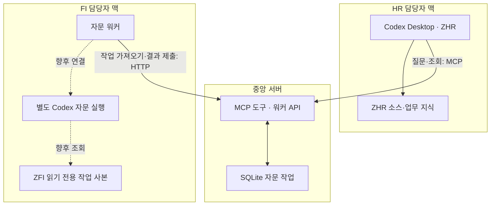

# 프로젝트 맥락과 설계 — ERP AI 에이전트간의 통신

- 프로젝트명: ERP AI 에이전트간의 통신
- 정리 기준일: 2026-10-08, Asia/Seoul
- 문서 버전: 교육 추출본 1.0.0 / 대상 코드 0.1.0
- 출처 식별자: [출처와검증기록](references/출처와검증기록.md)

## 1. 배경·문제·목표

사용자는 ERP 개발 패키지별 소스코드·매뉴얼·회의록을 추출하고, 맥의 Codex Desktop에서 해당 폴더를 지정해 업무 에이전트로 활용하고 있다고 설명했다. 시간외 정산 ZHR5는 FI 전표와 연결되는데, 폴더와 담당 에이전트가 분리되어 있어 어떻게 협업할지가 출발점이었다. [C01]

초기 답변은 상위 ERP 폴더를 열고 ZHR5·ZFI 담당 서브에이전트를 생성하는 방향이었다. 그러나 사용자는 각 팀원이 다른 업무 코드를 수정하면 안 되고, 본인 패키지만 클론한다는 제약을 추가로 명확히 했다. 최종 목표는 소스의 중앙 통합이 아니라 **사람의 업무 분장을 따라 배치된 에이전트 사이의 원격 자문**이다. [C04~C07]

## 2. 대상 업무와 범위

대표 참여자는 HR 담당자/ZHR 또는 ZHR5와 FI 담당자/ZFI다. ZMM·ZAA·ZCO·신규 ZXX로 확장하는 구상을 논의했다. ZHR과 ZHR5의 실제 저장소 대응 관계는 확인하지 않았다. 문서에서는 HR 예제 호출자를 ZHR, 최초 시간외 전문 패키지를 ZHR5로 구분한다. 둘이 동일 저장소라는 의미가 아니다. [C01,C02,C07]

포함 범위는 업무 역할, 권한 경계, 접점 MD, Obsidian 시각화, 원격 MCP/워커 연결, Node.js 중계 예제다. SAP 실제 정산·전표 로직 수정, 전표 생성/역분개 실행, ERP 서버 접속, 소스 export/import 구현, 포털 제작은 포함하지 않는다.

## 3. 환경·버전·제약

| 항목 | 확인한 사실·제약 | 상태·근거 |
|---|---|---|
| 담당자 환경 | 팀원마다 맥, 본인 ZXX만 GitHub에서 클론, Codex Desktop으로 선택 | 사용자 계획 [C06,C07] |
| 중앙 환경 | 별도 중앙 MCP, Node.js로 예시 작성 요청 | 사용자 선택 [C07~C09] |
| 실제 중앙 OS/주소 | 확인되지 않음 | 미확인 |
| Node 요구 | >=24, 내장 node:sqlite 사용 | 구현 [F-PACKAGE,F-SERVER] |
| 코드 버전 | erp-team-mcp-example 0.1.0 | [F-PACKAGE] |
| 잠금 의존성 | MCP SDK 1.31.0, Express 5.2.1, Zod 3.25.76 | [F-LOCK]의 해당 packages 항목 |
| 권한 경계 | 담당자가 타 업무 소스를 수정하면 안 됨 | 사용자 필수 제약 [C04] |
| 소스 배치 | HR 맥에 ZFI를 클론하지 않음 | 사용자 필수 제약 [C06] |
| 외부 자문 | 사람 간 수동 전달이 아닌 자동 에이전트 질의 | 사용자 교정 [C05] |
| 기기 가용성 | 맥 전원·절전 시 자문 응답 불가 가능 | 설계상 운영 고려 [C07] |
| 데이터 범위 | 실제 소스 없이 질문·근거를 중앙으로 전달 | 설계; DB에 질문·답변은 남음 [F-SERVER] |

잠금 파일은 이 예제의 재현 기준이지 2026-10-08 현재 권장 최신 라이브러리라는 뜻이 아니다. macOS·Codex 앱 버전은 확보하지 못했다.

## 4. 구성 요소와 연결 관계

실선은 예제가 제공하는 통신 구조를 설명하며, 사용자 맥에서 실제 구축 완료했다는 표시가 아니다. 점선의 실제 AI 실행 부분은 미구현이다. [F-SERVER,F-WORKER]

### 4.1 중앙 MCP

Codex가 호출할 자문 도구를 제공하고 요청을 저장·배정·조회한다. 중앙에 AI 모델이나 ZFI 저장소가 필수인 구조가 아니다. 중앙 Codex Desktop은 서버 프로그램 개발 보조로 사용할 수 있지만, 앱 설치 자체가 MCP 서버 구축은 아니다. [C08]

### 4.2 담당자 맥의 두 가지 실행

사람이 쓰는 Desktop 세션은 자기 패키지 편집용이다. 외부 질문은 별도 자문 워커가 받아 별도 읽기 전용 AI 실행에 넘기는 것이 설계다. 기존 Desktop 대화창을 원격 조종하거나 전체 대화 이력을 자동 공유하는 기능은 예제에 없다. [C07,F-README]

### 4.3 업무 지식과 접점 MD

AGENTS.md는 작업·위임 규칙, SKILL.md는 수행 절차, knowledge/는 업무 근거, exports/는 소스, harness/는 검증 자료라는 역할을 논의했다. 실제 파일을 이번에 읽은 것은 아니다. 패키지 간 연결 문서는 호출 함수·전달 필드·처리 시점·실패/취소/재처리·근거·마지막 확인일을 기록하도록 제안했다. [C01,C02]

접점 MD는 **협업 내용의 근거**이고 MCP는 **질문·답변의 통신 수단**이다. MD를 만든다고 다른 맥에 접근할 수 있거나 수정 권한이 생기지 않는다. 접점 MD를 어디에 공유·배포할지는 최종 확정되지 않았다.

## 5. 입력 → 처리 → 출력의 실제 흐름

다음은 확보 코드에서 확인한 흐름이다. 업무 분석 결과를 낸 흐름과 혼동하지 않는다.

1. HR Codex가 `/mcp`에 인증하여 `ask_expert(expert, question, context, parent_id?)`를 호출한다.
2. 서버는 토큰에 매핑된 사용자와 허용 담당을 확인한다. 입력에 적힌 사번을 신뢰해 권한을 부여하지 않는다.
3. SQLite에 queued 요청을 생성하고 `job_id`를 즉시 반환한다. 사용자별 진행 중 요청은 10개까지다.
4. FI 워커가 `/worker/claim`을 호출한다. FI 워커 토큰의 `expert=ZFI`와 일치하는 대기 요청만 원자적으로 배정한다.
5. 요청은 running으로 바뀌고 작업별 lease가 생긴다. 후속 요청이면 같은 사용자·담당의 앞선 질문/답변 최대 3개를 보낸다.
6. 현재 모의 워커는 조사하지 않고 `[MOCK]` 문구를 만든다. `/worker/:id/complete`에 배정받은 lease와 답변을 제출한다.
7. 서버는 해당 워커·담당·lease·running 상태를 확인해 done 또는 failed로 기록한다.
8. HR Codex가 `get_answer(job_id)`로 본인 답변을 가져간다. 결과를 다른 업무 로직의 확정 사실로 자동 승격하면 안 된다.

근거: [F-SERVER] makeMcp, /worker/claim, heartbeat/complete 핸들러; [F-WORKER] 반복 루프.

### 5.1 API와 상태

| 구분 | 실제 이름 | 입출력·주의 |
|---|---|---|
| MCP | list_experts | 허용 담당과 최근 통신 여부 |
| MCP | ask_expert | 자문 요청 → job_id; parent_id로 후속 질문 |
| MCP | get_answer | 본인 작업 상태·답변 조회 |
| HTTP | POST /worker/claim | 인증된 담당의 작업 1개; 없으면 204 |
| HTTP | POST /worker/:id/heartbeat | 유효 lease의 실행 시간 갱신 |
| HTTP | POST /worker/:id/complete | answer 또는 error 중 하나 제출 |

이전 설명에 나온 `follow_up`은 구상용 이름이며 현재 별도 도구로 구현되지 않았다. 실제 후속 질문은 `ask_expert`의 parent_id를 사용한다. [C07,F-SERVER]

| 정책 | 코드 0.1.0 |
|---|---|
| 요청 수명 | 생성 후 15분 |
| 실행 임대 | 60초; heartbeat로 갱신 |
| 만료 처리 | 관련 API 호출 시 sweep 실행; 독립 타이머 없음 |
| 상태 | queued / running / done / failed / expired |
| 재배정 | 임대 만료 시 failed; 자동 재시도 없음 |
| 모의 워커 폴링 | 3초; 실제 소스 분석·heartbeat 반복은 없음 |
| online 기준 | 최근 워커 통신 30초; 메모리 기록이라 재시작 시 초기화 |
| 네트워크 | 기본 127.0.0.1:3000, HTTP; 운영 HTTPS는 별도 |

서버가 expired로 표시하는 것은 외부 AI 프로세스를 강제로 중단했다는 뜻이 아니다. 실제 워커 취소·시간 제한은 별도 구현해야 한다. [F-SERVER,F-README]

## 6. 사람·AI·프로그램의 역할

| 주체 | 담당 | 담당하지 않는 것 |
|---|---|---|
| 업무 담당자 | 요구 설명, 자기 코드 검토·수정 승인, 업무 판단 | 타 업무 소스의 임의 수정 |
| ZHR 주 에이전트 | 자기 자료 분석, FI 질문 작성, 응답 통합 | 존재하지 않는 ZFI 자료를 아는 척하기 |
| ZFI 자문 AI | FI 자료 읽기, 근거·불확실성 반환 | 원격 요청에 따른 수정/배포 실행 |
| 중앙 일반 프로그램 | 인증·배정·상태·답변 저장 | 회계 로직 판단 |
| 맥 워커 | 질문 수신, 자문 실행, 결과 제출 | 본인 대화창과 무조건 문맥 공유 |

ZFI 자문 AI 행은 목표 설계다. 현재 파일에서는 모의 워커까지만 존재한다.

## 7. 주요 결정과 이유

| 결정·방향 | 이유 | 상태·근거 |
|---|---|---|
| 담당자별 자기 패키지만 클론 | 실제 업무 책임과 수정 범위 일치 | 사용자 결정 [C04,C06,C07] |
| 사람 대신 에이전트가 다른 업무에 질의 | 한 대화에서 업무 간 자문을 받고 싶음 | 사용자 결정 [C05] |
| 중앙 MCP 도입 | 맥별 담당을 연결할 공통 접점 필요 | 사용자 결정 [C07] |
| Node.js 중앙 예제 | 사용자가 언어를 지정해 예제 요청 | 사용자 결정 [C09] |
| 담당 맥의 별도 자문 워커 | MCP 클라이언트 등록만으로 Desktop이 수신 서버가 되지 않음 | 설계 제안 [C07] |
| 자문용 읽기 전용 작업 사본 | 편집 중 코드 혼입과 원격 수정 방지 | 설계 제안; 미구축 [C07,F-README] |
| 요청/조회 분리 | AI 처리가 길어질 때 한 호출을 오래 유지하지 않도록 | 예제 구현 [C09,F-SERVER] |
| 단순 SQLite 큐 | 소규모 중앙 예제를 한 프로그램으로 설명 | 예제 구현 [F-SERVER] |

## 8. 검토 후 제외한 대안·실패한 접근

1. **모두 ERP 루트를 열고 로컬 서브에이전트 운용:** 공유 파일 접근을 전제로 하는 방안. 사용자별 수정 영역과 단일 패키지 클론 조건에 맞지 않아 최종 운영안에서 제외했다. 개인 통합 분석이라는 별도 목적에는 활용 가능하지만 본 프로젝트 기본안은 아니다. [C01~C04]
2. **공통 저장소에서 사람이 검토 요청서를 전달:** 업무 분장에는 맞지만 사용자는 자동 에이전트 자문을 원했다. 대화 맥락을 잘못 해석한 제안으로 교정되었다. [C04,C05]
3. **ZFI를 로컬 읽기 전용으로 제공하고 서브에이전트 생성:** 사용자가 ZFI를 클론하지 않는다고 명시하면서 로컬 접근 전제가 무너졌다. 원격 조회 수단 없이는 성립하지 않는다. [C05,C06]
4. **중앙에 ZFI AI·소스를 배치:** C06 응답에서 제시된 대안이지만, 이후 사용자별 맥을 따라 에이전트를 배치하겠다는 요구에 맞춰 담당 맥 워커 중계안으로 구체화했다. 중앙 집중형 자문을 영구 금지한 결정은 아니나 현재 기본안과 섞지 않는다. [C06,C07]
5. **중앙 Codex Desktop만 설치:** 개발 보조 앱과 항상 실행되는 MCP 서버 프로그램의 역할을 혼동한 지점. 별도 Node 프로그램 필요로 정리했다. [C08]

이는 대부분 제품 실행 실패가 아니라 요구·설계 해석을 바로잡은 경험이다.

## 9. 사용자 피드백에 따른 변경 이력

| KST 시각 | 사용자 피드백 | 변경 결과 |
|---|---|---|
| 10-03 01:28 | 패키지 폴더 추가와 접점 MD 역할 재확인 | 상위 규칙·패키지 규칙·접점 문서로 구분 |
| 10-03 01:30 | Obsidian으로 연결 시각화 가능한지 질문 | 링크 그래프/로컬 그래프/Canvas 제안 |
| 10-03 01:35 | 다른 담당 코드 수정 금지 | 조회·수정 권한 분리 필요로 수정 |
| 10-03 01:40 | 수동 검토 요청이 아니라 ZFI가 붙어 대화해야 함 | 자동 자문 위임으로 요구 재정의 |
| 10-03 01:42 | ZFI는 클론하지 않음 | 원격 전문 에이전트 호출 필요로 수정 |
| 10-03 01:46 | 사람별 맥·자기 패키지·중앙 MCP 구성에 동의 | 맥별 자문 워커와 중앙 중계 설계 |
| 10-03 01:55 | 중앙에도 Codex Desktop을 설치하려 했음 | 클라이언트 앱과 서버 프로그램 구분 |
| 10-03 01:58 | Node.js 예제 코드 요청 | 중앙 코드·모의 워커·테스트 ZIP 제작 |

근거: [C02~C09].

## 10. 현재 방안과 과거 방안 비교

| 항목 | 초기 방안 | 현재 설계·구현 |
|---|---|---|
| 자료 위치 | 한 ERP 루트의 여러 패키지 | 각 맥에 자기 패키지 |
| 협업 | 로컬 서브에이전트가 타 폴더 읽기 | 중앙 도구로 원격 자문 요청 |
| 상대 지식 | 부모 환경에서 접근 가능하다고 가정 | 상대 맥 워커가 자기 자료 조사 예정 |
| 대화 | 기존 담당 대화와 혼동 가능 | 별도 자문 세션; 기존 대화 자동 공유 아님 |
| 결과 연결 | 메인 에이전트가 합침 | 원격 답변 수신 후 주 에이전트가 합침 |
| 현재 파일 | 초기 디렉터리 예시뿐 | Node 중앙 예제 + 모의 워커 |

## 11. 주요 프로그램·설정과 최신 여부

확보 ZIP은 0.1.0 한 버전이며 다른 저장소 최신성은 미확인이다. 상세 자료 목록은 [03 문서](03_자료목록과보완사항.md) A절 참조.

- [server.mjs](examples/erp-mcp-example/server.mjs): createHub, makeMcp, worker 핸들러, 기본 HR/FI 등록.
- [mock-worker.mjs](examples/erp-mcp-example/mock-worker.mjs): FI 토큰으로 폴링하고 고정 답변 반환.
- [test.mjs](examples/erp-mcp-example/test.mjs): 실제 SDK 클라이언트 기반 단일 통합 테스트 안의 여러 assertion.
- [README.md](examples/erp-mcp-example/README.md): 설치·토큰·MCP 설정·향후 워커 연결 지침.
- [package.json](examples/erp-mcp-example/package.json), [package-lock.json](examples/erp-mcp-example/package-lock.json): 실행 명령·버전 기준.

설정 이름은 HR_CLIENT_TOKEN, FI_WORKER_TOKEN, DB_PATH, HOST, PORT, 워커 HUB_URL, Codex의 ERP_HR_MCP_TOKEN이다. 값은 배포하지 않는다. jobs.sqlite는 실행 시 생성되는 데이터 파일이고 확보 ZIP에는 없다.

## 12. 완료·진행·미착수·미확인

| 상태 | 항목 |
|---|---|
| 완료 | 협업 요구 정리, 중앙 예제 생성, 모의 워커·테스트 제공 |
| 이번 완료 | 원본 재확보·해시 보존·교육 문서 추출; 재시험은 references 기록 참조 |
| 설계만 있음 | 원격 ZFI 읽기 전용 AI 워커, 자문 작업 사본, 운영 HTTPS |
| 미구현 | Codex SDK 연결, AI 프로세스 취소, heartbeat 반복, SSO/OAuth, idempotency, 서비스 등록 |
| 미확인 | 실제 맥 배치·설치·실행, 저장소 최신본, 실제 업무 응답 정확도, ERP 연결 |
| 별도 작업 | 포털 구현, GitHub push, SAP 변경·배포 |

## 13. 실제 검증과 남은 검증

원 대화 도구 출력에서 Node v24.19.0, `npm test` exit 0, tests 1/pass 1이 확인된다. 테스트 내용은 코드에서도 확인된다. 이번 추출에서도 원본을 수정하지 않고 별도 임시 디렉터리에서 같은 테스트를 재실행해 exit 0, tests 1/pass 1을 확인했다. 구체 결과는 [검증 기록](references/출처와검증기록.md) V02 및 [출력](references/2026-10-08_test-output.txt)을 기준으로 한다.

확인 범위는 요청 생성·FI claim·답변 반환·타 사용자 조회 차단·타 담당 claim/완료 차단·후속 history 전달·임대 만료 거절이다. 실제 맥/Codex UI/AI/사내망은 시험하지 않았다. SQLite 파일 재시작 복구, 만료 15분 전체 경로, 부하·다중 프로세스·보안 침투도 해당 테스트로 증명되지 않는다.

특히 중앙의 담당 제한은 실제 자문 AI의 파일 접근 제한을 증명하지 않는다. 워커 계정/권한/샌드박스/MCP 도구 권한 검증이 따로 필요하다.

## 14. 오류·주의사항과 해결 여부

| 구분 | 증상 | 원인·조치 | 상태 |
|---|---|---|---|
| 원 제작 환경 오류 | npm 의존성 설치 EPERM, 이후 SDK 모듈 없음 | 당시 실행 환경의 네트워크 제한; 허용된 설치 후 재시험 | 제작 환경에서 해결 [T01] |
| 원 제작 시험 | 제한 환경에서 첫 테스트 실패 | 후속 로컬 포트 시험 허용 환경에서 재실행 | 최종 exit 0; 최초 실패 상세 단정 금지 [T01] |
| 미시험 운영 주의 | 맥의 MCP 인증 실패 가능 | 터미널 환경변수를 Desktop 프로세스가 상속하지 않을 수 있음 | 앱별 설정 확인 필요 [F-README] |
| 의도된 동작 | 브라우저 직접 호출 403 | Origin 헤더를 일괄 거부 | 현재 예제 설계 [F-SERVER] |
| 의도된 동작 | 워커 결과 409 | 작업/lease/담당/상태 불일치 또는 임대 만료 | 테스트 일부 확인 [F-TEST] |
| 미구현 경계 | done이지만 실제 분석 아님 | 모의 고정 답변 | 실제 AI 워커 필요 [F-WORKER] |
| 코드 검토 주의 | 요청 중복·응답 지연 시 중복 작업 가능 | idempotency 및 안정 재시도 미구현 | 운영 전 보완 [F-README] |
| 코드 검토 주의 | 인증 파싱이 엄격한 Bearer 형식 검증은 아님 | 문자열 replace 방식; 운영 인증 미들웨어 검토 필요 | 추출 시 정적 관찰, 원본 미수정 [F-SERVER] |

사용자 맥에서 위 npm EPERM이 실제 발생했다고 교육하지 않는다. 제작 도구 환경에서 관찰된 오류다.

## 15. 다른 프로젝트와 입력·출력·의존관계

| 연계 프로젝트 | 필요한 입력 | 이 자료가 제공할 출력 | 통합 시 질문 |
|---|---|---|---|
| ERP 추출·배포 | 패키지별 소스와 버전·저장소 경계 | 어떤 담당이 어떤 소스를 읽을지 설계 | 최신 자문 대상 커밋은 무엇인가 |
| 업무 지식·스킬 | 실제 업무 지침·매뉴얼·회의록·출처 | 자문 요청·응답 구조 | 민감 내용과 공유 가능 범위는 |
| 하네스 | 업무별 기대 답변·회귀 기준 | 중앙 통신 테스트 범위 | 실제 FI 답변 정답 검증은 누가 하는가 |
| ERP API MCP | 허용된 ERP 조회 도구 | 원격 담당 자문 통신과의 구분 | 중앙 협업 MCP와 같은 서비스인지 별도인지 |
| Obsidian | 접점 문서·업무 링크 | 시각화에 필요한 관계 모델 | 분산 폴더에서 관계 문서를 어떻게 배포할지 |
| 교육 포털 | 통합 목차·대상 독자·실습 환경 | 이 MD·원본 ZIP·코드·보완 목록 | 정적 포털에서 실제 자문 API 호출은 별도 범위인지 |

## 16. 주요 내용의 출처

대화 근거 C01~C09, 기술 근거 F-SERVER/F-WORKER/F-TEST/F-PACKAGE/F-LOCK/F-README, 제작 시험 T01, 이번 검증 V02는 [출처와검증기록](references/출처와검증기록.md)에 정리했다. 일반 제품 최신 설명은 이번 추출에서 새로 확정하지 않았다.
