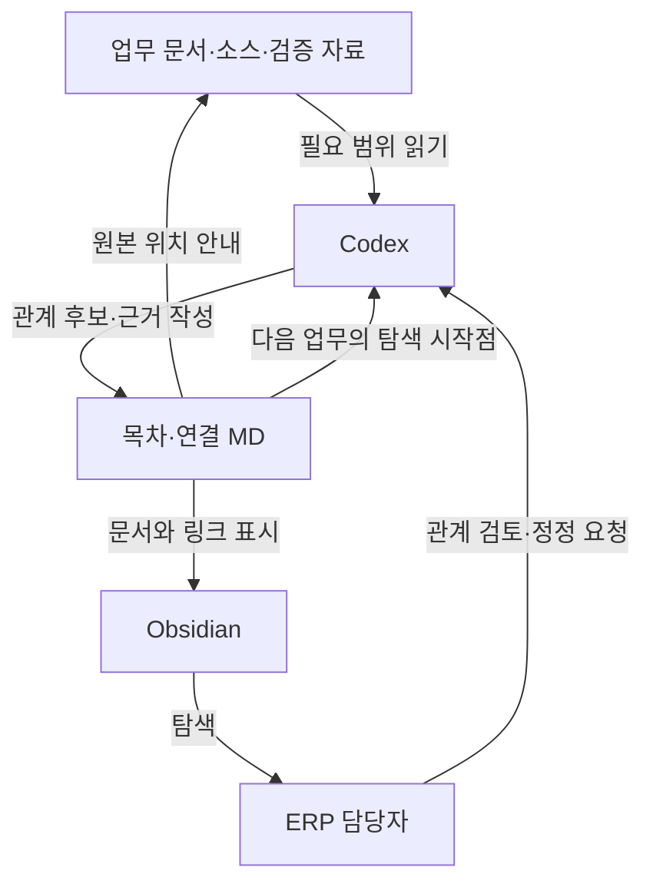

# 프로젝트 맥락과 설계 — 옵시디언을 활용한 ERP 업무 관계정립

프로젝트명: **옵시디언을 활용한 ERP 업무 관계정립**  
정리 기준일: **2026-10-08, Asia/Seoul**  
이 문서의 상태: 현재 대화에 기반한 설계·설명 이력. 사용자 맥의 구현·검증·운영 상태는 미확인.

[자료 안내](00_README.md) · [교육과 실습](02_교육과실습.md) · [자료 목록과 보완사항](03_자료목록과보완사항.md)

## 1. 배경, 기존 문제, 목표

### 1.1 출발점

사용자는 회사 ERP 관련 업무 맥락, 대화, 회의록, 매뉴얼을 MD로 분류하고 연결하려 했다. 최초 질문은 Obsidian이 이 분류·연결을 해주는 도구인지에 관한 것이었다. [C01]

곧 다음과 같은 **이미 진행한 작업**을 직접 설명했다. [C02]

- 시간외 프로젝트에서 업무 매뉴얼·회의록·대화 내용을 추출했다.
- AI로 이를 코덱스 스킬화하여 `skill.md`, `knowledge/`, 하네스 폴더를 만들었다.
- 엑스포트 폴더에 ABAP 코드와 웹 소스가 있다.
- 여러 폴더에 흩어진 MD와 코드를 통째로 Obsidian에서 지정하면 관계를 자동 생성할 수 있는지 알고 싶었다.

이는 사용자 진술로 확인된 이력이다. 어떤 파일을 언제 생성했고 어떤 검사를 통과했는지는 이번 대화에 원본이나 실행 기록이 없다. 특히 하네스 폴더가 존재한다는 설명만으로 자동 평가가 실행된다고 볼 수 없다.

### 1.2 해결하려는 문제

파일의 소재를 아는 것과 업무의 관계를 아는 것은 다르다. 예를 들어 시간외 업무를 설명하는 문서와 ABAP 소스가 모두 있어도, 어떤 회의의 결정이 어떤 기준으로 이어졌고 어느 계산 로직과 테스트에서 확인해야 하는지 다시 찾아야 할 수 있다. 이 문제를 **재배치가 아닌 연결 정보 추가**로 줄이려는 것이 이 프로젝트의 방향이다. [C02–C04]

### 1.3 목표와 비목표

목표는 사람이 업무 근거를 따라가고 AI가 필요한 원문부터 찾아 읽을 수 있도록, 업무별 진입점과 의미 있는 관계를 문서화하는 것이다. 모든 자료를 다시 요약하거나 AI 모델을 학습시키는 프로젝트가 아니다. Obsidian 설치 자체로 모델 추론 속도·정확도·권한을 바꾸는 것도 목표가 아니다. [C03–C05]

## 2. 대상 업무와 범위

| 구분 | 이 프로젝트에서 다룬 범위 | 다루지 않은 범위 |
|---|---|---|
| 업무 사례 | 시간외 업무 자료를 출발점으로 한 연결 방식 | 실제 시간외 단가·지급 자격·정산 로직의 확정 |
| 자료 | 기존 MD, 매뉴얼·회의록·대화의 정리본, ABAP·웹 소스의 관계 | 해당 원본 전체 추출·재검증 |
| 도구 | Codex가 문서층을 만들고 Obsidian으로 탐색하는 역할 구분 | AI 플러그인 구현, 임베딩 DB, 검색 서버 구축 |
| 구조 | `maps/` 추가, 기존 경로 보존, 프로젝트 단위 Vault | ERP 전체 저장소의 최종 폴더 구조 확정 |
| 성능 | 탐색 효율 개선 가능성과 한계 | 성능 수치 실측, 모델·하드웨어 튜닝 |
| 후속 활용 | 교육 포털에 전달할 MD와 자료 목록 | 웹 구현, 서버 설치, GitHub push, ERP 변경 |

2026-10-08 요청의 포털·Node.js·사내 도메인 계획은 **이번 추출물의 목적지**다. 이를 이 프로젝트에서 이미 구현한 시스템으로 포함하지 않는다. [C08]

## 3. 시스템 환경·버전·제약

### 3.1 확인한 환경과 미확인 환경

| 항목 | 근거 | 확인 수준 |
|---|---|---|
| 사용 장비·클라이언트 | 사용자가 “내 맥에 사용중인 코덱스 데스크탑”이라고 질문 [C05] | Mac에서 Codex Desktop 사용 중이라는 진술 확인 |
| 업무 자료 | 기존 지식·스킬·하네스·ABAP/웹 소스 보유 설명 [C02] | 구조 개념만 확인. 정확한 루트·파일명·대소문자·수량 미확인 |
| Obsidian 설치 | 연결 문서 구성 후 설치할 순서 질의 [C07] | 당시 계획 논의. 기준일 현재 설치 여부·버전 미확인 |
| Codex 버전·모델·세션 설정 | 자료 없음 | 미확인. 특정 메뉴·성능·자동 로드 동작을 사용자 환경에서 확인하지 않음 |
| SAP ECC·BASIS 세부 버전 | 현재 방의 직접 논의에 버전 확인 없음 | 다른 프로젝트 맥락과 합칠 때 별도 출처로 확인. 이 문서의 실행 전제 아님 |
| GitHub·MCP·Node.js·KBS 도메인 | 추출 목적의 통합 계획에 등장 [C08] | 이 프로젝트의 배포·접속 설정으로 확인한 것은 아님 |

### 3.2 유지해야 할 제약

- 기존 파일을 옮기거나 이름을 바꾸면 스킬·스크립트의 경로 참조에 영향을 줄 수 있으므로 보존을 우선한다. 실제 경로 의존성 발생 여부는 원본 확인이 필요하다. [C02, C06]
- 규정, 검토 의견, 최종 결정, 현재 적용 기준을 구분한다. 작성일과 적용일을 혼동하지 않는다. [C01, C02]
- 근거가 없는 관계는 “추정” 또는 “미확인”으로 둔다. 파일명 유사성이나 AI의 추론만으로 구현 근거를 확정하지 않는다. [C02]
- 앱·그래프·지도는 원문 검증을 생략하는 수단이 아니다. [C05]
- 실제 문서 작성 권한과 AI 처리 허용 범위를 지킨다. 이번 추출은 인증정보나 원시 인사 데이터를 요구하지 않는다. [C08]
- 본 실습에서 운영 ERP 변경은 필요하지 않으며 금지한다. 실제 소스·지침을 수정하는 후속 작업은 별도의 범위·검증을 정해야 한다. [C08 및 교육용 보완안]

## 4. 구성 요소별 역할과 연결 관계

### 4.1 역할 분담

| 구성 요소 | 역할 | 오해하면 안 되는 점 | 상태·근거 |
|---|---|---|---|
| 업무 원본·정리 문서 | 업무 내용과 결정 근거 | 문서가 있다는 것만으로 현재 유효한 규정은 아님 | 사용자 보유 진술 [C01, C02] |
| `skill.md` / `SKILL.md` | AI 업무 처리 지침으로 활용 중이라고 설명된 자료 | 정확한 실제 이름·배치·로딩 방식은 확인 안 됨 | 사용자 진술 [C02] |
| `knowledge/` | 정리된 업무 지식의 소재 | 자동으로 코드와 매핑되는 DB가 아님 | 사용자 진술 [C02] |
| 하네스 폴더, 표기 예 `harness/` | 관련 검증 기준·사례와 연결할 대상 | 실행 가능한 검사기나 통과 결과가 있는지는 별도 | 사용자 진술 및 연결 제안 [C02] |
| 엑스포트 폴더, 표기 예 `exports/` | ABAP·웹 소스 원본 참조 | 이 문서 작성으로 소스를 실행·수정한 것이 아님 | 사용자 진술 [C02] |
| `maps/` | 업무별 목차·관계·코드 설명 노트 | 제안된 폴더. 실제 생성 확인 없음 | 제안 [C02, C07] |
| Codex | 자료 조사, 연결 후보 도출, MD 작성·검사 | 지도 전체를 항상 읽게 할 필요는 없음 | 제안된 활용 [C02–C05] |
| Obsidian | 사람이 문서·링크·관계를 탐색하는 화면 | 의미 분석 AI, SAP 실행기, 중앙 에이전트 서버가 아님 | 역할 설명 [C01–C03], 제품 사실 [T01–T04] |

### 4.2 개념 구성도

아래 그림은 **대화에서 제안한 역할 관계**다. 사용자 환경의 실측 구성이나 실제 연결 상태가 아니다.

Codex와 Obsidian 사이에 별도 전송 서버를 둔 그림이 아니다. 같은 프로젝트의 파일을 활용하는 설계다. 그래프의 선은 문서 링크를 보여주는 것이므로 “구현한다”, “검증한다”, “폐기되었다” 같은 의미는 관계 문서의 본문에 기록해야 한다. [C03, T03]

## 5. 입력 → 처리 → 출력의 실제 흐름

### 5.1 이 방에서 실제 확인된 대화 진행

| 단계 | 입력 | 이 대화에서 한 처리 | 확인된 출력 |
|---|---|---|---|
| 1 | 업무 자료를 Obsidian으로 분류·연결할 수 있는지 질문 | 도구와 AI의 역할 설명 | 일반 구조와 링크 예시 [C01] |
| 2 | 이미 스킬·지식·하네스·소스가 있다는 보완 | 기존 구조 활용 방식으로 구체화 | 경로 보존 + `maps/` 추가 제안 및 지시문 [C02] |
| 3 | AI가 지도를 읽는 것인지 질문 | 시각 화면과 실제 MD 데이터 구분 | 사람/AI 공용 문서층 설명 [C03] |
| 4 | 효율·응답 속도·도입 손해 질문 | 기대 효과와 조건, 비용 설명 | 탐색 시간 개선 가능성, 과대 기대 보정 [C04–C06] |
| 5 | 연결 문서 작성 후 설치·루트 지정 순서 질문 | 적용 순서와 Vault 범위 설명 | 작은 프로젝트부터 여는 순서 [C07] |
| 6 | 교육 포털용 추출 요청 | 확인 범위·상태·자료 분리 | 이번 MD 4개와 ZIP [C08] |

파일 분석·생성·그래프 확인을 사용자 맥에서 실제 실행한 기록은 이 흐름에 없다.

### 5.2 향후 실행하도록 제안한 흐름

1. 현재 프로젝트의 파일 목록·작업 지침·기존 링크를 조사한다.
2. 업무 한 가지를 고르고 기준·근거·소스·검증 항목의 관계 후보를 찾는다.
3. 확인된 관계와 추정 관계를 구분한 짧은 연결 문서를 만든다.
4. 목차에서 해당 연결 문서로, 연결 문서에서 원본으로 이동하도록 한다.
5. 파일 존재, 근거 일치, 최신성, 원본 불변 여부를 확인한다.
6. 프로젝트 루트를 Obsidian 보관함으로 열고 탐색을 확인한다.
7. 새 업무 요청에서 AI가 목차를 먼저 참고하고 필요한 원문을 읽는지 확인한다.

1–7은 대화상 방향을 실습용으로 정리한 **미실행 절차**다. 자세한 수행과 합격 기준은 02 문서에 있다. [C02, C05, C07]

## 6. 사람·AI·프로그램의 담당 작업

| 담당 | 해야 할 일 | 맡기지 않는 일 |
|---|---|---|
| 업무 담당자 | 대상 업무 선택, 적용 기준 확인, 연결 근거·공개 범위 검토 | 그래프를 보고만 지급 기준이나 코드 정합성을 확정 |
| AI·Codex | 승인된 자료 탐색, 근거 후보 연결, 초안·변경 목록 작성, 가능 범위의 링크 검사 | 미열람 문서의 결론 추측, 원본 무단 이동, 권한 없는 외부 자료 접근 |
| Obsidian | MD 표시, 문서 간 탐색, 그래프 제공 | 근거의 업무적 진위 판단이나 소스 실행 |
| 별도 검사 도구 | 구성될 경우 파일·링크·변경 범위의 반복 검사 | 파일 검사 통과를 SAP 업무 검증 통과로 승격 |
| 통합 포털 제작자 | 추출 자료 대조, 역할별 폴더 관리, MD를 웹 콘텐츠로 변환 | 이 추출본을 이미 운영 중인 구현 설명으로 재표시 |

검사 도구의 실제 존재는 확인하지 않았다. 향후 자동화를 위한 역할 분담이며 설치 완료라는 뜻이 아니다.

## 7. 주요 결정과 결정 이유

| ID | 시점 | 내용 | 이유 | 엄격한 상태 |
|---|---|---|---|---|
| D01 | 10-03 [C01] | 기본 Obsidian과 AI의 역할을 구분 | 폴더 지정만으로 의미 분석이 된다는 오해 방지 | 설명 정리 |
| D02 | 10-03 [C02] | 이미 만든 폴더·경로를 유지하고 연결 문서 추가 | 스킬·하네스 참조를 보존하고 중복 작업 축소 | 제안, 후속 논의의 기준 |
| D03 | 10-03 [C02] | 업무별 진입점에서 근거·구현·검증을 연결 | 자료 종류별 분류만으로는 업무 이유를 추적하기 어려움 | 제안 |
| D04 | 10-03 [C02] | 코드에 설명용 MD를 붙이는 방식 활용 | 소스 복제 대신 역할·원본 위치를 탐색할 수 있게 함 | 제안 |
| D05 | 10-03 [C03] | 사람과 AI가 같은 MD를 활용 | 별도의 시각 지도 이미지를 AI에 매번 읽힐 필요 없음 | 설계 설명 |
| D06 | 10-06 [C05] | 성능 효과는 필요한 자료의 탐색 감소로 평가 | 설치 자체의 추론 가속과 구분, 입력량 증가 위험 방지 | 조건부 설명, 실측 없음 |
| D07 | 10-06 [C06] | 한 업무부터 작은 규모로 시작 | 관계 과밀과 유지보수 부담을 확인하며 확장 | 제안 |
| D08 | 10-07 [C07] | Codex 문서 구성 후 Obsidian에서 프로젝트 루트 열기 | 기존 작업부터 진행 가능하며 홈 전체를 범위로 삼지 않음 | 사용자 순서 재확인, 실제 실행 미확인 |
| D09 | 10-08 [C08] | 현재 프로젝트만 4개 MD와 ZIP으로 추출 | 다른 프로젝트와 상태·출처를 분리해 교육 포털에 통합 | 이번 요청의 확정 범위 |

D02–D08을 사용자 맥에 반영한 커밋·파일은 확보하지 못했다. 대화상 방향과 물리적인 적용을 구분한다.

## 8. 검토 후 제외한 대안과 실패한 시도

### 8.1 논의에서 배제하거나 조건을 단 접근

| 접근 | 논의 결과 | 근거 |
|---|---|---|
| 폴더를 열면 관계가 자동 완성됨 | 기본 도구 역할과 다름. 분석·링크 작성이 필요하다고 설명 | [C01, C02] |
| 이미 만든 지식 체계를 전부 재구성 | 필수 아님. 기존 구조를 보존하며 연결층 추가 | [C02, C06] |
| AI가 그래프 화면을 보며 업무 수행 | 이 설계에서는 MD와 링크를 직접 읽음 | [C03] |
| 앱 설치만으로 응답 속도 개선 | 보장하지 않음. 탐색 효율 개선은 조건부 | [C05] |
| 모든 파일을 서로 연결 | 관계가 복잡해질 수 있어 업무 단위의 의미 있는 연결 권고 | [C06] |

### 8.2 실제 실패 이력

**설치 실패, 파일 손상, 링크 검사 실패, 성능 악화의 실제 보고는 현재 대화에 없다.** “발생할 수 있다”는 경고를 “실제로 실패했다”는 이력으로 만들지 않는다. AI 플러그인·유료 서비스·특정 그래프 확장 도구를 비교 시험해 탈락시킨 기록도 없다.

## 9. 사용자 피드백에 따른 변경 사항

| 사용자 질문·보완 | 설명이 달라진 지점 | 보존해야 할 맥락 |
|---|---|---|
| 이미 스킬·knowledge·하네스·소스를 만들었다 [C02] | 신규 분류 체계 제안에서 기존 자료 재사용으로 초점 이동 | 기존 작업의 가치를 지키고 중복 생성하지 않음 |
| “업무지도를 만들어 주는 도구… AI가 그지도를 보는거지?” [C03] | AI가 만들고 읽는 문서층과 사람이 보는 UI로 역할 세분화 | Obsidian 자체의 의미 분석 자동화로 설명하지 않음 |
| “좀더 효율적이라는거지?” [C04] | 탐색·반복 분석·변경 영향·입력량 관점으로 효과 설명 | 측정되지 않은 효과를 확정적으로 강의하지 않음 |
| 응답속도·처리속도가 빨라지나 [C05] | 추론 속도와 자료 탐색 시간을 명확히 분리 | 이미 좋은 목차가 있으면 추가 이익이 작을 수 있음 |
| “손해볼건 없는거네?” [C06] | 무조건 이득 대신 경로 변경·지도 노후화·과도한 연결의 부담 명시 | 무비용·무위험 도입으로 설명하지 않음 |
| 먼저 구성하고 설치·루트 지정하면 되나 [C07] | 실행 순서와 최소 Vault 범위를 구체화 | 맥 전체/홈이 아닌 업무 자료를 포함한 프로젝트 폴더 |

## 10. 현재 방안과 과거 설명의 관계

현재 대화상 방안은 **기존 원본 보존 → 업무 목차·연결 MD 추가 → 근거와 링크 확인 → 프로젝트 폴더를 Vault로 열기 → 변경 시 지도 갱신**이다. [C02, C05–C07]

다음은 운영 중인 과거 버전을 폐기했다는 뜻이 아니라, 교육 시 바로잡아야 할 표현의 변화다.

| 초기 표현·인상 | 현재 사용할 설명 |
|---|---|
| Obsidian이 업무지도를 만들어 준다 | 의미 관계는 사람/AI가 작성하고 Obsidian은 링크 기반 탐색을 제공 |
| 넣으면 효율적이다 | 필요한 자료를 더 잘 고르면 효율 개선 가능. 추가 입력·관리 비용도 있음 |
| 손해가 없다 | 기존 구조를 보존한 작은 도입은 부담이 작을 수 있으나 유지보수·권한·변경 위험은 남음 |
| 최상위 폴더를 연다 | 필요한 자료를 포함하는 프로젝트 루트. 조직 ERP 전체 루트가 항상 정답은 아님 |

10-08의 교육용 보완안은 과거 결정과 분리한다. 상대 Markdown 링크, 근거 필드, 점검표, 지침 수정 전 별도 검토 단계는 이번 정리에서 실행 가능하게 구체화한 초안이다. 실제 팀 표준으로 확정된 것은 아니다.

## 11. 주요 프로그램·파일·폴더·설정과 최신 여부

| 이름 또는 후보 | 실제 확인 수준 | 최신 여부 | 처리 원칙 |
|---|---|---|---|
| `skill.md` / `SKILL.md` | 사용자 표현과 답변의 표기가 다름. 원본 미열람 | 미확인 | 실제 대소문자·설치 경로를 확인한 뒤 링크 |
| `knowledge/` | 사용자 언급 | 미확인 | 기존 업무 목차가 있으면 재사용 |
| `harness/` | 하네스 폴더를 이렇게 표기해 설명함 | 미확인 | 테스트 설명과 실행 코드·실행 결과를 구분 |
| `exports/` | 엑스포트 폴더를 이렇게 표기해 설명함 | 미확인 | ABAP·웹 원본을 이동·복제·재포맷하지 않음 |
| `maps/` | 제안된 추가 경로 | 생성 여부 미확인 | 새 연결층의 후보. 기존 동명 폴더가 있으면 조사 먼저 |
| `maps/INDEX.md` | 교육용 진입점 예시 | 기존 파일 아님 | 02 문서의 실습에서만 사용 |
| 프로그램별 설명 MD | 이름 미지정, 개념만 제안 | 기존 파일 아님 | 실제 코드 위치·객체명·확인 시점과 연결 |
| `AGENTS.md` | 공식 지침 방식 확인, 사용자 파일은 미열람 | 사용자 적용 미확인 | 사용할 경우 기존 지침과 병합 여부 검토 [T08] |
| Obsidian Vault 설정 | 제품 기능만 확인 | 사용자 설정 미확인 | 설정 공유·개인 설정 분리 정책은 후속 결정 [T05] |

특정 ABAP 프로그램명, 실제 함수·테이블·단가를 연결된 현재 사실로 기재하지 않았다. 02의 `time-rate` 등은 교육용 가상 이름이다.

## 12. 완료·진행 중·미착수·미확인 항목

| 항목 | 상태 | 판단 근거 |
|---|---|---|
| Obsidian·AI 역할과 기대 효과 논의 | 대화상 정리 완료 | [C01–C06] |
| 폴더 보존·연결 문서 추가·적용 순서 | 방향 확인 | [C02, C07] |
| 기존 지식·스킬 생성 | 사용자 완료 진술, 실물 미확인 | [C02] |
| 실제 연결 문서 생성·검토 | 미확인 | 실행 보고·파일·로그 없음 |
| 설치·Vault 개방·그래프 확인 | 미확인 | 사용자 환경 접근 없음 |
| 성능 비교·오류율 평가 | 미확인 | 측정 결과 없음 |
| 자동 갱신·정기 검사 | 구현 사실 미확인 | 필요성 논의가 자동화 존재를 의미하지 않음 |
| 이번 MD와 ZIP 작성 | 이번 요청에서 수행 | 신규 추출 산출물 |
| 포털 구현·서버 설치·GitHub push | 이번 작업에서는 미착수·범위 제외 | 사용자 명시 [C08] |

외부 작업의 “진행 중” 여부를 보여주는 자료가 없으므로 임의의 진행률을 넣지 않는다.

## 13. 실제 검증한 내용과 남은 검증

### 13.1 이번 작업에서 수행한 검증의 범위

- 현재 보이는 대화의 질문과 답변을 시점별로 대조했다.
- 파일 검색과 과거 기록 검색의 결과를 현재 대화의 원문과 구분했다.
- 공식 자료에서 Vault·내부 링크·그래프·파일 형식과 관련 기능을 확인했다. [T01–T08]
- 생성한 4개 MD의 상대 링크 20개, 메타데이터·필수 절·출처 ID·코드 블록 짝과 ZIP 구성·무결성을 검사했다. 결과는 00 문서 §8에 기록했다.

이 검증은 사용자 맥의 파일 보존, 실제 Obsidian 표시, 코덱스의 지침 적용, SAP 계산, 성능 개선을 검증한 것이 아니다.

### 13.2 사용자 환경에서 필요한 후속 검증

| 검사 | 합격 기준 | 필요한 근거 |
|---|---|---|
| 원본 보존 | 승인한 문서 외 경로·파일 내용 변화 없음 | 변경 전후 비교 또는 Git 차이 |
| 링크 정합성 | 실제 링크 대상 존재, 중복 이름의 잘못된 연결 없음 | 링크 점검 결과와 클릭 확인 |
| 의미 정합성 | “근거·구현·검증” 관계마다 내용을 실제로 대조 | 검토자와 근거 위치 |
| 최신성 | 현재 적용 기준과 과거 이력 구분, 소스 스냅샷 일치 | 적용일·원문 버전·가능 시 커밋 |
| 탐색 동작 | 목차에서 필요한 원문으로 도달 | 실제 Vault 화면과 확인 기록 |
| AI 활용 | 지도만 인용하지 않고 해당 근거·소스를 읽음 | 질의·읽은 파일·답변 근거 기록 |
| 성능 | 같은 조건에서 시간·탐색량·정확성 비교 | 여러 회차 기록. 개선 없음도 그대로 기록 |

## 14. 주요 오류·오해와 해결 여부

실제 기술 오류 로그는 없다. 아래는 대화에서 조정한 오해와 잠재 위험 목록이다.

| 유형 | 증상 또는 질문 | 원인·설명 | 조치·현재 상태 |
|---|---|---|---|
| 개념 오해 | 폴더 지정만으로 업무 관계 생성 기대 | 노트 탐색 기능과 AI 분석을 혼동 | 역할 설명으로 보정. 실제 생성은 미확인 [C01–C03] |
| 성능 기대 | 앱 적용 시 응답이 빨라질 것으로 기대 | 추론과 자료 탐색 시간 혼동 | 조건부 효과로 보정. 수치 미측정 [C05] |
| 경로 위험 | 기존 파일을 옮기면 연결·스크립트 영향 가능 | 경로에 의존한 참조 가능성 | 원본 보존 제안. 사고 발생 보고 없음 [C06] |
| 지도 노후화 | 과거 기준이 현재 기준처럼 남을 가능성 | 자료 변경과 지도 갱신 분리 | 변경 시 근거 재확인 제안. 운영 루틴 미검증 [C05, C06] |
| 관계 과밀 | 그래프가 너무 복잡해질 가능성 | 무차별 링크 추가 | 한 업무·의미 있는 관계 우선. 실제 화면 미확인 [C06] |
| 범위 오해 | 맥 전체 또는 모든 ERP를 한 번에 Vault로 지정 | 최상위라는 표현의 모호성 | 프로젝트 루트로 범위 구체화 [C07] |

공식 문서 확인 과정에서 북마크는 전체 그래프와 로컬 그래프를 구분해야 함도 확인했다. 전체 그래프 북마크는 지원되지만 로컬 그래프는 북마크할 수 없다고 안내한다. 이는 **이번 정리의 기술 보완**이며 이 방에서 발생한 오류를 해결했다는 기록이 아니다. [T07, P01]

## 15. 다른 ERP AI 프로젝트와의 입출력·의존관계

| 접점 | 필요한 입력 | 이 프로젝트가 제공할 출력 | 통합 시 확인 사항 |
|---|---|---|---|
| 소스 추출·배포 | 승인된 최신 스냅샷, 객체·경로·버전 정보 | 해당 소스로 가는 업무 연결 | Export 버전·누락 객체를 이 방에서 추정하지 말 것 |
| 지식·스킬 | 검토된 지식 문서, 출처, 적용 시점, 기존 탐색 지침 | 업무별 진입점·관계·미확인 목록 | 같은 기준의 중복 요약·충돌, 스킬 지침의 우선순위 |
| 하네스 | 실제 테스트 정의와 가능한 실행 결과 | 업무/변경 대상과 검증 항목의 연결 | 테스트 파일 존재와 실제 실행 통과를 구분 |
| 담당별 에이전트 | 업무 경계, 담당자, 승인된 자료 접근 경로 | 타 업무에 확인할 근거와 질문 | Markdown 링크가 호출·통신·권한을 만들지 않음 |
| ERP MCP | 필요한 경우 승인된 조회 결과와 시점 | 지도 보완에 사용할 근거의 위치 | MCP 설치·도구명·운영 상태는 해당 프로젝트에서 검증 |
| GitHub | 기준 브랜치·버전·변경 검토 규칙 | 버전 관리 가능한 MD 묶음 | 저장소 원본과 교육 포털 사본의 권위·갱신 방향 |
| 교육 포털 | 본 추출본과 실제 캡처·원본 보완 | 개념·실습·FAQ·자료 요청 목록 | 상대 링크 변환·Mermaid 렌더링·민감자료 비공개 경계 |

## 16. 주요 내용의 출처

### 16.1 현재 대화의 직접 근거

날짜는 대화에 표시된 사용자 제출 시각의 한국시간이다. 사용자 질문과 바로 이어진 답변을 한 묶음으로 식별한다. 원문 전체 덤프가 아니라 추적용 짧은 발췌와 요약이며, 링크를 만들 수 없는 대화에 가짜 URL을 부여하지 않았다.

| ID | 날짜·주제 | 확인한 사용자 발언 발췌 | 답변에서 제시한 내용 |
|---|---|---|---|
| C01 | 2026-10-03 00:59, 최초 역할 질문 | “회사의 erp관련업무 파일들을 구조화해서 저장해 놓고싶어” | MD·링크와 AI의 역할, 시간외 업무 예시, 출처·적용 시점 구분 |
| C02 | 2026-10-03 01:05, 기존 자산 보완 | “skill.md 파일과 knowledge폴더와 … 하네스 폴더까지 ai를 시켜서 만들었어” / “엑스포트 폴더에는 abap코드와 웹소스 코드들이 보관” | 실제 파일을 확인하지 않았음을 명시, 기존 경로 보존과 maps 추가 제안, 확인/추정 관계 구분·링크 검사 지시문 |
| C03 | 2026-10-03 01:09, 지도와 AI | “ai가 그지도를 보는거지?” | 사람은 Obsidian 화면, AI는 MD와 링크를 읽는 역할 분리 |
| C04 | 2026-10-03 01:11, 효율 확인 | “좀더 효율적이라는거지?” | 탐색·반복 분석 감소 가능, 목차 우선·원문 검증 지침 필요 |
| C05 | 2026-10-06 22:44, 속도 | “응답속도나 처리속도가 빨라질까?” | 설치 자체의 가속 아님, 탐색 조건부 개선, 기존 색인이 좋으면 추가 효과 작음, 전체 지도 입력은 비용 가능 |
| C06 | 2026-10-06 22:46, 도입 손익 | “손해볼건 없는거네? 시각적으로도 지도를 볼수있고” | 경로 변경·오래된 지도·과도한 연결의 부담, 작은 업무부터 적용 제안 |
| C07 | 2026-10-07 08:48, 실행 순서 | “연결 문서를 추가하는 방식으로 먼저 구성한 다음 옵시디언을 설치” | 같은 순서 확인, 필요한 프로젝트 루트를 Vault로 지정, maps와 기존 지침 연결 제안 |
| C08 | 2026-10-08 21:08, 이번 추출 요청 | “지금 요청하는 작업은 현재 프로젝트의 자료 추출” / “웹사이트 구현, 서버 설치, GitHub push는 수행하지 마” | 본 산출물의 범위·4개 문서·상태 구분·보완 목록·ZIP 요구 |

### 16.2 이번 확인에서 얻은 검색 근거와 한계

| ID | 확인일 | 확인 내용 | 사용 제한 |
|---|---|---|---|
| R01 | 2026-10-08 | 프로젝트명 및 관련 키워드로 파일 검색. 타 프로젝트 MD와 대화 자료 후보가 반환됨 | 제목·메타데이터·검색 발췌만 확인. 전체 파일을 읽은 자료 목록이 아님 |
| R02 | 2026-10-08 | 제목에서 “옵시디언”, “Obsidian”, “업무지도”, “maps” 검색 결과 없음. 짧은 본문 검색도 관련 원본을 확정하지 못함 | 프로젝트 자료가 존재하지 않는다는 증거가 아님. 최신본을 확보하지 못했다는 기록 |
| P01 | 2026-10-08 | 이전 기록 검색에서 10-08 필터·북마크 질의에 대한 답변 요약 확인 | 전체 대화·프로젝트 소속·실제 설정은 미확인. 현재 방의 구현 이력에 합치지 않음 |

타 프로젝트 `PROJECT_CONTEXT.md`의 경로나 기록상 수정 시각만으로 사용자 맥의 최신 상태를 판단하지 않았다. 기존 원본을 복사하지 않은 이유도 이 범위·동일성 확인 부족 때문이다.

### 16.3 공식 제품 사실의 확인 출처

열람 기준일은 모두 2026-10-08이다. 아래는 제품 기능 근거이며 사용자 프로젝트의 적용 증거가 아니다. 공식 문서 전체를 ZIP에 복제하지 않았다.

| ID | 공식 문서와 확인 절 | 이 문서에서 쓰는 근거 |
|---|---|---|
| T01 | [Obsidian — Create a vault](https://obsidian.md/help/vault), Open existing folder | 기존 폴더를 보관함으로 여는 방식 |
| T02 | [Obsidian — Internal links](https://obsidian.md/help/links), Supported formats / Interoperability | Wikilink·Markdown 링크, 호환성 구분 |
| T03 | [Obsidian — Graph view](https://obsidian.md/help/plugins/graph), Graph view / Local Graph | 노트·링크 시각화와 전체/로컬 그래프 구분 |
| T04 | [Obsidian — Accepted file formats](https://obsidian.md/help/file-formats) | 기본 지원 형식과 소스 설명 MD를 별도로 두는 설계 판단 |
| T05 | [Obsidian — How Obsidian stores data](https://obsidian.md/help/data-storage), Vault settings / Vaults within vaults | 같은 로컬 문서 활용, 보관함 설정, 중첩 Vault 주의 |
| T06 | [Obsidian — Plugin security](https://obsidian.md/help/plugin-security), Restricted mode / Plugin capabilities | 커뮤니티 플러그인의 권한·네트워크 위험. 회사 자료 사용 시 별도 검토 |
| T07 | [Obsidian — Bookmarks](https://obsidian.md/help/plugins/bookmarks), Bookmark a graph | 전체 그래프 북마크와 로컬 그래프 제한 구분 |
| T08 | [OpenAI — Custom instructions with AGENTS.md](https://learn.chatgpt.com/docs/agent-configuration/agents-md), How Codex discovers guidance / Verify your setup | 프로젝트 지침 반영의 후보 방식. 실제 지침 로딩 확인 필요 |

02 문서의 단계별 실습, 가상 파일명, 관계 레코드 필드, 검사 체크리스트는 [C02, C05–C08]을 바탕으로 **이번 추출에서 작성한 교육용 보완안**이다. 과거에 실제 생성·실행한 산출물로 인용하지 않는다.
