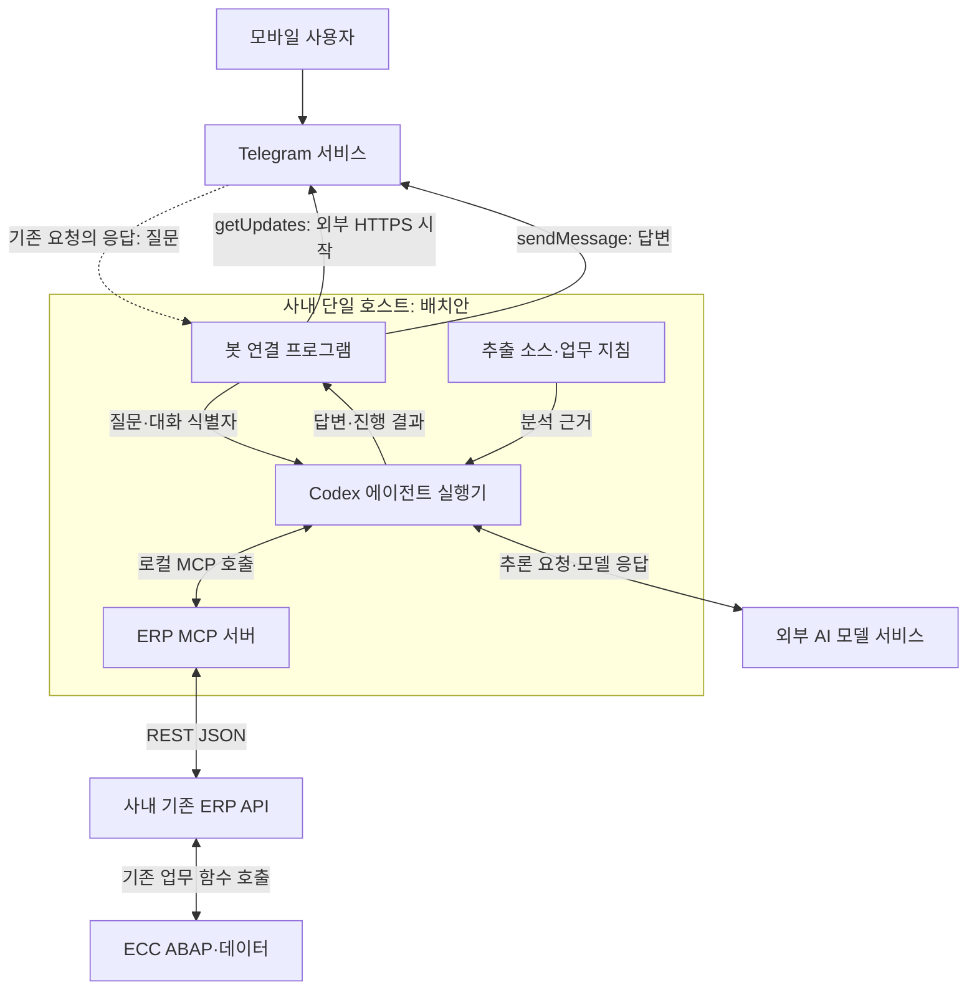

# ERP MCP 서버 구성 — 프로젝트 맥락과 설계

- 프로젝트명: ERP MCP 서버 구성
- 정리 기준일: 2026-10-08, Asia/Seoul
- 상태: 구성 설계·설명용 코드 제시 단계. 사용자 환경의 구현·검증·운영은 미확인.
- 출처 읽기: C번호와 F번호는 [대화 출처](references/대화출처_발췌.md), R번호는 [공식 문서](references/공식문서_확인목록.md)를 참조한다.

## 1. 배경·기존 문제·목표

사용자는 ECC 6.0의 RFC 호출용 함수를 JSON REST API로 외부 시스템과 연동하고 있었다. 이를 AI가 사용할 수 있게 확장하려 했지만, ‘MCP 설치’라는 표현만으로 실제 설치 대상·AI의 위치·ERP 호출 코드가 어디에 들어가는지 이해하기 어려웠다. 초기 답변은 중계 서버 구성에 집중했고, 사용자가 “AI 역할이 안 보인다”고 지적하면서 설명이 보완되었다. [C01~C04]

기존 패키지 추출 프로젝트로 만든 에이전트는 소스·구조를 읽을 수 있으나 실제 ERP 테이블 데이터를 이용하지 못했다. 목표는 소스에 있는 선정 조건·업무 로직과 허용된 실제 조회 결과를 비교해 근거 있는 분석을 하는 것이다. 모델을 ERP 데이터로 재학습시키는 작업은 이 프로젝트에 포함되지 않는다. [C05]

외부 이용 요구는 ‘회사 밖에서도 에이전트를 사용’에서 출발했다. VPN·원격 화면 제안 이후 사용자는 모바일 Telegram에서 자연어로 질문하고 답변받는 경험을 분명히 했다. 따라서 설계의 중심은 원격 데스크톱에서 메시지 연결 프로그램으로 바뀌었다. [C10~C12]

## 2. 대상 업무와 범위

| 범위 | 이 대화에서 다룬 수준 |
|---|---|
| 기존 ERP 조회 API의 MCP 도구화 | 핵심 설계 범위. 첫 실제 API는 아직 미선정 |
| ABAP·DDIC 소스와 실제 데이터의 결합 | 목표·사용 시나리오. 소스·실제 데이터 원본은 이 대화에 없음 |
| 예산 잔액·구매오더·근태·결재 조회 | 업무 도구 명칭과 활용 예시. 구현 사실 아님 |
| 모바일 Telegram 연동 | 사용자 명시 요구. long polling 방식 제안 |
| Codex를 이용한 설치·개발 자동화 | 사용자 선호. 실제 서버 설치는 수행하지 않음 |
| Codex를 에이전트 실행기로 호출 | SDK 또는 app-server로 프로그램 연동 제안 |
| 한 장비 통합 운영 | 사용자 서버 제약에 대한 배치 제안 |
| 신청·등록·취소 등 변경 업무 | 장기 고려 사항. 초기 실행 범위로 확정되지 않음 |
| MCP 내 AI 모델 학습·로컬 LLM 운영 | 요구 범위 아님. 자원 산정 전제를 설명할 때만 언급 |
| ERP 소스 Import·활성화·CTS | 별도 프로젝트와의 연결만 존재. 이 대화에서 구현하지 않음 |

## 3. 시스템 환경과 제약

### 3.1 직접 확인한 사용자 전제

- ECC 6.0를 사용하고, RFC 업무 기능을 JSON REST 방식으로 이미 외부와 연동하고 있다. [C01]
- MCP 서버는 사내망에 구축할 예정이며, 에이전트가 돌아가는 MacBook Air도 사내망에 둘 생각이다. 이는 배치 의도이지 배치 완료가 아니다. [C10]
- 모바일 Telegram 채팅 방식이 원격 화면보다 사용 의도에 맞는다. [C11]
- 사내 Telegram 접속과 개인정보 문제는 없다고 사용자가 밝혔다. 별도 승인 문서나 네트워크 실측 결과가 제공된 것은 아니다. [C13]
- 사용할 서버가 한 대라는 제약이 있다. 최종 OS·호스트명·IP·장비 구매 여부는 없다. [C13~C14]

### 3.2 배경으로만 주어진 상세

SAP_BASIS 700·Oracle DB·MacBook Air M3 16GB는 사용자 배경 요약에 나타나지만 이 대화에서 직접 시스템 정보를 읽지 않았다. ERP 커널·TLS·ICF 핸들러·RFC 인증·라이선스는 여기서 판정하지 않는다. 연결 단계에서 실제 시스템 출력과 API 명세로 보완한다. [B01]

### 3.3 설계 제약

1. 기존 REST/API 경계를 활용한다. MCP에서 임의 SQL이나 임의 RFC 이름을 받아 실행하는 방식은 초기 제안이 아니다.
2. 호출 사용자의 신원과 조회 권한은 코드로 검증한다. 모델이 생성한 사번·부서코드는 인증 근거가 아니다.
3. 사내 배치와 모델 처리 위치를 구분한다. 봇·에이전트 실행기·MCP가 로컬이어도 모델 서비스와 Telegram 통신은 외부로 나간다.
4. Telegram long polling은 허용된 아웃바운드 HTTPS가 있어야 동작한다. 방화벽 우회 기술로 해석하지 않는다.
5. 로컬 소스 버전과 조회 시스템·클라이언트를 맞춰야 소스-데이터 비교가 유효하다.

근거: C01, C05, C08~C13. 이 중 2~5의 구현은 확인되지 않았다.

## 4. 구성 요소별 역할과 연결 관계

| 구성 요소 | 담당 역할 | 담당하지 않는 일 |
|---|---|---|
| Telegram 모바일 앱·서비스 | 질문·답변 전달 | ERP 업무 계산, 권한 판단 |
| 봇 연결 프로그램 | 메시지 수신, 발신자 확인, 작업 큐·대화 연결, 답변 전송 | 자연어 의미 판단 자체 |
| Codex 에이전트 실행기 | 소스·지침 읽기, 모델과 통신, 도구 실행 흐름 관리 | 모든 API 의미·사용자 조직을 자동 획득 |
| AI 모델 | 질문 해석, 도구·인자 제안, 반환 결과 설명 | ERP 권한의 최종 판정, 임의 데이터 창작 |
| MCP 서버 | 도구 목록·설명·스키마 제공, 입력 검사, REST 호출, 결과 정규화 | AI 모델 그 자체, ERP 전용 완제품 설치 파일 |
| 기존 REST API | 기존 방식으로 ABAP/RFC 업무 기능 연결 | 모든 요청자가 같은 권한이라는 가정 |
| ECC ABAP 업무 함수 | 업무 조회·계산·검증·처리 | 모델 답변의 자연어 표현 |
| 추출 소스·업무 자료 | 프로그램 의도·필드 의미·업무 기준의 근거 | 현재 운영 데이터의 대체물 |

근거: C01~C05, C08~C13, R01~R04. 역할 표는 교육을 위한 재구성이다.

점선은 Telegram에서 맥으로 신규 접속을 개시한다는 뜻이 아니라, 봇이 시작한 HTTPS 요청의 응답이다. 이 그림은 구현 완료 구성도가 아닌 C13까지의 요구와 제안을 합친 배치안이다.

## 5. 입력 → 처리 → 출력의 흐름

### 5.1 사내에서 직접 에이전트를 사용할 때

1. 사용자가 질문한다. 예: “구매오더 4500001234의 승인 상태를 확인해줘.” 번호는 가상이다.
2. 에이전트 실행기가 MCP의 도구 설명을 모델에 제공한다.
3. 모델이 조회 도구와 인자를 제안한다. 필요한 정보가 없으면 추가 질문이나 선행 조회가 필요하다.
4. 실행기가 MCP 도구를 호출한다. MCP/API가 인자·사용자 권한을 확인한다.
5. MCP가 기존 REST API에 맞는 필드명으로 요청을 변환한다. ERP가 업무 결과를 계산한다.
6. 응답을 정규화하고, 에이전트가 근거·기준시점·조회 범위와 함께 답한다.

### 5.2 Telegram에서 질문할 때

1. 사용자가 봇과의 개인 채팅에 메시지를 보낸다.
2. 사내 연결 프로그램이 `getUpdates` 응답으로 메시지를 받는다.
3. 발신자·채팅 허용 여부를 프로그램에서 검사한다.
4. 채팅에 대응하는 에이전트 스레드로 메시지를 전달한다. 이 매핑은 별도 구현 대상이다.
5. 위 5.1의 조회·분석을 수행한다.
6. 연결 프로그램이 `sendMessage`로 답변을 전송한다.
7. 처리 식별자와 완료·실패 상태를 남긴다. 수신 확인 offset과 업무 완료 여부는 서로 다른 상태다.

1~6은 C11~C13의 흐름이다. 7의 명시적 작업 상태·중복 방지 구분은 이번 교육 보완이며 구현된 것으로 보지 않는다. Telegram의 offset은 전달 확인을 위한 값이고 업무 처리의 정확히 한 번 실행을 보장하는 장치가 아니다. [R05]

## 6. 사람·AI·프로그램의 업무 분담

| 주체 | 해야 할 일 | 판단 근거 |
|---|---|---|
| ERP 담당자 | 조회 업무 선정, API 명세 제공, 필드·금액·기간 기준 정의, 기준 결과 확인 | 실제 업무와 기존 ERP 화면·함수 |
| 구축 담당자·Codex | 프로젝트 파일 작성, 라이브러리 선택, 설치·테스트·서비스 설정 지원 | 선택 SDK 문서와 허용된 서버 권한 |
| 모델 | 자연어를 업무 도구에 연결, 결과와 소스 비교, 설명 생성 | 도구 설명·추출 자료·조회 결과 |
| 봇·에이전트 실행기 | 사용자별 스레드 연결, 작업 실행·취소·실패 전달 | 인증된 사용자 ID와 서버 상태 |
| MCP·ERP 프로그램 | 입력·권한·조회 범위 검증, 계산, 한도·오류 처리, 감사 기록 | 프로그래밍된 정책·ERP 권한 |
| 검증자 | 같은 입력을 기존 API/ERP 화면과 대조 | 원 응답·업무 기준·시험 기록 |

Codex로 MCP를 만드는 단계와, 완성된 시스템에서 Codex가 질문을 처리하는 단계는 다르다. 구축 도구로서 Codex는 작업 종료 후 꺼도 MCP 서비스가 계속 동작할 수 있다. 반대로 Telegram 요청을 Codex로 분석하려면 Codex 실행기가 요청 처리 시 가동되어야 한다. [C07, C13]

## 7. 주요 방향과 결정 이유

| ID | 내용 | 출처·이유 | 상태 |
|---|---|---|---|
| D01 | 기존 REST/RFC 재사용 | C01·C08: 이미 외부 연동이 많음 | 사용자 환경 기반의 설계 방향 |
| D02 | ECC 외부 MCP 어댑터 | C01: 프로토콜 처리를 현대 런타임으로 분리 | 답변 제안, 배포 미확인 |
| D03 | 업무 단위 도구 설명 | C03·C04: 모델이 API 용도를 이해해야 함 | 개념 정리, 실제 도구 목록 미확정 |
| D04 | 추출 코드 + 실제 조회 결과 | C05: 기존 에이전트의 실제 데이터 부재 | 사용자 확장 목표 |
| D05 | Codex로 구축 지원 | C07: 수동 설치 부담을 줄이고 싶음 | 사용자 선호 |
| D06 | Python SDK·Streamable HTTP 예시 | C02·C08·C09: 최소 구현 설명에 사용 | 예시, 최종 언어·버전 선택 아님 |
| D07 | 사내망 배치 | C10: MCP와 에이전트를 회사 안에 둘 예정 | 사용자 배치 의도 |
| D08 | 외부 접점은 모바일 채팅 | C11: VPN 화면 조작보다 Telegram 대화 희망 | 사용자 명시 요구 |
| D09 | Telegram long polling | C11·C12: 사내 장비가 먼저 연결해 메시지 수신 | 답변 제안, 송수신 검증 없음 |
| D10 | 세 기능 한 장비 배치 | C13: 서버 한 대 제약 | 실현 가능한 배치 제안 |
| D11 | 읽기 전용부터 시작 | C01·C05·C08·C13: 기능과 권한을 작게 검증 | 답변 권고, 실제 계정 미확인 |
| D12 | Mac mini 장비 검토 | C14: 상시 구동할 고정 장비 관심 | 구매 검토, 결정·도입 미확인 |

## 8. 검토 대안과 실패 경험

실제 서버 설치 실패 로그나 ERP 호출 오류 보고는 이 대화에 없다. 아래는 설계 대안과 설명 과정의 문제이며 실행 실패와 구분한다.

| 대안·초기 설명 | 검토 결과 | 근거 |
|---|---|---|
| ECC 안에 MCP 프로토콜 직접 구현 | 외부 어댑터 권고. 불가능 판정이나 실제 비교 시험은 없음 | C01 |
| 모델 도구 호출에서 REST 직접 실행 | 가능한 대안으로 설명. MCP는 재사용 가능한 연결 표준의 가치 | C03 |
| 임의 RFC 이름·SQL 실행 범용 도구 | 초기 권고에서 제외. 업무 단위 도구를 제안 | C01 |
| MCP 설치만 하면 AI가 동작 | 사용자 지적으로 개념 수정 | C03 |
| VPN + 원격 화면이 주 사용 경로 | 사용자가 Telegram 채팅 의도로 수정. 관리용 경로까지 폐기한 것은 아님 | C10·C11 |
| Telegram webhook | 외부에서 수신 가능한 HTTPS 주소가 필요. long polling을 우선 제안 | C11·C12, R05 |
| 에이전트·MCP·봇 각 전용 장비 | 필수 아님. 한 대에서 프로세스 분리 가능 | C13 |
| 고사양 GPU·로컬 모델 선행 | 현재 외부 모델 구성에 필요하지 않다는 산정 전제 | C06·C14 |
| OpenClaw 자체 설치 | 제품 선정·설치 요청 없음. 사용 방식의 비유에 그침 | C11 |

## 9. 사용자 피드백에 따른 설명·설계 변경

1. **설계도에서 설치 대상으로:** 사용자는 “어떻게 시작하는지도 의문”이라고 했고 Python·SDK·파일·프로세스 수준의 설명으로 내려갔다. [C02]
2. **중계 서버만 설명한 한계 수정:** AI가 빠졌다는 지적 후 모델의 도구 선택과 애플리케이션의 실제 실행을 분리했다. [C03]
3. **소스 분석에서 실데이터 분석으로:** 기존 에이전트의 데이터 접근 부재가 명확해져 MCP의 활용 목적이 구체화되었다. [C05]
4. **수동 설치에서 Codex 작업 위임으로:** 사용자는 설치 번거로움을 제기했고 Codex에 환경 구성·코드·검증을 맡기는 방향을 논의했다. [C07]
5. **수신 HTTP와 송신 REST 구분:** Streamable HTTP 질문을 계기로 MCP 서버 포트와 ERP HTTP 클라이언트의 방향을 명확히 했다. [C09]
6. **원격 화면에서 메시지 기반 작업으로:** Telegram/OpenClaw식 사용을 명시하여 봇 연결 프로그램이 추가되었다. [C11]
7. **네트워크 제약 해소를 사용자 전제로 반영:** 사용자가 접속·개인정보 문제 없음을 밝혔다. 이후 이를 반복적인 도입 불가 사유로 취급하지 않되, 실제 Bot API 테스트를 완료했다고 표기하지 않는다. [C13]
8. **분리 장비에서 단일 장비로:** 한 서버에서의 자원·프로세스·상시 운영을 설명하고 Mac mini 선택지로 이어졌다. [C13·C14]

## 10. 현재 방안과 과거 방안의 관계

현재 작업 가설은 **사내 단일 호스트에 Telegram 연결 프로그램 + Codex 실행기 + ERP MCP 프로그램을 두고, 기존 ERP REST API를 호출하는 것**이다. 호스트 OS는 Linux 또는 macOS, MCP 언어는 Python 예제가 있으나 미확정이다.

초기 Linux VM 권고가 이후 Mac mini 질문으로 자동 취소된 것도, Mac mini가 구매 확정된 것도 아니다. 2 vCPU/4GB/40GB 및 4 vCPU/8GB/80GB는 예산 산정용 제안이고 M6/24GB/512GB는 구매 검토용 제안이다. 서로 다른 배치 가정의 값으로 읽어야 한다. [C06·C13·C14]

별도 프로젝트의 `ERP_MCP_NodeJS_Example.zip`은 검색된 수정시각이 이 대화의 Python 예제보다 늦지만, 생성 시점·내부 버전은 확인하지 않았다. **수정시각이 더 늦다는 이유만으로 Python이 폐기되었다고 단정할 수 없다.** 해당 파일 내용을 통합 단계에서 읽고, API 계약·MCP 역할·에이전트 호출 책임·최종 런타임을 비교해야 한다. [F01]

## 11. 주요 파일·설정과 최신 여부

| 이름·설정 | 출처·성격 | 최신 여부·현재 증거 |
|---|---|---|
| `server.py` | C02 최소 MCP, C08 ERP 호출 예시의 파일명 | 같은 이름의 설명 예시. 사용자 파일 원본·최신본 없음 |
| `check_connection`, `add_numbers` | C02 시험 도구 | MCP 자체 테스트용. ERP 연결 성공 확인 함수 아님 |
| `get_purchase_order_status` | C08 가상 도구 | 실제 API 명세에 연결되지 않은 예시 |
| `ERP_API_URL`, `ERP_API_TOKEN` | C08 환경변수 예시 | 설정 방식 제안. Bearer 인증 실제 사용 여부 미확인 |
| `TELEGRAM_BOT_TOKEN` | C12 환경변수 예시 | 실제 값·발급 사실 미확인. 이 문서에 인증값 없음 |
| `.venv`, `~/erp-mcp` | C02 개발 폴더 예시 | 실재 서버 경로 아님 |
| `systemd`, `launchd` 서비스 | C07·C13 자동 실행 제안 | 서비스 파일·설치 결과 없음 |
| Codex SDK 스레드 매핑 | C11 연동 제안 | Desktop 세션과의 동기화·이관 미구현 |
| `ERP_MCP_NodeJS_Example.zip` | F01 타 프로젝트 메타데이터 | 내용·최신성·검증 상태 미확인 |

현재 ZIP의 예시 파일은 이름 충돌을 피하도록 `.example.json` 또는 목적이 드러나는 파일명을 사용했다. 운영 환경 설정으로 착각하지 않도록 한다.

## 12. 완료·진행 중·미착수·미확인 항목

| 항목 | 상태 | 근거 |
|---|---|---|
| 목적·역할·연결 구조 설명 | 완료: 대화와 교육 정리 범위 | C01~C13 |
| 초기 코드·명령 예시 제시 | 완료: 예시 제시만 | C02·C08·C12 |
| 요구 구체화 | 진행: 설계 논의에서 일관된 방향 확인 | C10~C14 |
| 서버 설치·의존성 확정 | 미확인 | 설치 로그·버전 목록 없음 |
| 실제 ERP API 선정·권한 계약 | 미확인 | 명세 미제공 |
| MCP 기능·AI 연동 구현 | 미확인 | 코드 저장소·실행 결과 없음 |
| Telegram 봇·Codex 연결 | 미확인 | 수신 예시에 AI 호출 부분 없음 |
| 변경형 ERP 도구 | 이 추출의 실습 범위에서 미착수 | 개발·반영 결과 없음 |
| 외부 채팅 종단 간 테스트 | 미확인 | 실제 응답·원 ERP 대조 기록 없음 |
| Mac mini 구매·배치 | 미확인 | 질문·추천 이후 구매 보고 없음 |
| 본 교육 자료 추출·검증 | 완료 | 이번 생성 파일과 ZIP 구조 검사 |
| 웹사이트·GitHub push·서버 설치 | 이번 요청에서 미착수 | C15의 명시적 제외 |

‘미확인’은 사용자가 다른 곳에서도 아무것도 하지 않았다는 뜻이 아니다. 현재 확인 범위에 증거가 없다는 뜻이다.

## 13. 확인한 기술 사실과 남은 검증

### 13.1 확인한 것

- 현재 대화의 요구 변화·코드 제시·사용자 전제를 직접 확인했다. [C01~C15]
- MCP 공식 SDK의 도구 등록, SDK의 HTTP 실행 방식, Codex의 프로그램 호출·스레드 유지, Telegram long polling의 문서상 동작을 대조했다. [R01~R06]
- 본 추출의 MD 링크·JSON 구문·ZIP 파일 포함 관계를 검사했다. 이 검사 결과는 ERP 검증과 구분한다.

### 13.2 아직 필요한 것

| 검증 | 성공 근거 |
|---|---|
| 런타임 호환 | OS·Python/Node·SDK 실제 버전, 설치 성공 로그 |
| MCP 자체 | 도구 목록에 시험 도구가 나타나고 지정 인자로 정확한 결과 반환 |
| REST 계약 | 동일 입력으로 기존 API 직접 호출 결과와 MCP 결과의 필드·단위 일치 |
| ERP 권한 | 허용 사용자 성공·비허용 사용자 거부, 공통 계정 뒤의 실제 사용자 추적 |
| 모델의 도구 선택 | 질문→선택 도구→인자→조회 증거를 남김 |
| Telegram | 허용 개인 채팅의 왕복과 비허용 발신자 거부 |
| 대화 연속성 | 후속 질문이 같은 사용자·업무 범위의 스레드로 연결 |
| 부하 | ERP 동시 호출·응답 크기 제한 적용, 지연·오류율 측정 |
| 상시 운영 | 로그아웃·재시작·절전·장애 후 서비스 복구 결과 |

## 14. 주요 혼동·오류와 조치 상태

| 증상·질문 | 원인 또는 구분 | 조치 | 해결 수준 |
|---|---|---|---|
| MCP에서 AI가 보이지 않음 | 초기 설명이 어댑터 구현에 집중 | 모델·실행기·MCP 역할 분리 | 설명 보완, 기능 구현 아님 |
| 어떤 MCP를 설치하는지 불명확 | 규약·SDK·전용 프로그램을 혼용 | 공식 SDK로 ERP 어댑터를 작성한다고 명확화 | 설명 보완 |
| Streamable HTTP가 ERP POST 기능인지 혼동 | 인바운드 MCP와 아웃바운드 REST 혼합 | 통신 방향을 두 구간으로 구분 | 설명 보완 |
| long polling이면 모든 망에서 통신 가능하다고 이해 | 요청 응답과 새 인바운드 연결 혼동 | 허용된 외부 HTTPS가 필수임을 명시 | 설명 보완, Bot API 접속 실측 없음 |
| 모바일 사용을 원격 화면으로 제안 | ‘외부에서 이용’ 요구 해석 부족 | Telegram 대화 연결로 변경 | 요구 정정 반영 |
| 코드가 있으니 구현 완료라고 오인 가능 | 예시 생성과 실행 검증 혼동 | 전 예시를 미검증으로 표시 | 이번 교육 추출에서 상태 보정 |

실제 TLS 오류, HTTP 상태 오류, SAP 덤프, Telegram 인증 실패는 이 대화에서 관측되지 않았다. 다른 프로젝트의 오류를 이 표에 실제 사건처럼 추가하지 않는다.

## 15. 다른 프로젝트와의 입출력·의존관계

| 연결 프로젝트 | 이쪽에 필요한 입력 | 이쪽이 제공할 출력 | 통합 시 확인 |
|---|---|---|---|
| 패키지 Export·Git 관리 | 시스템·클라이언트·추출시각·소스 커밋과 소스/구조 자료 | 소스와 조회 데이터 대조 근거 | 실제 추출·배포 버전, 시스템 불일치 |
| 업무 지식·스킬 | 필드 의미·업무 기준·조회 권한·판단 지침 | 실데이터에 근거한 질문 응답 | 지식의 유효 시점, 코드와 규정 충돌 |
| 업무별 에이전트 협업 | 담당 범위·선택 규칙·각 에이전트 실행 인터페이스 | 공용 ERP 조회 도구 | MCP 자체와 조정 에이전트의 역할 구분 |
| Node.js MCP 예제 프로젝트 | F01 원본 ZIP·README·의존성·시험 로그 | 이 대화의 요구·제약·방향 기록 | Python 예제와의 계약 호환·역할 중복 |
| 교육 포털 | 전체 목차·콘텐츠 규칙·정적 배포 방식 | 본 MD와 예시·캡처 요청 목록 | 교육 웹서버가 ERP MCP 운영 서버와 같다고 가정하지 않음 |

이 파일은 다른 프로젝트의 최신 코드나 아키텍처를 대신 정의하지 않는다. 통합 담당자는 해당 원본과 이 문서의 C/F 출처를 함께 대조한다.

## 16. 핵심 출처 연결

- 기존 REST·MCP 설계: [C01~C04](references/대화출처_발췌.md).
- 코드와 실제 데이터 결합: [C05](references/대화출처_발췌.md).
- 설치·자원·Codex 위임: [C02·C06~C09](references/대화출처_발췌.md).
- Telegram·네트워크·한 대 배치: [C10~C13](references/대화출처_발췌.md).
- 장비 검토: [C14](references/대화출처_발췌.md). 구매·제품 최신성은 미확인.
- 타 프로젝트 파일: [F01](references/대화출처_발췌.md). 메타데이터만 확인.
- SDK·통신 규약의 기술 근거: [R01~R06](references/공식문서_확인목록.md).
