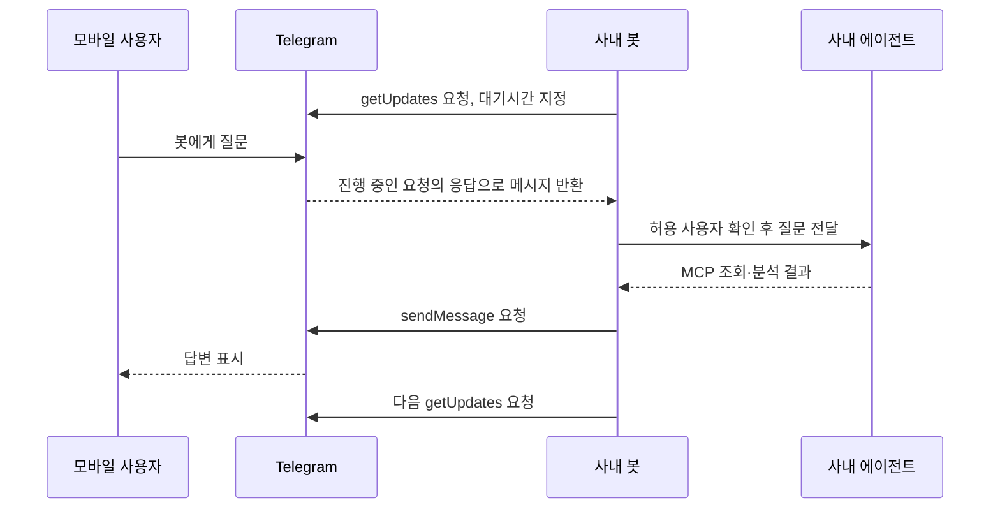

# ERP MCP 서버 구성 — 교육과 실습 초안

- 프로젝트명: ERP MCP 서버 구성
- 정리 기준일: 2026-10-08, Asia/Seoul
- 교육 상태: 대화에 제시된 설계·예시를 학습 순서로 재구성. 회사 환경에서 재현되지 않은 절차 포함.
- 출처: [대화 근거 C01~C15](references/대화출처_발췌.md), [기술 근거 R01~R06](references/공식문서_확인목록.md).
- 코드 표시: 아래 코드는 교육용 예시이며 실제 운영 파일을 추출한 것이 아니다. 자동 설치나 ERP 변경을 이 문서 작성 과정에서 실행하지 않았다.

## 1. 교육 대상과 학습 목표

### 1.1 대상과 사전 지식

KBS ERP 담당자 중 ABAP 함수·RFC·JSON REST 연동을 이해하고, 터미널에서 폴더 이동과 프로그램 실행을 할 수 있는 사람을 대상으로 한다. MCP·AI 에이전트·Telegram Bot 경험은 필수가 아니다. Python 문법은 예제의 입력·HTTP 호출·결과 반환을 읽을 수 있으면 된다.

이 프로젝트에서 사용한 Python은 설명 예제의 선택이다. 통합 프로젝트가 Node.js로 확정되어 있다면 아래 개념·API 계약·검증 기준을 유지하면서 구현 예제를 그쪽으로 통일해야 한다. 기존 Node.js ZIP의 내용은 이번에 읽지 않았다. [F01]

### 1.2 학습 후 할 수 있는 일

- MCP SDK, ERP 전용 프로그램, 에이전트, 모델의 역할을 구별한다.
- 기존 REST API 하나를 MCP 업무 도구로 정의한다.
- MCP 서버가 받는 통신과 ERP로 보내는 통신을 구별한다.
- 추출 소스 분석과 실제 데이터 조회를 연결해 근거를 제시한다.
- long polling의 네트워크 방향을 설명한다.
- 예시 생성·문서 대조·현장 테스트·운영 완료를 구별해 기록한다.

## 2. 전체 ERP AI 구조에서의 위치

패키지 추출 프로젝트는 소스와 구조라는 ‘정적 근거’를 제공한다. 이 MCP 프로젝트는 허용된 업무 데이터와 상태라는 ‘조회 근거’를 제공한다. 에이전트는 둘을 함께 읽어 답변한다. Telegram은 질문과 결과를 전달하는 사용자 화면이다.

교육 포털의 Node.js 웹서버는 교육용 HTML·CSS·JavaScript를 제공한다. ERP MCP 서버는 도구 호출을 받고 ERP API를 실행한다. 둘 다 HTTP를 사용할 수 있지만 서비스 목적이 다르다. 이번에는 포털 웹서버도 구현하지 않는다. [C05·C15]

## 3. 학습 모듈 A — 왜 MCP가 필요한가

### 3.1 실제 문제

사용자는 “기존 에이전트가 ERP 테이블 데이터를 학습하거나 이용하지 못했다”고 했다. 소스만 보면 특정 조건에서 대상자가 제외될 수 있다는 설명은 가능하지만, 그 직원의 실제 값이 어떤지는 확인할 수 없다. [C05]

MCP 도구를 연결하면 에이전트가 허용된 조회를 요청할 수 있다. 이는 조회 결과를 현재 작업 문맥에 사용하는 것이며 모델 자체의 학습을 의미하지 않는다. 모델이 데이터 접근 권한을 갖는 방식도 자연어 약속이 아니라 서버 프로그램의 검증에 달려 있다.

### 3.2 핵심 용어

| 용어 | 이 프로젝트에서의 의미 | 혼동 금지 |
|---|---|---|
| AI 모델 | 질문 해석·도구 선택·설명을 생성 | MCP 프로그램 내부에 자동 설치되는 것이 아님 |
| 에이전트 실행기 | 모델·파일·도구 호출의 작업 흐름을 수행 | MD 파일 한 개만으로 완성되는 서비스가 아님 |
| MCP | 도구 발견·호출을 위한 공통 규약 | ERP 제품명·LLM 이름 아님 |
| MCP SDK | 그 규약을 구현하는 개발 라이브러리 | ERP 업무 API를 알아서 만들어주지 않음 |
| MCP 도구 | 목적·입력·출력 의미가 정의된 호출 기능 | 반드시 RFC 하나와 1:1일 필요 없음 |
| REST 어댑터 | MCP 인자를 기존 API 계약으로 변환하는 코드 | SAP RFC 프로토콜 직접 연결과 구별 |
| Streamable HTTP | 원격 MCP 클라이언트의 요청을 받는 전송 방식 | ERP API로 보내는 POST 자체를 뜻하지 않음 |
| stdio | 같은 장비의 프로세스 간 표준입출력 전송 | 별도 인터넷 포트를 필요로 하지 않는 선택지 |
| long polling | 봇이 외부에 요청하고 메시지가 오면 응답받는 방식 | 방화벽 차단을 무시하거나 망을 통합하지 않음 |
| webhook | 외부 서비스가 지정된 URL로 메시지를 보내는 방식 | 현재 long polling 제안과 별도 경로 |
| 대화 스레드 | 에이전트의 후속 질문 문맥을 유지하는 단위 | Telegram 채팅 ID와 자동으로 같아지지 않음 |

근거: C03·C04·C08~C12, R01~R06.

## 4. 학습 모듈 B — 도구 설명과 실제 REST 호출

### 4.1 도구 설명의 역할

`Z_FM_001 실행`이라는 설명만으로는 모델이 용도를 판단하기 어렵다. ‘구매오더 번호를 입력받아 승인 상태를 조회’처럼 업무 목적을 설명하고, 필수 인자·허용값·결과 상태의 의미를 함께 정의한다. 모델은 이 정보를 근거로 도구를 선택한다. [C04·C08]

| 설계 항목 | 가상 교육 예시 |
|---|---|
| 도구 이름 | `get_purchase_order_status` |
| 설명 | 구매오더 번호로 현재 승인 상태 조회 |
| 입력 | `purchase_order`: 이 실습 계약에서 숫자 10자리로 제한 |
| 기존 API 필드 | `EBELN` |
| 결과 | `purchase_order`, `status` |
| 계약 주의 | 실제 KBS 번호 형식·상태 코드·URL은 별도 확인 |

도구 이름·10자리 검증·Bearer 인증은 대화의 가상 예제다. 실제 SAP 전체 객체에 그대로 적용하는 규칙이 아니다. 특히 ‘APPROVED’가 실제 API 응답 코드라는 증거는 없다.

### 4.2 호출이 일어나는 두 구간

| 구간 | 요청을 보내는 주체 | 받는 주체 | 구현 책임 |
|---|---|---|---|
| 에이전트 → MCP | 에이전트의 MCP 클라이언트 | MCP SDK HTTP 서버 | 도구 규약·입력 처리 |
| MCP → ERP REST | MCP 프로그램의 HTTP 클라이언트 | 기존 사내 REST API | URL·인증·JSON 매핑 |

별도 Apache/Nginx 없이 SDK가 HTTP 서버를 실행할 수 있다는 설명은 첫 번째 구간에 관한 것이다. ERP API를 호출하려면 두 번째 구간의 코드와 실제 명세가 있어야 한다. 일반 브라우저에서 `/mcp`를 열어 화면이 안 나온다는 이유만으로 MCP 장애라고 판단하지 않는다. [C09, R01·R02]

## 5. 학습 모듈 C — Telegram long polling

### 5.1 메시지가 사내로 들어오는 원리



요청이 열린 동안 메시지가 도착하면 대기시간이 끝날 때까지 무조건 기다리는 것이 아니라 응답이 돌아올 수 있다. 응답을 받은 후 다음 요청을 반복한다. 따라서 ‘몇십 초마다 무조건 한 번씩만 확인한다’는 설명과도 다르다. [R05]

위 그림은 질문 한 건의 논리적 순서다. 오래 걸리는 AI 작업 동안 실제 수신 루프까지 멈추게 구현하라는 뜻은 아니다. 수신과 작업 실행의 분리는 §8.7에서 다룬다.

### 5.2 이 프로젝트에서의 전제

사용자는 사내 Telegram 접속과 개인정보 문제가 없다고 밝혔다. 이를 프로젝트 전제로 기록한다. 다만 일반 앱 접속과 실제 서버의 `api.telegram.org` 호출, 프록시·인증·장시간 요청 유지 여부는 기술적으로 각각 확인해야 한다. [C13]

외부 인바운드 포트는 이 long polling 구성에 필요하지 않다. 봇이 시작한 HTTPS 요청과 그 응답은 필요하다. Codex 모델 서비스 접속도 별도의 외부 통신이다. [C12·C13]

## 6. 학습 모듈 D — 한 서버와 에이전트 연결

### 6.1 한 장비에서 역할 분리

- 봇 연결 프로그램: 상시 실행하여 메시지 수신·응답 전송.
- ERP MCP 프로그램: 상시 실행하거나 선택한 로컬 전송 방식의 수명주기로 실행.
- Codex 실행기: 질문에 따라 작업 실행, 대화 상태 유지.

이 프로젝트의 HTTP 배치안에서는 MCP를 `127.0.0.1`에 연결하는 방식을 우선 시험할 수 있다. 팀원이 다른 장비에서 직접 MCP에 접속할 때에는 접속 주소·인증·네트워크 정책이 달라진다. 같은 서버라는 이유로 사용자 권한이 자동 분리되는 것은 아니다. [C13]

### 6.2 Desktop 대화와 봇 대화의 관계

SDK를 통해 Codex에 질문을 보낼 수 있지만 기존 Desktop의 열린 대화창이 자동으로 Telegram에 이어지는 것은 아니다. 프로젝트 경로·읽을 지침·MCP 설정·사용자별 스레드 연결을 선택하고 구성해야 한다. 같은 스레드에서 후속 작업을 이어갈 수 있다는 문서 기능과, Desktop·Telegram 간 전체 세션 동기화를 구현했다는 주장은 다르다. [C11, R03]

## 7. 사례 학습 — 실제 논의와 가상 업무 예시

### 7.1 실제 사례: 요구 해석의 수정

| 단계 | 실제 대화 내용 |
|---|---|
| 문제 | 사용자가 회사 밖에서도 에이전트를 쓰고 싶다고 질문 |
| 입력 | 사내 MCP와 사내 MacBook Air 배치 계획 |
| 작업 | 처음에는 VPN·원격 화면 권고 |
| 사용자 수정 | 모바일 Telegram 채팅, OpenClaw 같은 사용 경험을 원한다고 명시 |
| 결과 | 메시지 연결 프로그램·long polling·프로그램 방식의 Codex 호출 제안 |
| 검증 | 사용자 요구 수정은 직접 확인. 실제 Telegram 동작은 미검증 |

근거: C10~C12. 이 사례의 학습 목표는 ‘외부 이용’이라는 말에서 원격 화면과 대화 인터페이스를 구분하는 것이다.

### 7.2 가상 사례: 근태 배치 누락 진단

| 단계 | 교육용 시나리오 |
|---|---|
| 문제 | 특정 직원이 등급 자동 생성 대상에서 제외된 이유를 모름 |
| 입력 | 추출 소스 버전, 기준일, 권한이 있는 시험 직원 식별자 |
| 작업 | 소스 선정 조건 확인 → MCP로 필요한 값만 조회 → 조건별 비교 |
| 예상 결과 | 어떤 조건에 해당/미해당인지 근거와 함께 설명 |
| 검증 | 동일 시스템·기준일의 ERP 조회 결과와 비교, 소스 버전 확인 |

근거: C05의 설명 예시. 실제 직원 데이터·프로그램 실행·제외 원인이 확인된 사례가 아니다. 이 문서를 근로시간 제도나 HR 배치 상세 업무의 권위 원본으로 사용하지 않는다.

## 8. 따라 하기 실습

### 8.1 준비물·선행 조건

- 시험용 Linux 또는 Mac과 터미널. 기존 운영 서비스와 구별된 작업 폴더.
- 선택한 SDK가 지원하는 Python 버전. 이전 대화는 Python 3.10 이상, MCP SDK 2.x 예시를 사용했다. 설치 시 실제 요구 버전을 다시 확인한다. [C02, R02]
- 가상 JSON API 계약. [실습 계약 파일](examples/erp_readonly_contract.example.json).
- 실제 API 단계에서는 담당자가 제공한 개발계 URL·인증·조회 조건·정상/오류 응답.
- Telegram 단계에서는 교육용 봇과 허용 발신자 ID. 비밀값은 문서·Git·화면 캡처에 넣지 않는다.
- AI 연동 단계에서는 조직에서 허용된 Codex 인증 방식·MCP 설정·모델 접속 경로.

**아래 절차는 문서화된 미검증 실습안이다. 지금 자료 추출 과정에서 설치·접속·메시지 발송을 하지 않았다.** 모의 단계는 ERP 변경이 없으며, 실제 API가 없다면 ERP 측 개발·권한 검토가 별도로 필요하다. 운영 ERP 변경은 이 실습의 범위에 포함하지 않는다.

### 8.2 실습 1 — AI 없이 MCP 호출 이해

목적: 프로토콜 연결과 AI 판단을 분리해서 확인한다. [C02·C03]

새 시험 폴더에서 다음 명령을 실행하는 형태로 준비한다.

```bash
mkdir erp-mcp-lab
cd erp-mcp-lab
python3 -m venv .venv
source .venv/bin/activate
python -m pip install 'mcp[cli]>=2,<3'
```

이 메이저 범위는 과거 대화의 2.x 예제를 재현하기 위한 것이다. 최초 성공 후 실제 버전을 기록해야 하며, 기존 프로젝트의 의존성을 무조건 업그레이드하지 않는다.

`server.py`에 아래 핵심 예제를 작성한다. 대화의 `add_numbers` 예시를 재구성한 것으로 ERP 연결은 없다.

```python
from mcp.server import MCPServer

mcp = MCPServer("ERP-MCP-LAB")

@mcp.tool()
def add_numbers(a: int, b: int) -> int:
    """MCP 통신 시험용으로 두 정수를 더합니다. ERP는 조회하지 않습니다."""
    return a + b
```

```bash
mcp run server.py --transport streamable-http
```

별도 터미널에서 동일 가상환경을 활성화한 뒤, 다음 코드를 `client.py`로 실행한다.

```python
import asyncio
from mcp import Client

async def main():
    async with Client("http://127.0.0.1:8000/mcp") as client:
        result = await client.call_tool("add_numbers", {"a": 10, "b": 20})
        print(result.structured_content)

asyncio.run(main())
```

```bash
python client.py
```

예상: 예시 SDK에서는 `{'result': 30}` 형태. 실제 출력·패키지 버전·실행 시각을 기록한다. 이 결과는 **MCP 왕복만** 입증하고 AI 판단·ERP 접속·Telegram 연결을 입증하지 않는다. API 형태는 R02와 대조했지만 이 추출에서 실행하지 않았다.

### 8.3 실습 2 — 업무 도구와 모의 REST 계약

목적: 실제 API를 호출하기 전에 이름과 필드 대응을 검증한다. [C08]

1. [가상 API 계약](examples/erp_readonly_contract.example.json)을 읽는다. 주소는 실제 서버가 아닌 `.invalid` 대체 도메인이다.
2. 구매오더 도구의 입력 `purchase_order`를 API의 `EBELN`으로 매핑한다.
3. 모의 HTTP 응답을 반환하는 테스트 대역을 사용한다. 이 단계에서 ERP 주소나 운영 자격증명은 필요하지 않다.
4. 응답 `EBELN`·`STATUS`를 도구 결과의 `purchase_order`·`status`로 정규화한다.
5. 값 누락·잘못된 JSON·HTTP 실패를 성공 결과와 구분한다.

핵심 연결 코드 형태는 다음과 같다. `client`, `endpoint`, `headers`는 실제 어댑터에서 공급할 값이다.

```python
# 부분 예시: 이 코드만으로 실행되는 프로그램은 아닙니다.
response = await client.post(
    endpoint,
    headers=headers,
    json={"EBELN": purchase_order},
)
response.raise_for_status()
data = response.json()
```

예상: 모의 응답과 정규화 결과가 일치. HTTP 200이어도 본문에 업무 오류가 들어오는 API라면 본문의 오류 계약을 별도로 판독해야 한다. 이는 이번 실습 보완 사항이며 실제 KBS 오류 형식은 제공되지 않았다.

### 8.4 실습 3 — 개발계 REST API 연결

목적: ERP 자체 업무 결과와 도구 결과를 대조한다. [C01·C08]

선행 조건은 URL·HTTP 메서드·인증·요청/응답·사용자 권한이 명시된 API 한 건이다. Bearer 토큰이 실제 방식이라고 가정하지 않는다. API가 이미 있으면 소비자 측 연결 시험이고, 없거나 권한 보완이 필요하면 ERP 측 개발 작업으로 분리한다.

1. 기존 수단으로 같은 시험 입력의 API 응답과 ERP 기준 결과를 확보한다.
2. 어댑터를 실제 명세로 매핑하고 자격증명을 보호된 실행 환경에 설정한다.
3. MCP를 통해 같은 입력을 호출한다.
4. 주요 키·상태·금액·단위·기준시점을 대조한다.
5. 데이터 없음, 권한 없음, API 실패를 서로 다른 결과로 확인한다.

예상: 같은 입력에 대해 동일한 업무 결과. 접근 로그의 사용자·도구·조회 범위·시각을 추적할 수 있어야 한다. 테스트 데이터를 읽는 권한만으로 시작하고 운영 데이터 쓰기·확정·활성화를 이 절차에 추가하지 않는다.

### 8.5 실습 4 — Codex가 도구를 선택하게 연결

목적: API가 동작하는 것과 자연어 질문에서 올바른 API를 선택하는 것을 따로 검증한다. [C03·C04·C11]

1. 에이전트가 읽을 소스 폴더·지침과 사용할 MCP 서버를 설정한다.
2. “시험 구매오더 4500001234의 승인 상태를 확인해줘”라는 가상 질문을 준다.
3. 선택한 도구명·인자와 ERP 반환 결과를 확인한다.
4. “그 상태가 무슨 뜻이야?”라는 후속 질문을 같은 스레드에서 실행한다.
5. 기준에 없는 상태를 모델이 임의 해석하지 않는지 확인한다.

SDK 연동은 `질문 → 에이전트 스레드 실행 → 결과`의 흐름이다. R03의 스레드 재사용 기능은 참고하되 Desktop 대화창 자동 공유 기능으로 설명하지 않는다. 인증 방식·사용 한도·과금은 실제 조직 계정과 선택한 호출 방식에서 확인해야 하며 여기서 확정하지 않는다.

예상: 실행 기록에 올바른 도구 선택과 실제 결과 근거가 남는다. 단지 자연어 답변이 그럴듯하다는 이유로 성공으로 기록하지 않는다.

### 8.6 실습 5 — Telegram 수신·응답부터 시험

목적: 에이전트 연결 이전에 채널 왕복을 분리 검증한다. [C12]

```bash
python -m pip install python-telegram-bot
```

BotFather에서 교육용 봇을 만든 뒤 토큰을 보호된 환경변수 `TELEGRAM_BOT_TOKEN`에 설정한다. 교육용 개인 계정의 숫자 사용자 ID도 `TELEGRAM_ALLOWED_USER_ID`에 미리 설정한다. 이름·닉네임으로 허용 여부를 판정하지 않는다. ID 확보 절차는 담당자의 테스트 계정 확인 방식에 따르며, ERP 연결 전 확인해야 한다.

대화의 최소 수신 예시에 **허용 사용자·개인 채팅 검사만 교육 보완**한 형태다. 운영용 봇 전체 구현은 아니다.

```python
import os
from telegram.ext import Application, MessageHandler, filters

allowed_id = int(os.environ["TELEGRAM_ALLOWED_USER_ID"])

async def on_message(update, context):
    if not update.effective_user or not update.effective_chat:
        return
    if update.effective_chat.type != "private":
        return
    if update.effective_user.id != allowed_id:
        return
    await update.message.reply_text("교육용 수신 확인: ERP와 AI는 호출하지 않았습니다.")

app = Application.builder().token(os.environ["TELEGRAM_BOT_TOKEN"]).build()
app.add_handler(MessageHandler(filters.TEXT & ~filters.COMMAND, on_message))
app.run_polling(allowed_updates=["message"])
```

예상: `/start` 같은 명령이 아닌 일반 문장을 개인 채팅으로 보내면 수신 확인이 온다. 비허용 계정·그룹에서는 응답하지 않는다. 비허용 메시지가 에이전트에도 전달되지 않는지 로그로 확인한다. 같은 봇 토큰으로 여러 수신 프로세스를 실행하거나 기존 webhook과 혼용하지 않는다. [R05·R06]

여기까지는 고정 답변 봇이다. 수신 확인 문장을 AI 답변이라고 소개하지 않는다. 당시 대화 원본 예시에는 위 ID 검사도 없었다는 점을 함께 가르친다.

### 8.7 실습 6 — 봇과 에이전트, MCP를 연결

이 단계는 후속 구현이 필요하며 본 ZIP에 완성된 연결 프로그램은 없다.

1. Telegram 사용자·개인 채팅을 승인된 에이전트 스레드에 매핑한다.
2. 질문을 접수하고 장시간 작업은 수신 루프와 분리된 큐에서 처리한다.
3. 에이전트를 호출해 MCP 도구를 실행한다.
4. 진행·완료·실패 상태를 처리 식별자로 연결한다.
5. 답변이 길면 Telegram 제한에 맞춰 분할하거나 승인된 결과 경로를 안내한다.
6. 동일 업데이트 재수신·재시작 시 중복 업무 실행을 방지한다.
7. 앞 절의 원 API 대조 결과와 최종 채팅 답변을 함께 기록한다.

1·3·4는 C11~C13을 구체화한 내용이고, 큐·분할·중복 방지의 세부 검증은 이번 교육 보완이다. `getUpdates` offset을 이동했다고 에이전트 작업이 성공한 것은 아니다. 긴 작업 중 polling을 멈추지 않는 실행 방식과 실패 복구 정책을 결정해야 한다.

### 8.8 구축을 Codex에 맡기는 프롬프트

복사용 완성 문안은 [codex_build_request.txt](examples/codex_build_request.txt)에 있다. 핵심은 “MCP 설치”만 지시하지 않고, 기존 REST 명세·도구 목적·모의/실제 시험 단계·상시 실행 여부를 명시하는 것이다. 이 문안은 이번 추출에서 작성한 후속 작업용이며 지금 실행한 명령이 아니다.

### 8.9 검증 기록

[validation_record.example.json](examples/validation_record.example.json)의 `NOT_RUN`을 그대로 유지한 채 시작하고, 실제 근거가 있을 때만 상태를 바꾼다. 설치 성공, MCP 성공, ERP 결과 일치, AI 도구 선택, Telegram 왕복, 재시작 복구를 별도 항목으로 남긴다. 토큰·개인정보가 포함된 원 로그는 이 교육 저장소에 넣지 않는다.

## 9. 자주 하는 실수와 확인 방법

아래는 예상되는 실습 문제다. 이 프로젝트에서 실제 발생·해결한 장애 목록이 아니다.

| 증상 | 우선 확인 | 조치 방향 |
|---|---|---|
| `MCPServer` import 실패 | Python·SDK 실제 버전·활성 가상환경 | 선택 버전 문서에 맞춤. v1/v2 예제 혼합 금지 |
| `/mcp`를 브라우저로 열어 오류 표시 | 일반 HTML 화면을 기대했는지 | MCP 클라이언트로 도구 호출 검증 |
| 다른 PC에서 MCP 접속 안 됨 | localhost 바인딩·방화벽·접속 주소 | 단일 호스트용과 사내 공유용 구성을 구별 |
| HTTP 성공인데 업무 결과가 틀림 | API 본문 업무 오류·단위·조회 시스템 | 기존 API 결과와 필드별 대조 |
| AI가 엉뚱한 도구 선택 | 설명·필수 인자·업무 명칭 중복 | 모호한 질문 사례로 도구 설명 개선 |
| 봇이 응답 안 함 | 프로세스·토큰·API 접속·프록시·webhook | 채널 왕복을 AI와 분리해 진단 |
| 질문마다 문맥 소실 | 채팅-스레드 매핑 | 같은 대화에서 재개하는 방식 구현 |
| 같은 업무가 재실행 | update 식별자·작업 상태·재시도 정책 | 메시지 수신과 업무 완료를 따로 기록 |
| 로그아웃·재부팅 후 중단 | OS 서비스·실행 계정·자격증명·잠금 상태 | 재시작 시험 후 운영 여부 판단 |

## 10. 운영 중 갱신·유지보수

이 절은 운영 전환 시 적용할 교육 보완이며, 현재 운영 중이라는 뜻이 아니다.

- API 변경 시 계약 예시·도구 설명·매핑·기준 응답을 같은 변경 단위로 갱신한다.
- 소스 갱신 시 원 시스템·추출시각·커밋을 기록하고 조회 데이터의 기준시점과 비교한다.
- 한 서버에서 봇과 MCP의 서비스·로그를 나누고 실패 위치를 식별한다.
- 모델·SDK 변경 후에는 대표 질문의 도구 선택과 결과 해석을 재검증한다.
- 현재 대화의 4 vCPU/8GB/80GB·동시 호출 3~5개는 시작 제안값이다. CPU·메모리·ERP 지연을 측정하고 조정한다.
- Mac에서는 서비스가 부팅 단계에 실행되는지, 사용자 로그인에 의존하는지 구분한다. 절전·재부팅·디스크 잠금 뒤 복구를 실제 점검한다.
- 문서의 변경 이유·출처·검증 기록을 남겨 교육 포털이 과거 가정을 최신 운영 사실로 표시하지 않게 한다.

## 11. 실제 논의에서 나온 FAQ

| 질문 | 답변 | 근거 |
|---|---|---|
| MCP 서버가 AI인가? | 모델이 도구를 선택하고 MCP는 도구 정보와 실행 연결을 제공한다. | C03·C04 |
| 결국 API 중계 서버인가? | ERP 호출을 중계하면서 모델이 도구를 발견·이해·호출할 규약을 제공한다. | C03 |
| 어떤 MCP 제품을 설치하나? | 이 대화에서는 공식 SDK로 ERP 전용 프로그램을 작성하는 방안을 제안했다. | C08 |
| 기존 RFC를 다시 만들어야 하나? | 필요한 기능이 REST로 제공되면 재사용한다. 부족한 업무·권한 기능만 별도 검토한다. | C01·C08 |
| ERP 데이터 학습이 필요한가? | 우선은 조회 결과를 분석 문맥에 제공한다. 재학습과 별개다. | C05 |
| 웹서버를 따로 설치해야 하나? | SDK 내장 HTTP 서버로 시험 가능하다. ERP 호출은 HTTP 클라이언트 코드가 맡는다. | C09 |
| Codex가 설치·구축을 해줄 수 있나? | 허용된 환경에서 파일 작성·명령·시험을 지원한다. 실제 환경과 API 명세는 제공해야 한다. | C07 |
| Telegram이면 VPN이 없어도 되는가? | 제안된 polling 경로는 VPN 없이 가능하나 서버의 외부 HTTPS 접속은 필요하다. | C11·C12 |
| 세 프로그램을 한 서버에 둘 수 있나? | 외부 모델 전제에서 가능하며 실제 부하·재시작 동작은 검증해야 한다. | C13 |
| 맥 미니가 꼭 필요한가? | 아니다. 장비 검토 중 하나다. Linux 또는 macOS 최종 선택은 미확인이다. | C06·C13·C14 |
| OpenClaw를 설치한 것인가? | 아니다. 사용자가 원하는 채팅형 경험을 설명한 비유였다. | C11 |

## 12. 포털 편집 시 지켜야 할 구분

‘핵심 설명 → 기술 상세 → 실습 → 예상 결과 → 검증’ 순서를 유지한다. 실제 사용자 요구 변화 사례와 가상 업무 사례를 따로 표시한다. 새 캡처는 실행 후 얻은 실제 화면으로 채우고, 가상 도식으로 성공 화면을 대신하지 않는다. 필요한 화면 목록은 [03_자료목록과보완사항.md](03_자료목록과보완사항.md)에 있다.
