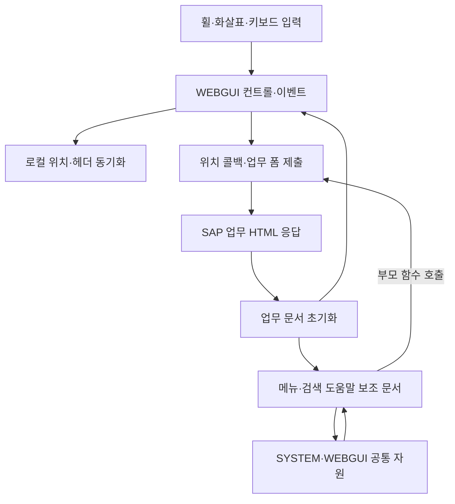

# ERP WebGUI·SYSTEMGUI 리팩토링 — 프로젝트 맥락과 설계

프로젝트: KBS ERP WebGUI·SYSTEMGUI HTML·JavaScript·CSS 리팩토링  
정리 기준일: **2026-10-08**  
현재 확보한 통합 기준: **ITS Chrome v3, 보고서 작성일 2026-09-14**  
출처 ID: [대화·자료 근거 목록](references/대화와자료_근거목록.md)

## 1. 배경, 기존 문제, 목표

### 1.1 디자인 개선에서 동작·구조 분석으로 확대

처음에는 WEBGUI의 CSS·JS를 기존 배치와 기능을 보존하면서 개선했다. 사용자는 초기 수정본 적용 후 큰 동작 이상을 느끼지 않았다고 했지만, 이전부터 있던 스크롤 끊김을 추가로 제기했다. 이후 SYSTEM 공통 소스, HTML 보조 페이지, Chrome 오류까지 범위를 확장했다. 이 흐름은 “디자인 패치가 모든 성능 문제를 해결했다”는 성공담이 아니라, 실제 사용 피드백을 통해 분석 범위와 검증 한계를 수정한 사례다. [C01~C09]

### 1.2 구분해야 했던 문제

- 화면 색상·가독성: CSS와 JS 동적 색상 값의 연계 문제
- 클라이언트 중복 작업: 동일 스크롤 위치 재대입, DOM 반복 조회, 초기화 중복
- 요청 기반 스크롤: 입력 후 업무 POST와 HTML 문서 재구성에 따른 단절
- 브라우저 오류: Chrome의 IE 오분류, 지원되지 않는 커서 API, 이벤트·프레임 처리
- 데이터 정확성: 0/false 손실, hidden input 직렬화, 잘못된 파라미터의 부분 반영
- 배포·관측 불일치: 콘솔의 파일명·행 번호와 제공된 소스가 다름

목표는 단순히 파일을 줄이거나 경고를 없애는 것이 아니라, **업무 값을 보존하면서 재현 가능한 결함을 수정하고, 운영 검증에 필요한 근거를 남기는 것**이다. [S01 “우선순위에 따른 변경”, S04 §1~2]

## 2. 대상 업무와 범위

| 대상 | 포함 내용 | 제외·한계 |
|---|---|---|
| WEBGUI 67개 | JS34·CSS33. 표·ALV·트리·입력·메뉴·드롭다운·검색 도움말·스크롤 등 UI 공통 자원 | 특정 업무 트랜잭션의 계산/ABAP 로직 전체 아님 |
| SYSTEMGUI 33개 | JS13·CSS1·HTML19. 공통 유틸리티·프레임·직렬화·보조 페이지 | 서버가 생성한 주 업무 HTML과 별개 |
| 사용자 증상 | 휠·화살표 차이, Network 문서 갱신, 콘솔 오류 | 실제 운영 세션에 AI가 직접 접속해 재현한 것은 아님 |
| 결과물 | 완전한 소스, 변경분, 원본/직전 기준본, diff·검증 기록 | 서버 반영·운영 승인 아님 |
| 이번 자료 추출 | 기존 자료 보존, 교육 초안, 읽기 전용 실습 | 새 리팩토링·포털 개발·GitHub push 없음 |

KBS ERP 담당 팀원의 공통 UI 유지보수 사례이며, 근로시간·급여·회계 등 개별 업무 에이전트나 업무 정책을 구현한 프로젝트로 분류하지 않는다. [C11, S01 첫머리]

## 3. 시스템 환경·버전·제약

### 3.1 확인된 환경과 미확인 환경

| 항목 | 확인한 내용 | 미확인 사항 |
|---|---|---|
| UI 기술 | 기존 HTML·CSS·JavaScript, 동기 script 로드, 전역 함수, iframe/보조 문서, 폼 제출 | 실제 모든 화면의 로드 순서·문서 모드 |
| 서비스 | SAP ITS/WebGUI 소스 및 `/mimes/webgui/sl`, `/mimes/system/sl` 참조 | SAP/ITS 제품 릴리스·패치 수준·서버 설정 |
| 브라우저 목표 | 초기 지원범위 미정 → 사용자 요청으로 v3 Chrome 중심 | 운영 Chrome 정확한 버전·기업 정책·확장 프로그램 |
| 테스트 환경 | v3 증빙 README는 Node.js24·Python3와 V8/최소 DOM 모형 사용 명시 | 실제 Chrome 레이아웃·IME·네트워크 검증 |
| 실제 통신 | 대화 캡처 판독상 업무 POST 및 HTML 응답 | 실제 요청 payload, ABAP 처리 단계, 콜백 호출 스택 |
| 소스 공급 | Google Drive WEBGUI/SYSTEMGUI 폴더 | 업로드본과 운영 배포본의 완전한 일치 |

Chrome 표본 UA 문자열에 들어 있는 버전은 테스트 입력일 뿐 운영 브라우저 버전 증거가 아니다. ES3 구문 통과도 IE 전체 동작 지원을 의미하지 않는다. [S01 “검증 결과”, S02/README·verify.js]

### 3.2 유지한 계약

사용자 최종 우선순위는 **업무·데이터 → 시스템 호환 → 배치·조작 → 디자인·가독성 → 근거 있는 성능**이다. Chrome 최적화 허용이 다음 계약의 임의 변경까지 허용한 것은 아니다. [C08]

- 폼 필드 이름·업무 이벤트·인코딩·행 번호·동기 호출 의미
- 부모/자식 문서의 함수 인수, 공개 이름, 초기화 순서
- 스크롤 이동량과 wheelDelay 값, 기존 서버 HTML 갱신 구조
- HTML 태그/ID/name 시퀀스·DOCTYPE, 기존 CSS 배치 선언
- 세션·보안 관련 구현을 자료 없이 제거하지 않는 원칙
- 실제 업무 데이터를 변경하는 검증은 별도 승인된 테스트 환경·데이터에서 수행

## 4. 구성 요소별 역할과 연결 관계

이 구성도는 소스 연결과 대화 관찰을 합친 개념도다. 모든 화면이 같은 스크롤 함수를 쓴다는 뜻이 아니다. `Submit→Server→Main`은 업무 POST 관찰에 근거하지만 정확한 휠 핸들러에서 해당 POST까지의 런타임 연결은 미확인이다. [C05, S03 §5, S01 “통신·데이터 계약”]

| 구성 요소 | 역할 | 연결상 주의점 |
|---|---|---|
| `gui_scroll.js` | 로컬/서버형 스크롤, 화살표·휠 입력, 예약 콜백 | 렌더링과 서버 위치 전달이 섞여 있음 |
| `gui_gridview.js`, `gui_tablecontrol.js`, `columntree.js` | ALV·TC·트리의 입력·선택·스크롤 | 헤더/고정 열 동기화, 개별 키 핸들러도 존재 |
| `its_utils.js`, `wgu_utils.js` | DOM·좌표·브라우저·이벤트 공통 처리 | 같은 이름의 함수가 겹침. 같은 문서 로드 순서와 iframe별 전역을 구분 |
| `menubase.html` | SYSTEM 공통 JS 및 WEBGUI 메뉴 자원 로드 | `document.write`로 부모의 MIME URL·테마를 사용. 자체 제거/비동기화는 미실시 |
| `contextmenubase.html` → `menu.js` | 부모 `ContextMenu_postUrl`에 5개 인수 전달 | 보조 GET 폼이 아니라 부모 업무 폼의 계약을 봐야 함 |
| `framepost.html` | 부모 폼/객체에서 파라미터를 준비해 POST | 디코딩·제외 목록·값 보존·submit 이름 충돌 고려 |
| `sap_commobj.js` | 테이블/속성값을 hidden input 형태로 직렬화 | HTML 문자열과 실제 제출 값의 차이를 검증 |
| 도메인·프레임·세션 코드 | 프레임 탐색·접근·종료·보안 상태 | 프레임 보안 정책을 JS로 우회하지 않음 |
| CSS34·HTML 보조 페이지 | 표시·포커스·배치·문서 생성 | SYSTEM/WEBGUI 같은 파일명도 내용·이미지 경로가 다름 |

근거: S01 파일별 목록, S03 §2~5, S02의 해당 경로 소스 및 diff.

## 5. 입력 → 처리 → 출력의 실제 흐름

### 5.1 실제 관찰된 스크롤 현상

1. 사용자가 휠을 한 번 내렸다.
2. Network의 Fetch/XHR는 비어 있었지만 Doc에 업무 문서 요청이 나타났다.
3. 선택한 큰 업무 문서는 POST·HTML 응답이었다. 대화 판독값은 본문158,856바이트, 전체163.19ms, 응답대기85.68ms, 수신74.59ms다.
4. 이후 메뉴 보조 문서와 JS·CSS가 캐시에서 읽혔다. 이 과정은 단순 repaint만으로 설명되지 않으며 문서 재구성과 부합한다.

이 수치는 **대화에서 판독한 단일 표본**이다. 현재 패키지에 원 Network 이미지·trace가 없고 이번에 재측정하지 않았다. 149kB·277ms라는 이전 표본 및 menubase의678바이트·1.93ms와 섞지 않는다. 163.19ms에350/700ms를 기계적으로 더하거나 85.68ms를 ABAP 순수 실행 시간으로 표기하지 않는다. [C04~C05]

### 5.2 코드 모형에서 확인된 휠 예약

기본 wheelDelay700 모형에서 기존 코드의 단일 휠은 같은 위치13에 대해350ms와700ms 두 콜백을 남겼다. v3는 휠 경로가 내부350ms 예약을 취소한 뒤 기존 wheelDelay를 적용해700ms 한 번만 실행한다. 화살표350ms 처리와 로컬 스크롤은 별도 테스트했다. **이것은 모형의 콜백 수이며 실제 업무 POST 수가 아니다.** [S01 “성능 근거와 예상 효과”, S02-V `originalDefects.wheelCallbacksBefore`, `wheelCallbacksAfter`]

### 5.3 컨텍스트 메뉴·POST 데이터 흐름

`contextmenubase.html`의 onload는 부모의 컨트롤ID·이벤트·파라미터·X·Y를 기존 순서로 전달한다. 부모 `ContextMenu_postUrl`은 업무 폼의 target/action/이벤트를 잠시 바꿔 제출한다. v3는 제출 실패에도 다음 업무 요청이 잘못된 메뉴 프레임을 향하지 않도록 상태를 복원한다. [S01 “통신·데이터 계약”, S02-D/menu.js]

`framepost.html`은 이름·값을 모두 디코딩한 뒤 hidden field와 부모 제외 목록을 반영한다. malformed 입력이 발견되면 일부만 제출하지 않고 제출 전 중단한다. 0·false를 빈 문자열로 버리지 않고 상속 속성은 입력으로 수집하지 않는다. 실제 SAP가 받는 최종 업무 값은 테스트 서버에서 별도 확인해야 한다. [S01, S02-V `framePOST*`]

## 6. 사람·AI·프로그램의 역할

| 담당 | 실제 수행/요구된 역할 | 대신할 수 없는 것 |
|---|---|---|
| 사용자·ERP 담당자 | 원본 업로드/재동기화, 적용 피드백, DevTools 캡처, 브라우저 범위·우선순위 결정 | AI가 사용자 승인·업무 수용 판단을 추정하면 안 됨 |
| AI | 소스·경로·증상 연결, 국소/통합 패치 작성, 대안·위험 설명, 검증 코드·보고서·ZIP 작성 | 모델 테스트만으로 실제 업무 정확성 인증 불가 |
| 검사 프로그램 | 구문·해시·파일 구성·모의 입력·실패 주입·값 비교 | 서버 비즈니스 규칙·실제 IME·화면 배치·사용자 체감 대체 불가 |
| 운영/배포 담당자 | 실제 서버 백업, 테스트 반영, 캐시·응답 버전 확인, 운영 승인·복원 | 제공 Rollback을 서버 백업으로 오인하면 안 됨 |
| 교육 통합 담당자 | 출처·버전 유지, 다른 프로젝트와 연결, 실습/원본/웹 소스 분리 | 미구현 제안을 기존 운영 구성으로 소개하면 안 됨 |

## 7. 주요 결정과 결정 이유

| 결정 | 이유 | 근거·상태 |
|---|---|---|
| 초기에는 IE/표준 분기·인터페이스·배치를 보존 | 지원 브라우저와 전체 업무 영향 범위가 미정 | C01, S03 §6. 과거 기준 |
| 스크롤 CSS는 근거 없이 변경하지 않음 | 강제 합성·contain이 배치·팝업에 영향을 줄 수 있고 병목 근거가 부족 | C03, S03 §4. 유지 |
| SYSTEM 공통 소스와 HTML까지 통합 분석 | 메뉴 문서가 공통 JS와 WEBGUI 자원을 함께 불러옴 | C04~C09, S01. 구현 범위 확대 |
| v3는 Chrome 중심으로 UA/API/이벤트 수정 허용 | 사용자가 브라우저 범위와 더 강한 변경을 명시 | C08, S01. 결정·구현 |
| 휠 delay 자체는 유지하고 중복 예약만 제거 | 응답 대기 시간이 아니라 요청 전 조절 장치이며 요청량 계약에 영향 | S01. 구현·모의 검증 |
| 오류를 가짜 생성자/빈 catch로 숨기지 않음 | dropdown 실패는 업무 초기화 실패일 수 있음 | S01/S04. 유지 |
| unload는 확인된 객체 해제만 제한 변경 | 세션 종료·저장과 메모리 정리를 구분해야 함 | S01/S02-D/sap_secu.js. 부분 구현 |
| 보고서·검증 코드와 교체용 ZIP 분리 | 실행 대상에 새 의존성/테스트 코드 혼입 방지 | C01, S01. 산출물 확인 |
| 막힌 브라우저 접근을 우회하지 않음 | 실제 검증 불가 상태를 투명하게 남김 | S01/S02-V limitations. 미검증 유지 |

## 8. 제외한 대안, 실패한 시도, 판단 수정

### 8.1 검토했으나 채택하지 않은 방향

- 모든 `var`/함수 문법의 일괄 현대화, strict mode, 전역 구조의 무차별 변경: 기능 개선과 무관한 위험·diff 증가 때문에 초기 제외. v3도 전체 재작성은 하지 않았다.
- CSS smooth scrolling, 강제 GPU 합성, `contain`/`will-change` 일괄 추가: 서버 HTML 재수신 문제를 해결하지 않고 배치 위험이 있어 미채택.
- 350/700ms 제거 또는 무조건 단축: 요청량·타이밍 변경이며 서버 응답 완료를 보장하지 않음. v3도 delay값 보존.
- 모든 unload를 pagehide로 치환하거나 보안 초기화 재검사를 삭제: 세션·저장 의미를 확인할 자료가 부족.
- 부모 프레임의 공통 초기화 결과를 모든 iframe이 공유하게 변경: 별도 document/global과 로드 순서 계약을 깨뜨릴 수 있음.
- 폼 POST를 JSON/Fetch 기반으로 교체하거나 전체 화면 갱신을 없앰: 현 범위의 JS·CSS/보조 HTML 수정으로 안전하게 결정할 수 없어 미착수.

### 8.2 실제 실패·자료 부족

초기 `ewtlib.js`·`gui_popupresize.js`가 비어 있거나 누락된 상태가 있었고 사용자 재업로드 후 정상 크기를 확보했다. 이후 `contextmenubase.html`도 재동기화 요구에 따라 원본736바이트를 다시 확보했다. “파일명 존재”만 확인하면 안 된다는 사례다. [C02/C09, S01/S02]

SYSTEM 1차 보고서는 Chromium 실행 파일 부재로 실제 브라우저 검증을 못 했다고 기록한다. v3 보고서는 Cloud Chrome의 로컬 검증 URL 접근이 승인 검토에서 거절되어 우회하지 않았다고 기록한다. 이는 서로 다른 시점·원인의 제한이며 “브라우저 테스트 통과”로 합치지 않는다. [S03 §7, S01 “검증 결과”]

사용자의 “파일이 반복 요청되니 리페인트 때문 같다”는 가설은 업무 Doc POST 확인 후 문서 재구성 설명으로 수정되었다. Fetch/XHR가 비었다는 사실과 서버 요청이 없다는 결론을 분리한 것이 핵심 학습 포인트다. [C04~C05]

## 9. 사용자 피드백에 따른 변경 과정

| 단계 | 사용자 입력 | 후속 작업·결과 | 상태 |
|---|---|---|---|
| 초기 디자인 | 동작·배치 보존 지침, 누락 JS 재업로드 | WEBGUI67개, CSS26·JS4 개선 보고 | 대화 결과 기록·사용자 일부 확인 |
| 스크롤 | 기존 끊김, 관련 JS/CSS만 개선 요청 | JS4개 반복 조회/재대입 감소, CSS 유지 | 대화상 구현·916 모의 건수 보고 |
| 네트워크 분석 | 휠 한 번의 Doc/JS/CSS 캡처 | 캐시·보조 문서·업무 POST 구분 | 관찰 해석. 함수 호출 경로 미확인 |
| 공통 범위 | SYSTEMGUI 소스 추가 | 14개 중2개 변경,221 모의 건수 | S03 구현·정적/모의 검증 |
| 화살표 오류 | 휠 정상, 화살표 후 오류 | 원본/수정본 비교, gui.js 커서 패치,25 모의 건수 | S04 부분 조치. 운영 원인 일부 미확정 |
| 통합 강화 | HTML 추가·Chrome 목표·5대 우선순위 | v3 총100개,33개 추가 수정 | S01/S02 구현·186 모의 건수 |
| 추가 원본 | contextmenubase 재동기화 | 부모 메뉴 계약과 함께 재분석·포함 | S01/S08 확인 |
| 구조 제안 | 더 구조적인 개선 요청 | 이 문서 §17에 별도 제안 정리 | 제안. 후속 운영 구현 근거 없음 |

위 건수들은 서로 다른 범위의 테스트다. 합산하여 “총 N개 업무 화면 검증”으로 소개하지 않는다.

## 10. 현재 방안과 과거 방안의 구분

### 10.1 버전 계보

| 버전 기준 | 포함 상태 | 현재 용도 |
|---|---|---|
| `original` / Original.zip | 처음 제공된 JS·CSS + 재동기화된 HTML 원본100개 | 원본 대조. 운영 최신본 아님 |
| `baseline` / Rollback.zip | WEBGUI 디자인+스크롤4+커서 패치, SYSTEM 1차 개선+HTML19 | v3 직전 비교 기준. 실제 서버 백업 아님 |
| `modified` / Full.zip | baseline에 v3 33개 변경 반영, 전체100개 | 확보한 통합 검토본 |
| Apply.zip | baseline→modified 변경33개만 | baseline 일치 확인한 경우의 변경분. 독립 전체 배포본 아님 |

초기 “UA 오분류를 발견했으나 보존”, “중복 타이머는 미수정”, “HTML 미제공”은 당시에는 맞았다. v3에서는 Chrome 승인 후 UA/중복 예약을 수정했고 HTML19개를 분석했다. 반대로 **실제 주 업무 HTML 미확보·Chrome/ERP 미검증**은 여전히 남아 있다. [S03 §5~7 ↔ S01]

v3 Full을 적용한 뒤 과거 커서 패치나 스크롤 패치를 다시 덮어쓰면 새로운 보완을 되돌릴 수 있다. 옛 보고서는 이력이며 현재 적용 지침은 아니다. [S01 기준 버전 설명·S02-D]

## 11. 주요 파일·경로·최신 여부

| 정리 폴더 | 소스에서 확인한 MIME 경로 | 주의 |
|---|---|---|
| `WEBGUI/JS` | `/mimes/webgui/sl/scripts` | scripts 복수 |
| `WEBGUI/CSS` | `/mimes/webgui/sl/style` | SYSTEM gui.css와 별개 |
| `SYSTEMGUI/JS` | `/mimes/system/sl/script` | script 단수 |
| `SYSTEMGUI/CSS` | `/mimes/system/sl/style` | 이미지 상대경로도 다름 |
| `SYSTEMGUI/HTML` | `/mimes/system/sl/page` | HTML은 업로드 분류명, 실제 경로는 page 단수 |

서버의 실제 서비스 prefix·테마·대소문자는 운영 설정과 Response로 다시 확인한다. 표를 이용해 새 경로를 임의 생성하지 않는다. [S01 “적용·복원”]

핵심 변경 파일은 `its_utils.js/wgu_utils.js`, `gui_scroll.js`, `gui.js`, `gui_event.js`, `gui_dropdown.js`, `gui_tablecontrol.js`, `gui_gridview.js`, `menu.js`, `framepost.html`, `shmult.html`, `contextmenubase.html`, `sap_commobj.js`, `sapwebframework.js`, 도메인·프레임·보안 파일 및 CSS3개다. 전체100개 개별 목록은 [소스 목록](references/100개_소스목록.md), 이유는 [기존 v3 보고서](references/ITS_Chrome_v3_Report.md)의 파일별 표를 본다.

2026-10-08 Drive 조회에서100개 이름·크기가 Original과 일치했고 contextmenubase 본문도 다시 읽었다. 나머지99개 원격 바이트 동일성은 미검증이며, 실제 서버 응답 최신성은 별도 문제다. [S05/S08/S07]

## 12. 완료·진행·미착수·미확인 상태

| 항목 | 상태 | 완료로 볼 수 없는 것 |
|---|---|---|
| v3 소스100개·변경33개·보고서/증빙 | 구현 완료, 산출물 확보 | 운영 승인 |
| v3 정적·모의 회귀 | 기록상 완료, 이번에 기록/바이트 대조 | 실제 Chrome·ERP 전체 검증 |
| 초기 WEBGUI 사용자 실행 | 사용자 일부 확인 | 후속 v3 동작 확인 |
| 운영 오류의 일부 코드 결함 | 재현·구현·모의 검증 | 캡처 오류 전부의 인과관계 해결 |
| 실제 Chrome 테스트·FPS 측정 | 미실행/미확인 | 개선율 주장 |
| 업무 HTML·서버 응답 버전 대조 | 추가 자료 대기 | 제공본=배포본 결론 |
| 공통 요청 계층·수명주기 재설계 | 제안/미착수 | 이미 공통 모듈화된 시스템이라는 설명 |
| 교육 추출 | 이번 MD·ZIP 작성 및 패키지 검사 | 포털 구축·Node 서버·GitHub 반영 |

진행 중이라는 이유로 자동으로 다른 작업을 실행하는 예약·상시 모니터링은 없다.

## 13. 검증한 내용과 남은 검증

### 13.1 2026-09-14 v3 기록

| 확인 | 결과·범위 | 출처 |
|---|---|---|
| 구성 | 전후100개, 빈 파일 없음,33개 변경 | S02/manifest |
| 구문 | JS47 ES3, 인라인30, 이벤트 속성66 | S02-V/S02-M |
| 인터페이스 | 기존 명명 함수 선언 이름·인수 유지 검사 | S02/verify.js. 모든 동적 전역 API의 완전한 인증 아님 |
| 구조 | HTML19 태그/ID/name·DOCTYPE 유지, CSS34 기존 부분 동일,3개에 focus-visible 추가 | S02-M |
| 동작 모형 | 186건, 커서·IME·POST·메뉴 복원·타이머 등 | S02-V |
| 직렬화 | 생성 input HTML7건을 별도 HTML 파서로 값 비교 | S02-M |
| 로드 순서 모형 | 유틸리티 두 순서, shmult 전후,TC 초기화 등5개 결과 | S02-I |
| 실제 브라우저·업무 | 미실행 | S01/S02 limitations |

이번 추출은 과거 실행 기록을 읽고 보존했다. 새로 수행한 것은 ZIP/해시/파일·링크 대조이며 [추출 검증 결과](references/추출_검증결과.json)에 따로 기록한다. 과거 회귀186건을 이번에 다시 실행했다고 쓰지 않는다.

### 13.2 운영 전 남은 항목

대표 화면에서 최초/반복 진입, TC·ALV·트리·검색 도움말, 휠·화살표 단일/길게 누르기, 경계 스크롤, 드롭다운·우클릭 메뉴, 팝업·iframe·분할선, 한글 IME 조합 Enter/일반 Enter/붙여넣기/Tab/단축키, 커서0·중간, 비활성·읽기전용, 확대/축소·창 크기, 저장/제출·중복 제출, 종료·세션 보존을 확인해야 한다. 데이터 변경은 테스트 데이터로 제한한다. 성능은 동일 화면·데이터·캐시·입력 조건에서 여러 번 비교한다. [S01 “적용·복원”]

## 14. 주요 오류: 증상·원인·조치·해결 여부

| 증상/결함 | 확인한 원인 또는 가설 | 조치 | 해결 수준 |
|---|---|---|---|
| `createTextRange is not a function` | Chrome UA의 `like Gecko`를 IE로 분류하는 코드 경로; 무조건 IE API 호출 모형 재현 | 커서 API/필드 유형/범위 확인, 양쪽 UA 개선 | 구현·모의 통과. 실제 문서의 UA/배포 파일은 미확인 |
| `gui_dropdownManager is not defined` | 제공 파일에는 생성자 존재. shmult의 `SL/sl` 경로를 구분한 모형에서는 실패 재현 | 경로 정규화·동기 로드 유지·초기화 모형 확인 | shmult 모형 수정. 원래 업무 오류와 동일 원인인지 미확정 |
| `gui_ts.js:360` 위치 불일치 | 제공 gui_ts.js는126행, 커서 함수는 gui.js358/360행 | Response와 script 목록 요청 | 운영 매핑/캐시/소스 표시 원인 미해결 |
| unload 정책 메시지 | 브라우저 정책 메시지. 다른 오류 원인이라는 증거 없음 | sap_secu 실패 초기화 객체 해제만 pagehide, persisted이면 유지 | 제한 조치. ITSSM_unload 등 미제공 경로 미해결 |
| 중복 휠 콜백 | scrollTo가 남긴350ms 예약과 wheelDelay 예약 공존 | 휠 경로가 예약 소유·정리 | 모형상2→1. 실제 POST 중복 여부 미확인 |
| 화살표 합성 이벤트 공유 | new 없이 생성한 이벤트가 공유 상태를 오염시킬 수 있는 경로 | 독립 이벤트 객체·표준 버튼·지역 핸들 참조 | 모의 통과. 실제 반복 입력 미검증 |
| query 파서 무한 반복 | match 결과 배열의 lastIndex 사용 | index+match 길이로 소비 | 모의 재현·수정 |
| 메뉴 submit 예외 후 폼 오염 | target/action/event 임시 변경이 복원되지 않음 | try/finally 및 실패 시 기존 값 복원 | 실패 주입 모형 통과 |
| POST 0/false·속성 문자열 손상 | truthy 처리·부족한 속성 이스케이프 | 값 보존·전부 디코딩 후 반영·HTML 직렬화 보호 | 모형/파서 통과. SAP 업무 결과 미검증 |
| 좌표·프레임·IE event/for | 미할당변수·함수 객체 비교·Chrome 즉시 실행 등 코드 결함 | 해당 호출·이벤트 등록 보완 | 구현·모의 확인. 실제 배치 영향 미검증 |

근거: S04 §1~5, S01 “이전 오류와 이번 결과” 및 파일별 목록, S02-V/S02-I. “AI 패치에서 파일을 빼먹었다”는 가설은 이전 ZIP 대조에서 직접 증명되지 않았다. 그렇다고 간접 영향까지 배제한 것도 아니다.

## 15. 다른 ERP AI 프로젝트와의 입력·출력·의존관계

| 연결 대상 | 이 프로젝트가 받을 입력 | 이 프로젝트가 제공할 출력 | 통합 시 경계 |
|---|---|---|---|
| ERP 소스 추출·배포 | 실제 MIME 경로·운영 버전·해시·변경 묶음·복원 절차 | 100개 소스 목록·버전3종·33개 diff·검증 항목 | 추출기/배포기 구현 사실은 여기서 확인 못함 |
| Codex Desktop·GitHub | 저장소 규칙·검토 절차·접근 권한 | 분석 프롬프트·변경 이유·시험 자료 | 설치·클론·push 교육은 별도 원천 필요 |
| ERP MCP | 허용 도구·테스트 환경·읽기/쓰기 경계가 필요할 수 있음 | 읽기 전용 진단과 변경 검증 요구사항 | 실제 MCP 서버·인증·도구 호출 구축은 이 범위 아님 |
| 업무 에이전트·스킬·하네스 | 업무별 정상값·회귀 시나리오·승인 기준 | UI 변경 시 보존할 데이터/이벤트 계약, 실패 사례 | 업무 스킬/서브에이전트가 구현되었다고 간주하지 않음 |
| Obsidian·교육 지식 관리 | 출처·버전·링크 규칙 | Markdown4개·근거·FAQ | Obsidian 설정은 확인하지 않음 |
| 포털·Node 웹서버·KBS 도메인 | 통합 교육 순서·배포·접근통제·저작권 정책 | 콘텐츠·실습·캡처 요청·시각자료 명세 | 이번 요청의 향후 활용 계획, 현재 구현 아님 |

## 16. 출처 우선순위와 남은 판단

구현 내용은 실제 v3 소스/diff와 S01을 함께 본다. 검증 건수는 결과 JSON을 본다. 운영 관찰은 사용자 대화와 캡처에 한정한다. 원본/직전/수정본이 충돌하면 이름보다 SHA·대상 경로·보고서 기준을 우선하되, 실제 서버 바이트가 없으면 배포 상태는 미확인으로 둔다.

핵심 파일 링크: [v3 보고서](references/ITS_Chrome_v3_Report.md), [SYSTEM 1차](references/SYSTEMGUI_Analysis_Report.md), [오류 보고서](references/WEBGUI_Arrow_Error_Report.md), [전체 diff](references/v3_evidence/changes.diff), [대화 근거](references/대화와자료_근거목록.md). 각 원문을 반복 수록하지 않고 교육에 필요한 맥락만 위에서 설명했다.

## 17. 추가 구조 개선 제안 — 구현 완료와 분리

다음은 C10의 요구와 확보 소스의 문제를 교육 통합 관점에서 재정리한 **제안**이다. 이번 추출에서 구현하지 않았고, 기존 v3에도 전면적인 공통 계층은 없다.

| 제안 | 해결하려는 문제·근거 | 선행 조건·안전 경계 |
|---|---|---|
| 요청 준비·검증·제출·복원을 공통 규칙으로 정리 | framepost와 메뉴에 폼 변경/예외 복원이 분산 | 저장은 중복 차단, 스크롤은 최신 위치 병합 등 업무별 의미를 먼저 정의. 모든 요청을 한 방식으로 합치지 않음 |
| 문서/컨트롤의 초기화·갱신·해제 수명주기 명시 | 중복 이벤트 관리자·타이머·교체된 문서 콜백 관리 | 세션 종료는 UI 정리와 분리. 반복 진입/종료 계측부터 |
| SYSTEM/WEBGUI 중복 유틸리티의 계약 테스트와 점진적 단일화 | S03 §5의 동일 이름4개 함수와 활성 구현 로드 순서 문제 | 전역 이름·부모/자식 문서 경계를 유지하는 어댑터 먼저. 새 공통 파일 경로 결정 필요 |
| 문서별 스크립트 의존성·초기화 순서 명세 | shmult 경로/생성자 오류와 업무 문서 미확보 | 업무 HTML 확보가 선행. async/defer 일괄 적용 금지, iframe 간 무조건 중복 제거 금지 |
| 화면 렌더링과 서버 스크롤 명령 분리 | 중복 위치 대입과 POST 기반 재구성 혼재 | 측정 후 읽기/쓰기 구간 분리. rAF는 시각 작업에만 검토하고 업무 제출 의미는 별도 보존 |
| 상태와 디자인 값의 경계 정리 | JS 인라인 색상·CSS 클래스가 상태 판별에도 사용 | 클래스/ID 계약 목록화. 레이아웃 계산값을 테마값으로 이동하지 않음 |
| 대표 화면 fixture·계측·버전 확인 절차 | 실제 Chrome 미검증, gui_ts 배포 불일치 | 개인정보 제거된 HTML/trace, 테스트 계정·데이터·버전 정보, 수용 기준 확보 |

권장 순서도 제안이다: **대표 화면·배포 버전 확인 → 데이터/요청 계약 회귀 → 수명주기 정리 → 중복 유틸리티 단일화 → 렌더링 최적화**. 전체 HTML 갱신을 없애는 연속 스크롤은 서버 데이터 계약까지 검토해야 하는 별도 설계 과제로 남긴다.
