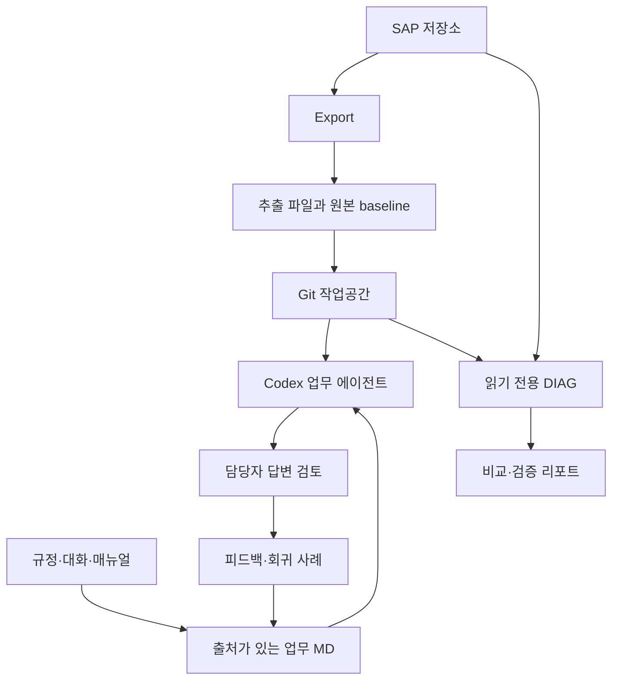

# 프로젝트의 출발점과 변화

- 프로젝트: SAP 패키지 추출·읽기 전용 진단 및 업무 AI 에이전트 구축
- project_id: `kbs-erp-export-diag-agents`
- 추출 기준일: 2026-10-12
- 근거 수준: 현재 보이는 사용자 발화 + 일부 실제 AI 답변 + 접근 가능한 기존 파일. 원문 미확보 AI 답변을 복원하지 않았다.

## 1. 실제 업무 문제와 시작 범위

ERP 개발 지식은 ABAP 소스에만 있지 않다. 함수 인터페이스, 테이블·구조 정의, BSP 화면과 이벤트, MIME 자산, 메시지 클래스가 함께 있어야 패키지를 이해할 수 있다. 사용자는 패키지를 내려받아 업무별 AI 에이전트(ZHR5, 이후 ZFI·ZMM 등)의 근거로 삼고 싶었다. 이어 규정·지침·매뉴얼·담당자 대화가 코드에 없는 판단 이유를 보완해야 한다고 인식했다. [U019, U021, U025–U032]

현재 보이는 첫 구간은 이미 존재하던 Export의 ZMM6 오류·구조 개선이다. 최초 프로그램 설계부터의 모든 대화를 확보한 것은 아니다. “프로젝트 최초 목표”는 뒤의 사용자 설명과 기존 인계서로 확인한 범위이며, 첫 코드 생성 당시 AI 발화는 미확보다. [U002, U019, U021; `assets/references/PROJECT_CONTEXT_20261008_v3.md` §1]

## 2. 환경과 자료의 출발점

| 항목 | 확인 내용 | 근거·한계 |
|---|---|---|
| ERP | SAP BASIS700 대상, 구형 ABAP 문법·API 호환성 중요 | U035, U058, U089. ECC6/Unicode/Oracle/SAP GUI 770은 기존 인계서 기재이며 현재 서버 재조회 아님 |
| 작업 환경 | VS Code + Codex, GitHub publish, MacBook Air Codex Desktop clone | U021–U024 사용자 보고. 현재 저장소·브랜치·앱 버전 미확인 |
| 패키지 사례 | ZMM6, ZCO3, ZWEB, ZHR5 | 실제 사용자 발화·화면. ZHR6는 ZIP 이름 예시이며 운영 결과 사례로 확대하지 않음 |
| 처음 확보하려던 자료 | ABAP, 함수/Include, DDIC, BSP HTML·JS·CSS, MIME, XML 메타데이터 | U003–U010 |
| 부족했던 자료 | 규정 시행일, 예외 처리 이유, 담당자 협의, 매뉴얼·양식·업무 경험 | U025–U032 |
| 검증 환경 | 실제 SAP에서 사용자가 반복 실행하고 오류 화면·엑셀 제공 | 개별 사용자 보고·화면에 한함. 우리가 현재 SAP에 접속해 실행하지 않음 |
| 현재 교육 자료의 제약 | 역사적 AI 답변 원문 대부분 없음, 정확한 패키지 ZIP/최신 DIAG JSON 없음 | `conversation-data.json` coverage 및 assets |

## 3. 시간 순서에 따른 목표의 변화

발화의 날짜는 확인되지 않아 표에는 자체 발화 ID로 순서를 표시한다. 문서 버전 날짜는 문서의 속성이며 메시지 날짜가 아니다.

| 순서·근거 | 당시 요구·문제 | 결정·다음 방향 | 확인 수준 |
|---|---|---|---|
| U002–U005 | BSP 경로 충돌, 탭과 파일명 불일치 | SAP 다섯 탭 중심의 파일 구조, Properties·Page Attributes 보존 | 사용자 요청 + 현재 코드 |
| U006–U010 | DDIC 구조/함수 인터페이스/MIME/메시지 부족 | 사람에게 읽히는 폴더명, 함수별 Source code, Messages.xml | 수정 요구·오해 정정 + 현재 코드 |
| U011–U013 | XML 값 보존 검사 실패 | KO 우선/부분 EN fallback과 직렬화 검사를 별도로 다룸 | 실패 화면 및 후속 점검 결과 |
| U014–U020 | 큰 패키지, 불필요 로그, MIME/기술 공통 클래스 | 범위·생략 정책, 용량 제한, MIME 그룹, baseline 유지 | 사용자 결정 + Export 0.3.18 |
| U021–U032 | 소스만으로 업무 맥락 부족 | GitHub·Mac clone, 패키지 지식·지침·스킬과 구축 가이드 | 사용자 사용 보고 + 문서 사본 |
| U033–U038 | 업무 답변은 에러가 안 남 | 업무 하네스와 코드 하네스 분리, 담당자 피드백 우선 | 결정·지침 존재; 전 자동 루프 미확인 |
| U039–U045 | ZIP 수동 업로드 불편 | GitHub 목록 조회 실험 후 TLS 오류로 직접 통신 보류 | 코드 ZIP·실제 로그·보류 발화 |
| U046–U053 | Actions/CI/CD 개념 혼동 | 저장소 검증 자동화로 이해, SAP 검증과 구분 | 질문·기존 요약; workflow 실행 없음 |
| U054–U068 | Import·비교·활성화 가능성 요구 | 읽기 전용 리포트, 원본 중심 세 비교, 업로드·UI 장애 수정 | 초기 코드·오류 화면·일부 실행 보고 |
| U069–U080 | 상태 의미 불명확, XML 과도한 차이, ALV 가독성 | 조회/활성 근거/문법 분리, 네 비교 상태, A/B ALV 헤더 | 결정 + 후속 코드 |
| U081–U085 | 자동 반영 위험, 입력·화면 복잡 | Import 제외, DIAG 명칭·방향, 결과 유형·변경분 필터 | 명시 결정 + 현재 코드 |
| U086–U090 | 실제 결과의 확인 실패·긴 설명·타입 오류 | 함수/Include 근거, 속성 범위, JSON, 0.4.5 호환 수정 | 엑셀·코드 존재; 최신 SAP 실행 미확인 |
| U091, A001–A004, U092 | 통합 교육 포털 콘텐츠 필요 | 요약 자료에서 실제 발화·교육 해설·첨부를 분리한 추출물로 확장 | 실제 응답 4개와 이번 산출물 |

## 4. 현재 구성 요소의 역할

DIAG에서 SAP로 쓰는 화살표는 없다. GitHub는 코드·문서 공유와 이력 관리에 사용하려는 경로이며 자동 원격 협업·ERP MCP·중앙 허브를 구현했다는 뜻이 아니다. 그림의 업무 하네스는 지침과 운영 방향까지 확인된 범위다. [U021–U038, U081; DOC-CONTEXT §11]

### 4.1 사람·AI·프로그램의 책임

| 주체 | 맡는 일 | 결과의 한계 |
|---|---|---|
| 업무 담당자 | 실제 업무 질문, 규정·예외 맥락 제공, 답변 오류 지적, 적용 판단 | 과거 대화는 현재 규정을 자동 대체하지 않음 |
| 사용자/개발 담당자 | SAP 실행, 오류 화면·결과 제공, 경로·UI 계약·작업 범위 결정 | 실행한 버전·입력·조건을 남겨야 재현 가능 |
| AI | 요청 해석, 코드·MD 초안, 원인 후보·테스트·영향 분석, 피드백 반영 | 수정 주장만으로 성공·활성화를 확정할 수 없음 |
| Export | 저장소 소스/정의/자산을 파일·manifest·원본 사본으로 추출 | 미지원·제외·생략이 존재; 업무 데이터 전체 백업 아님 |
| CHECK | 파일·manifest·수집 상태의 오프라인 확인 | SAP 현재 저장소 비교·런타임 보장은 아님 |
| DIAG | 추출 원본/현재 추출본/현재 SAP를 읽고 비교·사전검사 리포트 | 쓰기·자동 활성화·업무 로직 정답 보장 없음 |

## 5. Export 출력 계약과 시행착오

전체 실제 경로는 패키지/객체명 단계가 포함된다. 사용자의 축약 경로를 그대로 최상위 경로라고 오해하면 안 된다.

| 영역 | 현재 방향 | 근거 |
|---|---|---|
| 언어 | 한국어 우선, 필요한 일부 영어 fallback. KO 수식은 경로에서 제거 | U006, U011–U012; Export 소스 |
| DDIC | Dictionary Object / DBtable / Structures / TableType / Domain / Data element | U006, U020; Export 가이드 |
| 함수 | Function Module/함수/Attributes.xml, Import.xml, Export.xml, Changing.xml, Tables.xml, Exception.xml | U006, U009 |
| 함수 소스 | 각 함수 폴더 아래 Source code/함수명.abap | U009. 공용 Source code 폴더 방안은 폐기 |
| BSP | BSP Application, pages 아래 Properties.xml, Layout, Event Handler, Page Attributes.xml, Type Definitions.abap | U003–U004; 현재 Export 경로 계약 |
| MIME | BSP MIMEs의 원래 폴더와 패키지 MIME 유형별 그룹을 구분, metadata 통합 | U006, U020 |
| 메시지 | MessageClass/클래스/Messages.xml, 번호와 자리표시자 보존 | U010 |
| ZIP·입력 | 패키지명_export.zip, 개발클래스·저장경로 중심. 하위 포함·예산 기본값은 코드 확인 | U015–U017; 최신 0.3.18 |
| baseline | 원본 비교용으로 유지. AI 검색에서는 중복 본문 제외 | U020 질문, 이후 U060 비교 기준 확정 |

삭제 요청된 진단용 XML과 실제 업무 정보 XML은 다르다. 예를 들어 처음의 BSP attributes.xml 제거 요청을 Page Attributes 내용 폐기로 처리하면 안 된다. 구조체 category S의 SE16 오류와 CX_XSLT_SERIALIZATION_ERROR의 원인을 동일시하지 않는다. 지원할 수 있는 메타데이터와 알려진 직렬화 실패를 따로 기록한다. [U004, U019]

Export 0.3.16 화면의 비압축 예산 초과는 다운로드 후 ZIP 크기가 크다는 뜻이 아니다. 원시 누적 용량과 파일별 제한을 구분한다. 현재 0.3.18 기준은 누적 기본 512 MiB, 파일별 16 MiB이며 최초 요청의 256과 혼용하지 않는다. 알려진 19건을 참고·생략으로 재분류한 것은 누락 파일을 회복한 검증이 아니다. [U017–U020; DOC-EXPORT-VALIDATION, DOC-ZWEB]

## 6. DIAG의 현재 비교 계약

| 화면의 대비 | 기준 → 대상 | 질문 |
|---|---|---|
| 추출본/원본 대비 | baseline → 현재 추출 파일 | 로컬 파일이 추출 시점 이후 달라졌는가 |
| SAP/원본 대비 | baseline → 현재 SAP에서 읽은 내용 | SAP 내용이 추출 시점 이후 달라졌는가 |
| 추출본/SAP 대비 | 현재 SAP → 현재 추출 파일 | 현재 SAP를 기준으로 파일 쪽에 무엇이 다른가 |

| 기준·대상 상태 | 비교 결과 |
|---|---|
| 기준에 없고 대상에 있음 | 신규 |
| 기준에 있고 대상에 없음이 확인됨 | 누락 |
| 양쪽 있고 내용 다름 | 수정 |
| 양쪽 내용 같음 | 변경없음 |
| 읽기 실패·미지원·존재 미확인 | 네 상태로 억지 변환하지 않고 비교 불가/공란과 설명 |

비교는 길이만이 아니라 내용을 다룬다. 세 값이 모두 3,210 bytes인 함수 Attributes 행이 실제 결과에서 수정으로 표시된다. 이 사실은 “크기 같음=내용 같음”이 틀렸음을 보여주지만 해당 행의 어떤 필드가 바뀌었는지는 세 원본이 없어 여기서 확정할 수 없다. [U060–U061, U080; RESULT-RAWDATA Excel 1440행]

### 6.1 세 종류의 검증

| 축 | 실제 의미 | 잘못된 해석 |
|---|---|---|
| SAP 검증/조회 결과 | 객체·파일에 맞는 읽기를 시도했는지, 읽거나 진단 정보로 대체했는지 | 조회 성공=내용 정답 |
| 활성 버전 확인 | READ REPORT STATE A, DDIF STATE/GOTSTATE, 함수 인터페이스·소스 등의 근거 | 확인 실패=비활성 확정 |
| 문법형식 검증 | 적용 가능한 자료의 ABAP 사전검사 또는 XML 기본 파싱 등 | 검사 기본 ON=모든 파일 실행·활성화 가능 확정 |

메타데이터의 최신 조회값과 실제 활성 소스의 증거는 다를 수 있다. MIME의 저장소 조회를 ABAP 프로그램 활성화와 같은 상태로 표시하면 안 된다. 웹 HTML·CSS·JS의 줄 차이가 보여도 브라우저 실행 또는 업무 화면 작동을 검증한 것은 아니다. [U069–U072; DOC-CONTEXT §7]

### 6.2 화면·필터·JSON

메인 헤더 A는 세 비교의 신규/누락/수정/변경없음·합계, B는 활성 버전·문법 결과다. 상세는 원본을 중심으로 세 자료와 세 대비를 보여준다. 파일명은 바로 위 폴더를 포함하고 주요 열을 왼쪽 고정한다. 헤더 높이·폭·F3 복귀도 반복 피드백의 일부다. [U067–U084]

최신 코드에서 결과 유형과 변경분 필터는 표시 범위와 연결된다. 검사 전체 건수, 헤더 모수, JSON 전체 결과의 선택 플래그를 구별해야 한다. 필터를 켰다고 SAP 읽기를 전부 생략해 빨라지는 것으로 가르치지 않는다. 실제 화면과 JSON 출력이 서로 맞는지는 다음 SAP 검증에서 확인할 항목이다. [CODE-DIAG; DOC-CONTEXT §6.3, §8–9]

## 7. 업무 지식·스킬·하네스의 현재 방향

AGENTS.md는 작업 지침, INDEX.md는 탐색 지도, 업무 MD는 출처·시점이 있는 지식, SKILL.md는 언제 어떻게 자료를 읽고 답할지의 절차, 회귀 사례는 답변을 평가할 조건을 맡는다. 모든 원문을 스킬 한 파일로 합치거나 여러 패키지의 규칙을 한 에이전트에게 무제한 주입하는 방식은 확인된 최종 방안이 아니다. [U025–U037; DOC-BUILD]

기존 문서가 제시한 구축 순서는 자료 목록→원문 확인→업무 지식→실제 Export 경로 연결→지침·스킬·탐색 통합→기존 파일 병합→검증이다. 이번 ZIP에 있는 세 스킬은 기존 사본이며 자동 설치되는 새 스킬이 아니다. 실제 현재 Codex의 검색·설치 경로는 별도 확인해야 한다. [DOC-BUILD §5; assets/references/skills/]

담당자 피드백으로 수정할 범위는 근거에 맞는 업무 MD·답변 규칙·회귀 사례다. ABAP 변경은 별도 코드 작업이다. 업무 답변 실패는 SAP 오류코드가 없어도 정의할 수 있다. 근거가 부족할 때 REVIEW_REQUIRED, 아직 돌리지 않았을 때 NOT_RUN을 사용하여 PASS로 섞지 않는 것이 중요하다. 기존 지침 존재와 완성된 자동 하네스 운영은 별개다. [U035–U037; DOC-FEEDBACK]

## 8. 실패와 정정 근거

| 증상 | 확인 가능한 원인 또는 범위 | 조치·현재 해석 | 해결 수준 |
|---|---|---|---|
| BSP duplicate/case-colliding archive path | 동일 출력 경로 충돌 화면 | 경로 고유성·페이지 식별 처리 필요 | 최신 코드 존재, 당시 해결 로그 미확인 |
| NORMAL parameter does not exist | U008 사용자 오류 보고 | 대상 SAP API 인자 호환 확인 | 정확한 당시 수정 diff 미확인 |
| XML formatting / raw round-trip 실패 | 서로 다른 직렬화 단계 메시지 | 값 보존 검사와 언어 fallback 분리 | 후속 추출 화면 존재; 중간 버전 특정 불가 |
| NO-DISPLAY + AS CHECKBOX | 실제 컴파일 메시지 | 숨김 파라미터와 체크박스 표현 분리 | 현재 코드와 초기 요청 구분 |
| ZIP 비압축 예산 초과 | Export 0.3.16 STOP | 파일별/누적 예산 확인 | 이후 ZWEB 실행 보고, 같은 입력 재검증은 불명 |
| MIME LOIO URL, DDIC serialization | U019·기존 ZWEB 검토 | 알려진 생략·참고 로그로 분류 | 복구 완료가 아님 |
| GitHub ICM_HTTP_SSL_ERROR | 실제 TLS1.0 protocol version alert | 직접 통신 보류 | 성공 재시험 미확인 |
| MOD relational operator | U058 BASIS700 오류 | 구형 문법 호환 검토 | 당시 전체 수정 diff 미확인 |
| .git pack 크기 제한 | 23,453,562 > 16,777,216 bytes | SAP 데이터 ZIP과 Git 내부 파일 구분 | 최신 제외 로직, 동일 ZIP 재시험 미확인 |
| Only export 0.3.28 supported | Import 0.3.2 화면 | manifest 호환 계약 검토 | 현재 코드의 지원 범위와 과거 화면 구분 |
| 상세 F3 첫 화면 복귀 | U067 실제 사용 보고 | 목록·상세 화면 생명주기 수정 필요 | 후속 소스 존재, 최신 GUI 시험 없음 |
| XML 조상까지 과도한 변경 | GET_VALUE 하위 텍스트 합산은 코드상 알려진 문제 | 직접값·속성·경로 단위 비교 | 구현 확인, 최신 SAP 재현 미확인 |
| WIDTH 타입 / C_SCOPE 중복 | 실제 문법 오류 이미지 | API 인자 타입·식별자 충돌 검토 | 후속 코드 존재 |
| 71건 활성 확인 실패 | 실제 Excel은 함수 70 + DDIC 1 | 실패 종류·함수/Include 증거 분리 | 결과 데이터 재집계 확인 |
| 9128줄 CSEQUENCE | 실제 오류 이미지와 0.4.5 주석 | D/T 값을 STRING에 옮겨 전달 | 코드 확인, SAP 활성화·실행 성공 미확인 |

## 9. 현재 파일과 버전

| 산출물 | 버전 | 포함 경로 | 상태 |
|---|---|---|---|
| Export | 0.3.18 | `assets/code/Z_PACKAGE_EXPORT_0_3_18.abap` | 접근 가능한 최신 코드. 현재 운영 설치본 미확인 |
| 오프라인 CHECK | 0.3.3 | `assets/tools/DEVHUB_CHECK_0_3_3.html` | 기존 도구 사본 |
| DIAG | 0.4.5 | `assets/code/Z_PACKAGE_DIAG_0_4_5.abap` | 호환 수정 소스. 실제 SAP 검증 대기 |
| 초기 Import | 0.1.0 | `assets/history/DEVHUB_IMPORT_0_1_0.zip` | 과거 읽기 전용 설계 참고, 현재 실행 권장본 아님 |
| GitHub 통신 테스트 | 미확인 | `assets/history/GITHUB_ABAP_CONNECTION_TEST.zip` | 보류 실험 |
| ZHR5 결과 | 실행 버전 미확인 | `assets/results/ZHR5_RawData.extracted.json` | 실제 Excel 셀 전체 발췌. Office 메타데이터 제외 |
| 기존 인계서 | 3.0 / 2026-10-08 | `assets/references/PROJECT_CONTEXT_20261008_v3.md` | 요약 근거. 실제 과거 채팅 아님 |
| 업무 가이드·스킬 | 파일별 미확인 | `assets/references/` | 기존 문서 사본. 현재 설치 상태 미확인 |

“최신”은 이번에 접근 가능한 파일들 중 최신이라는 의미다. Export 0.3.28이라는 과거 오류 메시지를 최신 Export 버전으로 채택하지 않는다. 실행 결과 파일의 업로드일을 실행 시각이나 프로그램 버전으로 쓰지 않는다.

## 10. 완료·사용 보고·남은 검증

**파일에서 확인:** Export 경로·생략 정책, 읽기 전용 DIAG 비교·UI·JSON·0.4.5 수정, 구축 가이드와 피드백 지침, 세 스킬 사본이 있다. **사용자 보고:** GitHub publish와 Mac clone/ZHR5 에이전트 생성, 여러 패키지 Export 점검, ALV 결과 표시가 있다. **실제 자료 확인:** 오류 화면, ICM 로그, ZHR5 RawData가 있다. 이 세 분류를 합쳐 운영 완료라고 부르지 않는다.

남은 필수 확인은 DIAG 0.4.5의 BASIS700 문법·실행, 해당 실행의 입력 ZIP·manifest·JSON·화면 연결, 함수 API/Include 확인 실패의 대표 사례, XML 의미 비교, 필터와 집계 모수, 업무 QA 승인·회귀 실행이다. 자동 Import·활성화는 현재 범위에서 제외했으며 보류 기술 과제로 몰래 되돌리지 않는다. [U081, U088–U089]

## 11. 다른 ERP AI 프로젝트로 넘길 입력과 출력

| 방향 | 넘길 자료·확인 사항 |
|---|---|
| 다른 패키지 → 이 방식 | 원본 Export, 업무 자료 목록·시행일·권위, 담당자 승인 기준, 실제 ERP 버전 |
| 이 프로젝트 → 교육 포털 | 발화 JSON, 학습 단계, 실제 오류 이미지, 원본/파생 파일 구분, 결정·미확인 목록 |
| 이 프로젝트 → 업무 에이전트 | 검증 가능한 소스 경로, 업무 MD·스킬의 역할, 피드백 지침, 제외 범위 |
| 별도 MCP·협업 프로젝트와 통합 | Git 공유와 실제 원격 실행을 구분. 조회 권한·데이터 제공·실행 주체·승인 경계 확인 필요 |
| Obsidian·관계 지도와 통합 | 이 대화에서 실제 Obsidian 구축 절차 없음. 문서 연결 방식만 이후 통합 시 정합성 확인 |

ERP 조회 MCP, 중앙 자문 MCP, worker/expert/Telegram, REST·RFC 실행 체계는 이 프로젝트에서 구현·운영한 것으로 추출하지 않았다. 교육 포털의 Node.js 서버·사내망·도메인은 U091의 향후 활용 계획이며 이번 작업에서 설치하거나 배포하지 않았다.

## 12. 출처 읽는 법

- `Uxxx`·`Axxx`: `conversation-data.json`의 자체 발화 ID. 실제 플랫폼 ID가 아니다. 같은 발화는 `assets/conversation/visible_messages.md`에서도 읽을 수 있다.
- `CODE-*`, `DOC-*`, `RESULT-*`, `IMG-*`: JSON assets ID. 경로가 null인 것은 배포 파일이 없다. `original_acquired`와 제외 사유를 함께 본다.
- 본 문서는 교육용 해설이다. 과거 AI 응답을 재구성한 문서가 아니다. 코드의 존재, 사용자 실행 보고, 원자료 검증, 운영 검증은 별도로 유지한다.

## 2026-10-12 답변 전문 보완 기록 — 해설

기존 맥락 본문은 그대로 유지했다. 이번에는 당시 AI 답변 원문을 다시 조사했지만 U002–U090의 핵심 답변 전문은 찾지 못했다. 기존 발화와 첨부의 존재가 당시 AI의 설명 전문을 대신하지 않는다. A007–A009는 U093 뒤의 교육 자료 제작 응답을 추가한 것이며, 프로젝트 구현의 옛 답변 복구가 아니다. 초기 설계용 붙여넣은 MD를 파일로 확보했지만 원 대화·직전 질문과의 연결은 미확인이다. [조사 근거](assets/audit/RETRIEVAL_AUDIT.md), [요청별 누락](MISSING_RESPONSES.md), [변경 내역](CHANGELOG.md)을 함께 읽는다.
