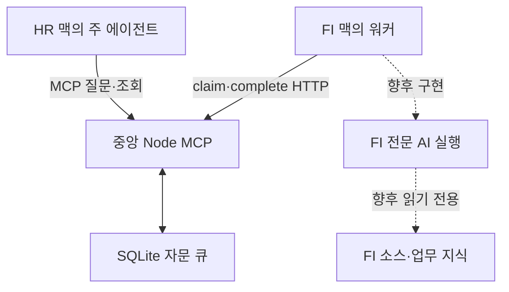

# 프로젝트의 출발점과 변화

프로젝트명: ERP AI 에이전트간의 통신  
project_id: erp-agent-communication  
추출일: 2026-10-12 / 대화 범위: 2026-10-03~2026-10-12 KST

아래 `m009`와 같은 표기는 자체 발화 ID `eac-m009`의 축약이다. 원문은 `conversation-data.json`의 `threads[0].messages`와 `assets/visible-conversation.md`에서 확인한다. 플랫폼 메시지 ID를 뜻하지 않는다.

## 1. 처음 해결하려던 문제

사용자는 ERP 패키지별 소스·매뉴얼·회의록을 추출해 맥의 Codex Desktop에서 해당 폴더로 업무 에이전트를 사용하고 있었다. 시간외 정산 ZHR5와 FI 전표처럼 업무가 연결될 때 분리된 에이전트가 어떻게 협업할지를 물었다. 이 설명은 사용자 발화 eac-m001에 직접 있다. 실제 소스 파일을 이번에 확보한 것은 아니다.

초기에는 한 사람의 폴더 통합 문제처럼 해석되었다. 그러나 사용자 핵심 목표는 **사람의 업무 분장을 따라 에이전트를 배치하고, 타 업무 소스 수정이나 클론 없이 자동 자문**을 받는 것이었다. 이 조건은 eac-m009, m011, m013, m015에서 단계적으로 구체화된다.

## 2. 당시 환경과 보유 자료

| 항목 | 확인 내용 | 증거·수준 |
|---|---|---|
| 사람과 업무 | FI·MM 등 담당자가 다르고 타 업무 코드를 수정하면 안 됨 | m009, 사용자 요구 |
| 맥·Codex | 본인 업무 폴더를 지정하여 사용 | m001; 팀원별 맥 지급은 m015의 계획 |
| GitHub | ZHR를 맥에 클론하고 ZFI는 클론하지 않는 조건 | m013, 사용자 시나리오 |
| 초기 자료 | 패키지 소스·매뉴얼·회의록을 추출했다는 설명 | m001, 사용자 보고; 원본 미확보 |
| 스킬·지침·하네스 | AGENTS.md/SKILL.md/knowledge/exports/harness 역할 논의 | m003·m005; 실제 파일 미확보 |
| 중앙 서버 | 별도 MCP, 이후 Node.js 예제 선택 | m015·m020 |
| 설치·SAP 버전 | 실제 Codex/macOS/중앙 OS/SAP 시스템 버전을 이 대화 원본으로 확정할 수 없음 | 미확인 |

ZHR과 ZHR5가 같은 저장소인지도 미확인이다. 최초 시간외 예시는 ZHR5, 이후 담당별 구성은 ZHR라고 표현한 원문을 유지했다. 다른 프로젝트의 ECC/BASIS·DIAG 정보를 이 대화의 실제 시험 환경으로 가져오지 않았다.

## 3. 시간 흐름과 교정

| 흐름 | 실제 요청·응답 | 당시 판단과 이후 상태 |
|---|---|---|
| 10-03 01:18 | m001~m003: 협업 질문 → ERP 루트·서브에이전트 제안 | 관련 자료가 같은 환경에 있다는 초기 가정 |
| 01:28 | m004~m005: 접점 MD·패키지 추가 질문 | 문서 역할은 유효하나 팀 운영 권한 조건이 미반영 |
| 01:30 | m006~m008: Obsidian 지도 질문 | 링크 그래프·Canvas 제안, 실물 Vault 없음 |
| 01:35 | m009~m010: 타 업무 수정 금지 | 전체 루트 공유 철회, 그러나 수동 검토 요청으로 목표가 바뀜 |
| 01:40 | m011~m012: 자동 대화를 원한다고 교정 | 자동 자문으로 수정, 여전히 로컬 ZFI 접근 가정 |
| 01:42 | m013~m014: ZFI 미클론을 명시 | 원격 실행/API·MCP 필요를 인정 |
| 01:46 | m015~m017: 사람별 맥·자기 패키지·중앙 MCP 동의 | 담당 맥의 별도 워커와 두 통로 설계 |
| 01:55 | m018~m019: 중앙 Codex 설치 질문 | 앱과 서버 프로그램 분리 |
| 01:58 이후 | m020~m024: Node 예제 요청·제작 | 코드 0.1.0, 모의 워커, 실제 AI 미연결 명시 |
| 10-08 | m025~m031: 교육 MD 추출 | 문맥·실습·자료 목록, 모의 재시험 |
| 10-12 | m032: 실제 대화 UI용 추출 요청 | 이번 MD/JSON 묶음의 요구. 과거 완료 응답 없음 |

assistant 발화 자체의 정확한 시각은 null이며 위 시각은 연결된 사용자 발화 기준이다.

## 4. 폐기·보류한 접근과 이유

### 4.1 모두 ERP 루트를 여는 방식

m003/m005에서는 간단한 방식으로 권했다. m009의 수정 경계와 m013의 미클론 조건이 추가되면서 최종 팀 운영안이 될 수 없었다. 기술적으로 항상 불가능하다는 의미가 아니라 이 사용자의 조건에 맞지 않았다는 뜻이다. 원 답변은 JSON에 남기고 정정은 이 해설과 m010/m014에 연결했다.

### 4.2 사람이 검토 요청 MD를 전달하는 방식

m010에서 제시되었지만 m011에서 의도와 다르다고 지적했다. 권한 분리라는 제약을 맞추다가 에이전트 자동 자문이라는 목표를 잃은 사례다. ‘사용자가 동의했다’고 정리하면 안 된다.

### 4.3 로컬 ZFI 읽기 전용 자료를 주는 방식

m012는 자료에 접근할 수 있다는 전제를 빠뜨렸다. m013이 그 결함을 드러내고 m014가 인정했다. 로컬 서브에이전트 이름을 ZFI로 바꿔도 없는 지식과 접근 경로는 생기지 않는다.

### 4.4 중앙에 전문 AI·소스까지 모으는 방식

m014에는 서버의 ZFI 전문 실행이라는 대안이 있다. m015가 담당자별 맥에 에이전트를 두겠다고 하면서 m017에서 중앙은 중계, 전문 자료·실행은 담당 맥으로 구체화했다. 미래의 중앙 집중 대안을 영구 금지한 결정은 아니지만 현재 설명과 섞지 않는다.

### 4.5 중앙 Desktop 설치만으로 MCP 완성

m018의 질문을 m019가 교정했다. Desktop은 개발·작업용 앱이고 중앙 Node 프로그램의 실행·인증·큐·배정은 별도다. 서비스 자동 시작·HTTPS·실제 AI 연결은 만들어졌다는 증거가 없다.

## 5. 현재 설계와 코드의 차이

이 구성도는 교육 해설용이다. 실선도 사용자 맥에서 구축 완료되었다는 뜻은 아니다. 실제 코드에는 중앙·모의 워커·테스트가 있으며 점선 부분은 없다. 근거: m024, asset-server, asset-worker.

| 항목 | 논의 | 확보 구현 |
|---|---|---|
| 질문 도구 이름 | m014 ask_zfi, m017 follow_up 등 예시 | list_experts/ask_expert/get_answer; 후속은 parent_id |
| 워커 통신 | m017 long polling/WebSocket 가능성 | 3초 간격 짧은 HTTP 폴링 |
| 후속 문맥 | m017 같은 자문 세션 가능성 | 최근 선행 질문/답변 최대 3개 전달; SDK 스레드 재개 없음 |
| FI 자료 분석 | m021 첫 안내의 목표 | m022/m024에서 MOCK으로 한정; 소스 읽기 코드 없음 |
| 권한 | 원격 자문 읽기 전용 목표 | 중앙 사용자/담당/lease 검사; 실제 AI 파일 권한 격리는 미검증 |
| 운영 | HTTPS·서비스 등록·기기 가용성 고려 | 루프백 HTTP 예제, 단일 프로세스, 정적 토큰 설정 |

## 6. 실제 산출물·버전

- Node 예제: erp-team-mcp-example 0.1.0. package.json의 Node >=24, package-lock의 MCP SDK 1.31.0·Express 5.2.1·Zod 3.25.76.
- 10월8일 교육 요약본: 1.0.0. 코드 수정 버전이 아니다.
- 이번 대화 추출본: 2.0.0. JSON schema는 사용자가 지정한 1.0.

원본 위치는 conversation-data.json의 assets로 연결한다. 다른 GitHub 저장소의 최신 변경은 조회하지 않았다. ‘최신’은 이번에 실제 확보한 해당 파일 기준이며 전 조직 최신 구현을 의미하지 않는다.

## 7. 주장·구현·실행·운영 근거 분리

| 근거 종류 | 실제 확보 증거 | 해석 가능한 범위 |
|---|---|---|
| AI 완료 주장 | m024 “예제를 만들었습니다”, m031 결과 안내 | 발화 자체. 이것만으로 실행 보장 안 됨 |
| 파일 내용 | server/worker/test 등 실제 6개 파일 | 구현 존재와 MOCK 범위 |
| 도구 실행 | 당시 npm 설치 오류·최종 tests 1/pass 1/exit 0 | 제작 환경에서 모의 통신 시험 |
| 재시험 원본 로그 | 2026-10-08_test-output.txt | 동일 테스트 재실행 성공 |
| 사용자 실행 보고 | 없음 | 사용자 맥에서 성공했다고 표현하지 않음 |
| 운영 가동 보고 | 없음 | 사내망·실제 FI AI·SAP 연계는 미확인 |

이번에는 추출 데이터·참조·원본 바이트를 검사했으며 새 코드 테스트를 수행하지 않았다. [assets/tool-evidence.md](assets/tool-evidence.md)는 도구 출력의 발췌/해설을 명시적으로 나눈다.

## 8. 제작 중 실패와 조치

초기 의존성 설치는 도구 환경에서 EPERM으로 실패했고 설치가 없는 상태의 시험은 SDK 모듈을 찾지 못했다. 이후 설치가 가능해졌고, 로컬 통신 가능한 실행에서 tests 1/pass 1/exit 0이었다. 최초 짧은 실패 출력만으로 모든 원인을 코드 결함이라고 단정하지 않았다. 이는 사용자 측 장애 보고와 구분한다.

실습에서 재현할 중요한 것은 제한을 우회하는 절차가 아니라 **오류 출력으로 환경·설치·코드 문제를 나누고, 최종 시험 증거를 남기는 습관**이다. 상세 발췌는 asset-tool-evidence, 검사 코드는 asset-test.

## 9. 다른 ERP AI 단원과의 연결

| 연결 단원 | 이 자료가 요구하는 입력 | 이 자료가 주는 출력·구분 |
|---|---|---|
| 소스 추출·Git | 담당별 저장소·확정 커밋 | 원격 자문이 어디의 버전을 읽을지 결정 |
| 업무 지식·스킬 | 패키지별 지침과 근거 | 질문/응답의 전문성; 실제 스킬 파일은 미확보 |
| Obsidian | 접점 MD와 링크 | 관계 시각화. 분산 자료 공유 위치는 별도 결정 |
| 회귀·담당자 피드백 | 기대 답변·검증 담당 | 중앙 통신 성공과 업무 정답 검증 분리 |
| ERP 조회 MCP | 별도 자료·API·권한 | 이 중앙 자문 MCP와 같다고 가정하지 않음 |
| 교육 포털 | UI/목차/콘텐츠 규약 | 이번 JSON/MD/첨부. 사이트 구현은 수행하지 않음 |

DIAG·Telegram·REST/RFC 실습은 이 대화에서 구현하지 않았다. 구성도에 있다는 이유로 해당 학습 단계를 만들지 않았다.

## 10. 추가 확보가 필요한 자료

실제 FI 워커 코드, macOS/앱 버전과 MCP 연결 캡처, 담당별 소스·스킬 최신본과 커밋, 읽기 전용 강제 설정, AI 인증/모델/사용량 기준, 중앙 도메인·HTTPS·기기 절전 대응, 사용자 측 실행 로그가 필요하다. 실제 전표 취소 규칙은 본 자료에 없으므로 FI/HR 업무 근거를 확보한 뒤 별도 실습으로 추가한다.
