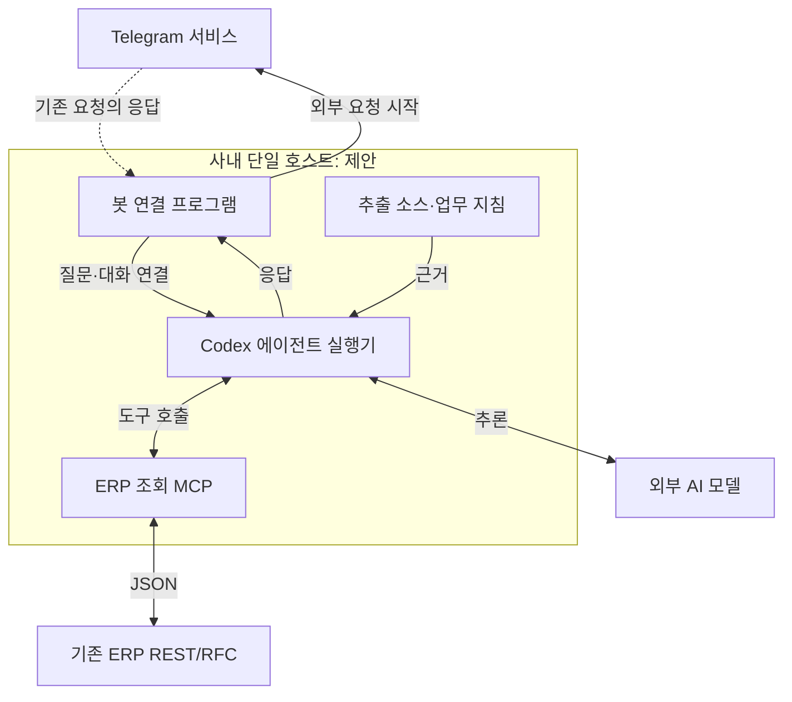

# ERP MCP 구성 — 프로젝트의 출발점과 변화

- 프로젝트명: ERP MCP 서버 구성 — REST/RFC·Codex·Telegram
- project_id: `kbs-erp-mcp-telegram`
- 추출일: 2026-10-12, Asia/Seoul / 패키지 버전 2.0.0
- 근거: [conversation-data.json](conversation-data.json)의 M001~M034와 assets의 실제 파일.
- 상태: 요구 구체화·설계 제안·교육 자료 생성. 실제 ERP 연동의 구현·검증·사용 성공은 미확인.

## 1. 출발점: 이미 있는 ERP 기능을 AI가 사용하게 하려는 질문

사용자는 ECC 6.0에서 RFC 업무 기능을 JSON REST 형태로 외부 시스템과 많이 연동하고 있다고 설명했다. 이미 있는 인터페이스를 출발점으로 MCP를 어떤 방향으로 구성해야 합리적인지 질문했다. 새 ERP 업무 로직을 처음부터 개발하는 요청보다는 기존 기능을 에이전트에 연결하는 문제가 중심이었다. [M001, 사용자 원문]

초기 보유 자료로 직접 확인되는 것은 이 환경 설명이다. 사용자가 제공한 실제 URL·인증·요청/응답 명세나 함수 소스는 없다. ‘기존 API가 있다’는 사용자 보고와 ‘이 API를 시험해 보았다’는 검증은 다르다. [M001; A013 원본 미확보]

이전 추출본은 외부 MCP 어댑터로 기존 REST를 재사용하고 업무 단위 도구를 정의하자는 답변을 기록했다. 현재 그 답변 전문은 없으므로 M002를 summary로 수록했다. 3~5개 도구, 권한·감사·범위 제한은 당시 제안에 대한 요약이지 구현 결과가 아니다. [M002; A006 §C01]

## 2. 설치 질문에서 드러난 설명의 빈틈

사용자는 ‘구성을 어떻게 시작하는지도 의문’이라며 Linux 서버 하나를 예로 들어 설치 절차를 물었다. ‘예를들어’가 있는 발언을 실제 서버 확보·설치 완료 보고로 바꾸면 안 된다. [M003, 원문]

이전 문서의 요약에는 Python 환경·가상환경·MCP SDK·server.py·시험 도구가 제시된 것으로 남아 있다. 파일 원본이나 실행 로그는 없다. A004 §8.2에 들어 있는 코드는 10월 8일에 교육용으로 재구성한 것이므로, 과거 AI가 생성한 원래 코드 블록이라고 표시하지 않는다. [M004 summary; A004; A011]

이어 사용자는 “ai의 역할이 안보이는데?”라고 지적했다. 초기 설명이 API 중계 구현에 치우쳐 AI가 도구를 선택하는 역할을 전달하지 못했다는 핵심 피드백이다. 과거 검색은 답변의 첫 부분 “맞아요. 제가 설명한 MCP 서버만 보면 API 중계 서버가 맞습니다...”를 반환했지만 전체 답변은 주지 않았다. 이 짧은 부분만 M006 excerpt로 보존했다. [M005 원문, M006 검색 발췌, A017]

A006 §C03의 답변 요지는 모델의 도구 선택, 애플리케이션의 호출 실행, MCP의 도구 설명·실행 창구를 분리한 것으로 기록한다. 이 보완 내용을 새로 쓴 assistant 대사로 복원하지 않고 교육 해설에 사용한다. [A006 §C03, 2차 요약]

## 3. 소스 기반 에이전트의 한계를 실제 데이터 조회로 연결

사용자는 추상적 명령에서 어떤 API를 사용할지 AI가 판단하도록 MCP가 돕는다는 이해를 자신의 말로 확인했다. 이어 이전 패키지 추출 프로젝트에서 생성한 에이전트들이 내부 테이블 데이터를 학습하거나 이용하지 못했다는 구체적인 한계를 추가했다. [M007, M009 원문]

그 결과 목표가 ‘MCP가 무엇인가’에서 ‘기존 소스 분석 에이전트에 조회 근거를 더하자’로 구체화된다. 소스에는 조건과 계산식이 있지만 실제 행의 값과 현재 상태는 조회가 필요하다. 이전 문서는 소스·DDIC와 조회 결과를 함께 활용하고, 모델 재학습과 현재 문맥에서 데이터 이용을 구분하는 답변 요지를 남겼다. [M008·M010 summary; A003 §1·§15]

근태 배치에서 특정 직원이 제외되는 예시는 A006 §C05와 A004 §7.2의 가상 사례다. 이 대화에서 실제 직원 데이터를 읽거나 원인을 확정하지 않았다. 다른 HR 프로젝트의 프로그램명·조건·오류를 여기로 가져와 실증 사례로 만들지 않는다.

## 4. 자원 질문과 Codex에 대한 구축 위임

사용자는 Linux 서버 사양을 물은 뒤, 설치가 번거로우니 Linux 또는 Mac에 Codex를 설치해 MCP 구성을 맡길 수 있는지 질문했다. 이어 ‘어떤 MCP를 설치하는 것인지’와 REST로 RFC 기능을 호출하는 코드의 위치를 구체화했다. [M011, M013, M015 원문]

이전 답변 요약에는 시범용 2 vCPU/4GB/40GB와 여유 있는 시작값 4 vCPU/8GB/80GB가 제시된 것으로 기록되어 있다. 측정 없는 제안값이며 공식 최소사양이 아니다. Codex CLI로 환경 확인·파일 작성·시험을 지원하고, 완성된 MCP를 별도 서비스로 운영하는 구상도 기록된다. [M012·M014 summary; A006 §C06~C07]

M016 요약의 Python·Streamable HTTP·httpx·가상 구매오더·Bearer 예시는 설명을 위한 선택이다. 실제 KBS API 인증이 Bearer인지, 해당 필드와 상태 코드가 맞는지는 모른다. 최종 언어나 SDK 버전이 결정되었다는 근거도 없다. [M016 summary; A008 가상 계약]

이 시점의 AI 활용은 **환경을 이해하기 위한 질의와 구축 지시를 구체화하는 대화**다. Codex가 실제 서버에 접속해 설치하거나 원래 프로젝트 파일을 수정한 사건은 확보되지 않았다.

## 5. Streamable HTTP와 REST 송신의 혼동

사용자는 Streamable HTTP가 별도 웹서버 없이 GET/POST를 보낼 수 있다는 뜻인지 물었다. 이전 답변 요약은 두 방향을 분리한다. [M017 원문, M018 summary]

| 연결 | 질문에서 구별해야 할 책임 | 검증 상태 |
|---|---|---|
| 에이전트의 MCP 클라이언트 → MCP 서버 | 도구 정보를 받고 정해진 규약으로 호출 | 실제 endpoint·왕복 미확인 |
| MCP 프로그램 → 기존 ERP REST API | 인증·JSON 매핑·업무 오류 판독·결과 변환 | 실제 계약·ERP 대조 미확인 |

SDK가 요청을 받는 기능이 있다는 설명과 ERP에 요청을 보내는 코드를 작성한다는 설명은 다른 단계다. 당시 답변을 바꿔 쓰지 않고 E04 교육 해설에서 이 혼동을 분리한다. [A004 §4.2; 2차 교육 문서]

## 6. 외부 사용: VPN·원격 화면에서 Telegram 채팅으로 수정

사용자는 MCP를 사내망에 두고 에이전트가 실행되는 MacBook Air도 사내망에 둘 계획을 밝힌 뒤 회사 밖에서 사용할 방법을 물었다. 여기까지의 요구만 보면 원격 화면 접속으로 해석할 여지가 있었다. [M019 원문]

이전 문서에는 VPN과 Mac 화면 공유를 우선 권고한 답변이 기록되어 있다. 사용자는 다음 발화에서 VPN을 쓸 수도 있지만 본래 의도는 모바일 Telegram에서 채팅으로 묻는 것이라고 명확히 했다. OpenClaw는 원하는 이용 경험을 표현한 비유였다. [M020 summary, M021 원문]

후속 답변 요약은 Telegram 연결 프로그램과 Codex SDK/app-server 같은 프로그램 연계, long polling 수신 방안으로 바뀐다. 이 변경은 사용자 인터페이스의 요구를 다시 이해한 결과다. VPN을 관리용으로도 금지하거나 모든 용도에서 폐기한 것으로 확대 해석하지 않는다. [M022 summary; A006 §C11]

기존 Codex Desktop의 열린 대화창과 Telegram 채팅이 자동으로 동일한 세션이 된다는 구현은 없다. 프로젝트 경로·지침·도구·사용자별 스레드 연결은 후속 설계 대상으로 남아 있다. [M022 요약; A004 §6.2]

## 7. long polling과 단일 서버라는 현실 조건

사용자는 long polling 봇의 정체·설치 방법·사내외 통신 원리를 물었다. 이전 요약은 사내 프로그램이 Telegram에 먼저 요청하고 그 응답으로 메시지를 받는 구조와 최소 수신 예시를 기록한다. 당시 최소 예시에는 사용자 허용 검사·Codex 호출·상태 저장이 없었다고 기록되어 있다. 원래 코드는 미확보다. [M023 원문, M024 summary; A006 §C12; A012]

A004 §8.6의 허용 사용자·개인 채팅 검사 코드는 **10월 8일 교육 보완**이다. 이 보완을 과거의 최초 봇 코드에 이미 있었던 것처럼 표시하지 않는다. 고정 응답 또는 echo 성공은 ERP AI 연동 성공과 다르다. [A004; 교육용 파생 자료]

이후 사용자는 사내 Telegram 접속과 개인정보 문제는 없다고 명시했고, 서버가 한 대밖에 없다는 제약을 추가했다. 이는 사용자 제공 전제이며 존중해야 하지만 특정 봇이 실제 연결에 성공했다는 테스트 증거는 아니다. [M025 원문]

M026 요약에는 봇·Codex 실행기·MCP를 같은 호스트의 별도 프로세스로 배치하는 제안이 남아 있다. 외부 모델 사용 전제와 장비 내 로컬 MCP 연결을 구분해야 한다. 이어 M027의 Mac mini M6 질문과 M028의 추천 요약이 있으나 구매·설치·성능 측정은 미확인이다. 제품의 출시·세부 사양·가격도 이번 추출에서 검증하지 않았다. [M026 summary, M027 원문, M028 summary]

### 7.1 마지막으로 확인되는 운영 구상

아래는 **대화의 제안을 모은 구성도**다. 실제 배치가 완료된 그림이 아니다.

근거: M009, M019~M026과 A003 §4. Telegram에서 사내로 새 인바운드 연결을 개시하는 그림이 아니다. 망 정책을 무시하는 방식으로 설명하지 않는다.

## 8. 문서 추출에서 실제 대화 기반 교육으로 확대

첫 자료 요청은 현재 프로젝트의 맥락·설계·교육·자료 목록을 MD 4개와 ZIP으로 만드는 일이었다. 웹사이트 구현·서버 설치·GitHub push는 명시적으로 제외했다. [M029 원문]

현재 직접 보이는 이전 진행 안내 3개와 완료 답변을 M030~M033에 그대로 수록했다. 완료 답변은 9개 파일과 미검증 실습을 안내한다. 이번에는 이전 ZIP 두 사본을 실제 확보했고, 크기 44,531 bytes와 SHA-256 일치를 확인했다. 내부 9개 파일을 변형하지 않고 함께 제공한다. [M030~M033 원문; A001~A010; A017]

이번 M034는 사용자·AI 대화를 말풍선으로 보여주며 목적·명령·오해·제약 추가·수정·검증을 따라갈 수 있는 자료를 요구한다. 이는 단순한 최종 요약에서 **과정 중심 교육 데이터**로 요구가 확대된 것이다. 다른 통합 대화방의 포털 화면을 여기서 직접 확인한 것은 아니다. [M034 원문]

이전 A002는 당시 ‘사용자 발언·답변·본문 코드’를 확인했다고 기록하지만, 지금은 초기 AI 답변 전문을 직접 확보하지 못했다. 과거 주장과 현재 확보 수준을 구별하기 위해 이번 coverage는 partial이다. 원본 파일을 고치지 않고 A017에서 이 차이를 해설한다.

## 9. 주요 결정·보류와 근거 수준

| 방향 | 왜 필요했는가 | 현재 판정 | 근거 |
|---|---|---|---|
| 기존 REST/RFC 활용 | 이미 있는 ERP 기능을 AI에 연결 | 사용자 환경 기반 설계 방향 | M001, M002 summary |
| 업무 단위 도구 설명 | 추상적 질문을 API 선택으로 연결 | 개념 정리, 실제 도구 목록 미확정 | M005~M008 |
| 소스+조회 결과 분석 | 추출 에이전트에 실데이터가 없음 | 사용자 확장 목표 | M009, M010 summary |
| Codex로 구축 지원 | 설치 번거로움 | 사용자 선호, 실행 미확인 | M013~M016 |
| 모바일 채팅 우선 | 원격 화면이 실제 사용 의도와 다름 | 사용자 명시 요구 | M019~M022 |
| long polling | 사내에서 시작하는 외부 통신으로 메시지 수신 | 답변 제안, 현장 시험 없음 | M023~M024 |
| 단일 호스트 배치 | 서버 한 대 제약 | 배치 제안, 최종 OS·서비스 미확인 | M025~M026 |
| 특정 Mac mini 구성 | 상시 사용할 후보 장비 검토 | 구매 보류/미확인. 최신 사양 권고 아님 | M027~M028 |
| 대화 JSON과 교육 단계 분리 | 과정과 출처를 말풍선 UI에 연결 | 이번 사용자 요구와 실제 생성물 | M034, conversation-data.json |

### 9.1 제외·보류된 접근

| 접근 | 확인되는 관계 |
|---|---|
| 원격 화면을 주 이용 방식으로 삼음 | 사용자 M021의 채팅 의도로 수정. VPN 자체의 전면 폐기는 아님 |
| ‘MCP만 설치하면 AI가 생긴다’는 이해 | M005~M008의 역할 구분으로 보완 |
| 일반 RFC 이름·SQL을 받아 임의 실행 | A003 §8의 권고에서는 업무 단위 도구를 우선. 실제 구현 비교 시험 없음 |
| ECC 내부에 MCP 직접 구현 | A003 §8에서 외부 어댑터가 권고됨. 불가능 판정이나 실험 결과는 아님 |
| Telegram webhook | A003 §8에서 대안으로 언급. 이번 주 흐름은 long polling 제안 |
| Python에서 Node.js로 최종 전환 | 그런 결정을 이 대화에서 확인하지 못함. 타 프로젝트 파일명만으로 판정 금지 |
| OpenClaw 설치 | M021의 비유일 뿐 선정·설치 기록 없음 |
| 운영 ERP 변경·GitHub push·포털 구현 | M029에서 제외. 이번 요청도 자료 추출이며 실행하지 않음 |

## 10. ‘실패·수정·검증’을 어떻게 읽어야 하는가

| 사건 | 증상·원인 | 사용자 추가 맥락 | 수정 또는 조치 | 확인 가능한 결과 |
|---|---|---|---|---|
| AI 역할 누락 | 중계 서버 설명으로 보임 | “AI 역할이 안 보인다” | 역할 분리 설명 요약 | 질문·발췌·요약 확보. 구현 검증 아님 |
| 설치 대상 불명확 | 규약·SDK·전용 프로그램 혼동 | “어떤 종류 MCP?” | SDK 기반 어댑터 설명 요약 | 실제 원본 파일 없음 |
| HTTP 방향 혼동 | 수신과 ERP 송신을 혼합 | GET/POST 가능 여부 질문 | 두 통신 구간 구분 | 포트·API 실행 로그 없음 |
| 외부 이용 의도 오해 | 원격 화면으로 답함 | 모바일 Telegram/OpenClaw식 경험 | 봇 연결 방식으로 제안 이동 | 사용자 정정은 원문으로 확인 |
| 최소 봇의 기능 범위 부족 | 수신 예시만으로 AI 연동 오인 가능 | long polling 세부 질문 | 이후 교육용 문서에 검증·허용 검사 추가 | 최초 원본 코드와 실제 연결 결과 미확보 |
| 요약 중심 자료의 한계 | 실제 대화 과정이 없는 구조 | M034의 원문·JSON·말풍선 요구 | 34개 표시 항목과 8개 교육 단계 생성 | 이번 패키지 검사로만 검증 |

실제 설치 오류·SAP 덤프·HTTP 실패·Telegram 인증 실패가 보고되고 해결된 사건은 확보하지 못했다. 실패한 척하는 로그나 화면을 만들지 않는다. 예상 실패는 교육 가이드의 ‘흔한 실패’에만 쓴다.

## 11. 산출물·버전과 실행 상태

| 대상 | 현재 파일·증거 | 상태 |
|---|---|---|
| 초기 MCP·REST·봇 예시 | 이전 요약과 교육 재구성본 A004 | 설명 예시. 원래 실행 파일 미확보 |
| 실제 ERP API·원본 소스 | A011~A014 unavailable | 구현·검증 미확인 |
| 이전 추출본 | A001 원본 ZIP 및 A002~A010 | 2026-10-08 추출본 1.0, 실제 파일 존재·원본 일치 확인 |
| 이전 자체 검증 주장 | M032와 이전 문서 | 과거 assistant 보고. 실제 ERP 검증으로 확장 금지 |
| 이번 추출 데이터·문서 | 루트 4개 파일·새 보조자료 | 2026-10-12 패키지 2.0.0, schema_version 1.0 |
| 이번 검사 | A018 | JSON·참조·파일·원본 보존 검사. 업무 런타임 시험은 NOT_RUN |
| 사용자 실제 사용 보고 | Telegram 접속 전제 M025 외 성공 로그 없음 | 봇·MCP·AI 종단 간 실사용 미확인 |
| 구매·상시 서비스 | 확인 가능한 파일·시험 없음 | 미확인 |

## 12. 다른 ERP AI 프로젝트와의 연결

| 연결 요소 | 이 프로젝트에 필요한 입력 | 이쪽이 제공하는 것 | 경계 |
|---|---|---|---|
| ERP 소스 추출 | 소스·DDIC·시스템·추출시점 | 실제 조회를 붙이려는 목적과 도구 계약 | 추출 프로그램 구현은 여기서 확인하지 않음 |
| 업무 지식·Codex 지침 | 업무 용어·조건·예외·권한 | 데이터 조회 근거를 결합하는 질문 구조 | 실제 스킬·하네스 파일 미확보 |
| 담당 업무별 협업 MCP | 별도 원본·라우팅·역할·검증 자료 | 조회 MCP와의 연결 요구 | lookup과 중앙 자문 hub를 같은 서버로 단정하지 않음 |
| GitHub·Obsidian·DIAG | 해당 프로젝트의 실제 구성·버전 | 이 추출 자료의 통합 후보 | 이 대화의 구현으로 추가하지 않음 |
| 교육 포털 | 전체 구성도·콘텐츠/자산 경로 규칙 | threads·episodes·assets·MD | 포털 Node.js 웹서버와 ERP MCP 런타임을 구분 |

실제 연결을 설명할 근거는 사용자 M009와 M029~M034, 이전 A003 §15·A005 E다. 다른 프로젝트의 최신 상태·오류·버전을 이 문서의 사실로 보충하지 않았다.

