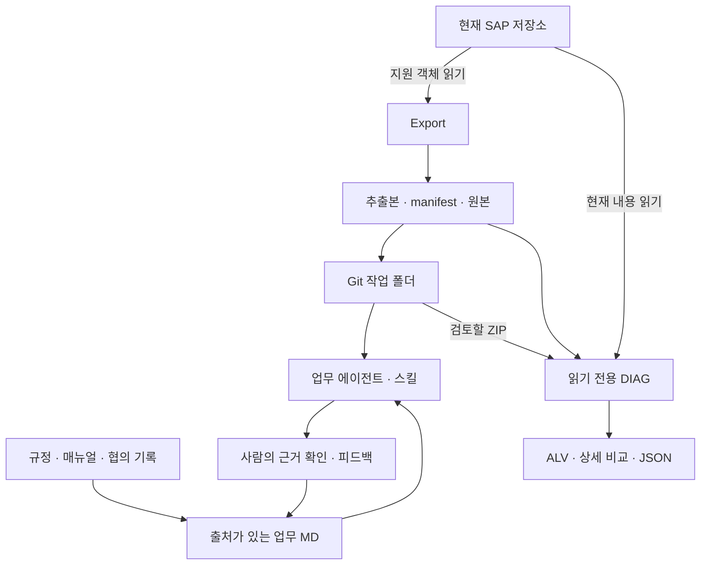

# KBS ERP AI — 프로젝트 맥락과 설계

- 프로젝트: SAP 패키지 추출·읽기 전용 진단 및 업무 AI 에이전트 구축
- 정리 기준일: **2026-10-08**
- 현재 기준: **Export 0.3.18 / CHECK 0.3.3 / DIAG 0.4.5 / manifest 0.2**
- 근거: 현재 대화, 접근 가능한 최신 소스, 기존 MD, 실제 결과 엑셀. 실제 SAP·Mac·GitHub 운영 환경은 이번에 접속하지 않았다.

## 1. 배경, 기존 문제와 목표

SAP의 개발 패키지는 프로그램·함수·DDIC·BSP·MIME 등 서로 다른 저장소 요소로 나뉘어 있다. SE80에서는 탐색할 수 있지만 외부 AI가 일관된 파일 집합으로 읽거나 Git으로 변경을 비교하기 어렵다. 단순히 코드만 꺼내도 담당자의 협의 이유, 규정 적용 시점, 예외 처리 배경은 충분히 설명되지 않는다.

사용자는 패키지를 내려받아 VS Code와 Codex로 관리하고, ZHR5·ZFI·ZMM 등 업무별 에이전트를 구성하려 했다. 목적은 전체 ERP 복제나 무인 배포가 아니라 **업무 질문에 근거를 들어 답하고 변경 영향을 파악하는 것**이다. Export와 DIAG는 이를 위한 자료 수집·비교 기반이다.

처음에는 수정본을 ERP에 Import하여 검사·활성화하는 구상도 있었다. 작업 도중 사용자는 검증의 불확실성과 위험을 지적하고 자동 반영을 제외했다. 현재의 DIAG는 사용자가 판단할 자료를 제공하는 읽기 전용 보고 도구다. [대화 C07·C11](references/conversation_decisions.txt), [인계서 §0–2](references/PROJECT_CONTEXT_20261008_v3.md)

## 2. 대상 업무와 범위

| 영역 | 이 프로젝트에서 실제 다룬 내용 | 범위 밖 또는 미확인 |
|---|---|---|
| 패키지 추출 | ZMM6·ZCO3·ZWEB·ZHR5 등 사례, 프로그램·함수·DDIC·BSP·MIME·메시지 | 모든 SAP 객체의 완전 추출·독립 실행·복원 |
| 업무 지식 | ZHR5 근로시간·시간외·대휴·정산 관련 자료와 스킬 구성 | 전사 HR 전체·ZFI/ZMM 지식 구축 완료 |
| 진단 | 원본/추출본/SAP 비교, 지원 객체 읽기, 활성 버전 근거, 문법 사전검사 | SAP 저장·생성·삭제·활성화·CTS 실행 |
| Git·Codex | publish/clone, 프로젝트 지침, 스킬·하네스 개념 | 현재 저장소 상태·Actions 운영·자동 협업 배포 |
| GitHub 직접 통신 | ABAP HTTPS 목록 조회 시험과 SSL 실패 | 성공한 SAP-GitHub 연동 |
| 교육 통합 연결 | 자료 추출·출처·학습 순서 | ERP MCP·Obsidian·Node.js 서버·도메인 구축 |

ZHR5 키트는 2026-09-22 전달 스냅샷이다. 당시 원본 11개를 다룬 기록은 있으나 이번에는 원본 11개의 전문을 다시 검토하지 않았다. 스킬 3종의 범위는 업무 질의, 변경 영향, 지식 정리다. [키트 검증 기록](references/zhr5_kit_20260922/VALIDATION.md), [자료 목록](03_자료목록과보완사항.md)

## 3. 환경·버전·기술 및 업무 제약

### 3.1 SAP 환경

기존 인계서가 기록한 대상은 **SAP ECC 6.0 / SAP_BASIS 700 Unicode / Oracle / SAP GUI 770**이다. 과거 검증 환경의 SP0041·KSD/300 기록은 모든 실행 대상의 현재 환경을 뜻하지 않는다. 최신 실제 시스템의 패치·권한·커널·GUI는 별도 확인해야 한다. [인계서 §0·12](references/PROJECT_CONTEXT_20261008_v3.md)

SAP_BASIS 700의 문법·메서드·타입 제약 때문에 다음과 같은 오류가 반복됐다.

- `NO-DISPLAY`와 `AS CHECKBOX` 동시 사용.
- 비교식 안의 `MOD` 연산 배치.
- 존재하지 않는 `NORMAL` 매개변수.
- 선택화면 제목 변수의 중복 선언, 긴 라디오 그룹 이름.
- ALV 문서 열 폭 인수의 기대 타입.
- 날짜·시각 타입을 `CSEQUENCE` 형식 인수에 직접 전달.

“현대 ABAP에서 동작할 것”이라는 추정은 이 환경의 검증을 대신하지 못한다. 현행 코드와 과거 오류 목록은 [DIAG 헤더](attachments/programs/Z_PACKAGE_DIAG_0_4_5.abap), [인계서 §12](references/PROJECT_CONTEXT_20261008_v3.md)에 남아 있다.

### 3.2 용량·언어·자료 범위

| 제약 | 현행 기준 | 판단할 때 주의할 점 |
|---|---|---|
| Export 언어 | KO 우선, 객체별 조건에 따른 일부 EN 보완 | 전체 영어 전환·모든 빈 항목 자동 보완이 아님 |
| Export 용량 | 파일당 16 MiB, 전체 비압축 예산 512 MiB | 압축 ZIP 크기와 다름. baseline 사본도 예산에 영향 |
| 패키지 경계 | 선택 패키지 및 하위 패키지 | 외부 참조 본문을 자동으로 가져오지 않음 |
| 클래스 | 본문 추출 미지원, 개별 참조 진단 생략 | 속성에 클래스명이 있다고 본문이 포함된 것은 아님 |
| 업무 데이터 | 개발 정의·코드 중심 | 실제 업무 테이블 데이터 행 추출 아님 |
| 시점 | 개별 객체 순차 읽기 | 전체 ERP가 한 시점으로 고정된 스냅샷 아님 |
| 문서 근거 | 규정·대화·소스의 역할과 시점 구분 | 대화의 제안을 현재 정책으로 단정하지 않음 |

입력 제한·언어 기준: [Export 소스](attachments/programs/Z_PACKAGE_EXPORT_0_3_18.abap), [Export 가이드](references/DEVHUB_EXPORT_GUIDE.md). 업무 근거 기준: [구축 가이드](references/PACKAGE_AGENT_BUILD_GUIDE.md), [업무 QA 스킬](references/skills/zhr5-business-qa/SKILL.md).

## 4. 구성 요소의 역할과 연결

이 그림의 화살표는 자료 흐름이다. AI나 DIAG에서 SAP로 쓰는 화살표는 없다. GitHub·에이전트 협업은 파일 공유·절차 설계와 사용자 성공 보고 범위이며, 이 그림이 자동 파이프라인의 운영 완료를 뜻하지 않는다.

| 구성 요소 | 담당 역할 | 다른 요소와의 경계 |
|---|---|---|
| Export Z프로그램 | SAP 지원 객체를 출력 규칙에 따라 파일화 | 변경·배포 기능 아님 |
| manifest·catalog·로그 | 파일 대응, 객체 범위, 생략·오류 근거 | 정상 파일 개수만으로 완전성을 보증하지 않음 |
| `.devhub/baseline` | 추출 시점 원문 보존 | 작업 파일과 함께 수정하면 비교 근거 훼손 |
| CHECK HTML | 로컬 추출 폴더 무결성·로그 요약 | 현재 SAP 조회 없음 |
| DIAG Z프로그램 | 추출본·원본·현재 SAP 비교 및 지원 검사 | 활성화 가능성·업무 실행 성공 보증 없음 |
| GitHub | 소스·지식·피드백 변경 이력 공유 | 저장소 자체가 에이전트 실행기인 것은 아님 |
| Codex·스킬 | 선택된 근거로 질의·정리·영향 분석 | 스킬 파일만으로 여러 에이전트가 자동 연결되지 않음 |
| 업무 하네스 | 질문·기대 근거·금지 단정·오답 회귀 기준 | 코드 문법 검사와 다른 문제 |

## 5. 실제 입력 → 처리 → 출력

### 5.1 Export

1. 개발클래스(패키지)와 저장경로를 받는다.
2. 지원 객체 카탈로그를 수집한다. 하위 패키지 포함은 숨겨진 기본값이다.
3. 활성 소스·정의·페이지·MIME 등을 읽는다. 언어는 정해진 KO/EN 정책을 적용한다.
4. 인간이 탐색하기 쉬운 경로와 XML로 직렬화한다. 원래 웹 자산 바이트는 보존한다.
5. 중복 경로·대소문자 충돌·용량·값 보존·기본 무결성을 확인한다.
6. `<패키지>_export.zip`에 본문·원본 사본·manifest·catalog·로그를 포함한다.
7. 사용자는 압축 해제 후 CHECK로 점검한다. 실패·생략·미지원 수를 별도로 해석한다.

Export의 `S_PACK`은 선택 범위형이고, DIAG는 이후 단일 `P_PACK`으로 변경되었다. 두 프로그램의 입력 정책을 섞지 않는다. `S_TYPE/S_NAME`은 제거했고 `P_SUB=X`, 현행 `P_MB=512`는 숨긴다. 초기 256은 현재값이 아니다. [Export 가이드](references/DEVHUB_EXPORT_GUIDE.md), [대화 C03·C05](references/conversation_decisions.txt)

### 5.2 업무 에이전트

1. Mac에서 GitHub 저장소를 clone하여 Codex 프로젝트로 연다.
2. 추출 코드의 실제 경로와 지원 범위를 먼저 확인한다.
3. 규정·지침·매뉴얼·협의 대화를 원문 보존, 출처 등록, 주제별 MD로 정리한다.
4. `AGENTS.md`는 지속 지침, INDEX는 찾아가는 순서, 스킬은 특정 업무 수행 절차를 담당한다.
5. 답변에는 적용 시점·규정/협의/구현 근거를 나누고 부족한 자료를 명시한다.
6. 담당자 피드백은 근거 확인 후 지식 수정과 회귀 질문으로 남긴다.

이는 문서를 검색·참조하는 구성이지 모델 가중치 재학습 완료가 아니다. [구축 가이드](references/PACKAGE_AGENT_BUILD_GUIDE.md), [업무 피드백 정책](references/BUSINESS_FEEDBACK_POLICY.md)

### 5.3 DIAG

1. 단일 개발클래스·추출 ZIP·결과유형을 입력한다.
2. ZIP 경로·중복·크기·manifest·원본 대응 등을 확인한다.
3. 원본과 추출본을 읽고 현재 SAP에서 대응 자료를 같은 형식으로 구성한다.
4. 세 방향 비교와 별도의 SAP 조회·활성 버전 근거·문법형식 검사를 수행한다.
5. 비교/검사 후 결과유형과 변경만 보기 조건을 적용한다.
6. 메인 ALV, 행 상세, 함수/Include 근거 대조, JSON으로 결과를 보여준다.

현행 기본값은 **소스코드 + 신규/누락/수정만 조회**이다. 문법 사전검사 토글은 없고 검사 절차는 항상 켜져 있지만 실제 검사는 대상·변경·문맥 조건에 따른다. 진행 단계는 GUI 하단에 표시한다. [DIAG 헤더·입력부·`im_json_build`](attachments/programs/Z_PACKAGE_DIAG_0_4_5.abap)

## 6. 사람·AI·프로그램의 책임

| 담당 | 해야 하는 일 | 대신 맡기지 않는 판단 |
|---|---|---|
| 업무 담당자 | 정책 효력·예외·정답 근거 확인, 피드백 승인 | 실행 로그가 없는데 운영 성공이라고 승인 |
| SAP 담당자 | 대상 시스템·권한·지원 객체 확인, 개발 환경에서 프로그램 검증 | 문법 통과만으로 지급·근태 결과 정답 확정 |
| AI/Codex | 문서 정리, 출처 연결, 코드 설명, 변경 제안, 허용된 로컬 MD 수정 | 근거 없는 정책 생성·SAP 자동 반영 |
| Export/CHECK | 자료 읽기·파일화·로컬 무결성 점검 | 업무 정책 판단 |
| DIAG | 비교 사실·검사 범위·미확인 사유 제시 | 누락을 삭제 의도로 간주·자동 활성화 |
| 통합 교육 담당 | 프로젝트별 근거·버전 대조, 실습 전제 확인 | 다른 대화방 구현을 추정해 채워 넣기 |

피드백 정책은 업무 지식 수정과 SAP 코드 수정의 권한을 분리한다. 업무 질문의 오답을 고친다는 이유만으로 ABAP·DDIC·baseline을 자동 변경하지 않는다. [피드백 정책](references/BUSINESS_FEEDBACK_POLICY.md)

## 7. 주요 결정과 사용자 피드백에 따른 변화

| 과거 문제·요구 | 현행 결정·반영 | 이유·근거 |
|---|---|---|
| BSP 페이지가 숫자 폴더와 원시 XML 중심 | 실제 페이지 이름, 탭별 파일, 실제 식별 이벤트 이름 | SE80과 대응하여 혼동 감소. C01–C03, S05 |
| 모든 파일에 KO 수식 | 자동 `/KO/`·`.KO` 제거, 내부 언어 정보 유지 | 기본 한국어 전제의 탐색성. 원래 이름 훼손 금지. C03 |
| KO만 고집하다 조회 공백 | 항목별 조건부 EN 보완 | 부분 언어 누락 대응. XML 직렬화 문제와 구별. C04 |
| 함수 소스가 공용 폴더에 모임 | 각 함수 하위 `Source code` | 함수 탭과 소스를 한 객체로 탐색. C03 |
| Structures가 보이지 않음 | TABL의 구조 분류를 별도 경로로 출력 | DB 테이블과 구조의 역할 분리. S05 |
| SMIM ID별 폴더·개별 metadata 난립 | MIME 유형별 본문 + 패키지 통합 metadata | 직관적인 탐색·중복 파일 감소. S05·S09 |
| baseline 중복 부담 | 보존하되 AI 색인에서 제외 | 원문 차이를 재현하려면 해시만으로 부족. S04 §4·6 |
| 첫 활성 소스 읽기 실패·특정 저장소 예외 | 첫 실패 개별 로그 제외; 알려진 MIME/DDIC 예외는 생략·참고 로그 | 지원 범위·잡음 조절. 오류 복구를 뜻하지 않음. C05 |
| 자동 Import·활성화 구상 | 읽기 전용 DIAG 확정 | 위험과 검증 부족. C11 |
| ABC·영문 상태 혼란 | 원본/추출본/SAP, 네 가지 방향 상태 | 기준 방향 명확화. C12 |
| 활성 상태의 모호한 설명 | 조회 결과와 활성 버전 근거, 문법 검사를 별도 표시 | 자료 확보와 활성 확인의 차이. S01 0.3.8 기록 |
| XML 하위 값 하나가 상위 전체 변경처럼 표시 | 요소 존재와 직접 텍스트·속성 값을 비교 | 자손 문자열 집계 중복 제거. S01 0.3.10 기록 |
| 상세 2열·F3·긴 헤더·가로 스크롤 불편 | 3자 상세, 별도 A/B ALV, 고정 열·간결한 폭·목록 복귀 | 실제 사용 피드백. C12, S01 헤더 이력 |
| 원인 구분·Excel 긴 설명 잘림 | 함수/Include 연결·공통 속성 범위·전체 JSON | 중복 오류 추정과 표시 한계 개선. C14, S01 0.4.4 |
| JSON 날짜·시간 인수 오류 | STRING으로 변환 후 `im_json_put` 전달 | BASIS700 타입 호환. S13, S01 0.4.5 |

표의 S번호는 [03의 원본 목록](03_자료목록과보완사항.md), C번호는 [대화 발췌](references/conversation_decisions.txt)와 연결된다. 구현 반영과 SAP 재검증은 별개다.

## 8. 현행 출력 경로와 제외한 과거 파일

약칭: `P=packages/<패키지>`, `F=P/function-groups/FUGR/<그룹>`, `B=P/BSP Application/WAPA/<앱>`.

| 역할 | 현행 경로 |
|---|---|
| 프로그램 | `P/programs/PROG/<프로그램>/source/<프로그램>.abap` |
| DB 테이블·구조·테이블 타입 | `P/Dictionary Object/{DBtable,Structures,TableType}/<객체>/definition.xml` |
| 도메인·데이터 요소 | `P/Dictionary Object/{Domain,Data element}/<객체>/definition.xml` |
| 함수 탭 | `F/Function Module/<함수>/{Attributes,Import,Export,Changing,Tables,Exception}.xml` |
| 함수 소스 | `F/Function Module/<함수>/Source code/<함수>.abap` |
| 함수 목록 | `F/Function Module/directory.xml` |
| 그룹 Include | `F/Include/<Include>.abap`, `F/Include/includes.xml` |
| BSP 페이지 | `B/pages/<페이지>/{Properties.xml,Page Attributes.xml,Type Definitions.abap}` |
| BSP 레이아웃·이벤트 | `B/pages/<페이지>/Layout/<파일>`, `Event Handler/<실제 이벤트명>.abap` |
| BSP 목록 | `B/pages/pages.xml`, `B/pages/page-paths.xml` |
| BSP 웹 자산 | `B/MIMEs/<원래 하위 경로>/<파일>` |
| 독립 SMIM 자산 | `P/MIME/<주유형>/<하위유형>/<파일>`, `P/MIME/metadata.xml` |
| 기존 W3MI | `P/MIME/W3MI/...` — SMIM 통합 규칙으로 무조건 바꾸지 않음 |
| 메시지 클래스 | `P/MessageClass/<클래스>/Messages.xml` |
| 원본 | `.devhub/baseline/<대응 경로>` |

기준: [Export 가이드](references/DEVHUB_EXPORT_GUIDE.md), [인계서 §4](references/PROJECT_CONTEXT_20261008_v3.md). 교육 표의 `<...>`는 대체값이며 실제 소속·이름은 manifest로 확인한다.

세부 계약:

- 페이지 폴더는 파일명 stem 기반이다. 하위 경로·동일 stem·대소문자 충돌은 키와 `page-paths.xml`로 구분한다.
- 이벤트를 `000001.abap` 순서로 OnCreate 등에 임의 대응하지 않는다. 실제 이름을 확인하고 없는 이벤트를 꾸며 만들지 않는다.
- 현행 `Include`는 과거 사용자 입력 `Inlcude` 오타와 구별한다.
- `image/png`는 `MIME/image/png/` 두 단계다. 같은 이름은 LOIO 구분값 등을 사용하며 URL·식별자는 metadata로 추적한다.
- 함수 `function-read-api.xml`, `include-owner-api.xml`, `short-text.KO.xml`, `source-rows.xml`, `interface.xml` 같은 중복 원시 파일은 요청에 따라 정리됐다.
- BSP의 옛 applications/local-mimes/navigation/nodes 및 페이지 attributes/events/layout-rows/parameters/types XML을 현행 파일로 착각하지 않는다. 필요한 값은 탭별 문서와 목록으로 옮긴다.
- 메시지 번호 `000`, `&1` 같은 치환 표식을 유지한다. 메시지 Long Text는 현행 지원으로 주장하지 않는다.

## 9. DIAG의 비교·검증 계약

### 9.1 세 비교의 방향

| 열 | 기준 | 비교 대상 |
|---|---|---|
| 추출본/원본 대비 | 추출 시점 원본 | 현재 ZIP의 추출본 |
| SAP/원본 대비 | 추출 시점 원본 | 현재 SAP에서 읽은 내용 |
| 추출본/SAP 대비 | 현재 SAP | 현재 ZIP의 추출본 |

| 상태 | 조건 |
|---|---|
| 신규 | 기준에는 **없음이 확인**되고 대상에는 있음 |
| 누락 | 기준에는 있고 대상에는 **없음이 확인**됨 |
| 수정 | 양쪽 내용이 확보됐고 전체 바이트가 다름 |
| 변경없음 | 양쪽 내용이 확보됐고 같음 |

읽기 실패·미구현은 부재가 아니다. 둘 다 없는 경우나 판정 근거가 없는 경우를 강제로 네 상태에 넣지 않는다. 빈 파일과 없는 파일도 다르다. `.devhub/baseline` CRC·길이 확인은 무결성 검사이며 작성자 신뢰·전자서명 보증이 아니다. [DIAG `im_pair_kind`, `im_pair_result`](attachments/programs/Z_PACKAGE_DIAG_0_4_5.abap)

### 9.2 바이트, 의미, 업무는 다른 층위

- 기본 비교는 **전체 바이트**, 단순 용량 비교가 아니다.
- XML은 경로·요소 존재·직접 값·속성을 펼쳐 왜 다른지 설명한다. 개행·BOM·직렬화 순서 차이로 바이트가 다를 수도 있다.
- 함수 Attributes XML은 자체 함수 속성 외에 공통 프로그램·함수그룹 메타데이터를 담을 수 있다. 반복 변경 표시를 곧 개별 함수 로직 수정으로 해석하지 않는다.
- 이미지의 바이트/HEX 비교는 그림에서 무엇이 바뀌었는지 설명하는 시각 비교 기능이 아니다.
- 바이트가 같다고 업무가 올바르거나 규정에 맞는 것도 아니다.

### 9.3 SAP 상태 세 축

| 축 | 묻는 질문 | 근거 예 | 보증하지 않는 것 |
|---|---|---|---|
| SAP 검증 결과 | 비교할 현재 자료를 읽었는가 | 조회 성공·실패·대상 아님·진단 생성 | 활성 버전 여부 |
| 활성 버전 확인 결과 | 읽은 구성요소가 활성 버전이라는 근거가 있는가 | `STATE A`, DDIF 반환 상태, 활성 인터페이스 대조 | 변경 추출본 활성화 성공 |
| 문법형식 검증 | 해당 검사 조건에서 문법·형식을 확인했는가 | SAP 문법 사전검사, XML 파싱 | 업무 실행·배포·지급 결과 |

과거 `VERSION_UNCONFIRMED`는 비활성이라는 뜻이 아니다. `METADATA_SNAPSHOT`도 “원천적으로 활성 관련 근거를 얻을 수 없다”는 일반 법칙이 아니다. 타입별 실제 조회·확인 근거와 미구현 여부를 읽어야 한다.

ABAP `SYNTAX-CHECK`는 가능한 주프로그램/Include 문맥과 **현재 SAP의** DDIC·인터페이스를 사용한다. 수정 XML까지 미리 반영한 가상 SAP를 검사하지 않는다. 함수/Include 중복 표현의 변경이 충돌하면 임의 선택하지 않는다. HTML·CSS·JS 차이 표시를 브라우저 실행 시험이나 웹 문법 검사로 표현하지 않는다. [DIAG 헤더·`im_syntax_units`](attachments/programs/Z_PACKAGE_DIAG_0_4_5.abap)

### 9.4 UI·JSON의 최신 구현 방향

메인은 A(파일 비교 집계)와 B(SAP 검증 집계)를 별도 ALV로 보여준다. A의 각 행은 세 비교, 열은 신규·누락·수정·변경없음·합계다. 0.4.4 이후 **A는 선택 범위, B는 필터 전 전체 결과**를 집계한다. 둘의 합계를 같은 모집단으로 간주하지 않는다.

본문은 예외·유형·구성요소·파일명을 선두 고정하고, 세 비교, SAP 검증/설명, 활성 확인/설명, 문법형식, 개발클래스·객체명·경로·세 bytes·오류 위치·검증 설명 순이다. 파일명에는 바로 위 폴더를 포함한다. XML 전용 중복 열 4개와 BOM 전용 열, 활성화 실행 열은 제거한 방향이다.

상세는 원본·추출본·SAP 세 내용과 세 방향 상태를 제공한다. 순서·세 상태 네 열을 고정하고 F3로 목록에 돌아간다. 헤더 B의 변경자는 실제 SAP 조회 단위 기준이며 ZIP 시각이나 생성자로 대체하지 않는다. 사용자 초기 표현 “최종생성일”과 달리 현행은 **최종변경일**이다. 생성일이 필요하면 별도 요구로 확인한다.

긴 줄은 현행 128자 표시 조각을 사용하며 원문 판정과 구분한다. 상세 분석에는 한도가 있고 대형 차이는 블록 단위일 수 있다. JSON은 전체 내부 결과·버전·시각·선택 여부·함수 연결 등을 내보낸다. **JSON이 원문 전체나 모든 상세 diff를 반드시 포함한다고 확대 해석하지 않는다.** 현재 스키마와 `im_json_row`를 확인한다. [DIAG 소스](attachments/programs/Z_PACKAGE_DIAG_0_4_5.abap)

## 10. 실제 ZHR5 결과의 재분석

원본은 [결과 엑셀](attachments/results/ZHR5_result_uploaded_20261007.xlsx)이며, 업로드 기록은 2026-10-07이다. 실행 날짜·버전은 확정하지 못했다. `RawData!A1:U2542`의 헤더 제외 2,541행을 사용했다. 표시용 `Format`/`Header`와 중복 합산하지 않는다.

### 10.1 재집계

| 비교 | 신규 | 누락 | 수정 | 변경없음 | 빈칸 | 전체 |
|---|---:|---:|---:|---:|---:|---:|
| 추출본/원본 | 1 | 0 | 0 | 2,530 | 10 | 2,541 |
| SAP/원본 | 10 | 0 | 90 | 2,440 | 1 | 2,541 |
| 추출본/SAP | 0 | 10 | 90 | 2,440 | 1 | 2,541 |

빈칸은 무조건 오류가 아니다. 원본·추출본이 모두 없는 SAP 신규 건 등에서 해당 방향 비교가 성립하지 않는다.

| 축 | 실제 기록 |
|---|---|
| 조회 | 조회 성공 2,539 / 조회 대상 아님 1 / 진단 정보 생성 1 |
| 활성 근거 | 활성 버전 확인 1,284 / 활성 처리속성 일치 127 / 활성 인터페이스 일치 635 / 활성 소스 연결 확인 273 / 확인 시도 실패 71 / 해당 없음 151 |
| 문법형식 | 내용 일치·검사 생략 2,439 / XML 기본 문법 확인 82 / 문법 사전검사 통과 8 / 검사 미수행 10 / 진단 자료 1 / 해당 없음 1 |

출처: 엑셀 E–L열. 수정 90건은 함수 탭 XML 74 + 프로그램 속성 XML 8 + ABAP 소스 8이다. bytes 열만으로 변경을 판정했다는 주장은 이 결과와 맞지 않는다.

### 10.2 핵심 사례와 해석 한계

| 행 | 사례 | 관찰 | 해석·남은 확인 |
|---|---|---|---|
| 828 | `VIEWFRAME_ZTHRBS01V` 함수 API 소스 | 세 비교 모두 변경없음, 조회 성공, 활성 확인 시도 실패 | 설명은 API 소스와 활성 Include 바이트 불일치. 세 자료 비교와 별도 증거 대조가 다를 수 있음. 비활성이라고 단정 금지 |
| 1440 | `ZHR_52TM_GET_SHIFT_OT_DATA/Attributes.xml` | 원본/추출본 동일, SAP 대비 수정, 세 크기 모두 **3,210 bytes** | 같은 크기라도 다른 내용. 어떤 필드인지 확정하려면 세 실제 XML/상세 필요 |
| 2532–2541 | SAP 신규 10파일 | 원본·추출본 없음, SAP 있음, 추출본/SAP는 누락, 검사 미수행 | 검사할 추출본이 없던 범주. 현재 0.4.4+는 대상 부재를 별도로 설명하는 개선 |
| 2542 | `ZHCMT_BSP_PA_XX_R9023` DDIC 진단 | `DDIC_STATE_DIAGNOSTIC`, 확인 시도 실패, 진단자료 | 정상 definition.xml이 아닌 `diagnostic-dd02l.xml`. 함수 실패에 포함하면 안 됨 |

**71건은 함수 API 소스 70건과 DDIC 진단 1건**이다. 이전 인계서 §9.2의 “함수 71건” 표현보다 이번 원본 집계를 우선한다. 함수 70건의 기록된 설명은 API/활성 Include 바이트 차이이나, 잘린 Excel 설명을 추정 복원하거나 최신 0.4.5에서도 전부 같은 결과라고 단정하지 않는다.

추출본 없는 10파일은 DB 테이블 1개와 프로그램 3개의 속성/소스/텍스트 각 3개다. **파일 수 10과 객체 수 4를 구분**한다. 함수 소스와 같은 Include 역시 서로 다른 파일 행이지만 하나의 변경 맥락에 연결될 수 있다. [파생 집계](examples/ZHR5_result_facts_derived.json)

## 11. 주요 오류·실패한 시도·해결 수준

| 증상 | 확인한 원인 또는 한계 | 조치·방향 | 현재 해결 수준·출처 |
|---|---|---|---|
| BSP duplicate/case-colliding archive path | 페이지 출력 경로 충돌 | 실제 페이지 경로·키·대응표, 충돌 방지 | 코드·가이드 반영. 모든 페이지 집합 재검증 아님. C01/S05 |
| `parameter NORMAL does not exist` | 해당 SAP 환경에서 호출 인수 불일치 | 호환 호출로 정리한 기록 | 이번에 당시 정확한 소스/호출문 미확보. C03 이후 오류 요구/S04 §12 |
| XML formatting/round-trip changed values | 값 보존 시험이 중단; 언어 부족과 별개 | 원시 XML 왕복·포맷 전후 값 검증 보강 | 로컬 검증 기록 있음. 원래 실행 입력 없이 단일 원인 확정 금지. S09 |
| `NO-DISPLAY` + `AS CHECKBOX` | SAP 문법상 함께 사용 불가 | 숨긴 플래그와 표시 체크박스 구분 | 현행 소스 반영. 과거 캡처는 C05 주변 |
| 비압축 ZIP 예산 초과 | 당시 256 MiB 한도 및 대형/중복 자료 | 현행 512 MiB; 범위·메모리 확인 | 자동 분할 미구현. 한도 증가가 무제한 안전 보증 아님. S05/S10 |
| MIME URL resolution failed for registered LOIO | 등록 메타데이터에 대응 URL 해석 실패 | 알려진 경우 생략·참고 로그 | 파일 복구 아님. S10 |
| DDIC `CX_XSLT_SERIALIZATION_ERROR` | 해당 객체 직렬화 실패 | 해당 알려진 예외 생략·참고 로그 | 정상 Structures 전체 제외 금지. SE16의 category S 조회 불가만으로 손상 단정 금지. S10/S04 |
| GitHub RECEIVE / SAP 407 / `ICM_HTTP_SSL_ERROR` | SSL 계층 실패는 관찰, 인증서·TLS·프록시 중 근본 원인은 미확정 | 직접 통신 보류, ZIP 경로 유지 | 미해결·보류. **HTTP 407로 바꿔 쓰지 않음**. C09 |
| `Relational operator MOD is not supported` | BASIS700 비교식 배치 호환 | 연산을 먼저 변수로 계산 | 현행 DIAG 헤더 기록, 최신 SAP 실행은 별도. S01 |
| ALV 미표시·F3 입력화면 복귀 | 출력/화면 생명주기 문제의 수정 이력 | 화면 컨테이너·중첩 상세·목록 복귀 개선 | 이전 ALV 출력은 사용자 확인, 최신 모든 GUI 재검증 미확인. S01/C12 |
| XML 상위까지 대량 수정 표시 | iXML 요소 값이 자손 텍스트를 합칠 수 있음 | 직접 텍스트·요소 존재 분리 | 0.3.10 구현 기록. 실제 다른 공통 속성까지 없애지는 않음. S01 |
| 선택화면·ALV 폭 관련 활성화 오류 | 제목 중복 선언/라디오명 길이/메서드 인수 호환 기록 | 0.3.13·0.4.1 등에서 수정 | 정확한 당시 캡처 다수 미확보; 최신 헤더와 문서 기준. S01 |
| 9128줄 날짜 인수 타입 불일치 | 0.4.4에서 D/T→CSEQUENCE 직접 전달 | 0.4.5에서 네 곳 STRING 변환, YYYYMMDD/HHMMSS 유지 | 소스 확인. 기존 로컬 검사 통과 기록. **SAP 재활성화 미확인**. S01/S13/S04 §9.4 |

ZWEB 후속 기록의 “실패 0”은 모든 누락 자산을 되찾았다는 뜻이 아니다. 0.3.17 검토에서 파일 동일 17,142, 생략 19, 참고 로그 19, 웹 완료 2,637이 기록됐고 생략은 MIME 14 + DDIC 5였다. 후속 MIME 통합으로 파일 수가 줄어드는 것도 기능 손실이라고 바로 판단하지 않는다. 전체 ZWEB ZIP은 이번에 미확보이므로 과거 보고서의 관찰로 표기한다. [ZWEB 검토서](references/DEVHUB_ZWEB_0_3_17_REVIEW.md)

## 12. 현재 방안과 사용하지 않는 과거 방안

| 항목 | 과거 | 현재 |
|---|---|---|
| 반영 범위 | Import·자동 활성화·CTS 구상 | DIAG 읽기 전용. 재추진 시 별도 범위 결정 |
| 통신 | SAP가 GitHub에서 직접 읽기 | SSL 문제로 보류, ZIP 업로드 |
| 언어 | KO 전용 | KO 우선·조건부 EN |
| 원본 | 중복이므로 제거 검토 | baseline 보존, AI 중복 색인 제외 |
| 비교 | ABC/영문 상태·2열 전후 | 원본/추출본/SAP·방향 4상태·3열 상세 |
| 활성 상태 | 조회·메타데이터·활성 추정 혼재 | 조회·활성 근거·문법 분리 |
| 문법 선택 | 사용자가 토글 | 절차 항상 사용, 실제 수행 여부는 조건/사유로 표시 |
| 소스 탐색 | 함수 공용 Source code, 페이지 번호 | 함수별 Source code, 실제 페이지·이벤트 |
| 증거 공유 | ALV Excel 중심 | Excel + 전체 결과 JSON 기능 추가, 실출력 재검증 필요 |
| 에이전트 실패 | SAP 에러가 있어야 피드백 가능하다는 우려 | 업무 답변도 근거·시점·단정·누락을 실패 기준으로 정의 |

과거 [2026-09-21 맥락 문서](references/DEVHUB_PROJECT_CONTEXT_20260921.md)는 변경 이유를 보존하기 위해 포함했다. 그 안의 향후 Import 계획을 현재 작업 지시로 적용하지 않는다.

## 13. 업무 지식·스킬·하네스의 구성과 상태

### 13.1 지식과 지침을 분리

구축 가이드는 저장소 루트의 `AGENTS.md`, 업무 지식의 `knowledge/INDEX.md`, 기술 용어·Export 가이드, `.agents/skills/<스킬>/SKILL.md`를 구분한다. 원본과 가공 지식은 별도 관리하며 패키지 소스 전체를 AGENTS에 복사하지 않는다. 기존 프로젝트의 AGENTS는 무조건 덮어쓰지 않고 병합한다.

| 종류 | 목적 | 최신 확인 범위 |
|---|---|---|
| AGENTS.md | 작업 원칙·근거 우선순위·권한·읽기 순서 | 구축 가이드·키트의 전달 기록; Mac 현재본 미확인 |
| INDEX.md | 업무별 자료를 찾아가는 입구 | 키트 존재 확인; 모든 연결을 이번에 재설치하지 않음 |
| 주제 MD·business-qa.md | 시점·출처가 있는 정책·예외·질문 | 키트 검증 기록을 읽음. 정책 효력 재확인 필요 |
| SKILL.md | 특정 작업을 언제·어떻게 수행할지 | QA·영향·큐레이션 3종 본문 읽음 |
| EXPORT_GUIDE·용어집 | 파일 구조의 의미와 한계 | 현행 Export 가이드 및 키트 용어집 포함 |
| 회귀 사례·rubric | 사용자 피드백이 다시 틀리지 않게 하는 기준 | 정책 문서 확인, 전체 실행기 운영 미확인 |

초기 대화의 `skills/sap/`는 개념 예시였다. 전달된 패키지 구축 가이드는 `.agents/skills/`를 사용한다. 현재 Codex 제품의 탐색 경로·UI 전체를 이 자료만으로 최신이라고 보증하지 않는다. 교육 실습 전 사용 중인 설치 환경을 확인한다.

### 13.2 업무 피드백 절차

사용자가 답변 오류를 지적하면 오류를 사실·시점·출처·해석·검색 누락 등으로 분류하고 근거를 찾는다. 승인된 지식 MD를 고친 후 사례와 기대 근거·금지 단정을 기록한다. 재검증 결과는 `PASS / FAIL / REVIEW_REQUIRED / NOT_RUN` 등으로 구분하며 결과를 좋게 만들려고 정답 기준을 완화하지 않는다. 반복 수정은 정책의 횟수 제한과 중단 조건을 따른다. [피드백 정책 전문](references/BUSINESS_FEEDBACK_POLICY.md)

키트에는 질문 34개 초안이 있었다는 검증 기록이 있다. **34개 답변이 모두 회귀 통과했다는 뜻은 아니다.** 당시 숫자 `152`를 `512`로 잘못 읽었던 항목을 재확인한 기록도 있다. 이번 추출에서는 원본 PDF를 다시 읽지 않았으므로 현재 정책값 자체를 새로 인증하지 않는다. [키트 VALIDATION](references/zhr5_kit_20260922/VALIDATION.md)

### 13.3 에이전트 협업·Actions

ZHR5 구성은 사용자 성공 보고가 있지만 ZFI/ZMM 에이전트의 실제 구현·자동 위임·공유 메모리·운영 책임은 미확인이다. GitHub는 자료와 변경을 공유할 수 있는 기반이며, 실제 협업은 과업 분해·입출력·소유권·검토 절차를 별도로 정해야 한다.

Actions는 저장소 이벤트 등에 따라 정해진 작업을 실행하는 자동화라는 개념까지 논의했다. 이 프로젝트에 workflow가 배포되었거나 로컬 Codex에 실패가 자동 전달된다는 증거는 없다. Ubuntu 러너·Docker·CI/CD 관련 질문은 교육 FAQ로 남기되 SAP 700 실검증을 일반 러너가 대신한다고 설명하지 않는다. [대화 C06·C08·C10](references/conversation_decisions.txt)

## 14. 산출물별 완료·진행·미확인

| 항목 | 제안/결정 | 구현 확인 | 실제 검증·운영 |
|---|---|---|---|
| Export 경로·언어·범위 정책 | 결정 | 0.3.18 소스·가이드 | 과거 SAP 실행/로컬 시험 기록. 최신 전체 재실행 미확인 |
| CHECK | 결정 | 0.3.3 HTML | 과거 사용자 결과 화면. 이번 브라우저 재실행 없음 |
| DIAG 비교·UI | 결정 | 0.4.5 소스 | 이전 엑셀·ALV 사용 보고. 최신 UI 전체 미확인 |
| 함수 연결·XML 범위·JSON | 결정 | 0.4.4→0.4.5 | 기존 로컬 시험 기록. SAP 최신 JSON 미확보 |
| 날짜 타입 수정 | 결정 | 0.4.5 네 곳 확인 | SAP 활성화·실행 대기 |
| 업무 지식·스킬 3종 | 결정 | 전달 키트·본문 | 질문 초안/문서 점검 기록. 현장 평가·현행 효력 별도 |
| 업무 피드백 하네스 | 결정·지침 | 정책 문서 | 현재 실행기/회귀 자동화 설치 미확인 |
| 코드 하네스·Actions | 논의 | 현재본 미확보 | 운영 미확인 |
| SAP 직접 GitHub | 시험 후 보류 | 시험 원본 미확보 | SSL 실패 기록, 성공 미확인 |
| Import·자동 활성화 | 제외 결정 | 현재 실행 범위 없음 | 검증·운영 대상으로 취급하지 않음 |
| 교육 포털 | 이번엔 자료 추출만 | 4개 MD·자료 ZIP | 포털 구현·배포 미착수 |

기존 로컬 검증 기록은 [인계서 §13](references/PROJECT_CONTEXT_20261008_v3.md), [Export 검증서](references/DEVHUB_0_3_18_VALIDATION.md)를 참조한다. 이번에 그 시험 환경·SAP를 재실행하지 않았다. 이번 검증은 파일 읽기·엑셀 집계·사본 동일성·링크·ZIP 구성 확인이다.

## 15. 다른 ERP AI 프로젝트와의 입출력·의존관계

| 연결 프로젝트 | 이 자료가 제공할 출력 | 다른 프로젝트에서 받아야 할 입력 |
|---|---|---|
| 패키지 업무 에이전트 | 추출 구조·지원 범위·스킬 예·출처 정책 | 실제 패키지 최신 코드, 업무 담당자, 유효 정책, 평가 질문 |
| ERP MCP | 읽기/쓰기 경계, 객체 식별·진단 의미 | 실제 서버·도구 스키마·권한·연결·감사 설계. 여기서 추정하지 않음 |
| GitHub 운영 | 원본/가공/검증 결과 분리 원칙 | 실제 저장소, 브랜치·PR·Actions·비밀 관리 정책 |
| Codex Desktop 교육 | Mac clone 성공 사례, 지침/스킬/피드백 구성 | 현재 제품 버전·설정·설치 경로·실제 화면 |
| Obsidian 지식 운영 | 출처·시점·INDEX·상대 링크 원칙 | 실제 vault 구조·동기화·링크 규칙. 구현 근거 없음 |
| 포털·배포 | 4MD, 코드·결과·이미지·실습 재료 | 콘텐츠 빌드·Markdown 렌더러·Node 서버·사내망·KBS 도메인 계획 |

교육 콘텐츠로 재구성할 때 **Export 도구 배포 ZIP**, **패키지 데이터 ZIP**, **지식 키트 ZIP**, **이번 교육 자료 ZIP**을 구별해야 한다. 이번 ZIP을 SAP DIAG 입력으로 사용하지 않는다.

## 16. 근거와 다음 확인 순서

1. 최신 DIAG 0.4.5를 승인된 개발 환경에서 활성화·실행하여 날짜 타입 수정, JSON, F3, 헤더·필터를 확인한다. 도구 설치 자체는 SAP 저장소 변경이므로 읽기 전용 분석과 구별한다.
2. 새 JSON과 대응 패키지 ZIP, 실제 세 XML을 확보하여 함수 70건·DDIC 1건·Attributes 사례를 다시 검증한다.
3. 업무 하네스의 실제 실행기·정답 근거·담당자 승인 상태를 확인한다.
4. 다른 프로젝트의 MCP·Obsidian·포털 운영 자료와 의존관계를 대조한다.
5. 최신 실화면을 캡처한 후 교육 콘텐츠에서 기능 상태를 갱신한다.

주요 출처는 [자료목록 A](03_자료목록과보완사항.md), 원본 사본의 경로·해시는 [source_inventory.json](references/source_inventory.json), 날짜 없는 사용자 요구의 식별자는 [대화 발췌 C01–C15](references/conversation_decisions.txt)에 있다. 문서 기록과 이번 직접 재확인을 구별했으며, 원본이 없는 부분의 원인·버전·운영 성공은 미확인으로 남겼다.
